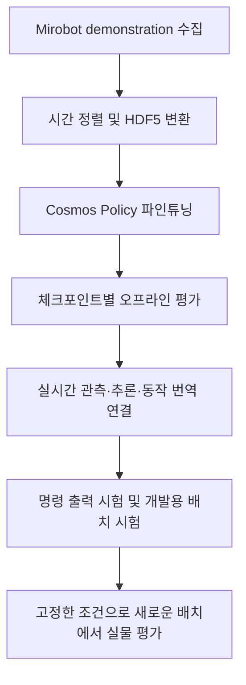

# Mirobot demonstration 기반 Cosmos Policy 파인튜닝 및 실물 실행 실험

> **설계** · 확인 2026-11-06 · 기준 `w10_mirobot_l01_l30_follow_4000`, 현재 학습·추론 코드
> Mirobot 시연 데이터로 Cosmos Policy를 파인튜닝한 뒤, 실제 Mirobot에서 언어 지시에 따른 블록 집기를 평가하는 실험 계획.

**실행 절차 업데이트(2026-11-06):** 이 계획의 `follow`용 실행 루프·브리지는 구현했고 최종 모델의 GPU 추론을 확인했다.
노트북 준비·연결·미리보기·실제 명령은 [DEPLOY_MIROBOT.md](DEPLOY_MIROBOT.md)를 따른다. 아래 구현 전 검토 내용은 설계 당시 기록이다.

**이 문서는 논문의 실험 절 형식으로 작성한 계획이다.** 파인튜닝은 4,000 update까지 정상 완료했으며, 완료 근거와 저장 체크포인트는 [학습 완료 기록](TRAINING_RESULT.md)에 있다. 오프라인 GPU 추론과 실물 정책 실행 결과는 아직 측정하지 않았다. 아래에서 새로 제안하는 평가 횟수·판정 수치는 확정값과 구분한다.

배경은 [11/02 미팅](../meetings/2026-11-02.md), 학습 재현 절차는 [현재 90개용 학습 안내](../../cosmos-policy/W10/TRAINING.md), 좌표 변환과 기존 검증 결과는 [정책 실행 도구](POLICY_RUN.md)를 따른다.

## 1. 실험 목적

본 실험은 Mirobot에서 수집한 demonstration으로 Cosmos Policy를 파인튜닝하고, 학습된 정책을 실제 로봇에 연결하여 언어 조건부 조작이 가능한지 확인한다. 실험 과제는 빨강·초록·파랑 블록이 함께 놓인 장면에서 지시한 색의 블록을 집어 들어 유지하는 것이다. 운반과 내려놓기는 이번 과제에 포함하지 않는다.

다음 두 질문을 구분하여 평가한다.

1. **동작 학습:** 파인튜닝된 정책이 녹화 관측으로부터 시연 action을 재현하는가?
2. **실물 실행:** 새로운 블록 배치에서 지시한 대상을 선택하고 실제로 집어 올리는가?

첫 질문은 오프라인 action 비교로, 두 번째 질문은 실제 로봇 rollout으로 평가한다. 학습 loss 감소만으로 실물 과제 성공을 판정하지 않는다.

## 2. 실험 설정

### 2.1. 장비와 과제

| 항목 | 설정 |
| --- | --- |
| 로봇 | WLKATA Mirobot, 그리퍼 사용 |
| 정책 입력 카메라 | 시연 수집 때와 같은 장착의 D405 손목 RGB |
| 대상 물체 | 빨강·초록·파랑 블록을 매 시행에 모두 배치 |
| 언어 지시 | 학습 데이터의 세 색 지시문을 그대로 사용 |
| 정책 입력 | 손목 영상, 실측 위치·자세와 명령 이력 기반 그리퍼 상태 추정, 지시문 임베딩 |
| 정책 출력 | 한 번의 추론에서 16개 action, 각 action은 위치·회전·그리퍼의 7차원 |
| 실행 구성 | GPU 서버에서 정책 추론·동작 번역, 로봇 연결 노트북에서 영상·상태 수집과 시리얼 통신 |
| 판정 기록 | 손목 영상과 별도로 블록의 색·들림을 확인할 수 있는 전체 장면 영상 |

정책에는 평가용 블록 좌표나 성공 판정 결과를 입력하지 않는다. 배치 좌표와 전체 장면 영상은 장면 복원 및 결과 판정에 사용한다.

### 2.2. Demonstration 데이터

학습 데이터는 L01–L30의 30개 배치에서 빨강·초록·파랑을 각각 대상으로 수집한 Mirobot demonstration 90개이며, 전체 길이는 27,820 timestep이다. 녹화된 RGB·로봇 상태·집게 기록을 시간 정렬한 뒤 Cosmos Policy가 읽는 HDF5로 변환한다.

| 항목 | 현재 실험 설정 |
| --- | --- |
| 학습 데이터 | L01–L30 × 세 색, 90개 전부 사용 |
| 처리된 데이터 | `cosmos-policy/W10/datasets/real/mirobot_l01_l30/processed/` |
| 영상 전처리 | 색 보정·설정된 회전 → 중앙 정사각 자르기 → 256×256 변환; 모델 입력 처리는 학습·추론 설정에 맞춤 |
| 로봇 상태 | 손가락 2칸, 위치 3칸, 쿼터니언 4칸의 9차원 proprio |
| 지시문 | 이번 데이터의 `t5_embeddings.pkl` 사용 |
| 정규화 | 이번 학습에서 사용한 `dataset_statistics.json`을 추론에서도 사용 |
| action 라벨 | 가상 Panda가 실측 다음 자세를 따라가도록 만든 기존 `follow` 방식 |

영상은 Mirobot 실물 시연에서 얻는다. 가상 Panda는 action 라벨을 계산하는 데 사용하며, 이번 학습에 Panda 장면의 시뮬레이션 시연을 섞지 않는다.

90개 모두 학습에 사용했으므로 같은 HDF5를 이용한 오프라인 평가는 **학습 데이터 재현 정도**를 의미한다. 새로운 배치에 대한 동작은 별도의 실물 평가로 확인한다.

### 2.3. 파인튜닝 조건

| 항목 | 값 |
| --- | --- |
| 초기 가중치 | `Cosmos-Policy-LIBERO-Predict2-2B` |
| 학습 job | `w10_mirobot_l01_l30_follow_4000` |
| GPU | RTX 4090 2개 |
| GPU당 batch size / gradient accumulation | 1 / 8 |
| 유효 batch size | 가중치 갱신당 16개 샘플 |
| 학습률 / 최대 update 수 | `1e-5` / 4,000 |
| 저장 간격 | 1,000 update |
| 영상 조건 | 손목 영상만 사용, third-person 영상 미사용 |
| 손목 전용 모델 설정 | `state_t=7`, 조건 프레임 3, `chunk_duration=25` |

학습 명령과 데이터 검사 명령은 [학습 안내](../../cosmos-policy/W10/TRAINING.md)에 있다. 최종 실험 기록에는 코드 버전, 데이터 목록, 학습 설정 파일, 사용한 체크포인트 경로를 함께 남긴다.

## 3. 실험 방법

### 3.1. 전체 절차



### 3.2. 체크포인트별 오프라인 평가

1,000·2,000·3,000·4,000 update 체크포인트에 동일한 녹화 관측과 추론 설정을 적용한다. 체크포인트가 완전히 저장된 뒤 DCP 가중치 조각을 하나의 `.pt` 파일로 합치고, 예측 action을 해당 시연 라벨과 비교한다.

기존 평가 코드의 추론 조건은 action 청크 16개, action denoising 5단계, `seed=1`, `randomize_seed=False`다. 모든 체크포인트에 같은 조건을 사용한다.

다음은 4,000 update의 재현 명령이다. GPU 번호는 평가 당시 비어 있는 장치로 선택한다.

```bash
cd ~/UROP

PYTHON="$PWD/cosmos-policy/.venv/bin/python"
DATA="$PWD/cosmos-policy/W10/datasets/real/mirobot_l01_l30/processed"
JOB=w10_mirobot_l01_l30_follow_4000
RUN="$PWD/cosmos-policy/W10/runs/real/cosmos_policy/w9_mirobot/$JOB"
FINETUNED="$RUN/checkpoints/iter_000004000"
EVAL_DIR="$PWD/cosmos-policy/W10/evaluations/real"

CUDA_VISIBLE_DEVICES='' "$PYTHON" -m tools.eval_offline \
  --ckpt "$FINETUNED" --convert-only

CUDA_VISIBLE_DEVICES=0 HF_HUB_OFFLINE=1 TRANSFORMERS_OFFLINE=1 \
  "$PYTHON" -m tools.eval_offline \
  --ckpt "$FINETUNED" \
  --hdf5 "$DATA/mirobot_real/*.hdf5" \
  --stats "$DATA/dataset_statistics.json" \
  --t5 "$DATA/t5_embeddings.pkl" \
  --every 16 \
  --report "$EVAL_DIR/${JOB}_4000.json"
```

다른 체크포인트는 `iter_000004000`과 결과 파일의 `4000`을 해당 update 수로 바꾸어 평가한다.

평가 스크립트의 기본값은 과거 혼합 데이터이므로 이번 `--hdf5`·`--stats`·`--t5`를 명시한다. HDF5 영상에는 전처리가 적용되어 있으므로 색 보정을 다시 적용하지 않는다. 현재 CLI와 참조 경로를 확인했으며, GPU 추론의 동작과 소요 시간은 이 절차로 처음 검증한다.

### 3.3. 실물 폐루프 실행

실행 시 다음 처리를 반복한다.

1. D405의 최신 RGB, Mirobot의 실측 위치·자세, 그리퍼 명령 이력에서 추정한 개폐 상태를 얻는다.
2. **실측 Mirobot 상태**로 proprio를 만들고 손목 영상·지시문과 함께 정책에 입력한다.
3. 예측 action을 라벨과 같은 규약으로 Mirobot 목표 자세·집게 명령으로 변환한다.
4. 정한 개수의 동작을 실행한 뒤 최신 관측으로 다시 추론한다.

**이번 `follow` 모델의 출력을 실물 현재 자세에 그대로 더해서 실행할 수는 없다.** 라벨은 action 적용 전 가상 Panda 자세에서 실측 다음 목표로 향하는 명령으로 만들어졌다. 이번 학습 결과를 활용하는 구현안은 가상 Panda 상태를 유지하면서, 그 현재 자세와 예측 action으로 컨트롤러 목표를 계산하고 Mirobot 좌표로 변환하는 방법이다. 이후 같은 action으로 가상 Panda 상태를 진행한다. 이 방법은 실물 루프로 구현·검증되지 않았으며, 초기 자세 맞추기와 실행 중 상태 차이를 검증해야 한다.

`env.step` 이후 가상 Panda의 도달 자세와 action이 지정하는 컨트롤러 목표를 구분한다. 전자를 실물 목표로 사용하면 시뮬레이션 추종 지연이 포함된다. 규약과 기존 데이터에서의 검증 결과는 [POLICY_RUN 3절](POLICY_RUN.md#3-걸리는-점--action-을-mirobot-목표로-바꾸는-법-결정-대기)에 있다.

재사용할 코드와 남은 구현은 다음과 같다.

| 처리 | 기존 부분 | 남은 구현 |
| --- | --- | --- |
| D405 입력 | [capture.py](../W9/d405/capture.py), [policy_obs.py](../../tools/policy_obs.py) | 같은 카메라 설정·색 보정을 적용하는 실시간 전송 |
| 로봇 상태 | [serial_bridge.py](../../robot/serial_bridge.py), [probe_mirobot.py](../../tools/probe_mirobot.py) | Cartesian 위치·자세 6값을 반환하는 상태 조회와 시각 관리 |
| 정책 추론 | [eval_offline.py](../../tools/eval_offline.py)의 모델 로딩·추론 | 실시간 관측을 받는 호출 경로 |
| action 번역 | [policy_io.py](../../common/policy_io.py), [action_labels.py](../W9/d405/action_labels.py) | `follow`용 가상 Panda 상태 초기화·유지·목표 변환 |
| 실물 실행 | [bridge_client.py](../../server/bridge_client.py)의 G-code 전송 | 관측부터 명령까지의 반복, 종료 조건, 시행 기록 |

기존 범용 카메라 브리지는 OpenCV/JPEG 전송이므로 학습용 D405 수집과 동일하지 않다. 기존 상태 통신도 20Hz 폐루프를 완성한 경로는 아니다. 추론·통신 시간을 측정하여 한 번에 실행할 action 수와 재관측 간격을 개발 시험에서 정하고 고정한다. 현재 실물 정책 실행을 시작하는 단일 명령은 없다.

## 4. 실물 평가 프로토콜

### 4.1. 평가 조건과 시행 수

주 조건은 Mirobot demonstration만으로 파인튜닝한 정책이다. 첫 실물 평가에서는 4,000 update를 대상으로 하고, 체크포인트 사이의 실물 비교는 추가 실험으로 둔다.

**평가 규모 제안은 새로운 배치 10개 × 지시 색 3종 × 각 1회 = 조건당 30회다.** 배치 수와 반복 수는 미확정이며 실험 시작 전에 확정해 기록한다. 여러 체크포인트를 비교하면 같은 배치·지시 조합을 모든 조건에 적용하고 실행 순서를 교차 배치한다.

- 학습의 L01–L30과 다른 배치를 사용하며, 모든 시행에서 세 색을 동시에 놓는다.
- 제어값 조정이나 체크포인트 선택에 쓰는 개발 배치와 최종 평가 배치를 분리한다.
- 매 시행 로봇 초기 자세·그리퍼 상태·세 블록 배치를 복원한다.
- 카메라 장착, 촬영·색 보정 설정, 조명, 지시문, 추론 설정, 동작 번역·제어 조건을 고정한다.
- 개발 단계에서 바꾼 조건과 이유를 기록하고, 최종 평가 중에는 결과에 따라 조건을 바꾸지 않는다.

### 4.2. 한 시행의 절차

1. 배치 ID와 지시 색을 선택하고 배치 사진·좌표, 체크포인트, 실행 설정을 기록한다.
2. 초기 상태와 관측을 확인하고 전체 장면 영상·손목 영상·상태·명령 로그의 기록을 시작한다.
3. 첫 정책 호출 전에 시행 시작을 기록하고 폐루프 실행을 시작한다.
4. 첫 집기 판정 성립, 제한 시간, 통신 이상, 중단 조작 중 하나로 시행을 끝내고 종료 이유를 남긴다. 이 평가안에서는 색과 무관하게 첫 블록이 높이·유지 시간 조건을 만족하면 종료하며, 들어 올린 뒤 다른 색으로 재시도하지 않는다.
5. 기록 영상에서 대상 선택과 들어 올리기를 각각 판정한다.

들어 올리기는 집게로만 지지된 블록의 최하단과 탁상면 사이 수직 간격이 `Δh` 이상인 상태를 `T_hold`초 이상 유지하는 것으로 정의한다. **임시 제안값은 `Δh=20 mm`, `T_hold=2초`, 시행 제한 시간 `30초`다.** 이 값은 기존 측정값이나 합의된 조건이 아니다. 전체 장면 영상에 측면 눈금 등 높이 판정 기준을 마련하여 개발 시험에서 확인하고, 종료 규칙과 함께 최종 평가 전에 고정한다.

## 5. 평가 지표

### 5.1. 오프라인 지표

| 지표 | 정의·해석 |
| --- | --- |
| 위치 action 오차 `step_mm` | 예측과 라벨의 위치 3성분 차이를 Mirobot 배율의 mm로 환산한 평균 노름 |
| 누적 위치 action 오차 `chunk_end_mm` | 16개 위치 action 차이를 합한 뒤 노름을 구한 지표 |
| 집게 일치율 `gripper_agree` | 예측과 라벨의 그리퍼 action 부호 일치율 |
| 추론 시간 | 첫 호출과 준비 이후를 나누어 한 번의 추론 시간을 기록 |
| 제로 action 기준 | 움직이지 않는 예측의 같은 위치 오차. 단순히 작은 동작을 내는 것보다 나은지 비교 |

`chunk_end_mm`는 action 공간에서의 누적 오차이며, `follow` 방식의 실물 폐루프에서 측정한 끝점 오차는 아니다. 색별·에피소드별로 집계하고 집계 가중치를 명시한다. 기존 도구의 색별 값은 에피소드별 지표를 같은 가중치로 평균한다.

### 5.2. 실물 지표

전체 시작 시행 수를 `N`으로 두고 세 성공률을 `성공 수/N`과 백분율로 보고한다. 완료 시간은 지시 색 집기에 성공한 시행의 중앙값으로 별도 보고한다.

| 지표 | 한 시행의 성공 판정 |
| --- | --- |
| 언어 준수율 | 첫 파지 시도에서 겨냥한 블록 색이 지시 색과 일치한다. 파지에 실패해도 대상 선택을 판정한다 |
| 집기 성공률·색 불문 | 어느 블록이든 높이·유지 시간 조건을 만족한다 |
| 지시 색 집기 성공률 | 지시한 색 블록이 높이·유지 시간 조건을 만족한다 |
| 완료 시간 | 지시 색 집기 성공 시행의 시작부터 성공 조건 성립까지. 해당 성공 시행 수와 전체 시간 초과 건수를 함께 제시한다 |

언어 준수율은 대상 선택을, 지시 색 집기 성공률은 과제 완수를 평가하는 핵심 지표다. 첫 파지 시도가 없거나 대상을 판정할 수 없으면 해당 구분을 기록하고 언어 준수 성공 수에 포함하지 않는다. 시작 이후 무동작·시간 초과·통신 이상·조작자 중단도 분모 `N`에 포함한다. 잘못된 색을 들어 올리면 색 불문 집기만 성공으로 기록한다.

전체 집계와 색별 결과를 제시한다. 적은 시행에서 나온 수치 차이만으로 우열을 단정하지 않는다. 체크포인트를 비교하면 같은 배치·지시 조합별 결과를 대응시킨다.

## 6. 결과 기록 양식

**아래는 작성용 표이며 수치는 미측정이다.** `—`는 미측정으로, 0%를 뜻하지 않는다.

### 6.1. 체크포인트별 오프라인 결과

| update | 평가 에피소드 수 | 위치 action 오차 mm ↓ | 제로 기준 mm | 누적 위치 action 오차 mm ↓ | 집게 일치율 ↑ | 추론 시간 s ↓ |
| --- | --- | --- | --- | --- | --- | --- |
| 1,000 | — | — | — | — | — | — |
| 2,000 | — | — | — | — | — | — |
| 3,000 | — | — | — | — | — | — |
| 4,000 | — | — | — | — | — | — |

### 6.2. 실물 결과

| 모델·update | 지시 색 | 시작 시행 수 N | 언어 준수 n/N | 색 불문 집기 n/N | 지시 색 집기 n/N | 성공 시 완료 시간 s |
| --- | --- | --- | --- | --- | --- | --- |
| Mirobot FT·4,000 | red | — | — | — | — | — |
| Mirobot FT·4,000 | green | — | — | — | — | — |
| Mirobot FT·4,000 | blue | — | — | — | — | — |
| Mirobot FT·4,000 | 전체 | — | — | — | — | — |

시행별로 `trial_id`, 배치 ID, 지시문, 체크포인트, 시작·종료 시각, 설정, 첫 파지 대상, 세 가지 성공 판정, 종료 이유, 영상·관측·action·명령 로그 경로를 남긴다. 저장 위치는 `cosmos-policy/W10/evaluations/real/` 아래로 한다.

## 7. 현재 진행 상태와 해석 범위

| 항목 | 확인 상태 |
| --- | --- |
| 시연 90개의 데이터 준비·학습 설정 | 확인 완료 |
| 파인튜닝 | 4,000 update 정상 완료, 네 체크포인트 저장 확인. [완료 기록](TRAINING_RESULT.md) |
| 오프라인 평가 | CLI·입력 경로 확인. GPU 추론 결과는 미측정 |
| 실물 폐루프 | 미구현. `follow` 번역·실시간 상태 조회·반복 실행의 구현과 검증 필요 |
| 실물 평가·성공률 | 미실시·미측정 |

이 실험에서 확인하는 것은 현재 Mirobot 데이터·세 색 블록 과제·고정한 장비 조건에서의 학습과 실물 실행이다. 다른 물체나 로봇으로의 일반화, Panda 사전학습의 효과, 다른 정책보다 우수하다는 결론은 이 한 조건만으로 내리지 않는다. 결과를 쓸 때 학습 데이터 재현·새 배치에서의 실물 실행·아직 수행하지 않은 추가 비교를 구분한다.
