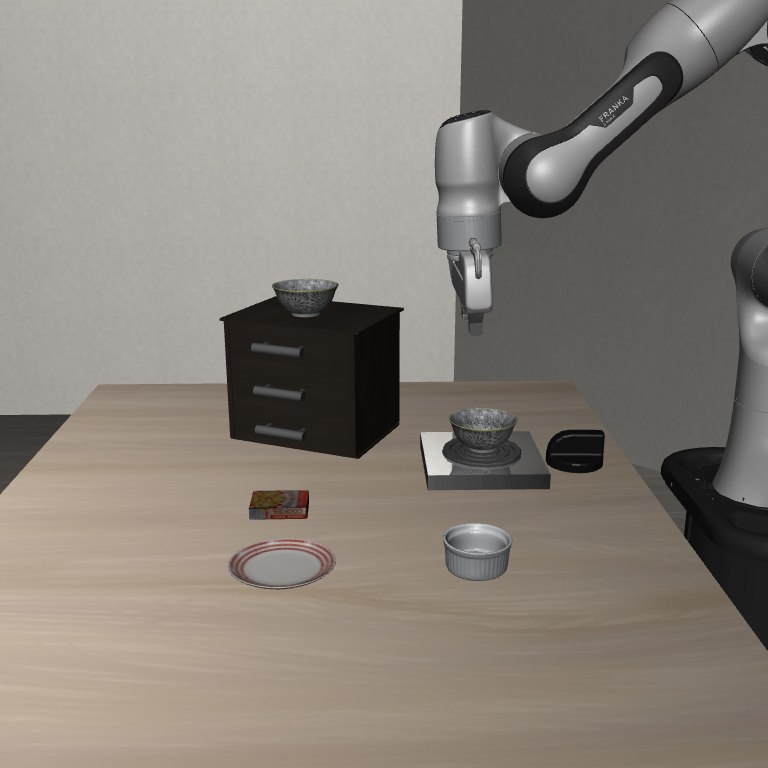
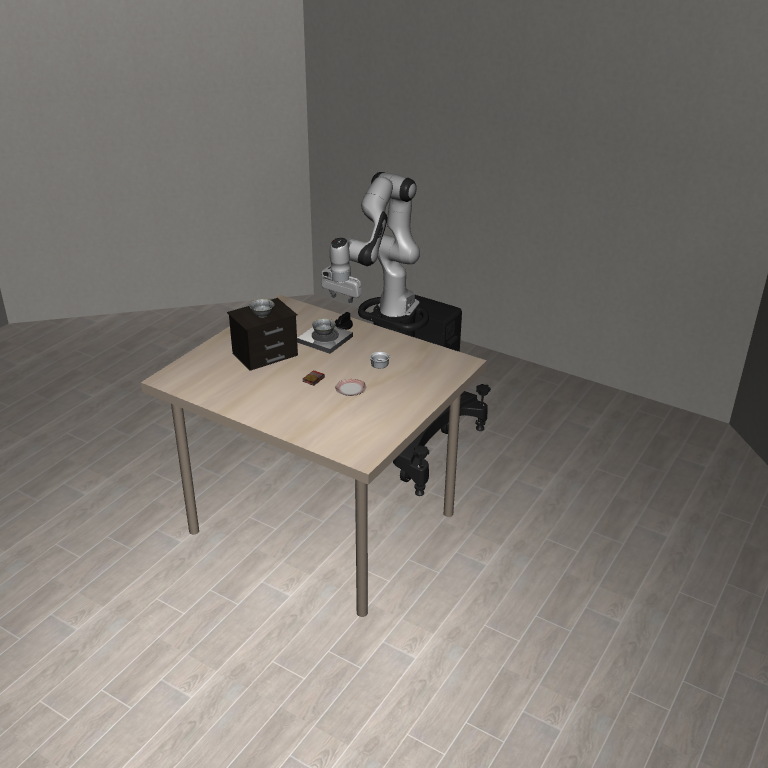
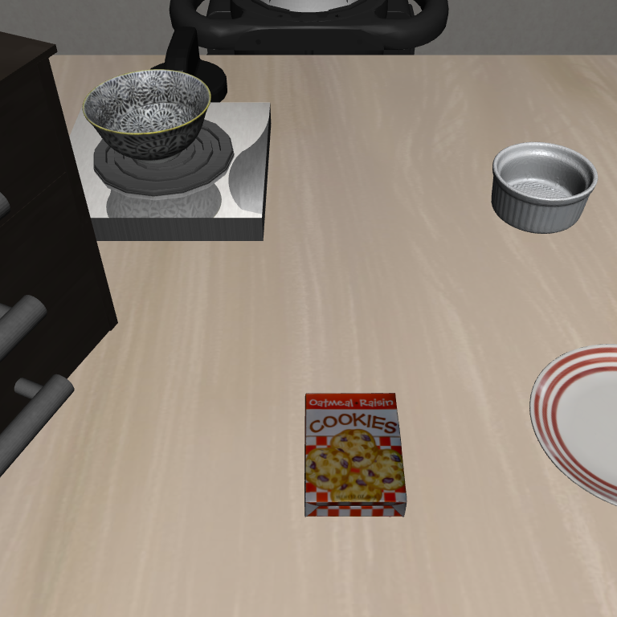
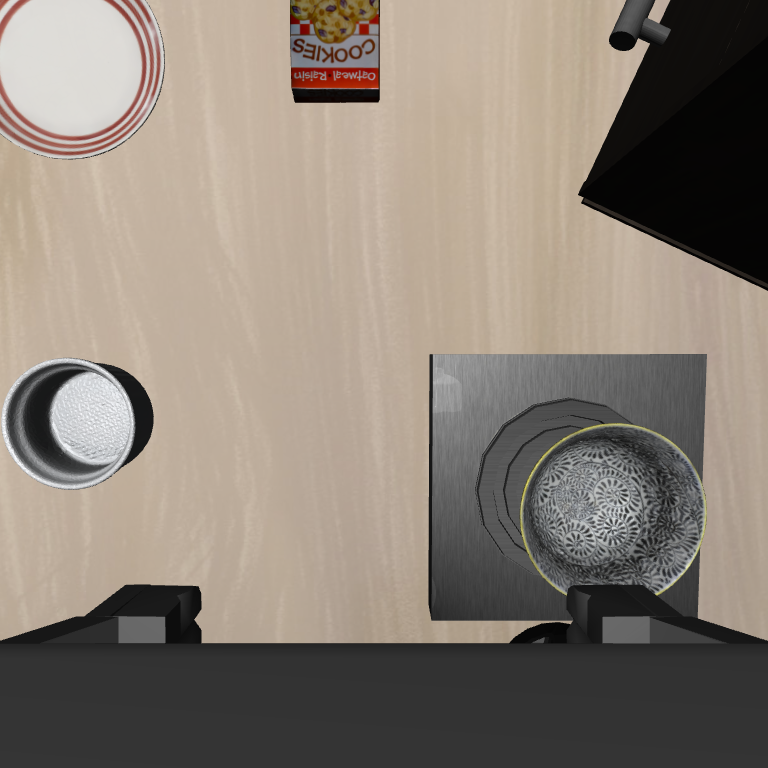
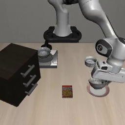

# LIBERO 시뮬레이션 검증과 Mirobot 실환경 재현 계획

## 연구 목표

LIBERO의 “나무 캐비닛 위 검은 그릇을 집어 접시 위에 놓기” 작업을 실제 Mirobot 작업대에 재현한다. 작업 지시와 물체의 상대 배치, 성공 조건, 카메라 구도를 기준으로 삼는다. Panda의 관절 궤적·각도·절대 좌표는 옮기지 않고, 거리와 높이는 Mirobot의 도달 범위에 맞춘다. 이후 실물 시연을 수집해 Cosmos Policy를 추가 학습하는 것이 목표다.

이번 문서에서 검증한 범위는 **LIBERO 장면 재현과 LIBERO 정책 실행**이다. 실물 Mirobot 작업대 구성, 추가 학습, 로봇 제어는 아래에 실행 절차로 정리했다.

## 세 레퍼런스 비교

비교 기준은 이번 작업을 그대로 재현할 수 있는지, 학습·평가 코드를 사용할 수 있는지, 실물 Mirobot 연결에 얼마나 많은 변환이 필요한지다.

| 레퍼런스 | 장점 | 단점 | 이번 연구에서의 사용 |
| --- | --- | --- | --- |
| [LIBERO](https://github.com/Lifelong-Robot-Learning/LIBERO) | task 9의 BDDL 장면, 초기 상태, 작업 지시와 성공 조건이 공개돼 있다. | Panda 시뮬레이터와 벤치마크이며 Mirobot에 배포할 정책·제어 코드는 제공하지 않는다. | 작업·물체 배치·성공 조건의 원본 |
| [OpenVLA-OFT](https://github.com/moojink/openvla-oft) | 시연 학습, 연속 말단 동작 청크, 손목 영상과 로봇 클라이언트 구현을 참고할 수 있다. | OpenVLA 모델과 전용 데이터 파이프라인이 중심이어서 선택할 Cosmos 체크포인트를 그대로 평가·추가 학습하는 경로는 아니다. | 시연·배포 구조 비교 자료 |
| [Cosmos Policy](https://github.com/NVlabs/cosmos-policy) | LIBERO 학습 체크포인트와 공식 학습·평가 코드가 있고, 단일 팔의 말단 동작·카메라·상태 입력을 사용한다. ALOHA 실물 배포 예제도 있다. | LIBERO 모델은 Panda 시뮬레이션에서 학습됐다. Mirobot 시연 데이터와 동작 변환 계층을 별도로 만들어야 한다. | **최종 정책과 평가 코드** |

**Cosmos Policy를 선택한 이유**는 목표인 LIBERO 작업을 학습한 체크포인트, 공식 학습·평가 코드, 실물 로봇 배포 예제를 한 저장소에서 확인할 수 있기 때문이다. [Cosmos Policy 논문의 LIBERO 비교표](https://arxiv.org/html/2601.16163)는 네 suite 평균으로 Cosmos Policy 98.5%, OpenVLA-OFT 97.1%를 제시한다. 이는 논문에 실린 벤치마크 결과이며 이번 실험이나 실물 Mirobot의 성능은 아니다. LIBERO는 장면과 성공 조건의 기준으로, OpenVLA-OFT는 시연·배포 구현을 비교할 자료로 사용한다.

## Cosmos Policy checkpoint 비교 및 최종 선택

같은 Cosmos Policy 계열에서도 학습 작업, 카메라, 상태와 동작 형식이 다르다. 이번 작업과의 일치 정도와 Mirobot에 옮길 때 필요한 변환을 기준으로 비교했다.

| 체크포인트 | 학습 환경·입출력 | 장점 | 단점 |
| --- | --- | --- | --- |
| [LIBERO-Predict2-2B](https://huggingface.co/nvidia/Cosmos-Policy-LIBERO-Predict2-2B) | LIBERO Panda; 작업·손목 카메라, 9D 상태 → 7D 말단·그리퍼 동작 16단계 | task 9를 공식 평가 코드로 바로 확인할 수 있고, 단일 팔의 동작 형식이 Mirobot에 가깝다. | 시뮬레이션 학습 모델이므로 Mirobot에 맞춘 시연 학습과 좌표·동작 변환이 필요하다. |
| [RoboCasa-Predict2-2B](https://huggingface.co/nvidia/Cosmos-Policy-RoboCasa-Predict2-2B) | RoboCasa Panda; 외부 2대·손목 카메라, 9D 상태 → 7D 동작 32단계 | 단일 팔, 7D 동작, 9D 상태는 LIBERO 모델과 비슷하다. | 주방 작업과 세 카메라 구성이어서 task 9의 장면과 입력을 다시 맞춰야 한다. |
| [ALOHA-Predict2-2B](https://huggingface.co/nvidia/Cosmos-Policy-ALOHA-Predict2-2B) | 실물 ALOHA 2; 상부·양손목 카메라, 14D 상태 → 양팔 관절·그리퍼 14D 동작 50단계 | 실제 로봇 시연과 배포 코드가 있다. | Mirobot은 단일 팔이어서 관절·동작·카메라 구성을 크게 바꿔야 한다. |
| [ALOHA Planning 모델](https://huggingface.co/nvidia/Cosmos-Policy-ALOHA-Planning-Model-Predict2-2B) | ALOHA 관측·후보 동작 → 미래 상태·가치 예측 | 후보 동작 평가에 쓸 수 있다. | 독립적인 동작 정책이 아니며 ALOHA 정책과 함께 쓰는 보조 모델이다. |

표의 장단점을 바탕으로 **LIBERO-Predict2-2B**를 출발 체크포인트로 정했다. 작업, 관측, 동작 형식별 선정 근거는 다음과 같다.

## 왜 `nvidia/Cosmos-Policy-LIBERO-Predict2-2B`를 선택하는가

**작업과 평가 환경.** 재현 대상인 [LIBERO Spatial task 9](https://github.com/Lifelong-Robot-Learning/LIBERO/blob/master/libero/libero/bddl_files/libero_spatial/pick_up_the_black_bowl_on_the_wooden_cabinet_and_place_it_on_the_plate.bddl)를 공식 코드로 바로 실행할 수 있다. 이 체크포인트는 LIBERO-Spatial·Object·Goal·Long 네 suite를 학습했다. [모델 카드](https://huggingface.co/nvidia/Cosmos-Policy-LIBERO-Predict2-2B)의 전체 벤치마크 결과와 아래에서 수행한 단일 에피소드 결과는 구분한다.

**동작과 상태.** 출력은 16단계의 7차원 동작 청크로, 각 단계가 6차원 말단 동작과 그리퍼 명령 1개다. 입력 상태는 그리퍼 관절 2개, 말단 위치 3개, 자세 쿼터니언 4개로 구성된 9차원이다. 로컬 `mirobot-vla/common/schema.py`에도 같은 항목의 7차원 동작과 9차원 상태가 정의돼 있다. 다만 [LIBERO 관측](https://github.com/ARISE-Initiative/robosuite/blob/v1.4.0/robosuite/robots/single_arm.py)의 쿼터니언은 `xyzw`, 로컬 스키마는 `wxyz` 순서이므로 입력을 재배열해야 한다. 차원과 항목이 같아도 Panda의 좌표계와 동작값을 Mirobot에 그대로 사용할 수는 없다.

**카메라와 로봇 구성.** LIBERO 모델은 작업 카메라 `agentview`와 손목 카메라 `eye_in_hand`를 사용한다. Mirobot에서도 두 시점을 마련할 수 있다. RoboCasa 모델은 외부 카메라 두 대와 손목 카메라를 사용하고 작업도 주방 중심이다. ALOHA는 양팔 관절 동작과 좌우 손목 카메라를 사용하므로 시작 체크포인트로는 연결 범위가 크다. ALOHA 코드는 시연 전처리, GPU 정책 서버, 로봇 클라이언트 구조를 참고한다.

결론적으로 LIBERO 체크포인트를 **Mirobot 시연으로 추가 학습할 출발점**으로 선택한다. 실물에서의 성공은 이 선택만으로 보장되지 않는다.

## Panda 기반 정책을 6축 Mirobot에 연결하는 방법

[LIBERO 장면의 Panda](https://frankaemika.github.io/docs/control_parameters.html)는 팔 관절이 7개이고, [실물 Mirobot](https://www.wlkata.com/en-gb/collections/mirobot-6dof/products/professional-kit-of-wlkata-mirobot-six-axis-robot-arm-robotic-arm-k12-education-equipment)은 팔 6축에 그리퍼가 별도로 있다. 그러나 선택한 정책은 Panda의 관절각 7개를 출력하지 않는다. 정책의 **7차원 동작은 말단 위치·자세 변화량 6개와 그리퍼 명령 1개**이며, 입력 상태도 Panda 관절각이 아닌 말단 위치·쿼터니언·그리퍼 값이다. 따라서 Panda의 일곱 번째 관절을 버리거나 일곱 관절을 여섯 관절에 일대일로 대응시키는 과정은 없다.

```text
정책 [Δx, Δy, Δz, Δrx, Δry, Δrz, gripper]
             ↓ 역정규화·좌표 변환·동작 범위 검사
현재 말단 위치·회전 + 위치·축각 변화량 → 목표 자세 X Y Z A B C → G0 명령
그리퍼 값 → 열기/닫기 → M4 명령
```

실물 제어에서는 Mirobot의 현재 말단 자세를 기준으로 정책 변화량을 적용해 목표 자세를 만들고, 그 목표를 **Mirobot의 6축 역기구학 또는 Cartesian 제어기**로 실행하도록 설계한다. 집기·들기·이동·놓기 경로의 각 목표가 관절 한계와 작업 범위 안에 있고 충돌·특이 자세를 피하는지 먼저 확인한다. 가능한 관절 해가 없으면 명령을 보내지 않고 캐비닛·접시 위치나 접근 자세를 조정한다. Panda의 7축 여유 관절이 만든 자세를 Mirobot이 항상 낼 수는 없으므로, 실물에서 가능한 경로의 Mirobot 시연으로 정책을 추가 학습한다.

LIBERO의 동작은 [20Hz `OSC_POSE` 제어기](https://github.com/Lifelong-Robot-Learning/LIBERO/blob/master/libero/libero/envs/env_wrapper.py)에 들어가는 정규화 명령이다. 위치 3값은 [제어기의 스케일](https://github.com/ARISE-Initiative/robosuite/blob/v1.4.0/robosuite/controllers/config/osc_pose.json)과 좌표계를 반영해 해석한다. 회전 3값은 오일러 각 `A·B·C`가 아닌 축각 변화량이므로 현재 회전과 합성한 뒤 최종 자세만 Mirobot의 `A·B·C` 규약으로 변환한다. 성분별로 각도를 더하지 않는다. Mirobot 시연에서도 물리 이동량과 제어 주기를 기록해 같은 의미의 7D 학습 라벨과 별도 정규화 통계를 만들고, 추론 시 역정규화한다. 브리지의 전송 지연과 실제 동작 완료 시간을 측정한 뒤 새 영상을 받아 정책을 다시 호출할 간격을 정한다. LIBERO의 정규화 값을 mm나 도 단위 G-code에 바로 대입하지 않는다.

로컬 `mirobot-vla/common/gcode.py`는 주어진 위치를 m에서 mm로 바꾸고, 호출자가 넘긴 `A·B·C`와 함께 `G0 X... Y... Z... A... B... C...`를 만든다. 이 함수가 회전값을 계산하지는 않는다. 그리퍼 값이 음수면 `M4 S40`(열기), 그렇지 않으면 `M4 S60`(닫기)을 선택한다. **Cosmos 출력의 역정규화, 회전 합성, 말단 변화량 적용, 도달 가능성 판단은 아직 구현되지 않았다.** 그리퍼의 연속 폭 제어가 필요하다면 실물에서 가용 범위를 확인한 뒤 별도로 매핑한다.

이 기능을 `MirobotActionAdapter`로 묶어 한 단계의 이동·회전량, 작업 공간, 자세, 도달 가능성, 그리퍼 범위를 확인한다. NaN·Inf를 거르고 비상 정지 경로도 둔다. 첫 실물 시험에서는 16단계 청크를 한꺼번에 실행하기보다 한두 단계 뒤 새 영상을 받아 다시 추론한다.

## 기준 장면과 재현 조건

기준 장면은 `libero_spatial`의 task ID 9, 첫 초기 상태인 episode index 0이다. BDDL의 작업 지시는 ‘Pick the akita black bowl on the wooden cabinet and place it on the plate’다. 공식 LIBERO에서는 Panda가 움직이고, 모델은 256×256 환경 영상에서 전처리된 224×224 `agentview`·`eye_in_hand`와 로봇 상태를 받는다. `--task_suite_name libero_spatial`만 지정하면 suite의 여러 작업이 평가되므로, 이 장면만 비교할 때는 공식 평가 코드의 task 반복을 `[9]`로 바꾸고 `--num_trials_per_task 1`을 지정한다. 이때 첫 초기 상태인 episode 0만 평가된다. [공식 task 목록](https://github.com/Lifelong-Robot-Learning/LIBERO/blob/master/libero/libero/benchmark/libero_suite_task_map.py)에서 task 9가 캐비닛 위 그릇을 접시로 옮기는 작업이다.

| 조건 | 기준값 |
| --- | --- |
| 모델 | `nvidia/Cosmos-Policy-LIBERO-Predict2-2B` |
| 평가 설정 | `cosmos_predict2_2b_480p_libero__inference_only` |
| 장면 | `libero_spatial`, task 9, episode 0 |
| 초기화 | seed 195, `deterministic=True`, `deterministic_reset=True`, reset seed 0 |
| 첫 관측 전 안정화 | dummy action 10회 |
| 입력 | `agentview`, `eye_in_hand`, proprioception, 언어 지시; `use_wrist_image=True`, `use_proprio=True` |
| 영상 전처리 | `flip_images=True` |
| 상태·동작 통계 | `normalize_proprio=True`, `unnormalize_actions=True`, 체크포인트의 `libero_dataset_statistics.json` 사용 |
| 작업 문장 | 체크포인트의 `libero_t5_embeddings.pkl` 사용 |
| 동작 | `chunk_size=16`, `num_open_loop_steps=16` |
| 추론 | `num_denoising_steps_action=5` |

평가에 쓰인 첫 관측은 [실행한 버전의 LIBERO 평가 코드](https://github.com/NVlabs/cosmos-policy/blob/18a2accadf4e7a3531e56754102af5a24d2316da/cosmos_policy/experiments/robot/libero/run_libero_eval.py)와 같은 순서로 얻는다. 환경을 reset한 뒤 task 9의 첫 초기 상태를 적용하고, dummy action 10회로 물체를 안정화한 다음 `get_libero_image()`와 `get_libero_wrist_image()`를 호출한다. 아래 코드는 이번에 사용한 고정 초기 상태에서 내장 카메라를 768×768 PNG로 저장한 방법이다. 정책은 별도로 환경 영상 256×256을 전처리해 입력받았다.

```python
import os
from pathlib import Path
os.environ.setdefault("MUJOCO_GL", "egl")

import numpy as np
from PIL import Image
from libero.libero import benchmark
from cosmos_policy.experiments.robot.libero.libero_utils import (
    get_libero_env, get_libero_dummy_action,
)
from cosmos_policy.utils.utils import set_seed_everywhere

out = Path("images")
out.mkdir(exist_ok=True)
set_seed_everywhere(195)
suite = benchmark.get_benchmark_dict()["libero_spatial"]()
task = suite.get_task(9)
initial_state = suite.get_task_init_states(9)[0]
env, _ = get_libero_env(task, "cosmos", resolution=256)
try:
    set_seed_everywhere(0)
    env.reset()
    obs = env.set_init_state(initial_state)
    for _ in range(10):
        obs, _, _, _ = env.step(get_libero_dummy_action("cosmos"))

    for camera in env.env.sim.model.camera_names:
        frame = env.env.sim.render(width=768, height=768, camera_name=camera)
        Image.fromarray(np.flipud(frame)).save(out / f"task9_initial_{camera}.png")
finally:
    env.close()
```

같은 task와 초기 상태, asset, 카메라 설정을 사용하면 장면 배치를 비교할 수 있다. 정책의 움직임 전체까지 같은 결과를 기대하려면 체크포인트 버전, LIBERO·robosuite·MuJoCo·PyTorch 버전, GPU 환경과 난수 설정도 맞춰야 한다. 실제 평가에서는 위 코드와 같은 초기 상태를 쓰도록 공식 `run_libero_eval.py`의 task 반복만 `range(num_tasks)`에서 `[9]`로 바꾸고 `--num_trials_per_task 1`을 지정했다. 물리 GPU 4는 `CUDA_VISIBLE_DEVICES=4`로 제한했고, 프로세스 안에서는 그 장치가 논리 GPU 0으로 보인다. 아래의 `--available_gpus 0`은 당시 사용한 옵션이지만 이번 비병렬 추론의 GPU 선택에는 관여하지 않는다. 모델 성능을 추정하려면 다른 task와 초기 상태도 시험해야 한다. 모델 카드의 공식 성능은 각 suite의 10개 task에서 task당 50개 episode를 세 seed로 평가한 결과다.

```bash
set -euo pipefail
ROOT=/mnt/SIM/<USER>/codex-libero-20260925
cd "$ROOT"
"$ROOT/.venv/bin/python" - <<'PY'
from pathlib import Path
path = Path("cosmos_policy/experiments/robot/libero/run_libero_eval.py")
source = path.read_text()
old = "for task_id in tqdm.tqdm(range(num_tasks)):"
new = "for task_id in tqdm.tqdm([9]):"
if source.count(old) == 1:
    path.write_text(source.replace(old, new, 1))
else:
    assert source.count(new) == 1
PY
CUDA_VISIBLE_DEVICES=4 MUJOCO_GL=egl MUJOCO_EGL_DEVICE_ID=4 \
HF_HOME="$ROOT/.hf-cache" "$ROOT/.venv/bin/python" \
  -m cosmos_policy.experiments.robot.libero.run_libero_eval \
  --config cosmos_predict2_2b_480p_libero__inference_only \
  --ckpt_path nvidia/Cosmos-Policy-LIBERO-Predict2-2B \
  --config_file cosmos_policy/config/config.py \
  --task_suite_name libero_spatial --num_trials_per_task 1 \
  --use_wrist_image True --use_proprio True \
  --normalize_proprio True --unnormalize_actions True \
  --dataset_stats_path nvidia/Cosmos-Policy-LIBERO-Predict2-2B/libero_dataset_statistics.json \
  --t5_text_embeddings_path nvidia/Cosmos-Policy-LIBERO-Predict2-2B/libero_t5_embeddings.pkl \
  --trained_with_image_aug True --chunk_size 16 --num_open_loop_steps 16 \
  --local_log_dir "$ROOT/reference_eval_logs" \
  --randomize_seed False --data_collection False --available_gpus 0 --seed 195 \
  --use_variance_scale False --deterministic True \
  --ar_future_prediction False --ar_value_prediction False \
  --use_jpeg_compression True --flip_images True \
  --num_denoising_steps_action 5 \
  --num_denoising_steps_future_state 1 --num_denoising_steps_value 1 \
  --deterministic_reset True --deterministic_reset_seed 0 > "$ROOT/eval.log" 2>&1
```

## 실제 시뮬레이터 실행 결과

PML 서버에서 공식 Cosmos Policy 코드의 commit `18a2accadf4e7a3531e56754102af5a24d2316da`를 사용해 task 9의 첫 초기 상태를 실행했다. 아래 사진 일곱 장은 **같은 장면을 LIBERO/MuJoCo 시뮬레이터에서 각기 다른 카메라로 렌더링한 PNG**다. 실물 Mirobot 사진이나 생성 이미지는 아니다. 배치를 자세히 볼 수 있도록 768×768로 저장했다. 이는 정책 평가에 사용한 256×256 환경 영상과 다른 해상도다.

### 카메라별 초기 장면

**작업 카메라 (`agentview`)** — 왼쪽 캐비닛 위 검은 그릇과 오른쪽 접시가 함께 보인다.


**위쪽 (`birdview`)** — 사진 위쪽이 로봇 방향이다. 캐비닛은 왼쪽 앞, 접시는 오른쪽 앞에 있고 중앙에 쿠키 상자가 있다.


**정면 (`frontview`)** — 캐비닛 윗면에 놓인 그릇의 높이를 확인할 수 있다.


**측면 (`sideview`)** — 그리퍼, 작업대, 캐비닛 사이의 높이 차이가 보인다.



**전체 (`galleryview`)** — 작업대 뒤쪽의 로봇 베이스 위치를 보여 준다.



**로봇 근처 (`robotview`)** — 접시, 스토브의 보조 그릇, 라메킨과 쿠키 상자의 간격을 볼 수 있다.



**손목 (`eye_in_hand`)** — 실물 손목 카메라의 시야를 정할 때 참고할 화면이다.



### 사진으로 정한 실물 배치 기준

`birdview`에서는 로봇 베이스를 작업대 뒤쪽 중앙에, 캐비닛을 왼쪽 앞에 비스듬히, 접시를 오른쪽 앞에 두는 상대 배치를 읽을 수 있다. `agentview`에서는 그릇과 접시가 한 화면에 들어오며, `frontview`·`sideview`에서는 그릇이 작업대보다 높은 캐비닛 위에 있다는 점을 확인한다. 쿠키 상자, 스토브 위 보조 그릇, 라메킨은 화면에 보이는 배경 물체다. 손목의 **초기 화면**은 실물 카메라 각도와 작업 시작 시야를 정하는 데 참고하고, 접근 중 가림은 실물 동영상으로 따로 확인한다.

PNG는 방향과 상대 배치를 보여 주지만 정확한 길이·높이·카메라 내부 파라미터까지 알려 주지는 않는다. 실물에서는 그릇 지름과 그리퍼 개구 폭을 재고, 캐비닛 상판과 접시 중심이 모두 도달 범위에 드는지 확인한 뒤 위치를 확정한다. 로봇 베이스·말단·카메라 좌표계를 같은 기준으로 기록해야 시뮬레이터와 실물의 관측을 비교할 수 있다.

### 정책 실행

이어서 첫 에피소드를 Cosmos Policy로 평가했다. PML의 `$ROOT/eval.log`에서 단일 에피소드 `1/1` 성공을 확인했다. 아래 사진은 이 실행에서 마지막 명령을 보내기 직전에 저장된 관측 프레임이다. 최종 성공 판정은 사진이 아니라 다음 평가 로그의 발췌에 근거한다.

```text
Success: True
# episodes completed so far: 1
# successes: 1 (100.0%)
```



| 확인 항목 | 실행 결과 |
| --- | --- |
| 평가 | task 9의 첫 초기 상태 1회, `1/1` 성공 |
| 실행 장비 | PML 서버 GPU 4 |
| 코드 버전 | Cosmos Policy commit `18a2accadf4e7a3531e56754102af5a24d2316da` |
| 소프트웨어 | Python 3.10.21, LIBERO 0.1.1, robosuite 1.4.0, MuJoCo 3.3.2, PyTorch 2.7.0+cu128 |

이 결과는 한 초기 상태의 단일 에피소드이므로 모델의 전체 성공률을 추정할 수 없다. 실물 Mirobot 제어나 추가 학습 결과도 아직 포함되지 않았다.

## 실물 Mirobot 적용 절차

**작업대 배치.** 위 LIBERO 사진과 [task 9 BDDL](https://github.com/Lifelong-Robot-Learning/LIBERO/blob/master/libero/libero/bddl_files/libero_spatial/pick_up_the_black_bowl_on_the_wooden_cabinet_and_place_it_on_the_plate.bddl)를 기준으로 로봇을 작업대 뒤에 고정하고, 왼쪽 앞 캐비닛 위에 검은 그릇, 오른쪽 앞에 접시를 둔다. 쿠키 상자·스토브·라메킨·보조 그릇은 영상 구도를 맞추기 위한 주변 물체로 둔다. Panda의 절대 좌표를 복사하지 않고 실물 그릇 지름, 그리퍼 개구 폭, 로봇 도달 범위·접근 높이와 카메라 장착 후 유효 하중을 측정해 위치를 정한다.

**카메라와 시연.** 고정 카메라에는 로봇·그릇·접시가 함께 보이게 하고 손목 카메라는 그리퍼 옆에 설치한다. 위 `agentview`와 `eye_in_hand` 사진과 초기 구도를 비교하고, 접근·집기 과정의 가림은 동영상으로 확인한다. 두 영상, 말단 위치·자세, 그리퍼 상태, 작업 지시와 실행 동작을 같은 시간축에 기록한다. 모델 입력의 그리퍼 관절값 두 칸에는 정규화한 개구율을 같은 값으로 넣는 규칙을 정해 시연과 추론에 공통으로 적용한다. 개구 폭을 읽을 수 없다면 실제로 확인한 열림·닫힘 상태로 두 값을 만들고 이 근사가 충분한지 검증한다. LIBERO 입력의 쿼터니언 순서는 `xyzw`이므로 로컬 `wxyz` 스키마에서 변환한다. 로컬 `mirobot-vla/common/schema.py`의 현재 작업 문장도 검은 그릇·접시 작업으로 바꾼다.

**학습과 제어.** Mirobot 시연에서 9차원 상태와 7차원 말단 동작·그리퍼 명령을 만들고, Mirobot 데이터의 정규화 통계로 LIBERO 체크포인트를 추가 학습한다. [Cosmos Policy 논문](https://arxiv.org/abs/2601.16163)의 대상 로봇 시연 추가 학습 방법을 따른다. 정책 추론은 PML GPU 서버에서 수행한다. 로봇 PC는 카메라·상태를 서버로 보내고 받은 동작을 역정규화·좌표 변환·범위 검사한 뒤 `server/bridge_client.py`와 `robot/serial_bridge.py`를 통해 전달하도록 개발한다. 현재 `serial_bridge.py`에는 위치·관절 응답을 읽는 코드가 있지만 `bridge_client.py`는 상태를 정책에 반환하지 않으며 쿼터니언·그리퍼 관측도 제공하지 않는다. 폐루프 제어 전에 상태 응답을 클라이언트로 연결하고 관절값 기반 순기구학으로 말단 자세를 계산하며, 그리퍼 관측과 Cosmos 동작 변환을 구현·검증해야 한다.

**실물 검증.** 먼저 그릇 없이 짧은 이동으로 좌표계·도달 범위·충돌 여유를 확인한다. 다음으로 한 단계 동작, 집기, 접시 위 놓기 순서로 시험한다. 그리퍼를 연 뒤 그릇이 접시 위에 남으면 성공으로 기록하고, 여러 초기 배치의 성공·충돌·중단 횟수를 함께 보고한다. 이 과정은 계획이며, 위 LIBERO 성공 기록이 실물 Mirobot 결과를 뜻하지는 않는다.

## 결론

| 항목 | 최종 선택 | 확인할 코드·모델 |
| --- | --- | --- |
| 정책 모델 | `nvidia/Cosmos-Policy-LIBERO-Predict2-2B` | [Hugging Face 모델 카드](https://huggingface.co/nvidia/Cosmos-Policy-LIBERO-Predict2-2B), [Cosmos Policy 코드](https://github.com/NVlabs/cosmos-policy) |
| 시뮬레이션 | LIBERO의 `libero_spatial` task 9 (robosuite·MuJoCo) | [LIBERO 저장소](https://github.com/Lifelong-Robot-Learning/LIBERO), [실행한 버전의 Cosmos Policy 평가 코드](https://github.com/NVlabs/cosmos-policy/blob/18a2accadf4e7a3531e56754102af5a24d2316da/cosmos_policy/experiments/robot/libero/run_libero_eval.py) |

위 모델과 장면을 PML 서버에서 실제 실행해 단일 초기 상태의 성공을 확인했다. 다음 단계는 그 장면의 물체 배치와 관측 구도를 **실물 Mirobot 작업대**에 옮기고, Mirobot 시연으로 같은 모델을 추가 학습하는 것이다.

## 참고 자료와 코드

- 원논문(arXiv): [Cosmos Policy](https://arxiv.org/abs/2601.16163), [LIBERO](https://arxiv.org/abs/2306.03310), [OpenVLA-OFT](https://arxiv.org/abs/2502.19645)
- 작업과 평가: [LIBERO](https://github.com/Lifelong-Robot-Learning/LIBERO), [task 9 BDDL](https://github.com/Lifelong-Robot-Learning/LIBERO/blob/master/libero/libero/bddl_files/libero_spatial/pick_up_the_black_bowl_on_the_wooden_cabinet_and_place_it_on_the_plate.bddl), [task 목록](https://github.com/Lifelong-Robot-Learning/LIBERO/blob/master/libero/libero/benchmark/libero_suite_task_map.py), [Cosmos Policy 코드](https://github.com/NVlabs/cosmos-policy), [실행한 버전의 LIBERO 평가 코드](https://github.com/NVlabs/cosmos-policy/blob/18a2accadf4e7a3531e56754102af5a24d2316da/cosmos_policy/experiments/robot/libero/run_libero_eval.py), [관측 변환 코드](https://github.com/NVlabs/cosmos-policy/blob/18a2accadf4e7a3531e56754102af5a24d2316da/cosmos_policy/experiments/robot/libero/libero_utils.py)
- 구현 비교: [OpenVLA-OFT](https://github.com/moojink/openvla-oft)
- 입력·제어 형식: [LIBERO 환경 코드](https://github.com/Lifelong-Robot-Learning/LIBERO/blob/master/libero/libero/envs/env_wrapper.py), [robosuite 1.4 쿼터니언 변환](https://github.com/ARISE-Initiative/robosuite/blob/v1.4.0/robosuite/robots/single_arm.py), [OSC_POSE 설정](https://github.com/ARISE-Initiative/robosuite/blob/v1.4.0/robosuite/controllers/config/osc_pose.json)
- 모델과 데이터: [LIBERO 체크포인트](https://huggingface.co/nvidia/Cosmos-Policy-LIBERO-Predict2-2B), [RoboCasa 체크포인트](https://huggingface.co/nvidia/Cosmos-Policy-RoboCasa-Predict2-2B), [ALOHA 체크포인트](https://huggingface.co/nvidia/Cosmos-Policy-ALOHA-Predict2-2B), [ALOHA Planning 모델](https://huggingface.co/nvidia/Cosmos-Policy-ALOHA-Planning-Model-Predict2-2B), [LIBERO 학습 데이터](https://huggingface.co/datasets/nvidia/LIBERO-Cosmos-Policy)
- 확인한 로컬 Mirobot 코드: `mirobot-vla/common/schema.py`, `common/gcode.py`, `server/bridge_client.py`, `robot/serial_bridge.py`
