# LIBERO 기반 Mirobot 실물 환경 구성과 Cosmos Policy 학습

## 1. 연구 목표와 진행 흐름

LIBERO로 구성한 custom 환경의 **작업대, 로봇과 카메라의 상대 배치, 기준 시작 자세**를 참고해 Mirobot 실험 환경을 만든다. 여기서 custom 환경은 연구에 맞게 설정을 바꾼 시뮬레이션 장면이고, task는 로봇이 수행할 구체적인 작업이다. 이 기본 환경을 유지하면서 실물 task와 물체 배치를 정하고, 사람이 Mirobot을 조작해 시연 데이터를 수집한다. 수집한 영상·로봇 상태·동작으로 Cosmos Policy를 추가 학습한 뒤, 실제 환경에서 정책을 실행해 성공률을 평가한다.

환경 구성 단계의 과제는 **① 공개 레퍼런스 코드로 시뮬레이션 환경을 비교하고, ② Mirobot 실물 배치의 기준으로 사용할 환경을 선정한 뒤, ③ 두 로봇의 사용 가능한 작업 영역 사이에 비례식을 세워 설치 위치를 정하는 것**이다. 이에 따라 환경 비교·선정은 2절에서, 실측값을 이용한 배치 계산과 설치 방법은 3절에서 다룬다.

전체 흐름은 **LIBERO custom 기본 환경 설정 → 실물 기본 환경 구성 → 실물 task·물체 배치 결정 → Mirobot 시연 수집 → Cosmos Policy 추가 학습 → 실물 추론·평가**다. 시뮬레이터는 기본 환경과 관측 구조의 기준으로 사용하고, 본 실험의 학습 데이터는 실제 Mirobot에서 수집한다.

## 2. 실험 환경 비교와 LIBERO 선택

이번 연구에서는 시뮬레이션의 작업대·카메라·시작 자세를 참고해 실물 기본 환경을 구성한다. 따라서 환경을 고를 때는 다음 세 조건을 우선한다.

1. **실물 배치와의 대응:** 탁상에 고정한 단일 로봇 팔과 고정·손목 카메라 구성을 기준으로 삼을 수 있는가.
2. **초기 조건의 재현:** 작업대·로봇·카메라 설정과 시작 상태를 코드에서 확인하고, 수정한 조건으로 다시 초기화할 수 있는가.
3. **정책 관측과의 연결:** 환경에서 얻은 영상과 로봇 상태가 정책 입력으로 전달되는 과정을 공개 코드로 확인할 수 있는가.

### 시뮬레이션 환경 비교

아래는 기본 환경을 구축할 출발점을 비교한 것이다. 장단점은 각 항목에 연결한 공개 코드와 예제를 위 조건에 비추어 판단했다. 비교 범위는 해당 구현이 제공하는 장면·초기화·관측 연결이다.

| 환경 | 장점 | 단점·추가 작업 | 이번 연구에서의 판단 |
| --- | --- | --- | --- |
| **[LIBERO](https://github.com/Lifelong-Robot-Learning/LIBERO/blob/8f1084e3132a39270c3a13ebe37270a43ece2a01/libero/libero/envs/problems/libero_tabletop_manipulation.py) — Cosmos Policy-LIBERO 실행 환경** | [tabletop 장면](https://github.com/Lifelong-Robot-Learning/LIBERO/blob/8f1084e3132a39270c3a13ebe37270a43ece2a01/libero/libero/envs/problems/libero_tabletop_manipulation.py)과 [환경 래퍼](https://github.com/Lifelong-Robot-Learning/LIBERO/blob/8f1084e3132a39270c3a13ebe37270a43ece2a01/libero/libero/envs/env_wrapper.py)에서 작업대·카메라·초기 상태 설정을 확인할 수 있다. OpenVLA-OFT와 Cosmos Policy의 실행 코드로 관측 연결도 확인된다. | 기본 로봇은 Panda이므로 Mirobot의 도달 범위·시작 자세·그리퍼와 실물 제어는 별도로 맞춰야 한다. | 필요한 기본 환경과 관측 흐름이 갖춰져 있어, 실물에 맞춘 배치·보정에 집중할 수 있다. |
| [RoboCasa](https://github.com/robocasa/robocasa) | [환경 생성 함수 `create_env()`](https://github.com/robocasa/robocasa/blob/456174f62b89b8fca99eaaf33949c29fec9cfc2a/robocasa/utils/env_utils.py)에서 로봇·카메라·주방 배치를 설정한다. 다양한 설비·물체를 포함한 장면을 구성하기 좋다. | 소형 탁상 구성에 맞는 장면과 관측 조건을 별도로 정해야 한다. | 설비와 장면의 다양성은 장점이지만, 고정된 기본 작업대를 옮기는 현재 범위에서는 활용도가 낮다. |
| [Isaac Sim — URDF 가져오기 예제](https://docs.isaacsim.omniverse.nvidia.com/latest/importer_exporter/import_urdf.html) | 공식 Python 예제에서 URDF 로봇 모델을 변환해 장면으로 여는 과정을 확인할 수 있다. Mirobot 모델을 불러오는 출발점으로 사용할 수 있다. | 검토한 예제에는 작업대·카메라·초기화·정책 관측 연결이 포함되지 않아 해당 구성을 추가해야 한다. | 로봇 모델을 직접 구성할 때 참고한다. 이번 기본 환경 기준으로 사용하려면 작업 장면과 관측 코드까지 확보해야 한다. |
| [Gazebo 기반 Mirobot 공개 예제](https://github.com/wlkata/RosForMirobot-master/blob/8a60a4ce16186ddbb9393e20bb904cbab61fc884/mirobot_gazebo/launch/mirobot_bringup_moveit.launch) | launch가 Mirobot 모델·관절 상태·6축 궤적 제어기·MoveIt/RViz를 연결한다. 모델과 관절 제어 구조를 직접 참고할 수 있다. | ROS 1·Gazebo Classic 기반이며 실행 버전 조합이 고정돼 있지 않다. 해당 launch 경로에 카메라·정책 관측 연결이 없고 실물 전송 노드도 비활성화돼 있어, 센서·동기화·정책 변환·실물 통신을 추가해야 한다. | Mirobot 기구·관절 제어의 참고 코드로 활용한다. 영상 기반 학습에는 별도의 환경·관측 구성이 필요하다. |

**환경별 대표 화면.** LIBERO·RoboCasa·Isaac Sim은 공식 논문·문서의 예시 이미지이며, 이번에 분석한 코드를 새로 실행한 결과와 구분한다. Mirobot Gazebo는 아래에 밝힌 조건으로 직접 렌더링했다.

| LIBERO |    RoboCasa |
| --- | --- |
| 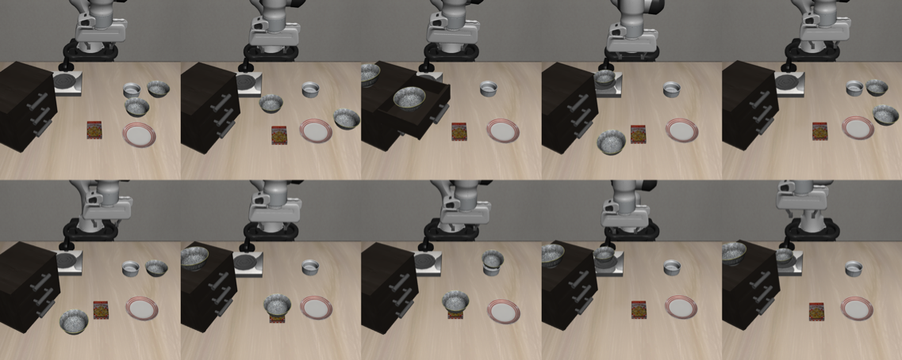 | 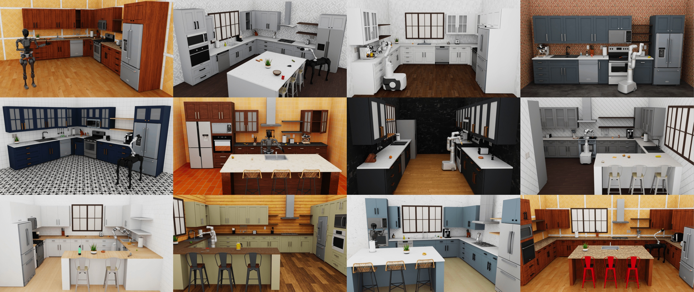 |
| 같은 물체의 공간 배치를 달리한 탁상 장면. [LIBERO 논문 Figure 8](https://arxiv.org/abs/2306.03310) | 설비·배치·로봇 구성이 다른 주방 장면 모음. [RoboCasa 공식 v0.2 문서](https://github.com/robocasa/robocasa/blob/456174f62b89b8fca99eaaf33949c29fec9cfc2a/docs/_versions/v0.2/images/robocasa-banner_v0.2.jpg) |

| Isaac Sim URDF 가져오기 예제 | Mirobot Gazebo |
| --- | --- |
| 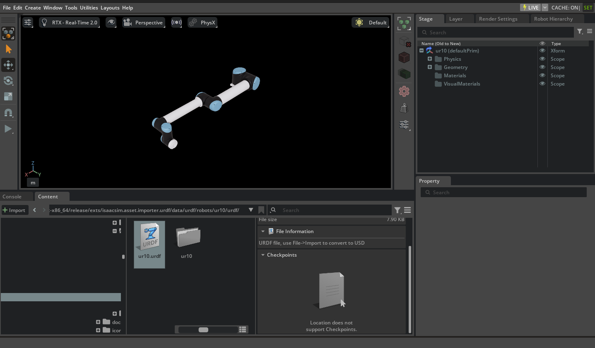 | 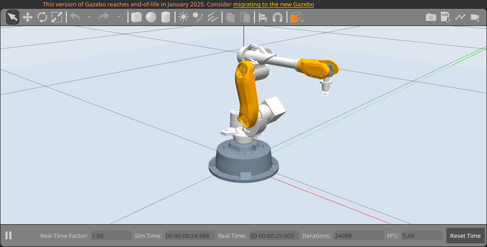 |
| 공식 **UR10** 모델 가져오기 화면. Mirobot 장면은 별도 구성해야 한다. [NVIDIA 공식 문서](https://docs.isaacsim.omniverse.nvidia.com/latest/importer_exporter/import_urdf.html) | [공식 Mirobot 모델](https://github.com/wlkata/RosForMirobot-master/blob/8a60a4ce16186ddbb9393e20bb904cbab61fc884/mirobot_urdf_2/urdf/mirobot_urdf_2.xacro)을 Gazebo 11.15.1에서 직접 렌더링했다. ROS 제어 플러그인을 제외하고 표시용 지면·조명·촬영 시점을 추가한 정적 장면이다. |

### 환경 구성 코드의 주요 함수

환경의 장단점을 판단한 근거를 주요 함수와 설정 파일별로 정리했다. 아래 내용은 공개 소스 분석이며, 각 후보의 Mirobot 성능 비교 결과는 아니다. 위 Gazebo 실행에서는 모델 표시를 확인했으며 ROS·MoveIt 제어와 정책 연동은 검증하지 않았다. 코드의 기본 치수와 예제 설정은 실물 설치값을 정할 때 참고한다.

함수 분석에 사용한 GitHub 원문은 확인한 커밋으로 링크를 고정했다. Isaac Sim 예제는 2026년 9월 26일 확인한 공식 문서를 기준으로 한다.

코드를 읽는 데 필요한 용어는 다음과 같다.

- **BDDL:** 물체 종류, 배치 영역, 시작·목표 조건을 적는 작업 명세 파일.
- **URDF / Xacro / USD:** URDF는 로봇의 링크·관절·형상을 기술하는 파일, Xacro는 이를 변수와 매크로로 작성하는 형식, USD는 Isaac Sim이 사용하는 장면 형식이다.
- **환경 래퍼 / offscreen:** 래퍼는 환경 생성·초기화·관측을 편하게 호출하도록 감싼 코드다. offscreen은 화면 창을 띄우지 않고 관측 이미지를 만드는 방식이다.
- **상태와 방향 표현:** 상태는 로봇의 위치·방향·그리퍼 값이다. 방향은 축과 회전량을 담은 축각 3값 또는 쿼터니언 4값으로 표현할 수 있어, 정책마다 요구하는 형식을 맞춰야 한다.

표의 `__init__()`는 처음 환경을 만들 때의 설정, `reset()`은 시작 상태로 초기화하는 함수다. 각 표는 **함수의 역할 → 실제 환경에 적용할 부분** 순서로 읽으면 된다. 아래 코드는 연결한 원문에서 설명에 필요한 부분만 발췌했다. 들여쓰기·줄바꿈을 정리하고, 생략한 부분은 주석으로 표시했다.

#### BDDL: 시뮬레이터의 작업 명세서

BDDL은 **시뮬레이터가 읽는 작업 명세서**다. 정식 이름은 *Behavior Domain Definition Language*이며, 물체와 배치 영역, 초기 조건, 목표 조건을 정해 작업을 표현한다. [BDDL 공식 설명](https://github.com/embodied-agent-interface/bddl)

예를 들어 “블록을 상자 안으로 옮기기”는 다음과 같이 정리할 수 있다.

| 항목 | 명세에 적는 내용 |
| --- | --- |
| 물체 | 블록, 상자, 작업대 |
| 배치 영역 | 블록과 상자를 놓을 위치·범위 |
| 초기 조건 | 블록이 작업대 위에 놓여 있음 |
| 목표 조건 | 블록이 상자 안에 들어가면 성공 |

LIBERO는 `.bddl` 파일을 읽어 장면의 물체·배치 조건을 구성하고 목표 달성 여부를 판단한다. 실제로 어떤 이동 동작을 실행할지는 정책이 영상과 로봇 상태를 보고 결정한다. [LIBERO 작업 생성 문서](https://lifelong-robot-learning.github.io/LIBERO/html/procedural_generation/task_generation.html)

**이번 연구에서는 LIBERO custom 환경의 물체·배치·작업 조건을 정할 때 BDDL을 사용한다.** 실제 Mirobot에서 시연을 수집하고 Cosmos Policy를 추가 학습하는 단계에는 BDDL이 필수는 아니다. 실물 task를 시뮬레이션에서도 재현하려는 경우에는 해당 task의 조건을 BDDL로 정의한다.

#### LIBERO: tabletop 장면

[`libero_tabletop_manipulation.py`](https://github.com/Lifelong-Robot-Learning/LIBERO/blob/8f1084e3132a39270c3a13ebe37270a43ece2a01/libero/libero/envs/problems/libero_tabletop_manipulation.py)의 `Libero_Tabletop_Manipulation`이 장면 조건을 정하고, 부모 클래스인 [`BDDLBaseDomain`](https://github.com/Lifelong-Robot-Learning/LIBERO/blob/8f1084e3132a39270c3a13ebe37270a43ece2a01/libero/libero/envs/bddl_base_domain.py)이 로봇·작업대·물체를 결합한다.

작업대의 치수를 정하는 부분과, 그 치수로 베이스 위치를 계산하는 부분이다. 두 코드가 연결되므로 작업대·베이스의 상대 배치를 함께 읽어야 한다.

```python
# __init__()의 기본 작업대 설정
self.table_full_size = (1.0, 1.2, 0.05)
self.table_offset = (0, 0, 0.90)
kwargs.update({"workspace_offset": self.table_offset})
kwargs.update({"arena_type": "table"})

# _load_model()의 로봇 베이스 배치
xpos = self.robots[0].robot_model.base_xpos_offset["table"](
    self.table_full_size[0]
)
self.robots[0].robot_model.set_base_xpos(xpos)
```

| 주요 함수 | 코드에서 하는 일 | 실물 환경 구성에 활용할 부분 |
| --- | --- | --- |
| `Libero_Tabletop_Manipulation.__init__()` | 기본 작업대 크기 `(1.0, 1.2, 0.05) m`, 위치 기준 `table_offset=(0, 0, 0.90) m`와 장면 XML을 지정한다. 로봇 이름에 `Mounted`를 붙여 고정형 모델을 선택한다. | 시뮬레이션의 작업면·베이스 관계를 읽는 출발점이다. 이 치수를 Mirobot 작업종이 크기와 구분해 비례식에 사용할 영역을 정한다. |
| `BDDLBaseDomain._load_model()` | 작업대 크기로 로봇 베이스 위치를 계산하고 `set_base_xpos()`에 전달한다. `TableArena`를 만든 뒤 카메라·물체를 불러와 `ManipulationTask`로 묶는다. | 작업대 크기를 바꾸면 베이스 위치도 확인해야 한다. 실제 생성된 두 위치의 상대 좌표를 배치 기준으로 저장한다. |
| `_load_fixtures_in_arena()` · `_load_objects_in_arena()` · `_load_sites_in_arena()` | BDDL의 고정물·이동 물체를 등록된 모델로 생성하고, 영역의 범위에서 중심·크기를 계산해 site를 만든다. | 기본 작업 영역과 task별 물체를 나누어 설정한다. 물체 종류는 등록 모델, 배치 영역은 BDDL에서 수정한다. |
| `_setup_camera()` | `set_camera()`로 `agentview`·`frontview`·`galleryview`의 위치와 쿼터니언을 지정한다. | 고정 카메라의 관측 방향을 읽고 수정할 위치다. 손목 카메라 장착 변환은 로봇 모델에서 따로 확인한다. |

#### LIBERO: 환경 래퍼

[`env_wrapper.py`](https://github.com/Lifelong-Robot-Learning/LIBERO/blob/8f1084e3132a39270c3a13ebe37270a43ece2a01/libero/libero/envs/env_wrapper.py)는 장면 설정을 실행 가능한 환경으로 연결하고 초기 상태를 복원한다.

위쪽은 창 없이 영상을 만드는 설정이고, 아래쪽은 저장 상태를 복원한 뒤 그 상태에 맞는 관측까지 갱신하는 코드다.

```python
# OffScreenRenderEnv.__init__()
kwargs["has_renderer"] = False
kwargs["has_offscreen_renderer"] = True
super().__init__(**kwargs)

# ControlEnv의 상태 복원 함수
def set_init_state(self, init_state):
    return self.regenerate_obs_from_state(init_state)

def regenerate_obs_from_state(self, mujoco_state):
    self.set_state(mujoco_state)
    self.env.sim.forward()
    self.check_success()
    self._post_process()
    self._update_observables(force=True)
    return self.env._get_observations()
```

| 주요 함수 | 코드에서 하는 일 | 적용할 때의 핵심 |
| --- | --- | --- |
| `ControlEnv.__init__()` | BDDL의 문제 이름에 맞는 환경을 `TASK_MAPPING`에서 찾고, `load_controller_config()`로 읽은 제어 설정을 전달한다. 기본값은 Panda, 말단 위치·방향 제어인 `OSC_POSE`, 초당 20회 제어, 두 카메라의 128×128 영상이다. | 로봇·제어 주기·카메라 이름과 해상도를 연결하는 위치다. 아래 정책 예제는 해상도를 256×256으로 바꾼다. |
| `OffScreenRenderEnv.__init__()` | 화면 창 렌더링을 끄고 offscreen 렌더링을 켠 뒤 `ControlEnv`를 생성한다. | 서버에서 영상 관측을 얻는 진입점이다. 장면 자체의 치수·카메라 위치는 앞의 장면 코드가 정한다. |
| `reset()` · `seed()` | 내부 환경을 초기화하고, 배치 샘플링 오류가 발생하면 초기화를 재시도한다. `seed()`는 난수 설정을 전달한다. | 같은 배치의 재현에는 seed와 함께 사용할 장면·저장 상태를 관리한다. 매번 `reset()`만 호출해 같은 배치가 된다고 가정하지 않는다. |
| `get_sim_state()` · `set_init_state()` → `regenerate_obs_from_state()` | 시뮬레이터 상태를 배열로 얻거나 복원한다. 복원 후 `sim.forward()`와 관측 갱신을 수행해 새 관측을 반환한다. | 확정한 시뮬레이션 시작 상태를 재사용하는 경로다. 이 배열은 해당 시뮬레이션 모델용이며, 실물 Mirobot에는 별도의 `q_start`와 보정값을 저장한다. |

#### RoboCasa: `create_env()`

[`env_utils.py`](https://github.com/robocasa/robocasa/blob/456174f62b89b8fca99eaaf33949c29fec9cfc2a/robocasa/utils/env_utils.py)의 `create_env()`는 로봇·카메라·주방 장면 인자를 모아 등록된 환경을 생성한다. 여기서 layout은 설비 배치, style은 외관, split은 사용할 장면·물체 집합의 구분이다.

`env_kwargs`에 로봇·카메라 설정을 모아 `robosuite.make()`로 넘긴다. 이 코드가 장면을 직접 그리는 대신 등록된 환경을 생성한다는 점이 비교 근거다.

```python
env_kwargs = dict(
    env_name=env_name,
    robots=robots,
    controller_configs=controller_config,
    camera_names=camera_names,
    camera_widths=camera_widths,
    camera_heights=camera_heights,
    has_renderer=render_onscreen,
    has_offscreen_renderer=(not render_onscreen),
    # 중간 인자 생략
    use_camera_obs=(not render_onscreen),
    # 나머지 장면·물체 인자 생략
)
env = robosuite.make(**env_kwargs)
return env
```

| 주요 함수·처리 | 코드에서 하는 일 | 적용할 때의 핵심 |
| --- | --- | --- |
| `create_env()`의 입력 구성 | `env_name`, 로봇, 카메라 이름·해상도, seed, 주방 layout/style을 받는다. 확인한 버전은 `PandaOmron`과 외부 두 대·손목 한 대의 카메라를 기본으로 둔다. | 고정 탁상 실험에는 사용할 로봇·장면·카메라를 명시해야 한다. 카메라 이름 지정과 설치 위치·보정값 설정은 별도다. |
| `load_composite_controller_config()` · `split` 분기 | 로봇의 복합 제어 설정을 불러온다. `split`에 따라 물체 집합과 layout/style 범위를 바꾸고, `randomize_cameras` 등 관측 조건을 구성한다. | 같은 기본 환경을 유지하려면 layout/style과 무작위화 조건을 고정한다. `split=None`만으로 배치가 고정되지는 않는다. |
| `robosuite.make(**env_kwargs)` | 조합한 인자로 환경을 생성해 반환한다. `render_onscreen=False`일 때 offscreen 렌더링과 카메라 관측을 켠다. 초기화는 호출하는 쪽에서 수행한다. | 이번 범위에서는 사용할 탁상 장면·카메라·초기 조건을 정해야 한다. Mirobot 자체를 시뮬레이션에 재현할 경우 로봇 모델도 추가해야 한다. |

#### Isaac Sim: 공식 URDF 가져오기 예제

[공식 Python 예제](https://docs.isaacsim.omniverse.nvidia.com/latest/importer_exporter/import_urdf.html)는 URDF를 USD 장면으로 변환해 여는 과정을 보여준다. 예제의 UR10 경로를 Mirobot 모델 경로로 바꾼 뒤, 작업대와 관측 구성을 추가하는 방식이다.

`URDFImporterConfig`로 변환 조건을 정하고, `import_urdf()`의 결과를 장면으로 연다. 아래 발췌는 모델 가져오기까지의 범위를 보여준다.

```python
importer = URDFImporter(
    URDFImporterConfig(
        # 원문의 입력 URDF·출력 경로 인자 생략
        merge_mesh=True,
        allow_self_collision=True,
    )
)
output_path = importer.import_urdf()
# 출력 경로 출력문 생략
result, stage = stage_utils.open_stage(output_path)
```

| 주요 함수·설정 | 코드에서 하는 일 | 적용할 때의 핵심 |
| --- | --- | --- |
| `get_extension_manager()` → `get_extension_path()` | URDF importer 확장의 설치 경로를 찾아 예제 모델 경로를 구성한다. | 준비한 Mirobot URDF와 mesh가 실제로 해석되는 경로를 지정한다. |
| `URDFImporterConfig(...)` · `URDFImporter(config)` | 입력·출력 경로와 변환 옵션을 정해 importer를 만든다. 예제는 `merge_mesh=True`, `allow_self_collision=True`를 지정한다. | 두 값은 예제의 선택값이다. Mirobot의 충돌 형상·베이스 고정·관절 구동 설정에 맞춰 검토한다. |
| `import_urdf()` → `stage_utils.open_stage()` | 변환 결과의 경로를 반환하고 해당 USD를 연다. | 이후 작업대·물체·카메라·초기 상태와 관측·동작 연결을 구현해야 한다. 모델을 불러온 단계만으로 실험 환경이 완성되지는 않는다. |

#### Mirobot Gazebo: `mirobot_bringup_moveit.launch`

이 파일은 XML의 `include`로 다른 설정 파일을 불러오고, `node`로 프로그램을 실행한다. ROS는 프로그램 사이의 통신을 연결하고, Gazebo는 물리 시뮬레이션, MoveIt은 로봇 경로 계획, RViz는 상태·경로 시각화를 담당한다. [상위 launch](https://github.com/wlkata/RosForMirobot-master/blob/8a60a4ce16186ddbb9393e20bb904cbab61fc884/mirobot_gazebo/launch/mirobot_bringup_moveit.launch)가 포함하는 네 파일을 따라가면 아래 연결을 확인할 수 있다.

상위 파일은 네 설정을 함께 불러온다. 각 파일이 맡은 기능은 바로 아래 표와 같다.

```xml
<launch>
  <include file="$(find mirobot_gazebo)/launch/mirobot_gazebo_world.launch" />
  <include file="$(find mirobot_gazebo)/launch/mirobot_gazebo_states.launch" />
  <include file="$(find mirobot_gazebo)/launch/mirobot_trajectory_controller.launch" />
  <include file="$(find mirobot_moveit_config)/launch/moveit_planning_execution.launch" />
</launch>
```

| 포함 파일 | 내부 설정·노드의 역할 | 적용할 때의 핵심 |
| --- | --- | --- |
| [`mirobot_gazebo_world.launch`](https://github.com/wlkata/RosForMirobot-master/blob/8a60a4ce16186ddbb9393e20bb904cbab61fc884/mirobot_gazebo/launch/mirobot_gazebo_world.launch) | `empty_world.launch`로 Gazebo를 열고, Xacro를 `robot_description`에 넣는다. `gazebo_ros/spawn_model`이 Mirobot 모델을 생성한다. | 기본은 빈 월드이므로 작업대·물체 배치를 추가해야 한다. 실물 전송용 `mirobot_write_node`는 주석 처리돼 있다. |
| [`mirobot_gazebo_states.launch`](https://github.com/wlkata/RosForMirobot-master/blob/8a60a4ce16186ddbb9393e20bb904cbab61fc884/mirobot_gazebo/launch/mirobot_gazebo_states.launch) | `controller_manager/spawner`로 관절 상태 제어기를 시작한다. `robot_state_publisher`가 `/mirobot/joint_states`를 받아 링크 사이의 좌표 관계인 TF를 발행한다. | 관절 상태와 링크 좌표의 연결을 제공한다. 카메라 영상과 정책 입력 상태를 만드는 처리는 따로 필요하다. |
| [`mirobot_trajectory_controller.launch`](https://github.com/wlkata/RosForMirobot-master/blob/8a60a4ce16186ddbb9393e20bb904cbab61fc884/mirobot_gazebo/launch/mirobot_trajectory_controller.launch) | YAML의 `position_controllers/JointTrajectoryController`를 읽어 `joint1`~`joint6`의 `arm_joint_controller`를 시작한다. | 6축 관절 궤적을 실행하는 구성이다. 정책의 말단 동작을 관절 목표로 바꾸는 변환은 추가해야 한다. |
| [`moveit_planning_execution.launch`](https://github.com/wlkata/RosForMirobot-master/blob/8a60a4ce16186ddbb9393e20bb904cbab61fc884/mirobot_moveit_config/launch/moveit_planning_execution.launch) | 경로 계획 프로그램인 `move_group`과 RViz를 띄운다. 계획한 관절 궤적을 `FollowJointTrajectory` 인터페이스로 Gazebo의 `mirobot/arm_joint_controller`에 전달한다. | 경로 계획·가상 관절 제어를 참고할 수 있다. 실제 로봇 통신·그리퍼 제어는 별도로 연결해야 한다. |

**코드에서 확인한 제약은 세 가지다.** 첫째, ROS 1·Gazebo Classic 구성이다. README의 기본 설치 예시는 ROS Kinetic이고 Noetic으로 이름을 바꾸는 예시도 있지만, 실행에 사용할 ROS·Gazebo·MoveIt 버전 조합은 고정돼 있지 않다. 특히 `mirobot_gazebo/package.xml`에는 실행 시 필요한 의존성이 충분히 선언돼 있지 않아 설치 목록을 보완해야 한다. Gazebo Classic은 2025년 1월 지원이 종료돼, 이 코드를 채택하려면 기존 환경을 고정해 재현하거나 지원되는 구성으로 옮기는 작업이 필요하다. [설치 안내](https://github.com/wlkata/RosForMirobot-master/blob/8a60a4ce16186ddbb9393e20bb904cbab61fc884/README.md) · [패키지 정의](https://github.com/wlkata/RosForMirobot-master/blob/8a60a4ce16186ddbb9393e20bb904cbab61fc884/mirobot_gazebo/package.xml) · [Gazebo 지원 안내](https://classic.gazebosim.org/)

둘째, 이 launch가 불러오는 [Mirobot Xacro](https://github.com/wlkata/RosForMirobot-master/blob/8a60a4ce16186ddbb9393e20bb904cbab61fc884/mirobot_urdf_2/urdf/mirobot_urdf_2.xacro)에는 카메라 센서가 없고 [MoveIt 센서 설정](https://github.com/wlkata/RosForMirobot-master/blob/8a60a4ce16186ddbb9393e20bb904cbab61fc884/mirobot_moveit_config/config/sensors_3d.yaml)도 비어 있다. 따라서 고정·손목 카메라, 영상 취득·시간 동기화, 정책 입력 구성을 추가해야 한다. 셋째, 현재 연결은 Gazebo의 6축 제어기까지다. Cosmos Policy의 말단 동작·그리퍼 출력을 실물 명령으로 변환하고 실제 상태를 되읽는 연결이 필요하다. 따라서 이 공개 예제는 **Mirobot의 기구·관절 제어 구조를 확인하는 참고 자료**로 활용한다.

앞에서 정한 **실물 배치와의 대응, 초기 조건의 재현, 정책 관측과의 연결**을 기준으로 LIBERO를 선택한다. 탁상 장면과 시작 상태를 정하는 코드, 두 카메라의 관측을 정책으로 전달하는 예제가 함께 공개돼 있어 이번 기본 환경의 기준으로 삼을 수 있다. Mirobot의 치수·시작 자세·실물 제어는 별도로 맞춘다.

### 환경 설정에서 참고할 코드

다음으로 LIBERO, OpenVLA-OFT, Cosmos Policy의 환경 관련 코드 중 **어느 코드를 기본 환경 구현의 기준으로 삼을지** 비교한다. OpenVLA-OFT와 Cosmos Policy의 LIBERO 실행 코드는 모두 LIBERO의 `OffScreenRenderEnv`를 불러온다. 따라서 세 레퍼런스에서 환경 자체를 정의하는 부분과, 그 환경을 정책에 연결하는 부분의 역할을 구분해 살펴본다. [OpenVLA-OFT 환경 함수](https://github.com/moojink/openvla-oft/blob/e4287e94541f459edc4feabc4e181f537cd569a8/experiments/robot/libero/libero_utils.py) · [Cosmos Policy 환경 함수](https://github.com/NVlabs/cosmos-policy/blob/18a2accadf4e7a3531e56754102af5a24d2316da/cosmos_policy/experiments/robot/libero/libero_utils.py)

| 레퍼런스 | 환경 관련 구현 | 장점 | 한계와 적용 범위 |
| --- | --- | --- | --- |
| [LIBERO](https://github.com/Lifelong-Robot-Learning/LIBERO/blob/8f1084e3132a39270c3a13ebe37270a43ece2a01/libero/libero/envs/problems/libero_tabletop_manipulation.py) · [환경 생성 코드](https://github.com/Lifelong-Robot-Learning/LIBERO/blob/8f1084e3132a39270c3a13ebe37270a43ece2a01/libero/libero/envs/env_wrapper.py) | 작업대·로봇·카메라 설정, BDDL 로딩, 초기화·상태 복원 | 기본 환경을 구성하는 설정을 직접 확인하고 바꿀 수 있다. | Panda 설정을 Mirobot 실측값과 대응시켜야 한다. **custom 기본 환경 구현의 기준으로 채택한다.** |
| [OpenVLA-OFT](https://github.com/moojink/openvla-oft/blob/e4287e94541f459edc4feabc4e181f537cd569a8/experiments/robot/libero/libero_utils.py) | `get_libero_env()`에서 LIBERO 환경 생성, 관측 영상·상태 전처리 | LIBERO 장면을 정책 입력으로 연결하는 실행 예를 확인할 수 있다. | 작업대·로봇의 정의는 LIBERO에 의존한다. 영상 180° 회전·축각 상태는 OpenVLA-OFT에 맞춘 처리이므로 환경 호출 방식만 참고한다. |
| [Cosmos Policy](https://github.com/NVlabs/cosmos-policy/blob/18a2accadf4e7a3531e56754102af5a24d2316da/cosmos_policy/experiments/robot/libero/libero_utils.py) · [관측 구성 코드](https://github.com/NVlabs/cosmos-policy/blob/18a2accadf4e7a3531e56754102af5a24d2316da/cosmos_policy/experiments/robot/libero/run_libero_eval.py) | LIBERO 환경 생성, 고정·손목 영상과 9차원 상태 구성 | 사용할 Cosmos Policy에 필요한 관측 항목과 처리 과정을 확인할 수 있다. | 작업대·로봇의 정의는 LIBERO에 의존한다. 환경 설정은 LIBERO에서 수정하고, 이 코드는 정책 입력 연결의 기준으로 사용한다. |

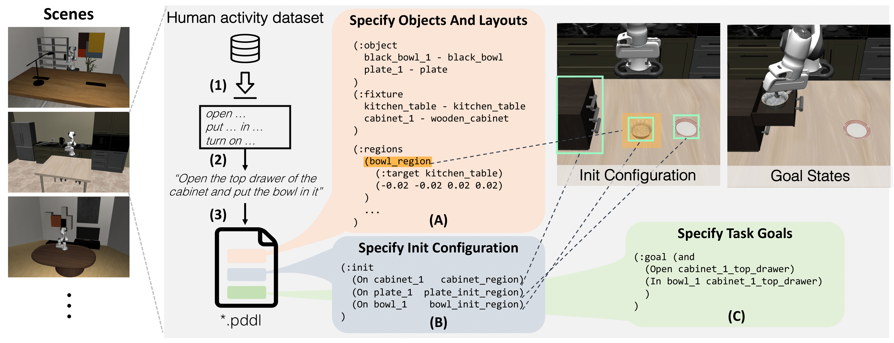

**LIBERO의 환경 구성 절차.** 장면 선택에서 물체·배치와 초기·목표 조건 정의로 이어진다. 원논문의 개념도이며, 앞에서 분석한 현재 코드에서는 BDDL로 작업 조건을 읽는다. 출처: [LIBERO 논문 Figure 2](https://arxiv.org/abs/2306.03310).

#### 환경 생성과 정책 입력을 연결하는 함수

LIBERO의 장면 생성·초기화·상태 복원은 앞에서 분석한 함수가 담당한다. 여기서는 같은 환경을 각 정책의 입력에 맞추는 함수를 비교한다.

**OpenVLA-OFT — 환경 호출과 전처리 예제**

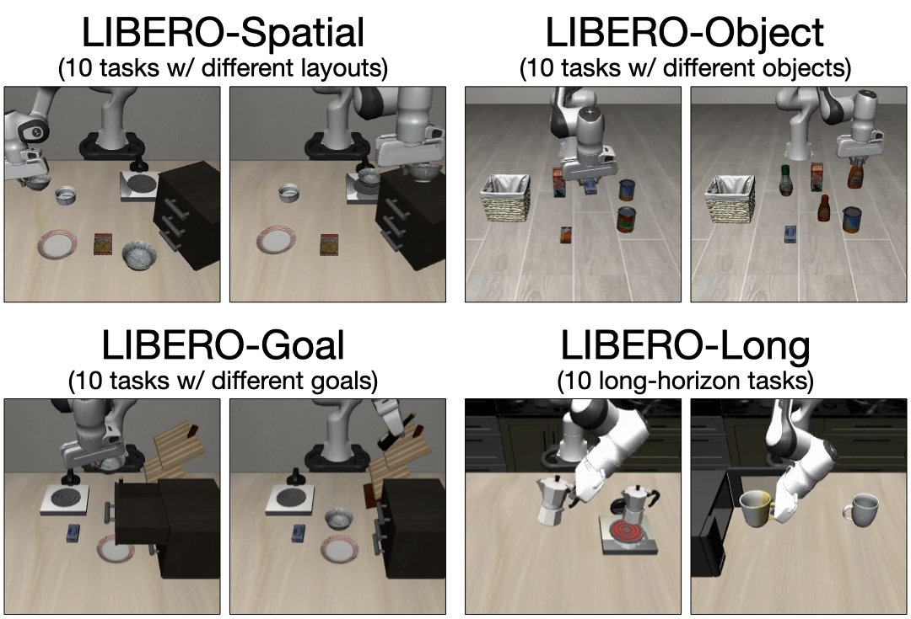

**OpenVLA-OFT 논문의 LIBERO 장면.** 공간 배치·물체·목표·작업 순서가 다른 네 작업군을 보여준다. LIBERO가 정의한 장면을 불러와 정책에 연결하는 예제로 참고한다. 출처: [OpenVLA-OFT 논문 Figure 3](https://arxiv.org/html/2502.19645v1).

`[::-1, ::-1]`은 영상의 행·열을 모두 뒤집어 180° 회전한다. 상태 배열에서는 위치 다음에 축각, 마지막에 그리퍼 값이 들어간다.

```python
# get_libero_image()의 영상 처리
img = obs["agentview_image"]
img = img[::-1, ::-1]

# prepare_observation()의 상태 구성
observation = {
    # 영상 항목 생략
    "state": np.concatenate(
        (obs["robot0_eef_pos"],
         quat2axisangle(obs["robot0_eef_quat"]),
         obs["robot0_gripper_qpos"])
    ),
}
```

| 주요 함수 | 코드에서 하는 일 | 이번 연구에서 참고할 부분 |
| --- | --- | --- |
| `get_libero_env()` | task의 BDDL 경로로 `OffScreenRenderEnv`를 만들고 해상도 기본값 256을 전달한다. `env.seed(0)`을 호출한 뒤 환경과 작업 지시문을 반환한다. | 환경을 불러오는 방식과 설정 전달 경로를 참고한다. 작업대·베이스 배치는 LIBERO 장면 코드가 정의한다. |
| `get_libero_image()` · `get_libero_wrist_image()` | 고정·손목 관측을 읽고 `img[::-1, ::-1]`로 두 영상을 180° 회전한다. | OFT 학습 영상에 맞춘 처리이므로, 사용할 Cosmos의 처리와 구분한다. |
| `prepare_observation()` · `quat2axisangle()` | 영상을 입력 크기로 바꾸고 상태를 **말단 위치 3 + 축각 3 + 그리퍼 관절 2 = 8차원**으로 구성한다. 쿼터니언은 회전벡터로 변환한다. | 상태의 순서·회전 표현을 비교하는 근거다. 이 8차원 구성을 Cosmos 입력에 그대로 사용하지 않는다. |
| `run_episode()` | `reset()` 후 저장된 초기 상태를 적용하고, 기본 10회의 대기 동작 뒤 관측·동작 반복을 시작한다. 대기 횟수는 설정 가능하다. | 시뮬레이션 초기화 흐름을 참고한다. 실물에서는 검증한 시작 자세 복귀와 상태 확인 절차로 구성한다. |

[OpenVLA-OFT 환경·영상 함수](https://github.com/moojink/openvla-oft/blob/e4287e94541f459edc4feabc4e181f537cd569a8/experiments/robot/libero/libero_utils.py) · [관측 구성·에피소드 실행](https://github.com/moojink/openvla-oft/blob/e4287e94541f459edc4feabc4e181f537cd569a8/experiments/robot/libero/run_libero_eval.py)

**Cosmos Policy-LIBERO — 최종 관측 연결의 기준**

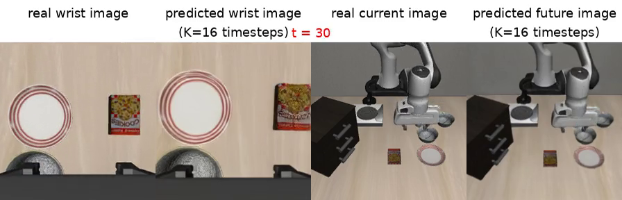

**Cosmos Policy-LIBERO의 관측과 미래 영상 예측.** NVIDIA 공식 LIBERO-Spatial 시연 영상에서 추출한 화면이다. 왼쪽부터 손목 관측·손목 미래 예측·고정 카메라 관측·고정 카메라 미래 예측을 보여준다. 화면의 `real`은 LIBERO 시뮬레이터에서 얻은 관측을 뜻한다. 출처: [공식 LIBERO 시연](https://research.nvidia.com/labs/cosmos-lab/cosmos-policy/).

이 연구는 **`nvidia/Cosmos-Policy-LIBERO-Predict2-2B`**의 고정·손목 두 영상과 **9차원 로봇 상태**를 입력으로 사용한다. 출력은 단계마다 말단 위치·회전 변화량 6값과 그리퍼 명령 1값을 갖는 **16단계 동작 청크**다. 이 7값은 Panda의 7개 관절각을 뜻하지 않으며, Mirobot에서는 아래의 말단 제어·역기구학 연결을 적용한다. [LIBERO 모델 카드](https://huggingface.co/nvidia/Cosmos-Policy-LIBERO-Predict2-2B) · [LIBERO 관측·평가 코드](https://github.com/NVlabs/cosmos-policy/blob/18a2accadf4e7a3531e56754102af5a24d2316da/cosmos_policy/experiments/robot/libero/run_libero_eval.py)

두 함수의 핵심 부분을 나란히 발췌했다. `np.flipud()`는 상하만 반전하며, `proprio`의 배열 순서는 그리퍼·위치·쿼터니언이다. OFT와 달라지는 부분을 코드에서 직접 확인할 수 있다.

```python
# get_libero_image()의 영상 처리
img = obs["agentview_image"]
if flip_images:
    img = np.flipud(img)

# prepare_observation()의 관측 구성
observation = {
    "primary_image": img,
    "wrist_image": wrist_img,
    "proprio": np.concatenate(
        (obs["robot0_gripper_qpos"],
         obs["robot0_eef_pos"],
         obs["robot0_eef_quat"])
    ),
}
```

| 주요 함수 | 코드에서 하는 일 | 이번 연구에서 적용할 부분 |
| --- | --- | --- |
| `get_libero_env()` | BDDL·해상도를 `OffScreenRenderEnv`에 전달하고 `env.seed(0)`을 설정한다. 기본 해상도는 256이다. | LIBERO custom 환경을 생성하는 진입점으로 사용한다. |
| `get_libero_image()` · `get_libero_wrist_image()` | `flip_images=True`이면 `np.flipud()`로 상하 반전한다. 함수의 기본값은 False지만 평가 설정은 기본 True를 전달한다. | 저장·학습·추론 영상의 방향을 통일한다. 실물 카메라는 원본 방향을 확인해 필요한 변환을 정한다. |
| `prepare_observation()` | `primary_image`, `wrist_image`, `proprio`를 만든다. 상태 순서는 **그리퍼 2 → 말단 위치 3 → 쿼터니언 4 = 9차원**이며, 이 함수는 쿼터니언을 축각으로 바꾸지 않는다. | Mirobot 기록기와 입력 변환기를 이 항목·순서에 맞춘다. 좌표계·단위·그리퍼 값의 의미도 함께 맞춘다. |
| `run_episode()` | 초기화와 저장 상태 복원 후 코드에 지정된 10회의 대기 동작을 수행하고 정책 실행을 시작한다. | LIBERO의 초기화 절차로 참고한다. 실물에는 해당 동작을 그대로 보내지 않고 복귀 완료와 새 관측을 확인한 뒤 추론한다. |

[Cosmos 환경·영상 함수](https://github.com/NVlabs/cosmos-policy/blob/18a2accadf4e7a3531e56754102af5a24d2316da/cosmos_policy/experiments/robot/libero/libero_utils.py) · [관측 구성·에피소드 실행](https://github.com/NVlabs/cosmos-policy/blob/18a2accadf4e7a3531e56754102af5a24d2316da/cosmos_policy/experiments/robot/libero/run_libero_eval.py)

핵심 차이는 **영상 방향과 상태 표현**이다. Cosmos의 `proprio`는 로봇 상태 입력을 뜻한다. 같은 LIBERO 환경을 쓰더라도 OFT의 전처리를 복사하면 Cosmos가 기대하는 영상 방향·상태 순서와 달라질 수 있으므로, 최종 입력 변환은 선택한 Cosmos Policy 코드에 맞춘다.

이 비교에서 사용할 코드의 역할이 정리된다. **작업대·로봇·카메라·초기 상태는 LIBERO 코드에서 설정하고, 영상과 로봇 상태를 정책 입력으로 만드는 부분은 Cosmos Policy-LIBERO 코드를 따른다.**

### 최종 사용할 환경과 설정 방법

위 비교에 따라 **LIBERO의 `Libero_Tabletop_Manipulation`을 바탕으로 한 custom 환경**을 사용한다. 테이블 위에 단일 로봇 팔을 고정하고, 작업 영역을 보는 `agentview`와 손목에 달린 `robot0_eye_in_hand` 카메라를 둔다. 이 환경에서 작업대·카메라·시작 자세를 정해 실물 배치의 기준으로 삼는다. [LIBERO tabletop 코드](https://github.com/Lifelong-Robot-Learning/LIBERO/blob/8f1084e3132a39270c3a13ebe37270a43ece2a01/libero/libero/envs/problems/libero_tabletop_manipulation.py)

이 초기 환경을 선택한 구체적인 근거는 다음과 같다.

- **실제 작업대와 대응하는 구조다.** 현재 Mirobot은 책상에 고정한 단일 팔로 격자 작업판을 사용한다. LIBERO의 `__init__()`와 `_load_model()`에는 작업대와 로봇 베이스의 상대 위치가 정의돼 있어, 사용할 영역의 폭·깊이·중심을 실측한 뒤 배치 비율을 계산할 수 있다. 검토한 RoboCasa의 주방 구성과 비교하면 이번 탁상 환경에 필요한 설정을 직접 확인하기 쉽다.
- **두 카메라의 역할을 분명히 정할 수 있다.** `agentview`는 작업 영역과 물체 배치를, `robot0_eye_in_hand`는 그리퍼 주변을 관측한다. 실제로 설치할 고정·손목 D405와 대응하고, Cosmos Policy-LIBERO도 이 두 영상을 입력으로 사용하므로 초기 구도와 모델 관측을 같은 기준으로 정할 수 있다.
- **공통 시작 상태를 재현하는 코드가 있다.** `set_init_state()`는 저장된 상태를 복원하고 그 상태의 관측까지 갱신한다. 이를 참고해 실물에서도 TCP 위치·접근 방향·그리퍼 상태를 공통 조건으로 기록한다. Panda와 관절 구조가 다른 Mirobot의 시작 자세는 6축 역기구학과 반복 복귀 확인으로 정하며, 그 구체적인 측정 방법은 3절에서 다룬다.

[작업대·카메라 설정](https://github.com/Lifelong-Robot-Learning/LIBERO/blob/8f1084e3132a39270c3a13ebe37270a43ece2a01/libero/libero/envs/problems/libero_tabletop_manipulation.py) · [초기 상태 복원](https://github.com/Lifelong-Robot-Learning/LIBERO/blob/8f1084e3132a39270c3a13ebe37270a43ece2a01/libero/libero/envs/env_wrapper.py) · [Cosmos Policy-LIBERO 관측 구성](https://github.com/NVlabs/cosmos-policy/blob/18a2accadf4e7a3531e56754102af5a24d2316da/cosmos_policy/experiments/robot/libero/run_libero_eval.py)

문서에서 **Cosmos Policy-LIBERO**는 이 LIBERO 환경을 Cosmos Policy 공식 코드로 실행·연결하는 구성을 뜻한다. LIBERO가 장면과 작업을 정의하고, robosuite·MuJoCo가 제어와 물리 시뮬레이션을 처리하며, Cosmos Policy가 관측으로부터 동작을 예측한다.

LIBERO 환경을 불러오는 기본 형태는 아래와 같다. `custom_scene.bddl`은 앞으로 작성할 장면 파일이며, 코드는 환경 설정 방식을 설명하는 예시다.

```python
from libero.libero.envs import OffScreenRenderEnv

env = OffScreenRenderEnv(
    bddl_file_name="custom/custom_scene.bddl",
    camera_names=["agentview", "robot0_eye_in_hand"],
    camera_heights=256,
    camera_widths=256,
)
```

작업대와 고정 카메라는 tabletop 장면 코드에서, 손목 카메라는 로봇 모델의 장착 위치·방향에서 설정한다. 반복해서 사용할 로봇 시작 상태는 초기화 설정에서 정한다. BDDL은 시뮬레이션 장면의 물체·배치·목표를 기술할 때 사용한다. **실물 시연으로 학습할 task를 모두 BDDL로 먼저 구현할 필요는 없다.** 실물 task의 정의와 성공 판정은 아래 실험 명세로 관리한다.

### Cosmos Policy 체크포인트 비교와 최종 선택

**체크포인트는 학습된 모델 가중치를 저장한 파일이다.** 추가 학습의 출발점으로 사용할 체크포인트를 카메라와 동작 형식에 따라 비교한다.

| 체크포인트 | 장점 | 이번 Mirobot 구성에서의 제약 |
| --- | --- | --- |
| **[LIBERO-Predict2-2B](https://huggingface.co/nvidia/Cosmos-Policy-LIBERO-Predict2-2B)** | 고정·손목 두 카메라와 단일 팔의 말단 동작을 사용해 이번 관측·제어 설계와 대응하기 쉽다. | Panda 시뮬레이션 기반이므로 Mirobot 시연 학습과 상태·동작 변환이 필요하다. |
| [RoboCasa-Predict2-2B](https://huggingface.co/nvidia/Cosmos-Policy-RoboCasa-Predict2-2B) | 단일 팔 말단 제어를 사용하며 다양한 주방 조작을 학습했다. | 외부 카메라 두 대와 손목 카메라를 사용해 이번 두 카메라 구성과 차이가 있다. |
| [ALOHA-Predict2-2B](https://huggingface.co/nvidia/Cosmos-Policy-ALOHA-Predict2-2B) | 실물 로봇 시연으로 학습했으며 배포 코드가 공개돼 있다. | 양팔 관절·그리퍼 동작과 세 카메라를 사용해 단일 팔 Mirobot과의 변환 범위가 크다. |
| [ALOHA Planning 모델](https://huggingface.co/nvidia/Cosmos-Policy-ALOHA-Planning-Model-Predict2-2B) | 후보 동작의 미래 상태와 가치를 예측할 수 있다. | ALOHA 정책과 함께 쓰는 보조 모델이므로 이번 동작 정책의 출발점으로 사용하지 않는다. |

따라서 두 카메라·단일 팔 말단 제어에 맞는 **LIBERO-Predict2-2B**를 출발 모델로 정한다. 이 선택은 입력·출력 연결을 위한 결정이며, Mirobot에서의 성능은 실물 시연으로 추가 학습한 뒤 평가한다.

모델 선택에서 확인한 핵심 근거는 다음 세 가지다.

- **고정·손목 두 영상이 실제 설치 계획과 맞는다.** RoboCasa 모델의 외부 두 대·손목 한 대, ALOHA 모델의 양팔·세 카메라 구성과 비교하면 LIBERO 모델이 이번 단일 팔·두 시점 구성에 더 가깝다.
- **출력을 말단 자세로 연결할 수 있다.** 단계마다 위치·회전 변화량 6값과 그리퍼 명령 1값을 예측하므로, 목표 TCP 자세를 Mirobot의 6축 역기구학에 연결하는 기준을 세울 수 있다. Panda의 7관절과 Mirobot의 6축 차이는 실제 도달 범위와 목표 자세를 확인하는 과정에서 반영한다.
- **선택한 환경과 모델 사이의 연결이 공개돼 있다.** 공식 LIBERO 평가 코드에서 환경 생성, 두 영상의 전처리, 그리퍼·위치·쿼터니언의 9차원 상태 순서를 확인할 수 있다. 초기 환경의 관측이 모델 입력으로 전달되는 과정을 같은 코드에서 검토할 수 있다는 점이 선정 근거다.

**실물 추론에는 이 출발 모델을 Mirobot 시연으로 추가 학습한 체크포인트를 사용한다.** 원본 모델은 Panda 시뮬레이션에서 학습돼 Mirobot의 촬영 영상·그리퍼 상태·동작 분포와 차이가 있다. 따라서 실제 데이터에 맞춘 가중치와 정규화 통계를 실물 추론의 기준으로 정한다. 실물 추론용 체크포인트는 추가 학습 후 생성할 모델이다.

[LIBERO 모델 카드](https://huggingface.co/nvidia/Cosmos-Policy-LIBERO-Predict2-2B) · [공식 LIBERO 환경·영상 함수](https://github.com/NVlabs/cosmos-policy/blob/18a2accadf4e7a3531e56754102af5a24d2316da/cosmos_policy/experiments/robot/libero/libero_utils.py) · [관측·동작 연결 코드](https://github.com/NVlabs/cosmos-policy/blob/18a2accadf4e7a3531e56754102af5a24d2316da/cosmos_policy/experiments/robot/libero/run_libero_eval.py)

## 3. Panda 기준 환경을 Mirobot에 맞추는 방법

먼저 작업대에 Mirobot을 고정하고 고정 카메라와 손목 카메라를 설치한다. 시뮬레이션의 상대 배치와 관측 방향을 참고하되, 거리·높이·시작 자세는 Mirobot의 도달 범위와 카메라 시야에 맞춰 정한다. 이후 **TCP는 그리퍼로 물체를 집는 기준점**, `q_start`는 실험 시작 시 사용할 6개 관절각을 뜻한다. 베이스 좌표계는 로봇 받침을 기준으로, 작업면 좌표계는 작업종이를 기준으로 위치를 나타내는 방법이다.

| 구분 | 실물 설정 | 유지·변경 기준 |
| --- | --- | --- |
| 작업대·로봇 베이스 | 로봇을 고정하고 작업 영역과 기준 좌표계 설정 | task를 바꿔도 유지 |
| 카메라·조명 | 고정 카메라는 전체 작업 영역, 손목 카메라는 집는 부분을 관측 | 위치·방향·영상 전처리와 조명 조건 유지 |
| 공통 시작 조건 | 작업 영역을 가리지 않는 대기 자세와 그리퍼 초기 상태 지정 | 매회 실행 전에 같은 조건으로 복귀 |
| task별 물체 배치 | 대상 물체와 시작·목표 위치, 필요한 주변 물체 배치 | 정해진 작업 영역 안에서 task에 맞춰 변경 |

### 실제 Mirobot 사진을 기준으로 한 구성

아래는 제공받은 실제 Mirobot 환경 사진이다. 로봇 베이스가 사진 오른쪽에 있고, 팔은 왼쪽 격자 작업판 방향으로 뻗어 있으며 그리퍼는 아래를 향한다. 왼쪽에는 원형 판, 앞쪽에는 조작기와 케이블이 놓여 있다. 이 배치를 출발점으로 작업 영역과 공통 시작 자세를 정한다.

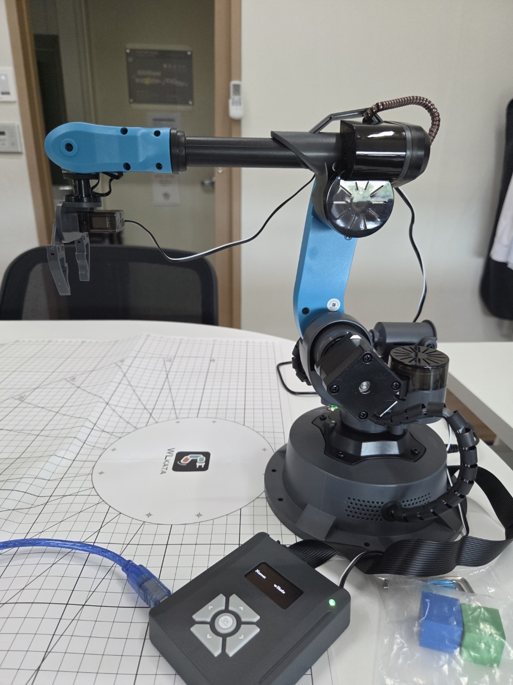

| 사진에서 확인한 구성 | 이번 실험에서의 설정 |
| --- | --- |
| 오른쪽 로봇 베이스와 왼쪽 격자 작업판 | 베이스의 고정 상태를 확인하고, 그리퍼가 닿는 작업판 영역을 실측해 표시 |
| 아래를 향한 그리퍼와 왼쪽으로 뻗은 팔 | 접근 방향의 참고로 사용하고, 관절 여유와 복귀 경로를 확인해 `q_start`를 별도로 확정 |
| 원형 판과 격자 | 배치 비교용 기준점으로 활용하되 격자 간격과 판의 치수를 실측하고 로봇 좌표계와 연결 |
| 앞쪽 조작기·케이블 | 조작기가 손에 닿도록 두면서, 로봇 이동과 물체 배치를 방해하지 않도록 작업 영역 밖으로 정리 |

사진만으로는 고정 카메라의 설치 상태나 그리퍼 부근 검은 모듈의 기능을 확인할 수 없다. 두 시점의 영상이 실제로 수집되는지 먼저 확인하고, 필요한 카메라를 설치한다. 사진 속 자세도 시작 자세의 후보이며, 반복 복귀가 가능한지 확인한 뒤 사용한다.

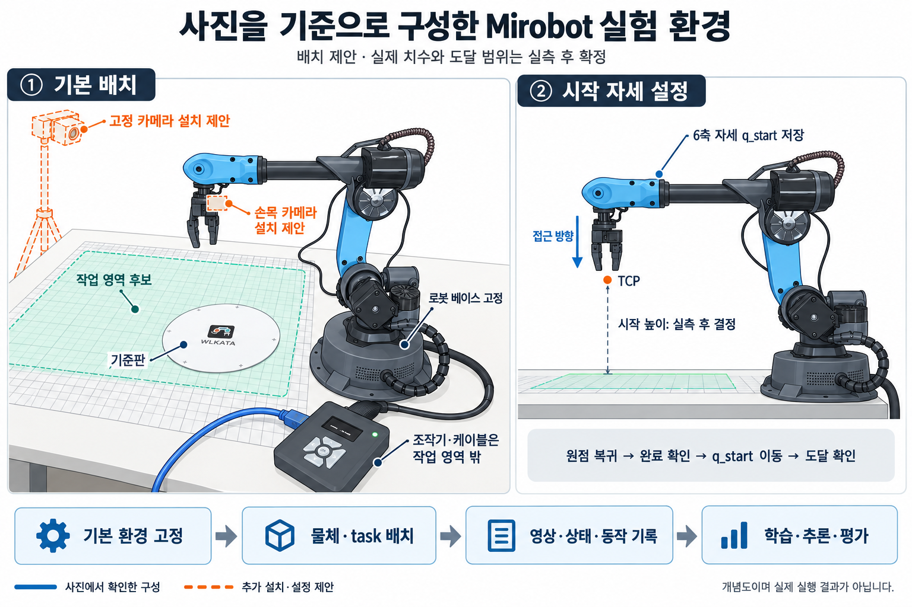

**그림은 실제 사진을 참고해 작성한 배치 제안 개념도다.** 왼쪽은 베이스를 유지하면서 작업 영역·카메라·케이블을 정리하는 방법이고, 오른쪽은 그리퍼의 접근 방향과 시작 높이를 정해 6축 시작 자세로 저장하는 과정이다. 주황 점선은 추가 설치 제안이며, 작업 영역·높이·카메라 위치는 실측 후 확정한다. 아래 순서처럼 기본 배치를 고정한 뒤 물체와 task를 정하고, 시연·학습·평가로 이어간다.

### 제공된 실측값과 배치 기준

다음은 사용자가 제공한 실측 기록이다. 높이는 작업종이 표면을 기준으로 하며, 좌우 각도는 Homing 상태를 0°로 두고 `inverse.py`에서 확인한 동작 범위다. 길이 단위는 mm로 통일했다.

| 항목 | 제공값 | 배치에 반영할 때의 기준 |
| --- | --- | --- |
| 작업종이 가로·세로 | **643 × 423 mm** | 작업판 위 위치를 표시할 기준 면적. 실제 로봇이 사용할 영역은 이 안에서 별도로 정한다. |
| 책상 상판 두께 | **25 mm** | 베이스 고정구와 작업대 하부 간섭을 확인할 때 사용한다. 작업종이 기준 높이에 다시 더하지 않는다. |
| Homing 높이 | **300 mm** | 작업종이 표면 기준으로 기록한 Homing 상태의 높이. 측정한 로봇 지점과 TCP의 일치 여부는 TCP 보정에서 확인한다. |
| 최대 높이 | **344 mm** | 작업종이 표면 기준, `inverse.py`에서 확인한 최대 높이. 측정 자세·장착 도구에 해당하는 값으로 사용한다. |
| 왼쪽·오른쪽 최대 각도 | **Homing 0° 기준 각 45°** | `inverse.py`에서 확인한 좌우 동작 범위로 기록한다. 특정 관절의 제조사 한계각이나 모든 자세의 도달 범위로 일반화하지 않는다. |

작업종이의 한 모서리를 원점으로 표시하고 긴 변 방향을 x축, 짧은 변 방향을 y축으로 정하면, 종이의 범위는 `0 ≤ x ≤ 643`, `0 ≤ y ≤ 423 mm`이고 중심은 **`(321.5, 211.5) mm`**다. 이 중심은 종이의 기하학적 중심이며, 로봇 베이스 원점이나 사용할 작업 영역의 중심과는 별도로 기록한다.

현재 사진의 오른쪽 베이스·왼쪽 작업판 배치를 유지하면서, 종이 위에 베이스 장착 기준점과 정면 방향을 먼저 표시한다. 그다음 사용할 접근 방향에서 도달 가능한 영역을 확인해 `x_min, x_max, y_min, y_max`를 정한다. 여기서 네 경계는 도달점 전체를 둘러싼 최솟값·최댓값이 아니라, 사용할 TCP 방향·높이에서 선택한 직사각형 작업 영역의 경계다. 내부에 도달 불가 구역이 있으면 영역을 줄이거나 제외 구역으로 기록하고, 배치점과 이동 경로를 확인한다. 검증 전에는 후보 영역으로 두며, 작업종이·도달 범위·간섭 조건을 충족한 영역의 치수를 아래 비례식에 사용한다.

```text
W_M = x_max − x_min
D_M = y_max − y_min
c_M = ((x_min + x_max)/2, (y_min + y_max)/2)
```

따라서 **종이 전체 크기 643 × 423 mm를 곧바로 Mirobot의 작업 영역으로 대입하지 않는다.** 실제 배율과 설치 좌표를 확정하려면 이 영역의 경계, 종이–베이스 좌표 변환, 선택한 LIBERO custom 환경의 기준 영역 치수가 추가로 필요하다. 위 높이·좌우 각도 조건에서 실제로 도달하는 점을 작업종이에 표시해 경계를 구하고, 사용할 TCP 방향과 물체 높이에서 다시 확인한다. 이때 `inverse.py`의 명령 축·회전 중심·당시 자세도 함께 기록한다.

### 실제로 측정할 길이와 각도

아래 그림의 A~G는 실물 환경을 재현하기 위해 기록할 항목이다. 베이스 기준 원점과 축을 먼저 표시하고, 길이는 mm, 각도는 도 또는 라디안 중 정한 단위로 기록한다. 시뮬레이션·학습 코드에서 다른 단위를 사용하면 입출력 변환 위치를 명시한다. 사진의 격자나 팔 모양으로 수치를 추정하지 않고 실측·보정한 값을 채운다.

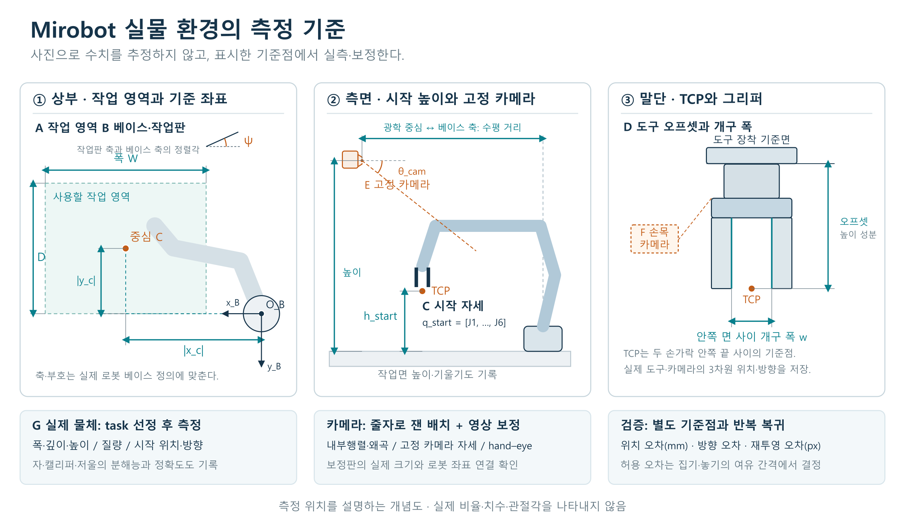

측정 위치를 설명한 개념도이며 실제 로봇의 비율이나 치수를 나타내지는 않는다. 그림의 `|x_c|, |y_c|`는 거리의 크기이고, 좌표를 저장할 때는 실제 베이스 축에 따른 부호까지 기록한다.

| 표시 | 재거나 기록할 길이·각도 | 측정 기준과 방법 |
| --- | --- | --- |
| **A 작업 영역** | 사용할 영역의 폭 `W`, 깊이 `D` | 도달 가능한 경계를 확인하고 작업판에 표시한 뒤 측정. 영역의 모든 점이 가능한지는 자세·경로로 별도 확인 |
| **B 베이스·작업판** | 베이스 기준 작업 영역 중심 위치 `x_c, y_c`, 작업면 높이, 축 정렬각 `ψ`와 작업면 기울기 | 원점·축과 기준점을 표시하고 자·각도계 또는 보정된 좌표 측정 사용. 작업면은 세 개 이상의 비공선 기준점으로 확인 |
| **C 시작 자세** | 6개 관절각 `q_start`, 시작 TCP 위치·방향, 작업면 위 높이 `h_start` | 관절각은 로봇 보고값, TCP는 보정된 기구 모델의 계산값으로 기록하고 외부 기준점·영상으로 대조 |
| **D 그리퍼·도구** | 장착면에서 TCP까지의 3차원 오프셋과 방향, 그리퍼 개구 폭 `w` | 실제 장착 상태에서 치수와 TCP 위치를 보정하고, 도구 축 방향은 별도로 확인 |
| **E 고정 카메라** | 베이스 기준 카메라의 위치 `x, y, z`와 방향, 내부 파라미터·왜곡·해상도 | 보정판으로 내부 보정 후, 베이스 기준 위치를 아는 기준점으로 카메라 자세 추정 |
| **F 손목 카메라** | TCP 기준 카메라의 3차원 위치·방향, 내부 파라미터·왜곡·해상도 | 여러 로봇 자세에서 보정판을 촬영하는 hand–eye 보정과 TCP 장착 변환을 함께 사용 |
| **G 실제 물체** | 선정한 물체의 폭·깊이·높이 또는 지름, 질량, 시작 위치·방향, 받침 높이 | 자·캘리퍼·저울로 실측하고, task별 배치표에 베이스 기준 좌표와 방향 기록 |

작업면이 베이스의 수평면과 평행하다면 `h_start = z_TCP − z_table`로 계산한다. 작업면이 기울어져 있으면 작업면에 수직인 거리를 사용한다. 카메라와 그리퍼의 방향은 yaw·pitch·roll의 축과 적용 순서를 명시하거나 회전행렬·쿼터니언으로 저장한다. 특히 **배치 거리의 축소 비율을 관절각·카메라 각도에 곱하지 않는다.** 카메라 보정은 [OpenCV 내부 보정](https://docs.opencv.org/4.x/dc/dbb/tutorial_py_calibration.html)과 [hand–eye 보정 함수](https://docs.opencv.org/4.x/d9/d0c/group__calib3d.html)를 참고한다.

### 시뮬레이션 PNG를 활용한 실물 배치

아래 네 장은 **기존 LIBERO 장면을 직접 렌더링한 참고 이미지**다. 앞으로 구성할 custom 환경이나 실물 Mirobot의 검증 결과는 아니다. 같은 장면의 여러 시점에서 작업대·로봇·그리퍼·카메라의 관계를 읽고, 이를 Mirobot 기본 환경 설계에 활용한다. 화면 속 물체는 기존 장면의 구성물이며 실물에는 결정한 task에 필요한 물체를 배치한다.

| 상부 시점 | 정면 시점 |
| --- | --- |
| 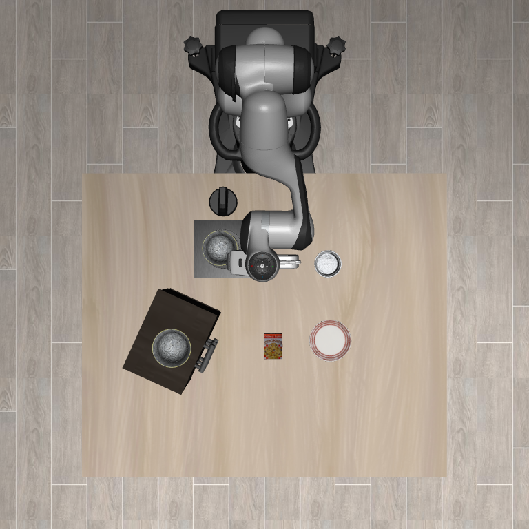 | 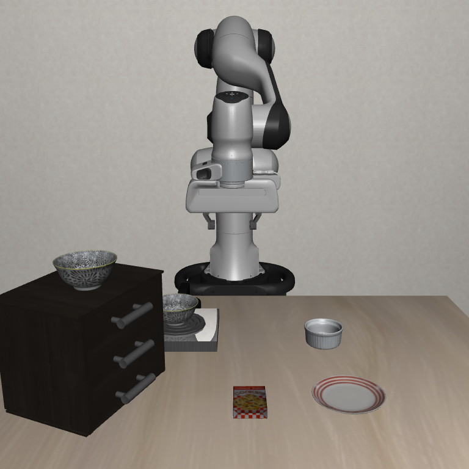 |

| 측면 시점 | 작업 관측 카메라 |
| --- | --- |
|  | 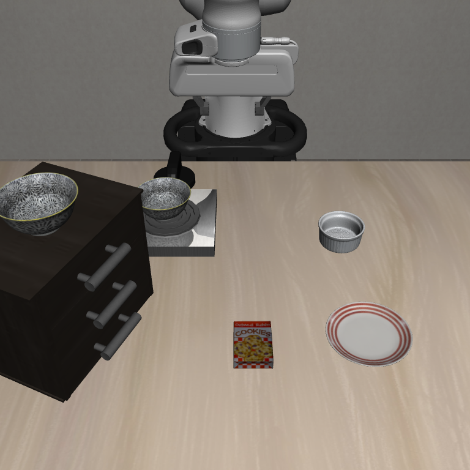 |

| 사진에서 확인할 요소 | Mirobot 실물 환경에 반영하는 방법 |
| --- | --- |
| 상부: 로봇 베이스 뒤쪽, 작업 영역 앞쪽의 관계 | 베이스와 작업 영역 중심을 정하고, 도달 가능한 범위 안에서 앞뒤·좌우 거리를 조정 |
| 정면: 작업면과 초기 그리퍼 사이의 높이 | 실제 작업면을 기준으로 시작 TCP 높이를 정하고, 그리퍼·물체가 지나갈 여유 확보 |
| 측면: 그리퍼 접근 방향과 팔·작업대의 간격 | 같은 접근 방향을 구현할 수 있는 6축 자세를 찾고, 이동 경로의 간섭 확인 |
| 작업 카메라: 작업 영역이 화면에 들어오는 구도 | 영역 모서리에 기준점을 두고 고정 카메라 거리·높이·기울기를 조정한 뒤 보정 |

사진의 픽셀 간격을 실제 길이로 바로 환산하지 않는다. 시뮬레이터의 좌표·카메라 설정과 실물 실측값을 사용해 치수를 정하고, 사진은 최종 배치와 관측 구도를 대조하는 자료로 사용한다.

### 비례식으로 실물 배치를 정하는 방법

Panda와 Mirobot은 링크 길이·관절 수·그리퍼가 다르므로, 한 링크의 길이 비율만으로 전체 배치를 결정하기 어렵다. 여기서는 **두 로봇에서 선택한 사용 가능 작업 영역의 비율**로 평면 배치 초안을 만든다. 관절각과 높이는 Mirobot의 기구 구조와 실제 장착물에 맞춰 별도로 정한다.

먼저 LIBERO custom 환경에서 베이스·작업면·초기 TCP·카메라의 좌표와 방향을 읽는다. 세계 좌표와 로봇 베이스 좌표를 구분하고, TCP는 물체를 잡는 기준점으로 통일한다. [말단 관측 구현](https://github.com/ARISE-Initiative/robosuite/blob/v1.4.0/robosuite/robots/single_arm.py) 실물에서는 그리퍼와 손목 카메라를 장착한 상태로 도달 범위를 확인해 작업 영역을 고른다. 제조사 최대 도달거리만으로 영역을 정하지 않고, 사용할 접근 방향에서 관절 한계와 작업대·카메라 간섭을 확인한다.

LIBERO 쪽 기준 영역도 같은 방식으로 정한다. 사용할 그리퍼 접근 방향과 작업 높이에서 Panda가 이동할 수 있고 카메라로 볼 수 있는 영역을 확인한 뒤, 그 안에서 직사각형을 고른다. 작업면 기준 경계 `x_Pmin, x_Pmax, y_Pmin, y_Pmax`를 저장하면 `W_P = x_Pmax − x_Pmin`, `D_P = y_Pmax − y_Pmin`이고 중심 `c_P`는 경계의 중간점이다. 이 영역은 `table_full_size`가 나타내는 작업대 전체와 구분한다. 실물에서도 같은 조건으로 영역을 선택하므로, 두 로봇의 링크 길이를 억지로 대응시키지 않고 배치 비율을 정할 수 있다.

**① 작업 영역의 폭과 깊이로 배율을 구한다.** 두 작업면의 x축·y축이 같은 방향을 뜻하도록 대응시킨다. LIBERO의 기준 영역을 `W_P × D_P`, 실물의 사용 영역을 `W_M × D_M`이라 하면 다음과 같이 정한다. 네 길이는 같은 단위로 입력한다.

```text
s = min(W_M / W_P, D_M / D_P)
s × W_P ≤ W_M,  s × D_P ≤ D_M
```

하나의 배율을 사용해 앞뒤·좌우 비율을 유지하며, 두 영역의 가로세로 비가 다르면 한쪽에 여유 공간이 남는다. 이 식은 작업 영역의 축을 대응시킨 상태에 적용한다. 배치를 실물 작업면 안에서 추가로 회전시키면 경계를 다시 확인해야 한다.

**② 중심을 기준으로 배치점을 옮긴다.** 각 작업면에 원점과 축을 표시하고, 영역 중심을 각각 `c_P = (c_Px, c_Py)`, `c_M = (c_Mx, c_My)`로 둔다. LIBERO 작업면의 기준점 `(x_P, y_P)`에 대응하는 실물 작업면의 후보 위치는 다음과 같다.

```text
x_M = c_Mx + s × (x_P − c_Px)
y_M = c_My + s × (y_P − c_Py)
```

배율만으로 로봇과 작업 영역 사이의 절대 거리가 정해지지는 않는다. **실물 영역 중심 `c_M`은 Mirobot의 도달 범위를 확인해 먼저 정하고**, 그 중심을 기준으로 초기 TCP의 평면 위치와 필요한 배치 기준점을 계산한다. 이때 물체·그리퍼의 실제 크기가 들어갈 공간과 이동 경로까지 확인한다.

예를 들어 LIBERO 기준 영역이 `400 × 300 mm`, 실물 영역이 `160 × 120 mm`라면 `s = 0.4`다. 두 영역의 원점을 각각 한 모서리에 두어 중심이 `(200, 150)`과 `(80, 60) mm`일 때, LIBERO의 `(250, 125) mm`는 실물 작업면의 **`(100, 50) mm`**에 대응한다. **계산 방법을 보여주는 가정값이며, 현재 Mirobot의 실측 치수나 확정 설치 위치가 아니다.**

**③ 작업면 좌표를 로봇 베이스 좌표로 바꾼다.** 계산한 평면 위치에 실측한 높이를 더해 `p_W = (x_M, y_M, z_M)`를 만든다. 작업면을 `z_M = 0`으로 정하고, 초기 TCP 높이 등은 실제 도구·물체와 이동 여유에서 결정한다. 뒤의 실측 절차로 구한 작업면→베이스 변환을 적용한다.

```text
p_B = R_BW × p_W + t_BW
```

`R_BW`는 작업면 좌표를 베이스 축 방향으로 바꾸는 회전행렬이고, `t_BW`는 작업면 원점의 베이스 기준 위치다. 작업판의 설치 각도와 기울기는 이 변환에 반영한다. 계산한 `p_B`는 배치·시작 자세의 후보이며, 실제 이동 전에는 다음 절차에 따라 역기구학과 경로를 확인한다.

### 계산한 위치를 실제 작업대에 표시하는 방법

제공된 사진의 **오른쪽 베이스와 왼쪽 작업판 배치**를 출발점으로 아래 순서대로 설치 위치를 정한다. 사진의 좌우는 배치를 설명하는 방향이며, 제어 좌표의 축과 부호는 로봇 모델에서 확인한 정의를 사용한다.

| 설치 대상 | 위치를 정하고 표시하는 방법 | 최종 기록 |
| --- | --- | --- |
| **Mirobot 베이스** | 사진 오른쪽 배치에서 고정 상태를 확인하고, 장착 기준점을 작업판에 표시한다. 작업 영역까지 접근이 부족하면 베이스 위치부터 조정하고 좌표 변환을 다시 구한다. | 베이스 장착 기준점·방향, 작업면→베이스 변환 |
| **기본 작업 영역** | 베이스 왼쪽에서 사용 가능한 중심과 폭·깊이를 정한다. 중심에서 좌우 `W_M/2`, 앞뒤 `D_M/2`만큼 표시해 경계를 그리고, 모서리·중앙·이동 경로의 도달 가능성을 확인한다. | 작업 영역 중심의 베이스 좌표, 폭·깊이, 제외 구역 |
| **초기 TCP** | 위 비례식으로 평면 후보 위치를 구하고, 도구와 작업면의 간격을 확인해 높이를 정한다. 그 위치·방향을 구현하는 6축 자세를 찾는다. | 시작 TCP 위치·방향, `q_start`, 복귀 경로 |
| **고정·손목 카메라** | 고정 카메라는 작업 영역 모서리가 화면에 들어오도록 거리·높이·방향을 조정한다. 손목 카메라는 그리퍼와 집는 부분이 보이도록 장착하고, 동작 중 가림까지 확인한다. | 내부 보정값, 베이스 또는 TCP 기준 카메라 위치·방향 |
| **task별 실제 물체** | task를 정한 뒤 확보한 물체를 기본 작업 영역 안에 놓고 시작·목표 위치를 표시한다. 실제 크기와 파지·이동·놓기 경로를 확인한다. | 대상 물체, 시작·목표 좌표, 방향과 허용 배치 범위 |

카메라는 렌즈 시야각과 로봇 형상이 다르므로 거리 배율만으로 구도를 정하지 않는다. 또한 `s`를 실제 물체 크기·관절각·카메라 각도나 정책 출력에 일괄 적용하지 않는다. 배율은 환경 배치의 초안에만 사용하고, 실물 제어에는 Mirobot 실측 좌표와 해당 데이터의 정규화 통계를 사용한다. 최종 설치값은 실측·도달 검증 후 채우며, 지금은 확정하지 않는다.

### Panda의 시작 상태를 Mirobot 시작 자세로 변환

시작 자세는 **작업 영역에 대한 그리퍼의 위치, 접근 방향, 손목 카메라 시야**가 대응하도록 정한다. 팔꿈치 모양이나 Panda의 7개 관절각에 축소 비율을 적용하지 않는다.

| 순서 | 설정 방법 | 확인할 결과 |
| --- | --- | --- |
| ① 기준 맞추기 | Mirobot의 원점 복귀를 수행하고, 베이스 좌표축과 장착한 그리퍼의 TCP 위치·방향 확인 | 위치 단위, 각도 단위·회전 순서, 도구 장착 오프셋 |
| ② 목표 말단 자세 정하기 | 위 배치 비율로 초기 TCP 위치의 후보를 잡고, 그리퍼 접근축과 손가락이 닫히는 방향을 작업대 기준으로 맞춤 | Mirobot의 시작 목표 위치·방향 |
| ③ 6축 관절 자세 구하기 | 목표 TCP 위치·방향을 만드는 관절각을 역기구학으로 계산하거나, TCP를 좌표축 방향으로 조금씩 움직이는 Cartesian 조그로 자세를 찾아 관절값을 기록 | 시작 관절값 `q_start = [J1, …, J6]` |
| ④ 자세와 복귀 경로 확인 | 관절 한계·특이 자세·테이블 충돌·카메라 가림을 확인하고, 시작점으로 돌아오는 경유점과 경로 검사 | 실행 가능한 시작 자세와 복귀 경로 |
| ⑤ 반복 복귀 검증 | 같은 경로로 여러 번 복귀해 TCP 위치·방향, 그리퍼 상태와 두 카메라 화면 비교 | 시작 상태 오차와 반복성 기록 |

두 로봇의 도구 좌표축이 다르면 장착 오프셋을 반영해 그리퍼 방향을 맞춘다. 역기구학 해가 없거나 관절 한계에 가까우면 시작 위치·높이·접근 방향을 조정하고 다시 확인한다. 여러 해가 있으면 관절 한계에서 여유가 있고 복귀 경로가 짧은 자세를 선택한다. 기구 모델과 제어 연결은 [WLKATA의 Mirobot URDF·MoveIt 코드](https://github.com/wlkata/Wlkata_Mirobot_Ros2)를 참고하되, 실제 장착 장치와 기구 치수가 일치하는지 확인한다.

**원점 복귀는 기계의 기준을 잡는 과정이고, `q_start` 복귀는 실험을 시작하는 과정**이다. 필요한 원점 복귀 후 최신 상태 응답으로 완료를 확인하고, 매 에피소드에서는 검증한 경로로 `q_start`에 복귀해 도달 여부와 그리퍼 초기 상태를 확인한다. SDK 함수가 반환됐다는 사실만으로 이동 완료를 판단하지 않는다. [WLKATA 제어 SDK](https://github.com/wlkata/WLKATA-Python-SDK-wlkatapython)

최종 설정에는 `q_start`, 시작 TCP 위치·방향, 그리퍼 초기 상태, 좌표 변환·카메라 보정값, 복귀 경로를 함께 저장한다. 허용 오차는 그리퍼와 물체의 여유 간격을 기준으로 정하며, 로봇 보고 상태와 외부 기준점·영상의 반복 측정을 비교해 확인한다. 실제 치수와 관절각은 실측 후 확정한다. 매회 초기 상태는 이 공통 설정과 해당 회차의 물체 배치를 합쳐 기록한다.

### 실측 절차와 정확도 확인

계산한 위치를 로봇에 입력하기 전에 도구·작업면·카메라의 좌표를 보정하고 검증한다. 실측은 **도구·좌표 기준 확인 → 작업대 치수 측정 → 카메라 보정 → 별도 기준점 검증** 순서로 진행한다. 자와 각도계는 배치 초안을 잡는 데 사용하고, 로봇에 입력할 좌표는 기준점과 보정 결과로 확인한다. 필요한 도구는 자·캘리퍼·직각자 또는 각도계, 평평하게 고정한 카메라 보정판이다. 사용하는 도구의 눈금 간격과 사양상 정확도를 함께 기록한다.

카메라 **내부 보정**은 렌즈의 확대 비율·영상 중심·왜곡을 구하는 과정이고, **외부 보정**은 작업대나 로봇을 기준으로 카메라의 위치·방향을 구하는 과정이다. 손목 카메라의 **hand–eye 보정**은 로봇 손목과 카메라 사이의 고정된 위치·방향 관계를 구한다. 아래의 플랜지는 그리퍼를 로봇에 장착하는 면을 뜻한다.

1. **TCP와 좌표 기준을 먼저 맞춘다.** 원점 복귀 후 SDK·기구 모델의 베이스 원점과 축을 확인한다. 사진에서 보이는 받침대 중심을 원점으로 임의 지정하지 않는다. TCP는 실제로 물체를 잡는 기준점으로 정하고 장착면과의 거리·방향을 측정한다. 위치를 더 정밀하게 보정하려면 TCP와의 관계를 아는 기준 팁을 사용해 고정 기준점에 여러 방향으로 접근하고, 자세를 바꿔도 같은 점을 가리키도록 도구 오프셋을 구한다. 이 과정만으로 도구 축 방향까지 정해지지는 않으므로 접근축과 손가락이 닫히는 축은 별도로 확인한다. 컨트롤러에 TCP를 등록할 수 없다면 제어 프로그램에서 변환한다. [TCP 위치 보정 원리](https://www.universal-robots.com/manuals/EN/HTML/SW10_12/Content/prod-usr-man/software/PolyScopeX/polyx-application/polyx-TCP_Position.htm) · [방향 보정 원리](https://www.universal-robots.com/manuals/EN/HTML/SW10_10/Content/prod-usr-man/software/PolyScopeX/polyx-application/polyx-TCP_Orientation.htm)

2. **작업판의 위치와 기울기를 구한다.** 판 위에 원점과 서로 직각인 두 축을 표시하고, 여러 격자 간격을 함께 재어 실제 눈금 크기를 확인한다. 폭·깊이는 자를 측정 방향과 평행하게 놓고, 작은 치수와 그리퍼 안쪽 폭은 캘리퍼로 잰다. 작업판의 위치를 로봇 좌표에 연결할 때는 보정한 기준 팁으로 서로 일직선상에 있지 않은 여러 표시점을 확인하고 로봇 보고 자세를 기록한다. 작업판에서 잰 좌표와 로봇 기준 좌표의 대응으로 회전·이동 변환을 구한다. 세 점은 평면을 정하는 최소 조건이므로 모서리와 중앙 등 더 많은 점으로 평면을 맞추고, 기울기와 표면의 들뜸을 확인한다. 로봇 보고값을 이용한 결과에는 기구 모델 오차도 포함된다.

3. **길이와 각도를 각각 검증한다.** 작업 중심 `x_c, y_c`는 위 좌표 변환으로 구하고, 시작 높이는 TCP에서 작업면까지의 수직 거리로 확인한다. 평면상의 정렬각은 좌표를 확인한 두 기준점이 만드는 방향으로 구한다. 예를 들어 작업판 x축 위 두 점의 베이스 좌표가 주어지면 `ψ = atan2(y₂−y₁, x₂−x₁)`로 평면 방향을 계산할 수 있다. 작업판이 기울어져 있으면 전체 3차원 회전을 사용한다. 그리퍼 자세는 6개 관절 보고값과 보정된 기구 모델에서 계산하고 외부 기준과 대조한다. 사진 속 팔의 겉보기 각도로 관절각을 정하지 않는다.

4. **카메라별로 렌즈와 설치 자세를 보정한다.** 보정판의 실제 칸 크기를 재고, 사용할 해상도·초점을 고정한다. 두 카메라 각각에서 화면 중앙·가장자리, 서로 다른 거리와 기울기의 선명한 영상을 확보해 내부 파라미터와 왜곡을 추정한다. 고정 카메라는 베이스 기준 위치·방향을 확인한 보정판으로 설치 자세를 구한다. `solvePnP` 결과는 보정판에서 카메라로의 좌표 변환이므로 이를 역변환한 뒤 보정판의 베이스 기준 자세와 합성한다. 손목 카메라는 판을 고정한 채 로봇의 위치와 회전 방향을 다양하게 바꾸고, 정지 후 영상과 짝지은 베이스 기준 플랜지 자세를 저장해 hand–eye 보정을 수행한다. 한 축으로만 회전하거나 위치만 옮기는 자료는 피한다. 반환된 카메라→플랜지 변환에 TCP 오프셋을 반영해 TCP 기준 카메라 자세를 구한다. [OpenCV 내부 보정](https://docs.opencv.org/4.x/dc/dbb/tutorial_py_calibration.html) · [solvePnP](https://docs.opencv.org/4.x/d5/d1f/calib3d_solvePnP.html) · [hand–eye](https://docs.opencv.org/4.x/d9/d0c/group__calib3d.html)

5. **보정에 쓰지 않은 점과 자세로 확인한다.** 작업 영역의 중앙·모서리와 치수를 잰 받침 위에 검증점을 두어, 작업면과 실제 물체 높이에서 변환 결과를 확인한다. 위치 정확도는 로봇 보고값과 독립적으로 실측한 기준점에 대조한다. 기준점과 검증값을 모두 같은 로봇 기구 모델로 얻었다면 절대 정확도 대신 반복성·내부 일치성으로 기록한다. 테이블 평면에 맞춘 픽셀 변환을 높이가 있는 물체에 그대로 적용하지 않는다. 시작 자세도 여러 번 복귀시켜 위치·방향 차이를 기록한다. 카메라의 재투영 오차는 픽셀 단위로, 실물 기준점 위치 오차는 mm로, 방향 오차는 각도로 따로 보고한다. 작은 재투영 오차만으로 실물 위치 정확도를 입증할 수는 없다.

### 수작업 측정의 오차를 줄이는 과정

자나 각도계로 잰 값에는 눈금 읽기, 도구 정렬, 영점 등의 오차가 남는다. **반복 측정으로 값의 흔들림을 확인하고, 기준과의 비교로 치우침을 보정한 뒤, 작업에 필요한 정확도를 충족하는지 검증한다.** 여러 번 재어 평균을 내더라도 잘못된 영점이나 축 방향이 자동으로 바로잡히지는 않는다. 보정 후에도 남는 불확실성은 측정값과 함께 기록한다. [NIST 측정 불확실성 지침](https://www.nist.gov/pml/nist-technical-note-1297/nist-tn-1297-2-classification-components-uncertainty)

| 단계 | 실제로 적용할 방법 | 확인할 결과 |
| --- | --- | --- |
| **① 측정 조건 고정** | 베이스·작업판·카메라를 고정한다. 자는 측정 방향과 나란히 대고 눈금을 정면에서 읽는다. 캘리퍼는 영점을 확인하고, 각도계는 동일한 기준면에 밀착시킨다. 반복 배치용 고정구와 표시선을 사용한다. | 측정할 때마다 기준점과 도구 방향이 달라지는 문제를 줄인다. |
| **② 다시 대어 반복 측정** | 같은 치수를 도구를 떼었다가 다시 대며 반복해서 잰다. 이번 절차에서는 우선 5회 측정해 평균·표준편차·최솟값·최댓값을 남기고, 흔들림이 크면 고정·읽기 방법부터 수정한다. | 5회는 초기 확인을 위한 횟수이며 정확도를 보증하는 기준은 아니다. 평균이 비슷해도 도구의 분해능과 정확도를 함께 확인한다. |
| **③ 기준과 비교해 보정** | 값과 불확실성을 확인할 수 있는 기준 길이·각도나 교정 기록으로 도구의 치우침을 확인한다. 보정판도 실제 칸 크기를 확인한다. 여러 기준점으로 작업판 좌표와 TCP·카메라 변환을 구해 수작업으로 정한 배치를 보정한다. | 도구의 영점·치수 오차와 좌표계 오차를 구분해 수정한다. 보정판 크기가 틀리면 영상 보정 결과에도 그 오차가 전달된다. |
| **④ 오차 양상에 따라 재점검** | 앞 절의 별도 검증점에서 계속 같은 방향으로 어긋나면 원점·TCP 오프셋을, 거리와 함께 어긋남이 커지면 축 정렬·크기 보정을 우선 점검한다. | 오차 양상으로 원인을 좁히고 수정 후 다시 검증한다. 이러한 양상만으로 원인을 확정하지는 않는다. |

각도 오차는 작업 거리가 길수록 위치 차이를 크게 만든다. 작은 각도 오차 `δθ`에 대해, 회전축에서 거리 `L`인 점의 위치 차이는 대략 `L × δθ`다(`δθ`는 라디안). 예를 들어 **200 mm 떨어진 점에서 1°의 정렬 오차는 약 3.5 mm의 위치 차이**를 만든다. 이는 영향을 설명하기 위한 계산 예시이며 Mirobot 실측 결과가 아니다. 따라서 베이스 축이나 카메라 각도는 각도계로 초안을 잡은 뒤, 작업 영역에 분산된 기준점과 영상 보정으로 확인한다.

**허용 오차는 최종 task에서 집기·놓기에 남는 여유 간격을 기준으로 정하고, 시연 수집 전에 확정한다.** 도구 사양·교정 정보와 반복 측정 결과를 함께 기록하고, 로봇 복귀·좌표 변환·물체 배치를 모두 적용한 상태에서 검증한다. 보정과 검증에 같은 자나 보정판을 사용하면 공통 오차가 드러나지 않을 수 있고, 관측한 최대 편차가 모든 조건의 오차 상한을 뜻하지는 않는다. 허용 오차를 넘거나 현재 도구로 정확도를 판정하기 어렵다면 관련 보정을 다시 하거나 측정 도구·고정구·작업 배치를 조정한다. [NIST 불확실성 합성·보정 원칙](https://www.nist.gov/pml/nist-technical-note-1297/nist-tn-1297-5-combined-standard-uncertainty)

보정값, 단위와 좌표계, 측정 도구, 반복 측정 결과, 확인 날짜를 함께 저장한다. 베이스·도구·카메라 장착을 바꾸면 관련 보정을 다시 수행하고, 영상 크기·크롭을 바꾸면 내부행렬과 픽셀 좌표 변환을 갱신한다. 아직 측정하지 않은 값은 미정으로 남긴다.

### 실제 카메라 설치와 배치

LIBERO의 고정 시점 `agentview`와 손목 시점 `robot0_eye_in_hand`에 대응하도록 D405 두 대를 배치한다. 외부 카메라는 작업종이 왼쪽의 책상 가장자리에 클램프·지지봉·볼헤드로 고정해 작업 영역을 내려다보게 한다. 두께 2.5 cm인 상판에 클램프가 밀착하는지 확인하고, 지지봉은 짧게 사용해 흔들림을 줄인다. 손목 카메라는 그리퍼와 집는 위치가 보이도록 고정한다.

원본 `agentview`의 위치는 `(0.658613, 0, 1.610350) m`, 작업면 높이는 `0.90 m`다. 작업면 기준점을 `(0, 0, 0.90) m`로 두고 공칭 reach 비율을 적용하면 다음 설치 후보를 얻는다.

```text
배율 후보 = Mirobot 315 mm / Panda 855 mm ≈ 0.3684
렌즈 높이 = (1.610350 − 0.90) × 100 × 0.3684 ≈ 26.2 cm
기준점까지 수평 거리 = 0.658613 × 100 × 0.3684 ≈ 24.3 cm
```

원본 광축의 하향각은 **38.9°**이고, 위 위치에서 기준점을 영상 중앙에 맞추는 각도는 `atan2(26.2, 24.3) ≈ 47.2°`다. 두 조건은 조준 방향이 다르므로 시야를 확인해 선택한다. 로봇마다 reach의 말단 기준과 실제 도달 영역이 다르므로 최종 배치는 앞의 작업 영역 비례식과 보정으로 확정한다. **렌즈 높이·수평 거리·하향각은 실측 필요**다.

체결부를 잠근 뒤 작업 영역의 모서리와 물체 이동 경로가 보이는지 확인하고, 손목 영상에서 그리퍼가 물체를 가리지 않도록 방향을 조절한다. 외부 USB 케이블은 지지대에 고정하고 손목 케이블에는 움직일 여유를 둔다. Homing 높이 기록은 **30 cm**이며, 실험 시작 TCP 높이는 앞의 시작 자세 절차로 정한다. 로봇 가동부와 외부 카메라·지지대 사이에는 **7 cm를 초기 여유 목표**로 두고 전체 경로의 최소 3차원 이격을 확인한다(**실측 필요**). D405 깊이를 사용할 때는 물체가 권장 거리 **7~50 cm**에 있는지 따로 확인한다.

근거: [LIBERO 카메라 설정](https://github.com/Lifelong-Robot-Learning/LIBERO/blob/8f1084e3132a39270c3a13ebe37270a43ece2a01/libero/libero/envs/problems/libero_tabletop_manipulation.py) · [Mirobot 사양](https://www.wlkata.com/pages/product-mirobot-robotic-arm) · [Panda 매뉴얼](https://download.franka.de/documents/100010_Product%20Manual%20Franka%20Emika%20Robot_10.21_EN.pdf) · [MuJoCo 카메라 방향 규약](https://mujoco.readthedocs.io/en/3.3.2/XMLreference.html#body-camera) · [D405 사양](https://www.realsenseai.com/product-family/d405-series/)

### 추가 실측 항목과 사진을 이용한 측정

현재 확보한 자·각도기·카메라로 배치 초안을 잡고, 영상 분석으로 좌표와 방향을 확인한다. **앞의 A~G 측정 항목 중 아래 값은 아직 최종 실측값이 없으므로 ‘실측 필요’로 관리한다.** 앞에서 기록한 상판·작업종이 치수와 Homing 높이·동작 범위는 기존 측정 기록으로 유지한다.

| 추가로 기록할 값 | 현재 상태 | 측정 방법 |
| --- | --- | --- |
| 외부 카메라 렌즈 높이·수평 위치·하향각 | **실측 필요** — 26.2 cm·24.3 cm와 각도는 후보 | 조립 후 자·각도기로 확인하고, 기준판의 영상 자세 추정으로 대조 |
| 사용 가능 영역의 경계·중심 `W_M, D_M, c_M` | **실측 필요** | TCP 방향·작업 높이별 도달·경로 확인 후 평면 기준점과 영상으로 위치 기록 |
| 베이스 원점·축, 작업면 높이·기울기와 축 정렬각 | **실측 필요** | 앞의 B 항목 기준점을 로봇 좌표와 대응시키고 평면·좌표 변환으로 확인 |
| 실험 시작 TCP 위치·방향과 `q_start` | **실측 필요** | TCP 보정, 로봇 보고값, 외부 기준점·영상 대조. Homing 높이와 구분 |
| 그리퍼 개구 폭과 장착면→TCP 오프셋·방향 | **실측 필요** | 실제 장착 상태에서 자로 치수 확인 후 TCP 위치·도구 축 보정. 눈금으로 판정하기 어려운 치수는 정밀 측정 도구 필요 |
| 손목 카메라–TCP 장착 위치·방향 | **실측 필요** | 고정 브래킷 확인 후 여러 로봇 자세로 hand–eye 보정 |
| 카메라 내부 파라미터·왜곡과 작업면–베이스 변환 | **실측 필요** | 해상도·초점을 고정한 보정 촬영과 작업판 기준점 대응 |
| 전체 경로의 최소 이격·케이블 여유 | **실측 필요** | 정지 자세와 이동 중 영상·3차원 거리 확인. 단일 사진의 겉보기 간격으로 확정하지 않음 |
| 실제 물체의 치수·높이·질량·시작·목표 위치와 방향 | **실측 필요** | 자로 치수 측정, 평면 영상 좌표와 높이 측정 병행. 질량은 사진 대신 저울로 확인 |
| 좌표·방향 보정 오차와 시작 자세의 복귀 편차 | **실측 필요** | 계산에서 제외한 검증점과 반복 복귀로 위치 오차(mm)·방향 오차(°) 기록 |

#### 자·각도기로 잴 때 오차를 줄이는 방법

자·각도기의 오차를 완전히 없앴다고 보장할 수는 없다. 앞의 반복 측정 절차에 더해 **같은 기준에서 다시 대어 측정하고, 별도 기준점에서 확인하는 방식**을 사용한다.

- 자의 영점·끝단 손상을 확인하고, 측정 방향과 평행하게 고정한 뒤 눈금을 정면에서 읽는다. 끝단이 닳았다면 온전한 두 눈금 사이의 차이로 길이를 구한다. 렌즈 높이는 비스듬한 카메라까지의 거리가 아닌 작업면에 수직인 높이로 잰다.
- 각도기의 기준선을 작업면에 맞춘다. 정렬각은 가능한 한 멀리 떨어진 두 기준점으로 구해 점을 표시한 오차의 영향을 줄인다. 부품 겉면과 카메라 광축의 방향이 일치하는지도 확인한다.
- 도구를 떼었다가 다시 대어 측정하고 평균과 편차를 기록한다. 영점·기준축·자의 눈금 자체가 잘못된 경우에는 평균만으로 해결되지 않는다. 현재 도구의 눈금보다 작은 오차를 검증할 수 없다면 ‘판정 불가’로 남긴다.

#### 사진·영상에서 코드로 길이와 각도를 구하는 방법

사진의 픽셀을 mm로 바꾸려면 **실제 길이를 아는 기준과 카메라 보정**이 필요하다. 현재 격자 작업판이나 평평하게 고정한 기준판을 사용하되, 눈금·인쇄 크기는 자로 여러 간격을 함께 재어 확인한다.

1. **기준점을 정한다.** 사용할 영역에 분산된 점을 네 개 이상 표시하고, 작업면의 mm 좌표와 사진의 픽셀 좌표를 같은 순서로 기록한다. 점들이 한 직선에 몰리지 않게 하며, 네 점만 쓴다면 사각형을 이루도록 놓는다. 픽셀 좌표는 원본 사진에서 점을 클릭해 기록하거나 모서리를 검출해 얻는다. 측정 검증용 점은 별도로 남긴다.
2. **렌즈를 보정한다.** 체크무늬 보정판을 서로 다른 거리·기울기에서 촬영해 `findChessboardCorners()`·`cornerSubPix()`로 모서리를 찾고 `calibrateCamera()`로 내부행렬 `K`와 왜곡값 `dist`를 구한다. 인쇄 설정값 대신 실측한 칸 크기를 넣는다. 촬영 해상도·초점·줌을 고정한다.
3. **작업면 길이·방향을 계산한다.** 왜곡을 제거한 기준점과 mm 좌표로 `findHomography()`를 구한다. 이 변환으로 두 점의 작업면 좌표를 얻고 거리와 작업면 x축 기준 각도를 계산한다. 이는 같은 평면 위의 값에 적용한다.
4. **카메라 높이·기울기를 계산한다.** 기준판의 3차원 점을 `Z=0`으로 놓고 `solvePnP()`로 작업면→카메라 변환을 구한다. 이를 역변환하면 작업면 기준 카메라 위치와 광축 방향을 얻는다.
5. **계산에 쓰지 않은 값으로 확인한다.** 별도 검증점에서 위치 오차를 mm로 기록하고, 자로 잰 다른 구간의 길이와 비교한다. 카메라 높이도 자로 잰 값과 대조한다. 여러 프레임에서 값이 흔들리면 초점·흔들림·가림·점 선택부터 확인한다. 각도는 회전 방향·순서를 고정해 비교하며, 검증점을 같은 보정 자료에 다시 넣어 오차를 평가하지 않는다.

아래는 그 계산의 핵심 예시다. `image_px`와 `target_px`는 **원본 사진의 픽셀 좌표**, `table_mm`는 실제로 잰 기준점의 작업면 좌표다. `K`, `dist`는 해당 해상도에서 보정한 값이고, `tolerance_mm`는 task에 맞춰 정한 대응점 오차 기준이다. 이 예시는 실제 촬영값을 입력해 얻은 측정 결과가 아니다.

```python
import cv2
import numpy as np

def measure_from_photo(image_px, table_mm, target_px, K, dist, tolerance_mm):
    raw = np.asarray(image_px, np.float64).reshape(-1, 1, 2)
    xy = np.asarray(table_mm, np.float64).reshape(-1, 2)
    targets = np.asarray(target_px, np.float64).reshape(1, 2, 2)
    # 원본 픽셀의 왜곡을 한 번만 제거해 평면 좌표로 변환한다.
    corrected = cv2.undistortPoints(raw, K, dist, P=K).reshape(-1, 2)
    H, mask = cv2.findHomography(corrected, xy, cv2.RANSAC, tolerance_mm)
    if H is None or mask is None or np.count_nonzero(mask) < 4:
        raise ValueError("기준점 대응과 배치를 다시 확인해야 합니다.")
    corrected_targets = cv2.undistortPoints(targets, K, dist, P=K)
    points_mm = cv2.perspectiveTransform(corrected_targets, H).reshape(-1, 2)
    delta = points_mm[1] - points_mm[0]
    length_mm = float(np.linalg.norm(delta))
    angle_deg = float(np.degrees(np.arctan2(delta[1], delta[0])))

    # 자세 추정에는 원본 픽셀과 원본 K·dist를 함께 사용한다.
    valid = mask.ravel().astype(bool)
    object_mm = np.column_stack((xy[valid], np.zeros(valid.sum())))
    ok, rvec, tvec = cv2.solvePnP(object_mm, raw[valid], K, dist)
    if not ok:
        raise ValueError("카메라 자세 추정에 실패했습니다.")
    R, _ = cv2.Rodrigues(rvec)
    camera_mm = -R.T @ tvec.reshape(3)
    optical_axis = R.T @ np.array([0.0, 0.0, 1.0])
    depths = (object_mm @ R.T + tvec.reshape(3))[:, 2]
    if camera_mm[2] <= 0 or optical_axis[2] >= 0 or np.any(depths <= 0):
        raise ValueError("작업면 축 방향과 자세 추정 결과를 확인해야 합니다.")
    down_deg = np.degrees(np.arctan2(-optical_axis[2],
                                    np.hypot(*optical_axis[:2])))
    return points_mm, length_mm, angle_deg, camera_mm, float(down_deg)
```

작업면의 `+Z`를 위쪽으로 정했으므로 `camera_mm[2]`는 작업면 위 카메라 높이이고, `down_deg`는 그 평면에 대한 광축 하향각이다. `angle_deg`는 선택한 두 점의 평면 방향이며 로봇 관절각과 구분한다. 평면 자세 추정에는 후보 해가 생길 수 있으므로, 코드의 앞뒤·높이 검사와 함께 실제 설치 방향·독립 검증점의 일치도 확인한다. 왜곡 보정된 픽셀을 자세 추정에 사용한다면 보정된 내부행렬과 `dist=0`을 써야 한다. 보정 후 원본 왜곡값을 다시 적용하지 않는다. [OpenCV 내부 보정](https://docs.opencv.org/4.x/dc/dbb/tutorial_py_calibration.html) · [평면 변환](https://docs.opencv.org/4.x/d9/dab/tutorial_homography.html) · [자세 추정](https://docs.opencv.org/4.x/d5/d1f/calib3d_solvePnP.html)

**평면 변환만으로 높이가 있는 물체나 TCP의 3차원 위치까지 구할 수는 없다.** 이때는 보정된 D405 깊이 영상의 점들을 3차원 좌표로 바꾸어 작업면을 맞추거나, 위치 관계를 보정한 여러 시점의 영상을 사용한다. D405의 깊이값은 카메라 축 방향 값이므로 이를 곧바로 작업면 위 높이로 쓰지 않고 작업면 좌표로 변환한다. 실제 높이를 잰 물체로 깊이 결과를 확인한 뒤 사용한다. [RealSense 3차원 좌표 변환](https://dev.realsenseai.com/docs/projection-in-realsense-sdk-2-0/)

영상 분석도 기준 길이, 렌즈 보정, 픽셀 선택과 자세 추정의 오차를 포함한다. 같은 자로 정한 기준을 다시 같은 자로 검증하면 공통 오차가 남을 수 있다. 현재 장비에서는 확인 가능한 정확도와 반복성을 함께 기록하고, task의 허용 오차보다 충분히 작다고 검증한 값만 설치·제어에 사용한다. 검증을 마치기 전의 수치는 계속 **‘실측 필요’**로 둔다.

### 실물 task와 물체 배치

기본 환경이 마련되면 확보할 수 있는 물체의 크기·무게·집는 부분을 확인하고 Mirobot으로 조작 가능한 task를 정한다. 예를 들어 작은 물체와 받침을 사용할 수 있다면 “시작 영역의 물체를 집어 받침 위에 놓기”로 정의할 수 있다. 최종 task는 실제 물체와 작업 가능 범위를 확인한 뒤 확정한다.

task 명세에는 **작업 지시, 대상 물체, 시작·목표 영역, 허용하는 초기 배치 범위, 성공 조건, 제한 시간**을 기록한다. 작업대·로봇·카메라는 유지한 채 물체를 배치하고, 사람이 Mirobot을 조작해 집기부터 놓기까지 경로와 카메라 가림을 확인한다. 이 확인을 마친 배치에서 시연 수집을 시작한다.

## 4. Mirobot 시연 수집과 end-to-end 학습

### 영상과 로봇 동작을 함께 기록하는 시연

사람이 조작 인터페이스로 Mirobot을 움직여 task를 수행한다. 고정·손목 카메라 영상, 로봇이 보고한 상태, 그 시점 이후에 보낸 제어 명령을 같은 시간축에 기록한다.

| 기록 항목 | 필요한 내용 |
| --- | --- |
| 두 카메라 영상 | 촬영 시각, 원본 영상, 카메라 설정 |
| 로봇 상태 | 말단 위치·자세, 그리퍼 상태와 상태 취득 시각 |
| 동작 명령 | 실행할 위치·회전 변화량, 그리퍼 명령, 전송·완료 시각 |
| 작업·에피소드 정보 | 작업 지시, 초기 배치, 성공 여부, 중단 이유 |

**영상만 촬영하면 선택한 정책을 학습할 동작 정답이 확보되지 않는다.** 관측 직후 사람이 로봇에 보낸 명령을 함께 저장해야 영상 속 상황과 다음 동작을 연결할 수 있다. 목표 명령과 로봇 보고값·기구 모델로 추정한 도달 상태를 구분하고, 말단 자세를 순기구학으로 계산할 때는 로봇이 보고한 관절값을 사용한다.

**한 step은 기록과 제어의 한 단위이고, 동작 청크는 여러 step의 명령을 묶은 것이다.** 시연 전에 사전 구동 시험으로 한 step을 고정 시간 간격으로 할지, 명령 완료 단위로 할지 정한다. 절대 목표 자세로 조작한다면 해당 관측의 말단 자세를 기준으로 위치·회전 변화량을 계산해 기록한다. 긴 이동을 나누는 규칙과 한 청크의 16단계가 뜻하는 시간·실행 단위를 수집·학습·추론에서 동일하게 유지한다.

여러 시작 위치와 물체 방향에서 시연을 모으고 성공 조건과 영상·상태·동작의 시간 정렬을 검수한다. 행동 모방 학습에는 검수를 통과한 성공 시연을 사용한다. 실패·중단 기록은 원인 분석용으로 구분해 보관하며, 성공 시연을 전제하는 공식 데이터 로더 경로에 섞지 않는다. 학습·검증 데이터는 에피소드 단위로 나누고, 최종 평가용 초기 배치는 별도로 둔다. [공식 데이터 로더](https://github.com/NVlabs/cosmos-policy/blob/18a2accadf4e7a3531e56754102af5a24d2316da/cosmos_policy/datasets/libero_dataset.py)

### 관측에서 동작을 예측하는 정책 학습

이 연구에서 end-to-end는 **카메라 영상·로봇 상태·작업 지시를 입력받아 다음 동작 청크를 직접 예측하는 방식**을 뜻한다. 사람이 수행한 시연을 정답으로 삼아 관측과 동작의 대응 관계를 학습한다. Cosmos Policy의 로봇 시연 기반 학습 구조를 사용하며, 영상·상태 전처리와 실물 제어 변환은 별도로 구현한다. [Cosmos Policy 논문](https://arxiv.org/abs/2601.16163)

```text
고정·손목 영상 + 로봇 상태 + 작업 지시
                  ↓
             Cosmos Policy
                  ↓
       말단 위치·회전 변화량 + 그리퍼 명령
```

기본 입력 상태는 그리퍼 2값·말단 위치 3값·쿼터니언 4값의 9차원이며, 출력은 단계마다 말단 위치·회전 6값과 그리퍼 1값으로 이루어진 16단계 동작 청크다. Mirobot의 그리퍼 관측을 어떻게 표현할지 정하고, 좌표계·단위·주기와 쿼터니언 순서(`xyzw`)를 수집·학습·추론에서 일치시킨다. 차원만 맞추는 임의 값 채우기로 호환성을 판단하지 않는다. [모델 카드](https://huggingface.co/nvidia/Cosmos-Policy-LIBERO-Predict2-2B) · [관측 코드](https://github.com/NVlabs/cosmos-policy/blob/18a2accadf4e7a3531e56754102af5a24d2316da/cosmos_policy/experiments/robot/libero/run_libero_eval.py)

추가 학습에는 다음 설정이 필요하다.

- **데이터 변환:** 실물 영상·상태·동작과 필요한 미래 관측·성공 정보를 공식 데이터 로더 형식에 맞춘다. 시뮬레이터 상태 재생 대신 Mirobot 기록을 읽는 변환기를 작성한다.
- **초기 가중치:** `checkpoint.load_path`를 내려받은 `Cosmos-Policy-LIBERO-Predict2-2B.pt`로 지정한다. 공식 LIBERO 학습 설정의 기본 시작점은 Video2World이므로 이 항목을 변경한다.
- **언어·정규화:** task 문장을 T5 언어 모델로 변환한 숫자 표현인 텍스트 임베딩을 준비하고, Mirobot 학습 데이터에서 상태·동작 통계를 산출한다. 추론에도 같은 전처리와 통계를 사용한다.

[공식 데이터 로더](https://github.com/NVlabs/cosmos-policy/blob/18a2accadf4e7a3531e56754102af5a24d2316da/cosmos_policy/datasets/libero_dataset.py)와 [학습 설정 코드](https://github.com/NVlabs/cosmos-policy/blob/18a2accadf4e7a3531e56754102af5a24d2316da/cosmos_policy/config/experiment/cosmos_policy_experiment_configs.py)를 기준으로 연결하되, Mirobot 데이터 기록기·변환기·제어 연결은 이번 연구에서 구현할 부분이다. PML GPU 4~7의 가용 메모리를 확인하고 작은 배치로 데이터와 손실 계산이 정상인지 검증한 뒤 본 학습을 진행한다.

## 5. 결론

| 구분 | 최종 사용 대상 | 코드·모델 |
| --- | --- | --- |
| 기본 환경의 기준 | **Cosmos Policy-LIBERO와 연결되는 LIBERO tabletop 기반 custom 환경** | [LIBERO tabletop](https://github.com/Lifelong-Robot-Learning/LIBERO/blob/8f1084e3132a39270c3a13ebe37270a43ece2a01/libero/libero/envs/problems/libero_tabletop_manipulation.py) · [Cosmos 환경 생성](https://github.com/NVlabs/cosmos-policy/blob/18a2accadf4e7a3531e56754102af5a24d2316da/cosmos_policy/experiments/robot/libero/libero_utils.py) |
| 추가 학습의 출발 모델 | **`nvidia/Cosmos-Policy-LIBERO-Predict2-2B`** | [Hugging Face 모델](https://huggingface.co/nvidia/Cosmos-Policy-LIBERO-Predict2-2B) · [Cosmos Policy 코드](https://github.com/NVlabs/cosmos-policy) |
| 실물 추론 모델 | 위 모델을 Mirobot 시연으로 추가 학습한 체크포인트 | 실물 시연 수집·학습 후 생성 |

탁상 단일 팔 구성, 초기 조건의 재현, 공개된 정책 관측 연결을 함께 고려해 **기본 환경으로 LIBERO를 선택한다.** 작업대·카메라·시작 상태는 LIBERO 원본 코드에서 설정하고, 관측은 Cosmos Policy-LIBERO 공식 코드에 맞춰 연결한다. 두 카메라와 단일 팔 말단 제어에 대응하는 **LIBERO-Predict2-2B**에서 추가 학습을 시작한다.

실물에서는 사진의 **오른쪽 베이스·왼쪽 작업종이 배치**를 출발점으로 삼는다. 643×423 mm 종이 위에서 실제로 사용할 수 있는 영역을 먼저 찾고, 시뮬레이션 영역과의 폭·깊이 비율로 배율을 구한다. 영역 중심을 맞춰 초기 TCP의 후보 위치를 계산한 뒤 베이스 좌표로 바꾸고, 6축 자세·이동 경로·카메라 시야를 확인해 설치 위치를 확정한다. 최종 배율과 설치 좌표에는 도달 영역 경계와 작업면–베이스 보정값이 추가로 필요하다.

이 기본 배치를 유지하면서 실물 task와 물체 배치를 정한다. 실제 로봇 시연으로 정책을 추가 학습하고, 학습한 정책을 같은 작업대에서 실행해 성공률을 평가한다.

현재 문서는 이 실험의 설계안이다. custom 기본 환경의 최종 설정, 실물 시연 학습과 성공률은 구현·실험 후 보고한다.

## 참고 자료

- 원논문: [LIBERO, arXiv:2306.03310](https://arxiv.org/abs/2306.03310) · [OpenVLA-OFT, arXiv:2502.19645](https://arxiv.org/abs/2502.19645) · [Cosmos Policy, arXiv:2601.16163](https://arxiv.org/abs/2601.16163)
- 환경 설정 코드: [LIBERO tabletop](https://github.com/Lifelong-Robot-Learning/LIBERO/blob/8f1084e3132a39270c3a13ebe37270a43ece2a01/libero/libero/envs/problems/libero_tabletop_manipulation.py) · [LIBERO 환경 생성](https://github.com/Lifelong-Robot-Learning/LIBERO/blob/8f1084e3132a39270c3a13ebe37270a43ece2a01/libero/libero/envs/env_wrapper.py) · [OpenVLA-OFT 환경 함수](https://github.com/moojink/openvla-oft/blob/e4287e94541f459edc4feabc4e181f537cd569a8/experiments/robot/libero/libero_utils.py) · [Cosmos Policy 환경·영상 처리](https://github.com/NVlabs/cosmos-policy/blob/18a2accadf4e7a3531e56754102af5a24d2316da/cosmos_policy/experiments/robot/libero/libero_utils.py) · [Cosmos Policy 관측·평가](https://github.com/NVlabs/cosmos-policy/blob/18a2accadf4e7a3531e56754102af5a24d2316da/cosmos_policy/experiments/robot/libero/run_libero_eval.py)
- 함수 분석 원문: [LIBERO 장면 조립·초기화](https://github.com/Lifelong-Robot-Learning/LIBERO/blob/8f1084e3132a39270c3a13ebe37270a43ece2a01/libero/libero/envs/bddl_base_domain.py) · [OpenVLA-OFT 관측·실행](https://github.com/moojink/openvla-oft/blob/e4287e94541f459edc4feabc4e181f537cd569a8/experiments/robot/libero/run_libero_eval.py) · [Mirobot Gazebo 상위 launch](https://github.com/wlkata/RosForMirobot-master/blob/8a60a4ce16186ddbb9393e20bb904cbab61fc884/mirobot_gazebo/launch/mirobot_bringup_moveit.launch) · [Mirobot Xacro](https://github.com/wlkata/RosForMirobot-master/blob/8a60a4ce16186ddbb9393e20bb904cbab61fc884/mirobot_urdf_2/urdf/mirobot_urdf_2.xacro)
- 비교 환경과 설정 예제: [RoboCasa 환경 생성 코드](https://github.com/robocasa/robocasa/blob/456174f62b89b8fca99eaaf33949c29fec9cfc2a/robocasa/utils/env_utils.py) · [Isaac Sim URDF 가져오기 Python 예제](https://docs.isaacsim.omniverse.nvidia.com/latest/importer_exporter/import_urdf.html) · [WLKATA Mirobot Gazebo 실행 안내](https://github.com/wlkata/RosForMirobot-master/blob/8a60a4ce16186ddbb9393e20bb904cbab61fc884/README.md)
- 학습·모델: [Cosmos Policy 데이터 로더](https://github.com/NVlabs/cosmos-policy/blob/18a2accadf4e7a3531e56754102af5a24d2316da/cosmos_policy/datasets/libero_dataset.py) · [학습 설정](https://github.com/NVlabs/cosmos-policy/blob/18a2accadf4e7a3531e56754102af5a24d2316da/cosmos_policy/config/experiment/cosmos_policy_experiment_configs.py) · [LIBERO-Predict2-2B 체크포인트](https://huggingface.co/nvidia/Cosmos-Policy-LIBERO-Predict2-2B)
- 모델 비교: [RoboCasa 체크포인트](https://huggingface.co/nvidia/Cosmos-Policy-RoboCasa-Predict2-2B) · [ALOHA 체크포인트](https://huggingface.co/nvidia/Cosmos-Policy-ALOHA-Predict2-2B) · [ALOHA Planning 모델](https://huggingface.co/nvidia/Cosmos-Policy-ALOHA-Planning-Model-Predict2-2B)
- 시뮬레이션 확장: [custom task 생성](https://github.com/Lifelong-Robot-Learning/LIBERO/blob/master/scripts/create_libero_task_example.py) · [물체 등록](https://github.com/Lifelong-Robot-Learning/LIBERO/blob/master/libero/libero/envs/objects/turbosquid_objects.py) · [MuJoCo 모델링](https://mujoco.readthedocs.io/en/3.3.2/modeling.html)
- Mirobot 기본 환경·시작 자세: [공식 URDF·MoveIt 코드](https://github.com/wlkata/Wlkata_Mirobot_Ros2) · [WLKATA 제어 SDK](https://github.com/wlkata/WLKATA-Python-SDK-wlkatapython) · [Panda 말단 관측 구현](https://github.com/ARISE-Initiative/robosuite/blob/v1.4.0/robosuite/robots/single_arm.py)
- 실측·보정 방법: [TCP 위치](https://www.universal-robots.com/manuals/EN/HTML/SW10_12/Content/prod-usr-man/software/PolyScopeX/polyx-application/polyx-TCP_Position.htm) · [TCP 방향](https://www.universal-robots.com/manuals/EN/HTML/SW10_10/Content/prod-usr-man/software/PolyScopeX/polyx-application/polyx-TCP_Orientation.htm) · [카메라 내부 보정](https://docs.opencv.org/4.x/dc/dbb/tutorial_py_calibration.html) · [solvePnP 자세 추정](https://docs.opencv.org/4.x/d5/d1f/calib3d_solvePnP.html) · [hand–eye 보정](https://docs.opencv.org/4.x/d9/d0c/group__calib3d.html)
- 측정 오차의 평가: [NIST 측정 불확실성 지침](https://www.nist.gov/pml/nist-technical-note-1297/nist-tn-1297-2-classification-components-uncertainty) · [기기 사양·교정 정보의 활용](https://www.nist.gov/pml/nist-technical-note-1297/nist-tn-1297-4-type-b-evaluation-standard-uncertainty) · [불확실성 합성·보정](https://www.nist.gov/pml/nist-technical-note-1297/nist-tn-1297-5-combined-standard-uncertainty)
