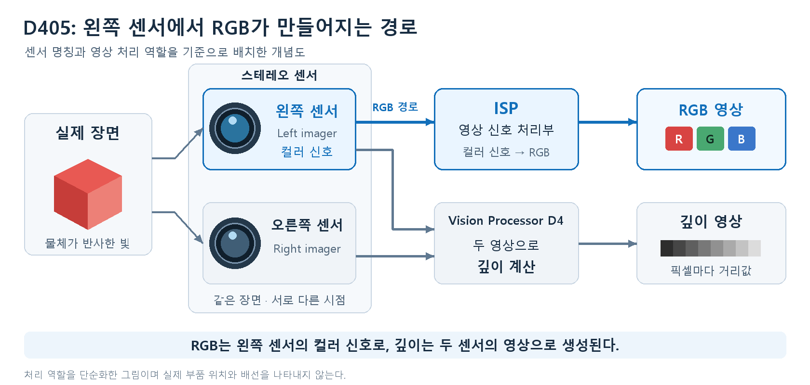
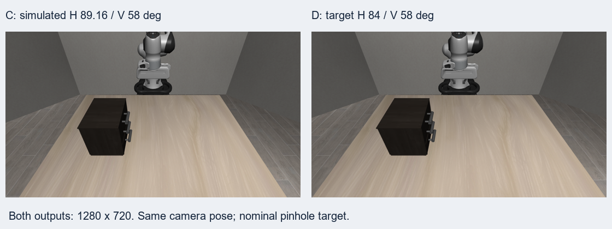

# D405와 LIBERO의 RGB 영상 차이와 보정

## 목차

1. [RGB 정보의 차이](#1-rgb-정보의-차이)
2. [RGB 색 지정 방식과 색감 보정](#2-rgb-색-지정-방식과-색감-보정)
3. [시야각과 해상도 보정](#3-시야각과-해상도-보정)
4. [비교 결과](#4-비교-결과)

## 1. RGB 정보의 차이

**RGB**는 빨강(R)·초록(G)·파랑(B) 값으로 색을 표현하는 방식이다. D405와 LIBERO의 차이는 **색을 만드는 과정**과 **장면을 담는 범위**에 있다. 두 영상의 저장 형식을 RGB로 통일해도 같은 물체의 색과 크기가 곧바로 같아지지는 않는다.

| 항목 | D405 | LIBERO |
|---|---|---|
| RGB 생성 | 실제 빛 → 센서 → 영상 처리 → RGB 영상 | 가상 물체의 재질·텍스처·조명 → 렌더링 → RGB 영상 |
| 색을 결정하는 요소 | 실제 조명·물체 표면, 노출과 카메라 영상 처리 | 물체 색·표면 이미지, 조명 색·세기·방향, 반사 설정 |
| 최종 픽셀 표현 | 출력을 `RGB8`로 받으면 R·G·B 각각 0–255 | 이번 실행의 RGB 관측은 R·G·B 각각 0–255 |
| 시야각·구도 | 렌즈와 카메라 설치 위치·방향으로 결정 | 가상 카메라의 시야각·위치·방향으로 결정 |

**픽셀**은 영상을 이루는 작은 점이다. `RGB8`은 각 색을 8비트로 저장하는 형식으로, 채널마다 0–255의 정수를 사용한다. LIBERO에서 확인한 `uint8`도 이 정수 범위를 저장하는 자료형이다. **렌더링(rendering)**은 가상 장면을 영상으로 계산하는 과정이다. [RealSense RGB 형식 정의](https://github.com/realsenseai/librealsense/blob/master/include/librealsense2/h/rs_sensor.h), [MuJoCo RGB 픽셀 출력](https://github.com/google-deepmind/mujoco/blob/2.3.7/src/render/render_gl2.c#L98)

## 2. RGB 색 지정 방식과 색감 보정

### 2.1. D405의 RGB 생성

D405는 **왼쪽 스테레오 센서**에서 받은 컬러 신호를 **ISP(Image Signal Processor, 영상 신호 처리부)**로 처리해 RGB 영상을 만든다. 스테레오는 두 시점의 영상을 이용하는 구성을 뜻한다. 실제 물체가 반사한 빛을 측정하므로 촬영 조명과 카메라 설정이 픽셀값에 영향을 준다. [D405 공식 RGB 설명](https://www.realsenseai.com/product-family/d405-series/)



**그림 1. D405의 RGB·깊이 영상 생성 구조.** RGB 경로는 파란색, 깊이 생성 경로는 회색으로 표시했다. [D400 Rev.021, Figure 7-2](https://dev.realsenseai.com/download/42003/)

**노출**은 센서가 빛을 받는 시간, **게인(gain)**은 신호를 증폭하는 정도다. **화이트밸런스(white balance)**는 조명 때문에 흰 물체에 색이 끼는 현상을 줄이는 처리다. 같은 물체라도 이 조건이 바뀌면 영상의 밝기나 R·G·B 비율이 달라질 수 있다.

D405는 RGB가 스테레오 센서에서 나오므로 노출·게인 제어도 그 센서의 설정을 사용한다. 색 보정용 영상을 수집할 때는 조명을 유지하고, 지원되는 범위에서 자동 노출·자동 화이트밸런스를 끈 뒤 촬영 설정값을 고정한다. **SDK**는 장치를 프로그램에서 사용하도록 제공하는 개발 도구다. 옵션의 지원 여부와 범위는 SDK의 `supports()`와 `get_option_range()`로 확인한다. [D405 센서 구성](https://github.com/realsenseai/librealsense/blob/master/src/ds/d400/d400-color.cpp), [공식 색 제어 옵션](https://github.com/realsenseai/librealsense/blob/master/src/ds/ds-color-common.cpp)

### 2.2. LIBERO의 RGB 지정

LIBERO에서는 카메라에 하나의 ‘기본 RGB 색’을 넣는 방식으로 장면을 만들지 않는다. 물체의 **재질(material)**과 **텍스처(texture)**, 조명을 지정하고 MuJoCo가 최종 색을 계산한다. 재질은 표면의 색·광택·반사 성질이고, 텍스처는 표면에 입히는 이미지나 무늬다.

| 설정 | 색에 영향을 주는 내용 |
|---|---|
| `rgba` | 재질의 R·G·B와 불투명도 A. 각 값은 0–1 |
| `texture` | 나뭇결·물체 라벨 등 표면 이미지 |
| 조명 `ambient` | 방향과 무관하게 더해지는 주변광 성분 |
| 조명 `diffuse` | 표면 방향에 따라 달라지는 조명 성분 |
| `specular`, `shininess` | 밝게 반짝이는 부분의 세기와 집중 정도 |

예를 들어 `rgba="1 0 0 1"`은 불투명한 빨간 재질을 지정한다. 조명과 반사가 반영되므로 영상의 모든 해당 픽셀이 `(255,0,0)`이 되는 것은 아니다. 텍스처가 있으면 재질 RGB와 텍스처 색이 성분별로 곱해진다. 재질의 기본값 `(1,1,1,1)`은 텍스처 색을 그대로 유지하는 역할을 한다. **재질의 0–1 값과 렌더링 후 픽셀의 0–255 값은 서로 다른 단계의 정보다.** [MuJoCo 재질·텍스처 정의](https://mujoco.readthedocs.io/en/2.3.7/XMLreference.html#asset-material)

이 프로젝트의 [Tabletop 장면 설정](LIBERO/libero/libero/assets/scenes/libero_tabletop_base_style.xml)도 테이블에 나무 텍스처를 사용하고, 두 조명의 `diffuse`를 `(0.8,0.8,0.8)`로 지정한다. 따라서 실제 작업대에 가까운 RGB 영상을 만들려면 **표면 텍스처·재질·조명을 함께 조정**해야 한다. 조명의 RGB 비율은 색조에, 세기와 방향은 밝기 분포에, 반사 설정은 광택에 영향을 준다. [MuJoCo 조명 정의](https://mujoco.readthedocs.io/en/2.3.7/XMLreference.html#body-light)

### 2.3. RGB 형식 통일

색감 보정 전에 두 영상의 채널 순서와 값의 범위를 같게 둔다.

| 처리 | 목적 |
|---|---|
| D405를 `RGB8`로 받고 LIBERO도 RGB 순서로 사용 | R·G·B 채널의 대응 통일 |
| OpenCV에서 BGR로 읽은 영상은 RGB로 변환 | 빨강과 파랑이 뒤바뀌는 오류 제거 |
| 계산에 0–1 값이 필요하면 두 영상 모두 255로 나눔 | 숫자 범위 통일 |

예를 들어 `(128,64,32)`를 255로 나누면 약 `(0.502,0.251,0.125)`가 된다. 색을 유지하면서 숫자 범위를 바꾸는 **정규화(normalization)**다. **255로 나누거나 채널 순서를 바꾸는 작업만으로 카메라와 시뮬레이션의 색감 차이가 없어지지는 않는다.**

### 2.4. 색 기준표를 이용한 보정

**색 기준표(ColorChecker)**는 여러 색과 회색 조각을 가진 표다. 같은 색 조각이 실제 영상과 기준 영상에서 어떤 RGB 값으로 나타나는지 비교해 변환을 구한다.

D405에 가까운 시뮬레이션 영상을 만들려면 D405 촬영값을 기준으로 다음처럼 대응값을 만든다.

1. 일정한 조명·카메라 설정에서 실제 색 기준표를 D405로 촬영한다.
2. LIBERO에 대응하는 색 조각을 만들고 렌더링한다. 기준값은 재질의 `rgba`가 아니라 **렌더링된 영상에서 읽은 RGB**다.
3. 각 색 조각의 중앙 영역에서 평균 RGB를 구해 `LIBERO 관측값 → D405 기준값` 쌍으로 묶는다. 강한 반사나 값이 255에 붙어 색 차이를 잃은 부분은 제외한다.
4. 대응값 사이의 차이를 줄이는 **색 보정 행렬(CCM, Color Correction Matrix)**을 구한다. 보정 계산에 사용하지 않은 색 조각이나 별도 촬영으로 결과를 확인한다.

CCM은 R·G·B를 섞는 계수를 모은 표다. 계수는 여러 색 조각에서 보정 후 RGB와 기준 RGB의 차이가 작아지도록 구한다. 계산 방법은 다음 절에 정리했다.

**색공간(color space)**은 RGB 숫자가 어떤 색을 뜻하는지 정하는 규칙이고, **밝기 응답**은 빛의 밝기를 RGB 숫자로 바꾸는 관계다. 알려진 색공간의 기준표로 보정할 때는 밝기 응답도 고려한다. OpenCV의 `ColorCorrectionModel`은 측정 색과 기준 색, 해당 색공간을 받아 이런 보정을 계산한다. [OpenCV 색 보정 방법](https://docs.opencv.org/4.6.0/d1/dc1/tutorial_ccm_color_correction_model.html)

`RGB8`이나 `uint8`만으로 특정 색공간이나 밝기 응답을 단정할 수는 없다. 두 영상의 관측 RGB 자체를 기준으로 맞추는 경우에는 **대응 RGB 수치 사이의 경험적 변환**으로 다루고, 별도 색 조각의 RGB 차이로 평가한다. `ColorCorrectionModel`에 기준 색공간을 지정할 때도 그 규칙이 확인된 기준값을 사용한다.

LIBERO의 색감에 실물 입력 영상을 맞추는 경우에는 대응 쌍의 기준을 반대로 두고 `D405 → LIBERO` 변환을 구한다.

공개 시야각·해상도에는 이 색 보정 계수가 들어 있지 않다. 계수는 대응하는 실제 RGB 측정값으로 결정한다. 또한 전체 영상에 적용하는 하나의 색 행렬은 전반적인 색 치우침을 줄이는 방법이다. 그림자 위치나 반사 무늬까지 맞추려면 장면의 조명·재질도 조정해야 한다.

### 2.5. 색 보정 계수의 계산

LIBERO를 D405에 맞추는 경우 **입력값은 LIBERO에서 읽은 RGB, 목표값은 대응하는 D405 촬영 RGB**다. 여러 색 조각에서 이 쌍을 모아, 전체 차이가 가장 작아지는 계수를 계산한다.

3×3 보정 행렬 `M`에는 계수 아홉 개가 있다. 입력 색을 `R,G,B`, 보정 후 색을 `R',G',B'`라고 쓰면 다음과 같다.

```text
R' = m11 × R + m12 × G + m13 × B
G' = m21 × R + m22 × G + m23 × B
B' = m31 × R + m32 × G + m33 × B
```

`m11`은 입력 R을 보정 후 R에 얼마나 반영할지, `m12`는 입력 G를 보정 후 R에 얼마나 섞을지를 나타낸다. 계수를 바꾸면 각 색 조각의 보정 RGB도 바뀐다.

RGB 숫자 차이를 기준으로 하는 기본 방법은 **최소제곱법(least squares)**이다. 각 색 조각에서 보정값과 목표값의 차이를 제곱한 뒤 모두 더하고, 이 합이 가장 작아지는 계수를 선택한다.

```text
한 색 조각의 오차 = (R' − 목표 R)² + (G' − 목표 G)² + (B' − 목표 B)²
전체 오차 = 모든 색 조각의 오차 합
```

세 출력 채널에 대해 각각 계수 세 개를 구하면 행렬 `M`이 완성된다. Python의 수치 계산 라이브러리 **NumPy**는 `numpy.linalg.lstsq()`로 이 계산을 수행한다. [NumPy 최소제곱 계산](https://numpy.org/doc/1.22/reference/generated/numpy.linalg.lstsq.html)

회색만 측정하면 R·G·B가 함께 변해 각 채널의 영향을 구분하기 어렵다. 빨강·초록·파랑 계열과 여러 밝기의 색 조각을 포함해야 한다. 구한 행렬은 계산에 쓰지 않은 색 조각에도 적용해 목표 RGB와의 차이가 줄어드는지 확인한다. 이 방법은 선택한 조명·촬영 설정에서의 RGB 대응을 추정하는 것이다.

계수는 재질의 `rgba`와 달리 0–1로 제한되는 값이 아니며, 음수가 나올 수도 있다. 실제 계수는 촬영·렌더링한 대응 데이터로 정해진다.

## 3. 시야각과 해상도 보정

### 3.1. 카메라 파라미터 비교

**시야각(FOV)**은 카메라가 볼 수 있는 각도 범위이고, **해상도**는 영상의 가로·세로 픽셀 수다. 같은 위치에서 시야각이 넓어지면 주변이 더 많이 보이고 물체는 작게 보인다.

| 비교 항목 | D405 RGB: 데이터시트 Rev.021 기준 | LIBERO 외부 카메라 | LIBERO 손목 카메라 |
|---|---:|---:|---:|
| 가로 시야각 | 84° | 45°¹ | 75°¹ |
| 세로 시야각 | 58° | 45° | 75° |
| 해상도 | 지원 모드 중 1280×720 | 이번 실험 512×512 | 이번 실험 512×512 |
| 가로:세로 비율 | 위 모드에서 16:9 | 위 설정에서 1:1 | 위 설정에서 1:1 |

¹ LIBERO의 가로 시야각은 1:1 출력 조건이다. 외부 카메라 이름은 `agentview`, 손목 카메라는 `robot0_eye_in_hand`다. 값은 이번 Tabletop 장면에서 읽었다.

[D400 데이터시트 Rev.021, Table 3-49](https://dev.realsenseai.com/download/42003/)는 D405 컬러 시야각을 84°·58°로 기재하고, [현재 D405 제품 페이지](https://www.realsenseai.com/product-family/d405-series/)는 RGB도 87°·58°로 기재한다. **아래 실험의 84°는 Rev.021을 기준으로 정한 목표값**이다. 장치의 정확한 투영에는 선택한 RGB 영상 설정의 `get_intrinsics()`로 얻는 내부 파라미터를 사용한다. [RealSense 내부 파라미터 설명](https://dev.realsenseai.com/docs/projection-in-realsense-sdk-2-0/)

### 3.2. 시야각 설정과 영상 변환

LIBERO가 사용하는 MuJoCo 2.3.7은 `fovy`라는 **세로 시야각**과 영상 비율로 가로 시야각을 결정한다. 외부 카메라의 `fovy`를 45°에서 58°로 바꾸고 1280×720으로 렌더링하면 가로 시야각은 **89.16°**다. [MuJoCo 카메라 정의](https://mujoco.readthedocs.io/en/2.3.7/XMLreference.html#body-camera)

```text
가로 시야각 = 2 × atan[(1280 / 720) × tan(58° / 2)] ≈ 89.16°
```

`tan`은 각도를 길이의 비로 바꾸는 삼각함수이고, `atan`은 그 비에서 각도를 구하는 함수다. 세로 시야각과 출력 비율을 바꾼 뒤에도 가로 방향의 보정이 필요하다.

3차원 물체를 영상의 위치로 옮기는 계산을 **투영(projection)**이라고 한다. 작은 구멍으로 장면을 본다고 단순화하는 **핀홀 카메라 모델**에서, `fx,fy`는 물체의 영상 크기를 결정하는 픽셀 단위 초점거리다. 카메라의 정면 방향이 영상에 나타나는 **주점**은 이번 계산에서 중앙 `(640,360)`으로 두었다. 초점거리는 다음 관계로 계산했다.

```text
fx = 가로 픽셀 수 / [2 × tan(가로 시야각 / 2)]
fy = 세로 픽셀 수 / [2 × tan(세로 시야각 / 2)]
```

| 1280×720 투영 설정 | 가로 시야각 | 세로 시야각 | `fx` | `fy` |
|---|---:|---:|---:|---:|
| C: 세로 58°로 렌더링 | 89.16° | 58° | 649.46px | 649.46px |
| D: Rev.021 기준 목표 투영 | 84° | 58° | 710.79px | 649.46px |

`px`는 픽셀 단위다. D의 값은 공개 시야각과 중앙 주점으로 계산한 설계값이다. 가로 초점거리를 약 1.09444배 키우고 세로는 유지했다. 가로·세로 픽셀 위치를 `u,v`라고 하면 변환은 다음과 같다.

```text
새 u = 640 + (710.7920 / 649.4572) × (기존 u − 640)
새 v = 기존 v
```

화면 중앙은 유지되고 대상의 가로 크기가 커진다. 영상 처리 라이브러리 **OpenCV**의 `warpPerspective`로 이 좌표 대응을 적용했다. [OpenCV 영상 좌표 변환](https://docs.opencv.org/4.x/da/d54/group__imgproc__transform.html)



**그림 2. 왼쪽 C는 가로 89.16°·세로 58°, 오른쪽 D는 가로 84°·세로 58°의 목표 투영이다.** 같은 장면에서 만든 1280×720 시뮬레이션 영상이다. 이 그림은 시야각 보정 결과를 보여 준다.

## 4. 비교 결과

| 차이 | 맞추는 방법 |
|---|---|
| RGB/BGR 채널 순서·숫자 범위 | RGB 순서와 동일한 값 범위로 통일 |
| 실제 촬영과 가상 재질·조명에서 생기는 색감 | 촬영 조건 고정, 재질·텍스처·조명 조정, 색 기준표의 대응 RGB로 보정 |
| 시야각·해상도 | `fovy`와 출력 크기 변경 후 목표 내부 파라미터로 영상 변환 |

RGB 색감과 시야각은 별도의 보정 대상이다. **RGB 색감은 대응하는 색의 측정값으로, 시야각은 카메라 내부 파라미터로 맞춘다.** 재질의 `rgba`를 실제 RGB 값으로 단순 환산하는 방식은 렌더링의 조명·표면 효과를 반영하지 못한다.

기하 실험에서는 카메라 설정을 바꾸고 다시 렌더링해 목표 영상을 생성했다. 장면 상태가 유지됐고, 검사한 세 점의 변환 좌표 차이는 약 `5.7×10⁻¹⁴px`였으며, 출력 전체가 원본 범위 안에서 만들어졌다. 이 수치는 시야각 변환 코드의 계산 차이다. 색 보정 행렬은 해당 실험에서 구한 값이 아니므로 색감 보정 성능으로 해석하지 않는다.

실험 코드와 자료는 W5의 `d405_libero_camera` 폴더에 있다.

- [시야각 영상 생성·보정 코드](d405_libero_camera/render_camera_comparison.py)
- [카메라 설정·변환 행렬·실행 결과](d405_libero_camera/camera_parameters.json)
- [보정 전 원본 C](d405_libero_camera/nominal58_wide.png) · [보정 후 원본 D](d405_libero_camera/nominal84x58_wide.png)
