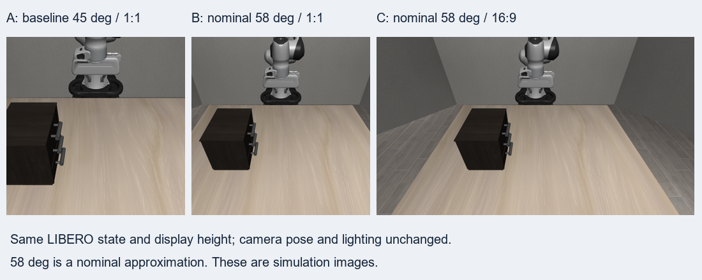

# D405 RGB와 LIBERO 카메라 — 공개 파라미터 비교와 보정 계획

> **참조·설계** · 확인 2026-10-01 · 기준 D400 데이터시트 Rev.021, 로컬 LIBERO `40c219a`, robosuite 1.4.0 / MuJoCo 2.3.7
> D405의 공개 RGB 파라미터와 W5 LIBERO 카메라 설정을 비교하고, 시뮬레이션에서 맞출 항목과 실물 도착 후 검증할 항목을 정리한다.

## 목차

1. [조사 범위와 현재 판단](#1-조사-범위와-현재-판단)
2. [카메라 파라미터의 뜻과 D405 공개값](#2-카메라-파라미터의-뜻과-d405-공개값)
3. [현재 LIBERO 설정과 실제 비교 이미지](#3-현재-libero-설정과-실제-비교-이미지)
4. [RGB가 달라지는 원인](#4-rgb가-달라지는-원인)
5. [차이를 맞추는 절차](#5-차이를-맞추는-절차)
6. [검증 방법과 평가 기준](#6-검증-방법과-평가-기준)
7. [이번 조사 결과와 다음 작업](#7-이번-조사-결과와-다음-작업)
8. [근거와 재현 파일](#8-근거와-재현-파일)

## 1. 조사 범위와 현재 판단

[9/28 미팅 기록](../meetings/2026-09-28/2026-09-28.md)의 카메라 조사 항목은 **D405의 공개 Camera Parameter로 LIBERO 설정과의 차이를 확인하고, 그 차이를 어떻게 보정할지 찾는 것**이다. 이 문서는 그 사전 조사에 해당한다. D405 실물의 촬영 결과나 교정 완료를 보고하는 문서는 아니다.

**공개값으로 우선 맞출 수 있는 것은 영상의 기하학적 조건, 즉 어디를 얼마나 크게 보는가이다.** 현재 LIBERO의 외부·손목 카메라와 D405는 시야각과 영상 비율이 다르다. 시뮬레이터의 시야각, 출력 해상도, 카메라 위치·방향을 조정하고 영상 전처리를 통일하면 이 차이를 줄일 수 있다. 다만 장치별 정확한 내부 파라미터, 실제 장착 위치, 색 응답은 공개 사양만으로 확정할 수 없다.

LIBERO는 로봇 조작 과제를 제공하는 시뮬레이션 환경이다. 아래에서는 물리·영상 계산 엔진인 **MuJoCo**와 그 위의 로봇 환경 라이브러리인 **robosuite**를 통해 만들어진 RGB를 다룬다. **RGB**는 한 픽셀의 색을 빨강·초록·파랑 세 성분으로 나타내는 영상이다. 시뮬레이터가 장면 모델과 조명으로 영상을 계산하는 과정을 **렌더링**이라고 한다.

관측으로 다음 행동을 결정하는 모델을 **policy(정책)**라고 부른다. 프로젝트의 action 번역 방식은 [ACTION_MEANING.md](ACTION_MEANING.md), 좌표·배율 결정은 [PIPELINE.md](PIPELINE.md)가 기준이다. action을 Panda 자세로 번역하는 것과 실제 카메라 관측을 맞추는 것은 각각 검증해야 한다. **시뮬 RGB를 D405처럼 만들어도 실제 장면의 물체 상태가 자동으로 시뮬에 반영되지는 않는다.**

## 2. 카메라 파라미터의 뜻과 D405 공개값

### 2.1. 무엇을 알아야 같은 구도로 보이나

| 용어 | 뜻 | 이 조사에서의 역할 |
|---|---|---|
| 해상도·종횡비 | 영상의 가로·세로 픽셀 수와 그 비율 | 1280×720은 16:9, 256×256은 1:1이다. 비율이 달라지면 보이는 범위나 물체 형태가 달라질 수 있다 |
| FOV, 시야각 | 카메라가 보는 각도 범위. 가로 H와 세로 V를 구분한다 | 같은 위치에서 시야각이 넓으면 더 많은 장면이 들어오고 물체는 작게 보인다 |
| 내부 파라미터, Intrinsics | 카메라 안에서 3차원 방향을 픽셀 위치로 바꾸는 값 | 픽셀 단위 초점거리 `fx, fy`, 주점 `cx, cy`, 렌즈 왜곡 모델·계수를 확인한다 |
| 주점, Principal point | 광축, 즉 렌즈가 바라보는 중심선이 영상에 닿는 위치 | 대략 영상 중앙에 있지만, 실제 장치에서 정확히 중앙이라고 가정하면 안 된다 |
| 외부 파라미터, Extrinsics | 기준 좌표계에서 카메라가 있는 위치와 바라보는 방향 | 고정 카메라는 작업대 기준, 손목 카메라는 로봇 손 기준 장착 관계가 필요하다 |
| FPS, 초당 프레임 수 | 1초에 생성되는 영상 수 | 센서의 촬영 주기와 로봇 제어 주기가 다를 때 시간 대응을 정해야 한다 |

왜곡을 제외한 기본 모델은 **핀홀 카메라**이다. 작은 구멍을 통해 장면을 투영한다고 생각하면 된다. 카메라 기준의 점 `(X,Y,Z)`가 픽셀 `(u,v)`에 나타나는 관계는 다음과 같다. `Z`는 카메라에서 앞쪽으로 잰 거리다.

```text
u = fx × X/Z + cx        v = fy × Y/Z + cy

    [ fx   0  cx ]
K = [  0  fy  cy ]       K: 내부 파라미터 행렬
    [  0   0   1 ]
```

이 식에서 영상 차이를 보는 순서가 나온다. `fx, fy`가 다르면 물체 크기, `cx, cy`가 다르면 화면 중심, 카메라 위치·방향이 다르면 구도와 가려지는 부분이 달라진다. 렌즈 왜곡은 이 이상적 투영에서 직선 등이 휘어지는 차이다. SDK는 선택한 영상 스트림마다 내부 파라미터와 왜곡 정보를 제공한다. [RealSense 투영·파라미터 설명](https://dev.realsenseai.com/docs/projection-in-realsense-sdk-2-0/)

### 2.2. D405에서 공개된 값과 아직 알 수 없는 값

영상의 해상도·FPS·픽셀 형식 등을 묶은 설정을 **스트림 프로파일**이라고 한다. 동일 장치라도 선택한 프로파일에 맞는 파라미터를 사용해야 한다.

| 항목 | 공개 사양 또는 확인 방법 | 현재 판단 |
|---|---|---|
| RGB 생성 | 두 시점으로 깊이를 구하는 스테레오 센서 중 왼쪽에서 컬러 영상을 만들며 ISP 경로를 제공한다 | 별도 RGB 카메라가 있는 다른 D400 모델의 설정을 그대로 가져오지 않는다 |
| RGB 명목 시야각 | 데이터시트의 Color Camera FOV: **H 84° / V 58° / D 92°** | 사전 설계값으로 사용한다 |
| 출력 모드 예 | USB 3.1에서 1280×720, 30 FPS 컬러 모드를 제공한다 | 도착 후 실제 활성 프로파일을 확인한다 |
| 픽셀 형식 | 장치 컬러 모드는 UYVY/YUY2 등이 있고 SDK에서 `rgb8` 출력을 요청할 수 있다 | 장치 전송 형식과 모델에 전달할 RGB 배열을 구분한다 |
| 장치별 `fx,fy,cx,cy`·왜곡 | 활성 color 스트림의 `get_intrinsics()`로 조회한다 | 본 문서에는 D405 실측값이 없다 |
| 작업대·그리퍼에 대한 위치·방향 | 실제 마운트와 장착 자세에 따라 결정된다 | 구매 모델명이나 제품 사양만으로 확정되지 않는다 |

**ISP(Image Signal Processor)**는 센서 신호를 컬러 영상으로 처리하는 영상 처리부다. 센서가 빛을 받는 시간·양을 조절하는 **노출**과 색 처리의 영향을 포함하므로, 시야각이 같아도 픽셀 색까지 같아지는 것은 아니다. 위 사양의 기준은 [D400 데이터시트 Rev.021, Table 3-49·4-4](https://dev.realsenseai.com/download/42003/)다.

Intel 제품 페이지의 **H 87° / V 58°는 Depth FOV**로 표기돼 있다. 이를 RGB 명목값으로 옮겨 적으면 근거가 섞인다. 또한 해당 페이지의 7–50cm는 **깊이 측정의 동작 범위**이므로, 그 밖에서 RGB가 무조건 나오지 않거나 쓸 수 없다는 뜻으로 해석하지 않는다. [Intel D405 제품 사양](https://www.intel.com/content/www/us/en/products/sku/229218/intel-realsense-depth-camera-d405/specifications.html)

## 3. 현재 LIBERO 설정과 실제 비교 이미지

### 3.1. 로컬 환경에서 확인한 기준값

W5의 Tabletop 장면을 실행해 **컴파일된 모델의 실제 카메라 값**을 읽었다. 아래 값은 모든 LIBERO 과제에 공통인 값이 아니라, 이번 비교에 사용한 장면의 값이다.

| 항목 | 외부 카메라 `agentview` | 손목 카메라 `robot0_eye_in_hand` |
|---|---|---|
| 세로 시야각 `fovy` | **45°** | **75°** |
| 이번 비교의 원본 해상도 | 512×512 | 설정 조회는 같은 해상도의 환경에서 수행 |
| 1:1 출력일 때 가로 시야각 | 45° | 75° |
| 위치 | 월드 기준 `(0.65861, 0, 1.61035)m` | 카메라가 붙은 부모 로봇 링크 기준 `(0.05, 0, 0)m` |
| 회전 `quat` | `(0.63802, 0.30485, 0.30485, 0.63802)` | `(0, 0.70711, 0.70711, 0)` |
| 실제 RGB 관측 이름 | `agentview_image` | `robot0_eye_in_hand_image` |

`quat`는 회전을 네 수로 표현하는 **쿼터니언**이다. 위 MuJoCo 값의 순서는 **w,x,y,z**다. 프로젝트의 일부 자세 데이터는 **x,y,z,w** 순서이므로 복사할 때 순서를 확인해야 한다. 손목의 50mm 오프셋은 부모 링크 기준이며, 파지점 기준 50mm라고 읽으면 안 된다.

외부 카메라는 [Tabletop의 `_setup_camera()`](LIBERO/libero/libero/envs/problems/libero_tabletop_manipulation.py)에서 설정되고, 손목 카메라는 설치된 robosuite의 Panda 모델 XML에 정의된다. 환경이 만들어진 뒤의 값과 버전은 [실행 결과 JSON](d405_libero_camera/camera_parameters.json)에 기록했다.

해상도에는 세 기준이 있다. 로컬 [LIBERO Wrapper](LIBERO/libero/libero/envs/env_wrapper.py)의 기본값은 128×128, 이번 W5 비교는 512×512, Cosmos 평가 코드의 기본 렌더링은 256×256이다. **모델 입력은 별도로 224×224로 처리된다.** 따라서 “LIBERO RGB 해상도”를 한 숫자로만 적으면 서로 다른 단계를 혼동한다. [Cosmos 평가 설정](https://github.com/NVlabs/cosmos-policy/blob/18a2acc/cosmos_policy/experiments/robot/libero/run_libero_eval.py), [모델 입력 전처리](https://github.com/NVlabs/cosmos-policy/blob/18a2acc/cosmos_policy/experiments/robot/cosmos_utils.py)

### 3.2. 같은 장면에서 시야각과 영상 비율만 바꾼 결과



**그림 1. 모두 실제 LIBERO 렌더링 결과이며 D405 촬영 사진은 아니다.** A는 기존 외부 카메라, B는 세로 시야각만 58°로 바꾼 경우, C는 58°를 유지하고 출력 비율을 16:9로 바꾼 경우다. 그림에서는 세 영상의 표시 높이를 같게 맞췄다.

| 조건 | 원본 해상도 | 세로 FOV | 가로 FOV |
|---|---:|---:|---:|
| A: 기존 외부 카메라 | 512×512 | 45° | 45° |
| B: D405 세로 명목값 적용 | 512×512 | 58° | 58° |
| C: 세로 명목값 + 16:9 적용 | 1280×720 | 58° | **약 89.16°** |
| D405 데이터시트 명목값 | 프로파일별 확인 필요 | 58° | **84°** |

카메라 위치·방향, 물체 배치, 로봇 자세, 조명은 고정했다. 렌더링 전후 로봇·물체의 위치 상태 배열 `qpos`가 변하지 않았음을 코드에서 검사했다. 영상이 달라진 것은 이번 비교에서 바꾼 투영 조건 때문이다.

**58°와 16:9를 넣는 것만으로 D405 명목 파라미터 전체가 일치하지는 않는다.** MuJoCo 2.3.7의 기본 카메라는 세로 시야각과 출력 비율에서 가로 시야각을 계산한다. 이 결과가 89.16°이고 D405의 RGB 명목 가로값은 84°이므로, 다음 절차에서는 내부 파라미터 행렬까지 다룬다. 이 차이만으로 데이터시트가 잘못됐다거나 특정 광학 원인이 확인됐다고 단정하지 않는다. [MuJoCo 2.3.7 카메라 정의](https://mujoco.readthedocs.io/en/2.3.7/XMLreference.html#body-camera)

원본 영상은 [A](d405_libero_camera/baseline_square.png), [B](d405_libero_camera/nominal58_square.png), [C](d405_libero_camera/nominal58_wide.png)에서 각각 확인할 수 있다.

## 4. RGB가 달라지는 원인

### 4.1. 투영과 구도의 차이

중앙 주점과 왜곡 없는 카메라를 가정하면 다음 관계를 사용할 수 있다. 각도는 세로·가로를 구분해 넣는다.

```text
fy ≈ H / [2 tan(V/2)]        fx ≈ W / [2 tan(H_FOV/2)]
가로 FOV = 2 atan[(W/H) tan(V/2)]   ← fx=fy인 기본 MuJoCo 투영
```

D405의 명목 H=84°, V=58°를 1280×720에 대입하면 **fx≈710.8px, fy≈649.5px**다. 이는 **명목 시야각으로 역산한 근삿값**이며 SDK에서 읽은 공장 교정값이 아니다. 현재 정보로 장치의 정확한 주점이나 왜곡도 알 수 없다.

같은 카메라 위치에서 45°를 58°로 바꾸면 보이는 세로 범위가 약 1.34배 넓어진다. 예를 들어 광축에 수직인 평면까지 30cm라는 가정에서 세로 범위는 약 249mm에서 333mm로 늘어난다. 같은 출력 높이에서는 물체가 약 0.747배로 작게 보인다. **카메라를 멀리 놓는 것과 시야각을 넓히는 것은 3차원 장면에서 같은 효과가 아니다.** 위치를 바꾸면 물체 사이 가림과 원근 관계도 바뀐다.

영상 일부를 잘라 쓰는 **크롭(crop)**도 시야각을 바꾼다. 1280×720에서 중앙 720×720을 잘라 정사각형으로 만들면, 위 명목 근사에서는 가로 FOV가 약 **53.72°**로 줄어든다. 반대로 전체 영상을 224×224로 바로 줄이면 가로·세로 축소 비율이 달라 형태가 변한다. 어느 방법을 선택하든 시뮬과 실물에 같은 규칙을 적용해야 한다. 크롭 원점을 `(x0,y0)`, 그 뒤의 축소 비율을 `sx,sy`라고 하면 내부 파라미터도 함께 갱신한다.

```text
fx' = sx × fx        cx' = sx × (cx − x0)
fy' = sy × fy        cy' = sy × (cy − y0)
```

### 4.2. 실제 센서와 렌더러의 차이

| 차이 | 실제 D405 RGB에 영향을 주는 것 | LIBERO에서 다룰 방법과 한계 |
|---|---|---|
| 색·밝기 | 조명 스펙트럼, 노출, 센서·ISP의 색 응답 | 조명·재질을 조정하고 실물 색 기준으로 보정한다. 명목 FOV로는 색 응답을 알 수 없다 |
| 왜곡·영상 품질 | 렌즈·스트림별 왜곡, 노이즈, 움직임 중 흐림, 압축 | 실제 프로파일을 확인하고 필요할 때 왜곡 제거·품질 변화를 적용한다 |
| 구도·가림 | 장착 위치, 손목 오프셋, 카메라 마운트, 실제 그리퍼 형태 | 가상 카메라 자세를 맞추되 Panda와 Mirobot의 외형 차이를 별도로 평가한다 |
| 시간 | 노출 시점, 프레임 도착·전송 지연 | 프레임 시각과 로봇 상태·명령 시각을 함께 기록한다 |
| 색 채널·영상 방향 | SDK RGB, OpenCV BGR, 렌더러의 영상 원점 | 색 순서와 상하 방향을 입력 경로에서 한 번 정하고 통일한다 |

**BGR**는 RGB와 채널 순서가 반대인 OpenCV의 일반 영상 표현이다. 파랑·빨강이 바뀐 상태는 카메라의 색 특성 차이가 아니라 데이터 처리 오류다. 현재 OpenGL 방식의 시뮬 영상은 저장할 때 상하 반전이 필요하지만, 이미 정상 방향인 D405 영상에 같은 반전을 적용하면 안 된다.

## 5. 차이를 맞추는 절차

### 5.1. 비교할 두 카메라와 최종 입력 형식을 먼저 정한다

외부 카메라는 `agentview`, 손목 카메라는 `robot0_eye_in_hand`에 대응시키되 **각 카메라별로** 파라미터를 관리한다. 한 대의 고정 D405만으로 이동하는 손목 시점을 얻을 수는 없다. 고정 카메라의 모델과 손목 마운트가 확정되지 않은 부분은 가정으로 남긴다.

권장 입력 경로는 **원본 RGB 보존 → 필요한 왜곡 보정·투영 변환 → 동일한 크롭·리사이즈 → Cosmos 입력**이다. **리사이즈(resize)**는 픽셀 수를 바꾸는 처리다. 학습 데이터와 실제 실행의 순서·파라미터가 같아야 한다.

현재 Cosmos 코드는 224×224로 리사이즈하고, `trained_with_image_aug=True`이면 면적 약 90%의 중앙 크롭 후 다시 224×224로 만든다. JPEG 압축 설정도 존재한다. **JPEG**는 영상 크기를 줄이는 손실 압축이다. 새 전처리에서 같은 크롭·압축을 중복 적용하지 않도록 전체 경로를 확인한다. [Cosmos 전처리 코드](https://github.com/NVlabs/cosmos-policy/blob/18a2acc/cosmos_policy/experiments/robot/cosmos_utils.py), [리사이즈 구현](https://github.com/NVlabs/cosmos-policy/blob/18a2acc/cosmos_policy/datasets/dataset_utils.py)

현재 `robot/camera_bridge.py`는 OpenCV 카메라를 JPEG로 전송하며 요청 해상도 기본값이 1280×720이다. **D405 전용 스트림 선택·내부 파라미터 조회 기능은 없다.** 따라서 브리지의 요청값을 D405 활성 프로파일이라고 보고하면 안 된다.

### 5.2. 공개값으로 가상 카메라의 투영을 먼저 맞춘다

첫 비교는 그림 1처럼 기존 카메라의 `fovy`를 58°로 바꾸고 16:9로 렌더링한다. 같은 장면에서 시야각의 영향만 확인하기 위한 단계다. 이후에는 **목표 내부 파라미터 `K_target`**를 정해 가로·세로 초점거리와 주점까지 맞춘다.

현재 로컬 MuJoCo는 **2.3.7**이라 카메라 XML에 최신 버전의 `focalpixel`, `principalpixel`을 그대로 넣을 수 없다. 이 환경에서는 기본 투영으로 필요한 범위를 충분히 렌더링한 후 **재매핑(remap)**, 즉 출력 픽셀마다 원본의 어느 위치를 읽을지 계산하는 영상 변환을 사용하는 것이 현실적이다. 왜곡 없는 동일 시점이라면 다음 행렬이 출발점이다.

```text
H_image = K_target × inverse(K_sim)
목적: 동일한 카메라에서 본 빛의 방향을 목표 픽셀 좌표로 옮긴다.
```

여기서 `H_image`는 두 영상 사이의 투영 변환 행렬이며 영상 높이 H와는 다른 기호다. 렌더링 범위 밖을 읽는 픽셀은 복구할 수 없으므로, **원본 렌더링의 시야를 넉넉하게 잡고 유효 영역을 확인**해야 한다. 이 처리는 카메라 위치가 바뀌어 새로 드러나는 물체를 만들어 주지 않는다.

MuJoCo 3.3.2에는 초점거리·주점 등을 직접 지정하는 항목이 있다. 다만 현재 검증 환경과 버전이 다르므로 이는 별도 적용 경로다. 직접 지정할 때도 MuJoCo의 주점 표기와 SDK 픽셀 좌표의 차이를 확인하고 테스트 점의 투영으로 검산한다. [MuJoCo 3.3.2 카메라 항목](https://mujoco.readthedocs.io/en/3.3.2/XMLreference.html#body-camera)

### 5.3. 카메라 위치·방향과 장면 크기를 함께 맞춘다

실물 도착 전에는 설치 도면에 따른 **후보 위치·방향**을 정할 수 있다. 도착 후에는 작업대의 알려진 점이나 격자 무늬 판을 촬영해 실제 장착 관계를 구한다. 측정으로 카메라 파라미터를 추정·확인하는 과정을 **캘리브레이션(calibration, 교정)**이라고 한다.

외부 카메라는 작업대 기준 자세를 가상 카메라에 옮긴다. 손목 카메라는 로봇 손과 카메라 사이의 고정 위치·회전 관계를 구하는 **손눈 교정(hand-eye calibration)**이 필요하다. 기준을 잡는 로봇 손 프레임과 파지점까지의 변환을 명확히 기록한다. “말단 위치가 같으니 영상도 같다”는 결론은 카메라 장착 위치와 두 그리퍼의 외형까지 확인해야 성립한다.

W5에서는 위치 배율 `s=0.44`를 후보로 사용한다. 이 배율은 렌즈 초점거리에 곱하는 값이 아니다. [PIPELINE.md 4.4절](PIPELINE.md)의 좌표 대응을 카메라 위치와 물체 크기에도 일관되게 적용해야 한다.

```text
p_M = a_M + s × (p_P − a_P)
c_P = a_P + (c_M − a_M) / s
```

`p`는 물체 위치, `c`는 카메라 위치, P/M은 Panda/Mirobot 공간, `a`는 두 공간의 대응 기준점이다. 두 공간의 거리 단위를 통일한 뒤 적용한다. 현재 [common/workspace.py](../../common/workspace.py)의 위치 대응은 세 축을 같은 방향으로 두고 이동·배율을 적용한다. 자세 변환의 `FRAME_F`를 위치에 추가로 곱하는 구현은 아니다. 작업대 기준축을 새로 회전시킬 경우에는 그 회전 관계를 별도로 정의해야 한다.

예를 들어 실물에서 카메라와 기준점 사이의 **100mm**를 Panda 공간으로 옮기면 배율 0.44에서는 약 **227mm**다. 카메라와 대상 물체를 같은 배율로 옮기면 핀홀 투영의 `X/Z` 비가 유지될 수 있다. 물체나 카메라 위치는 그대로 두고 로봇 궤적만 줄이면 이 관계가 유지되지 않는다. 손목 카메라 오프셋과 물체 치수에도 같은 검토가 필요하다.

방향에도 좌표 규약을 적용해야 한다. RealSense 카메라는 +Z가 앞, +Y가 아래이고 MuJoCo 카메라는 −Z가 앞, +Y가 위다. 위치 배율만 적용하거나 쿼터니언 숫자만 복사하면 안 된다. 카메라 축 변환과 이미지 상하 반전은 서로 다른 처리를 뜻한다. [RealSense 좌표 규약](https://dev.realsenseai.com/docs/projection-in-realsense-sdk-2-0/), [MuJoCo 카메라 축](https://mujoco.readthedocs.io/en/2.3.7/XMLreference.html#body-camera)

### 5.4. 도착 후 활성 RGB 파라미터와 색 차이를 보정한다

먼저 실제 color 스트림의 해상도·FPS·픽셀 형식, `K`, 왜곡 모델·계수, 프레임 시각을 저장한다. [조회 코드](d405_libero_camera/inspect_d405.py)를 준비했으며 **실물 D405 실행 검증은 아직 수행하지 않았다.** 이 코드는 장치 내부의 스트림 교정 정보를 읽는 것이며 작업대·로봇에 대한 장착 자세를 측정하지는 않는다.

왜곡 모델이 `NONE`이면 왜곡 제거를 추가하지 않는다. 그 외에는 SDK 모델과 계수의 의미를 먼저 확인한다. OpenCV의 지원 모델과 일치하는 경우 `initUndistortRectifyMap`·`remap`으로 왜곡 없는 목표 `K`로 변환할 수 있다. **RealSense의 왜곡 모델 이름·계수를 확인하지 않고 OpenCV에 그대로 넣는 방식은 피한다.** [OpenCV 왜곡 제거와 재매핑](https://docs.opencv.org/4.x/d9/d0c/group__calib3d.html)

색 보정은 기하학적 정렬 후에 한다. 같은 색 기준판을 외부·손목 카메라로 촬영하고, 지원되는 노출·화이트밸런스 설정을 확인한다. **화이트밸런스**는 조명 때문에 흰색이 다른 색으로 보이는 현상을 조절하는 처리다. 고정 설정이 가능하면 조건을 유지하고, 자동 설정을 사용하면 변화 상태를 기록한다.

기준 색 패치로 카메라별 색 변환을 구할 때는 **3×3 색 변환 행렬과 3차원 오프셋** 같은 단순 모델부터 검토한다. 변환을 구하는 데 쓰지 않은 패치·장면에서도 오차를 확인하고, 색 범위가 잘려 디테일이 사라지는지 검사한다. 재질 반사·그림자·가림은 하나의 색 변환으로 해결되지 않는다.

미팅의 “Colormap으로 RGB 차이 보정”은 구현 전에 의미를 정해야 한다. **컬러맵(colormap)**은 보통 하나의 값에 표시 색을 대응시키는 표다. 깊이 영상을 무지개색으로 보여주는 컬러맵은 RGB 카메라 색 교정과 목적이 다르다. 여기서는 **실제 RGB 색 기준에 대한 카메라별 색 변환**을 검토한다.

### 5.5. 남는 영상 차이를 학습·평가에서 다룬다

기하와 색을 맞춰도 실제 센서의 노이즈, 반사, Panda/Mirobot 외형 차이가 남는다. 이처럼 학습 영상과 실행 영상의 분포가 다른 문제를 **도메인 차이(domain gap)**라고 한다. 실물 데모로 기존 모델을 이어서 학습하는 **fine-tuning(미세 조정)**을 할 때, 조명·색·약한 노이즈·시점 변화를 학습 데이터에 추가하는 **데이터 증강(augmentation)**을 검토할 수 있다.

증강 범위는 도착 후 관측한 변동으로 정한다. 임의의 큰 색·시점 변화가 성능을 높인다고 가정하지 않는다. 사전학습 policy의 카메라만 바꿔도 성공률이 유지되는지는 별도 실험으로 확인해야 한다.

## 6. 검증 방법과 평가 기준

### 6.1. 무엇을 고정하고 무엇을 비교할 것인가

**기하 → 색·품질 → 시간 → 과제 성공률** 순서로 확인한다. 여러 항목을 동시에 바꾸면 어느 보정이 효과가 있었는지 판단하기 어렵다. 대응 물체·로봇 자세, 카메라 기준, 입력 전처리를 기록하고 한 단계씩 비교한다.

| 검증 | 측정·증거 | 결론을 낼 수 있는 범위 |
|---|---|---|
| 기하 | 알려진 3차원 점을 예측한 픽셀과 관측 픽셀의 거리. 중앙값과 95백분위 오차 기록 | 시야각·주점·위치·방향이 얼마나 맞는지 |
| 시야 확보 | 필요한 작업 영역·그리퍼·대상이 최종 입력에서 보이는지 | 크롭이나 재매핑으로 필요한 정보를 잃었는지 |
| 색 | 보정에 쓰지 않은 색 패치의 RGB 오차, 검정·흰색 영역의 정보 손실 | 색 변환의 효과와 한계 |
| 시간 | 프레임 시각, 수신 시각, 대응 로봇 상태 시각, 프레임 누락 | 움직임과 영상의 시간 대응 |
| 실제 Task | 같은 평가 조건에서 성공 횟수/시도 횟수, 실패 유형 | 보정 후 policy가 과제를 수행하는지 |

기하 표의 픽셀 거리는 **재투영 오차(reprojection error)**다. 95백분위는 오차의 95%가 그 값 이하라는 뜻이다. 영상 전체 평균만 보고 화면 가장자리나 손목 근처의 큰 오차를 놓치지 않도록 위치별로도 확인한다. 교정에 사용한 점과 다른 점·자세에서 평가해야 한다.

### 6.2. 합격선을 정하는 근거

첨부 주제와 미팅 기록에는 공식 수치 합격선이 없다. 따라서 특정 픽셀 오차를 교수님 기준으로 제시하지 않는다. **실제 Task의 허용 위치 오차에서 영상 오차 한계를 역산**한다.

핀홀 모델의 작은 오차 근사에서는 `실제 가로 오차 ≈ Z × 픽셀 오차 / fx`다. 예를 들어 최종 입력의 `fx=200px`, 거리 300mm, 허용 위치 오차 2mm라는 **가정**이면 픽셀 오차 허용치는 약 **1.33px**다. 이 숫자는 예시이며, 실제 Task의 여유와 최종 입력 `K`를 넣어 다시 정해야 한다. 1280×720 원본에서만 오차가 작다는 결과로 224×224 모델 입력까지 검증했다고 볼 수 없다.

색 보정은 보정 전후의 미사용 패치 오차를 비교하고 물체의 구분 정보가 유지되는지 확인한다. 최종 평가는 Task 성공률이며, 반복 횟수와 실패 원인을 함께 보고한다. 이미지가 비슷해 보이는 것만으로 로봇 조작 성공을 대신 평가하지 않는다.

## 7. 이번 조사 결과와 다음 작업

| 구분 | 완료·준비된 것 | 남은 확인 |
|---|---|---|
| 공개 사양 비교 | D405 RGB 명목 FOV·스트림 사양과 LIBERO 카메라 차이 정리 | 실제 D405 활성 프로파일 |
| 로컬 시뮬 검증 | 외부 45°·손목 75° 조회, 동일 상태의 A/B/C PNG 생성 | 정확한 `K`에 대한 재매핑·위치 교정 적용 |
| 재현 자료 | BDDL 장면, 렌더링 코드, 버전·파라미터 JSON | 다른 장면·손목 시점에서 같은 절차 검증 |
| 실물 준비 | RGB 프로파일·프레임 저장 코드 작성 | 하드웨어 실행, 외부·손목 교정, 색·시간 측정 |
| policy 검증 | 평가 방법 정리 | 보정 전후 동일 조건의 Task 반복 평가 |

**이번 조사에서 확인한 것은 LIBERO 투영 설정을 실제로 바꿀 수 있고, D405 공개값과의 차이를 수치로 설명할 수 있다는 점이다.** 그림 1의 58° 영상은 세로 명목값을 적용한 비교 결과다. 정확한 D405 재현이나 실물 교정 완료를 뜻하지 않는다.

다음 작업은 활성 RGB 프로파일을 확보한 뒤 목표 `K`를 확정하고, 외부·손목의 장착 관계를 맞추는 것이다. 이후 같은 전처리 조건에서 기하·색·시간을 검증하고 Task 성공률로 연결한다. 각 단계의 설정과 결과를 보존해야 어떤 차이를 줄였고 무엇이 남았는지 설명할 수 있다.

## 8. 근거와 재현 파일

로컬 비교 자료는 [d405_libero_camera/](d405_libero_camera/)에 모았다. PNG와 Markdown 상대경로를 사용하므로 VS Code 미리보기와 GitHub에서 같은 이미지를 확인할 수 있다.

| 파일 | 내용 |
|---|---|
| [render_camera_comparison.py](d405_libero_camera/render_camera_comparison.py) | 같은 상태에서 시야각·영상 비율을 바꾸고 PNG·파라미터 JSON 저장. 이번 환경에서 실행 확인 |
| [comparison_scene.bddl](d405_libero_camera/comparison_scene.bddl) | 비교에 사용한 Tabletop·서랍 장면 |
| [camera_parameters.json](d405_libero_camera/camera_parameters.json) | 환경 버전, 두 카메라의 위치·회전·FOV, A/B/C 투영값 |
| [camera_comparison.png](d405_libero_camera/camera_comparison.png) | 본문의 비교 그림 |
| [inspect_d405.py](d405_libero_camera/inspect_d405.py) | 도착 후 장치 RGB 파라미터·원본 프레임 저장용. 실물 실행 미검증 |

시뮬 비교는 기존 `libero` 환경에서 재현한다. 저장소 루트를 작업 디렉터리로 사용한다.

```powershell
conda activate libero
python .\docs\W5\d405_libero_camera\render_camera_comparison.py
```

D405 도착 후, `pyrealsense2`, NumPy, Pillow가 있는 촬영 환경에서는 다음 명령으로 선택한 RGB 프로파일을 저장할 수 있다. 카메라가 여러 대면 `--serial`을 지정한다. 기본 출력은 전용 폴더 아래 `measured/`다.

```powershell
python .\docs\W5\d405_libero_camera\inspect_d405.py --width 1280 --height 720 --fps 30
```

프로파일·광학 설명은 제조사 자료, 렌더링 규약은 MuJoCo 문서, 모델 입력은 기준 커밋의 Cosmos 코드로 확인했다. 로컬 LIBERO의 HEAD는 참고용 공식 소스 `8f1084e`와 다르고 미커밋 변경도 있으므로, 본문의 실행 결과는 **기록된 로컬 환경**을 기준으로 읽는다. 이 문서의 실험은 카메라 투영 비교까지이며, 렌즈 왜곡·색 보정·Task 성능의 실물 측정 결과는 아직 없다.
