# 1\. LIBERO BDDL 새로운 task를 작업명세서로 작성했을 때 시뮬레이션에서 돌아가는 지 검증

로컬 Windows PC의 Nvidia RTX 5070으로 진행했다. 명령어는 VSCode의 PowerShell 터미널 기준이다. 아래 순서대로 설치 → 기존 task 확인 → custom BDDL 초기화 → action 및 goal 검사를 진행한다.

먼저 파이프라인과 각 요소의 역할을 정리하고, 실제 명령어·코드·검증 결과는 아래 [실행과정 1–9장](#실행과정)과 10장의 전체 정리에서 설명한다.

## 작업명세서, BDDL, Parser 및 실행 Pipeline

### 전체 파이프라인

작업명세서를 BDDL로 작성한 뒤, LIBERO가 내용을 해석해 환경을 구성한다. `env.reset()`으로 초기 상태를 만들고, `env.step(action)`으로 로봇을 움직이며, `env.check_success()`로 goal condition을 확인한다.

1–4장은 설치, 5장은 책상과 Panda만 있는 초기 장면을 구성하는 준비 과정이다. 6–7장은 서랍 Task로 로딩부터 실제 Panda 동작까지 확인하고, 8장은 같은 파이프라인에 두 BDDL을 넣어 새 Task를 검증한다. 9장은 새 물체·Fixture·Predicate·카메라와 제어 설정을 코드에 추가한 뒤 같은 검증 절차를 적용한다. 10장은 5장의 초기 상태부터 9장의 결과까지 정리한다.

```text
작업명세서
    ↓
로봇이 수행할 task 정의
예: "가운데 서랍을 연다."
    ↓
[실행과정 6번: BDDL 준비 / 환경 생성 / 초기 상태 확인]
BDDL 작성 / 기존 BDDL 복사 및 수정
    ↓
custom_tasks/custom_test.bddl
    ↓
9장: 새 물체·Predicate·Problem 모듈을 import하여 등록
     (환경 생성 전에 수행)
    ↓
OffScreenRenderEnv(bddl_file_name=...)
    ↓
get_problem_info()로 problem 이름 확인
    ↓
TASK_MAPPING에서 BDDL의 problem 이름에 해당하는 환경 선택
6–8장: LIBERO_Tabletop_Manipulation
9장 D·F: 새로 등록한 환경
    ↓
BDDL Parser로 내용 해석
(objects / regions / fixtures / init / goal)
    ↓
robosuite / MuJoCo scene 구성
    ↓
env.reset()
    ↓
BDDL의 :init 조건을 기반으로 초기 상태 생성
Panda 초기 자세 / Cabinet / Object 배치
    ↓
obs 반환 → obs["agentview_image"]
    ↓
초기 상태 PNG·실시간 화면·녹화 영상 확인
    ↓
[실행과정 7번: action 전달 / observation 갱신 / goal 검사]
env.check_success()로 초기 goal 확인
현재 서랍 task에서는 False 예상
    ↓
action 생성
현재 7.2: zero action / 이후: 실제 작업 수행 action
    ↓
env.step(action)
    ↓
컨트롤러를 통해 Panda action 실행
MuJoCo 물리 시뮬레이션 진행
    ↓
새로운 observation / reward / done / info 반환
    ↓
agentview_image 갱신
(실시간 viewer 사용 시 cv2.imshow()로 화면 갱신)
    ↓
env.check_success()
    ↓
BDDL의 :goal 조건 만족 여부 확인
    ├─ False → goal 미충족 → 다음 action으로 반복
    └─ True  → goal 충족 → task 성공
```

아래 표는 실행 파이프라인의 각 단계와 세부 목차의 대응이다. 7.3과 8.5, 9.4.6에서는 **시뮬레이터 상태를 직접 변경**해 Goal 판정을 시험한다.

| 파이프라인 단계 | 기존 서랍 Task | 변경한 Custom Task |
| --- | --- | --- |
| BDDL 준비·환경 선택 | 6.1 공식 BDDL 확인, 6.2 `custom_tasks` 구성 | 8.1 검증 기준, 8.2 Task 설계, 8.3 두 BDDL 작성 |
| BDDL 로딩·`env.reset()`·초기 이미지 | 6.3 직접 실행, 6.4 실시간·PNG·영상, 6.5 Windows 렌더링 설정 | 8.4 환경 로딩·초기 상태·사진 확인 |
| 초기 Goal·`env.step(action)` | 7.1 초기 `False`, 7.2 zero action과 관측값 확인 | 8.4 초기 `False`, 8.5 실제 OSC_POSE action과 영상 확인 |
| Goal 판정과 실제 수행 구분 | 7.3 서랍 joint 직접 변경, 7.4 Panda로 서랍 열기 | 8.5 물체 상태 직접 변경과 Panda action 결과를 따로 기록 |
| 검증의 적용 범위와 결론 | 6–7번의 서랍 Task 결과 | 8.6 BDDL·코드 확장 범위, 10장의 5–9장 종합 결과 |

9장의 C–F는 **일반적인 추가 방법 → 실험 예시와 구현 → BDDL 작성 → 초기 상태 → Action·Goal** 순서로 진행한다. 각 사례의 1–5번 소절은 이 순서에 대응하며, 추가 구현 방법과 전체 정리까지 다음 표에 연결했다.

| 파이프라인 단계 | 9장 세부 목차 | 코드가 담당하는 부분 |
| --- | --- | --- |
| 검증 기준과 일반적인 추가 방법 | 9.1 공통 기준, 9.2.1 C, 9.3.1 D, 9.4.1 E, 9.5.1 F | 추가할 요소 선정, 코드 작성·등록 절차와 확인 기준 |
| 실험 예시의 설계·구현 | 9.2.2 C, 9.3.2 D, 9.4.2 E, 9.5.2 F | C의 새 Object 등록, D의 Fixture·배치 높이, E의 Predicate 등록, F의 카메라·컨트롤러 설정 |
| 추가 요소의 구현 방법 | 9.1.1 코드 작성 항목, 9.3.6 장면·Init 확장, 9.5.6 로봇·작업대 설정 | 환경 생성과 초기화 단계에서 작성·적용할 코드 |
| BDDL 준비·Problem 선택 | 9.2.3 C, 9.3.3 D, 9.4.3 E, 9.5.3 F | 등록한 요소를 BDDL 이름과 연결 |
| BDDL 로딩·`reset()`·초기 상태 | 9.2.4 C, 9.3.4 D, 9.4.4 E, 9.5.4 F | 초기 사진, Init 조건, 초기 Goal `False` 검사 |
| `step(action)`·최종 Goal | 9.2.5 C, 9.3.5 D, 9.4.5 E, 9.5.5 F | 실제 Panda 동작, 놓기·후퇴 이후 Goal 유지 확인 |
| Predicate 의미와 결론 | 9.4.6 경계 조건 검사, 10장 전체 정리 | E의 거부 조건 검증, 5–9장 결과와 적용 범위 정리 |

새 요소의 등록은 환경 생성 전에 끝내야 한다. D의 배치 높이는 초기 상태를 만들 때, E의 판정 함수는 `check_success()`를 호출할 때 사용된다. F의 카메라와 컨트롤러는 환경을 구성할 때 설정하며, 실제 실행 중에는 각각 화면 관측과 로봇 제어를 담당한다.

### 작업명세서란?

작업명세서는 로봇이 어떤 작업을 수행해야 하는지를 사람이 이해할 수 있는 형태로 정의한 것이다. 작업명세서에는 다음 내용이 포함된다.

- 어떤 물체를 사용할 것인지
- 물체의 초기 위치는 어디인지
- 로봇이 어떤 행동을 수행해야 하는지
- 어떤 상태가 되면 작업이 성공한 것인지

예를 들어, "테이블 위에 있는 우유를 집어서 바구니 안에 넣는다."라는 문장은 사람이 이해할 수 있는 작업명세서이다. 즉, 작업명세서는 **"로봇에게 어떤 작업을 시킬 것인가?"**를 정의하는 상위 개념이다.

### BDDL이란? — 작업명세서와의 차이

BDDL은 사람이 작성한 작업명세서를 LIBERO 시뮬레이터가 읽고 사용할 수 있도록 구조화한 작업 정의 파일이다. 작업명세서와 BDDL은 서로 다른 task가 아니라 같은 task를 서로 다른 형태로 표현한 것이다.

작업명세서가 "우유를 집어서 바구니 안에 넣는다."라면, BDDL에서는 사용할 물체, 배치 영역, 초기 상태, 성공 조건 등을 나누어 정의한다. 작업명세서는 무엇을 수행할지 사람이 이해하기 쉽게 정의하고, BDDL은 그 작업을 LIBERO에서 사용할 수 있도록 구체적으로 표현한다.

BDDL 파일의 전체 구조와 각 항목은 실행과정 6.2의 예시에서 확인할 수 있다. BDDL에 목표를 적으면 환경과 성공 조건이 정의되며, 그 목표를 달성할 action은 별도로 만들어 입력해야 한다.

**Fixture와 Object of interest**

| 항목 | 의미 | 이번 Task의 예시 |
| --- | --- | --- |
| Fixture (`:fixtures`) | 작업 장면의 구조나 기준이 되는 요소다. 주로 배치 후 위치가 고정되는 작업대·캐비닛·스토브를 선언한다. | `wooden_cabinet_1 - wooden_cabinet`: 캐비닛을 장면에 추가한다. 캐비닛의 위치는 고정돼도 내부 서랍 joint는 움직일 수 있다. |
| Object of interest (`:obj_of_interest`) | Task에서 관심 대상으로 지정한 물체나 영역의 이름 목록이다. | 우유 놓기에서는 `milk_1 plate_1`, 서랍 열기에서는 `wooden_cabinet_1_middle_region`을 지정한다. |

Fixture의 BDDL 표기는 복수형 `:fixtures`다. `main_table - table`도 이 항목에 선언하지만, 실제 작업대는 환경의 TableArena로 구성된다. `:obj_of_interest`는 이미 선언되거나 생성된 대상을 참조하며, 여기에 이름을 적는 것만으로 물체가 생성되거나 성공 조건이 정해지지는 않는다. 성공 여부는 `:goal`이 결정한다.


### BDDL Parser란?

BDDL Parser는 `.bddl` 파일에 작성된 내용을 읽고 해석하는 프로그램이다. `custom_test.bddl`은 텍스트 형태의 작업 정의 파일이기 때문에 MuJoCo가 그 내용을 바로 이해하는 것은 아니다.

따라서 Parser가 problem, domain, language, objects, regions, fixtures, init condition, goal condition을 읽고 LIBERO가 사용할 수 있는 형태로 해석한다.

예를 들어 BDDL에 다음과 같이 작성되어 있으면,

```lisp
(:objects
    milk_1 - milk
)
```

"milk 타입의 milk_1이라는 물체가 필요하다."라고 해석한다. 여기서 인스턴스(instance)는 장면에 생성할 개별 물체를 뜻한다. `milk_1 - milk`의 오른쪽 `milk`는 LIBERO에 등록된 Object 종류(type), 왼쪽 `milk_1`은 그 종류로 만들 인스턴스의 이름이다. 또한 `:goal`을 해석해서 어떤 상태가 되어야 task가 성공한 것인지 LIBERO가 판단할 수 있도록 정보를 전달한다.

### Predicate란?

**Predicate(프레디케이트)는 현재 상태가 어떤 조건을 만족하는지 `True` 또는 `False`로 판정하는 함수**다. BDDL에서 `On`이나 `Open`처럼 조건의 맨 앞에 적는 이름이 Predicate다.

| BDDL 조건 | 검사하는 내용 |
| --- | --- |
| `(On milk_1 plate_1)` | 우유가 접시 위에 놓였는가? |
| `(Open wooden_cabinet_1_middle_region)` | 캐비닛의 가운데 서랍이 열렸는가? |
| `(Close wooden_cabinet_1_middle_region)` | 가운데 서랍이 닫혔는가? |

예를 들어 우유가 접시와 떨어져 있으면 첫 조건은 `False`, 접시 위에 놓이면 `True`다. 이 조건을 `:goal`에 적으면 `env.check_success()`가 현재 상태를 검사해 작업 성공 여부를 반환한다. `And`로 여러 조건을 묶으면 모두 만족해야 성공한다. **조건을 검사하는 함수이므로 우유를 옮기거나 서랍을 여는 동작은 하지 않는다.** 실제 동작은 `env.step(action)`으로 입력한다. Python 구현은 8.1에서 `On`과 `Open`의 짧은 코드로 확인한다.

### LIBERO_Tabletop_Manipulation이란?

BDDL 파일의 첫 부분에는 다음과 같은 내용이 들어간다.

```lisp
(define (problem LIBERO_Tabletop_Manipulation)
```

이 의미는 "이 작업은 LIBERO_Tabletop_Manipulation이라는 Tabletop 조작 문제 형식을 사용한다."라는 뜻이다. LIBERO는 이 problem 이름을 확인하고, 이에 해당하는 Tabletop manipulation 환경을 생성한다.

실제 코드에서는 `OffScreenRenderEnv`가 `get_problem_info()`로 problem 이름을 읽고, `TASK_MAPPING`에서 환경 클래스를 선택한다. 선택된 환경은 `robosuite_parse_problem()`으로 나머지 BDDL 내용을 해석해 장면과 조건을 구성한다.

MuJoCo는 로봇과 물체의 움직임, 접촉 등 실제 물리 simulation을 수행하는 엔진이다. LIBERO와 robosuite는 BDDL로 정의된 환경을 구성하고, action 전달과 observation 반환, 성공 조건 판정을 연결한다.

### env.reset()이란?

LIBERO 환경을 생성한 뒤 `obs = env.reset()`을 실행하면 BDDL에 정의된 scene과 `:init` 조건을 기준으로 시뮬레이션의 초기 상태를 만든다. 현재 서랍 Task에서는 Panda 로봇 초기 자세, Tabletop과 Cabinet, 서랍의 초기 상태를 준비한다.

5장은 BDDL 없이 책상과 Panda의 기본 초기 자세를 구성한다. 6장부터 `env.reset()`이 BDDL의 배치 영역과 초기 조건으로 장면을 만든다. Region 안에서 좌표를 샘플링하므로 물체의 위치는 seed에 따라 달라질 수 있다.

**Sampler(샘플러)**는 정해진 범위와 조건에서 초기 상태의 값을 뽑는 코드다. 예를 들어 BDDL의 `milk_region`이 우유를 놓을 수 있는 범위를 지정하면, 배치 sampler가 그 안에서 실제 시작 위치를 선택한다. Region은 **허용 영역**, sampler는 **그 영역에서 좌표를 정하는 구현**이다. `seed`는 이 무작위 선택의 기준이며, 같은 환경에서 같은 seed를 사용하면 초기 배치를 재현할 수 있다. 배치 sampler는 위치·회전을, 속성 sampler는 지원되는 서랍 관절 상태 등을 초기화한다. 로봇을 움직일 Action은 별도로 입력한다.


이때 얻는 `obs`에는 카메라 이미지, 로봇 상태 등의 observation이 들어 있다.

**Offset(오프셋)**은 기준 위치에서 더하거나 빼는 보정값이다. 위치 계산에서는 보통 `최종 위치 = 기준 위치 + offset`으로 생각할 수 있다. 값의 기준 좌표와 단위는 사용하는 코드에서 확인한다.

| 코드의 예 | 의미 |
| --- | --- |
| `table_offset=(0, 0, 0.90)` | 원점에서 X·Y 이동은 없고 Z 방향으로 0.90 m 떨어진 곳을 작업대 상판의 기준 위치로 사용한다. |
| 배치 sampler의 `z_offset=-0.04` | 계산한 배치 높이에 −0.04 m를 더해 4 cm 낮춘다. D의 새 받침대에서는 이 보정이 필요 없어 0으로 바꿨다. |
| 로봇 모델의 `base_xpos_offset` | 작업대 크기에 맞춰 로봇 바닥의 설치 위치를 정하는 값 또는 함수다. |


### agentview_image란?

`agentview_image`는 LIBERO 시뮬레이션 환경을 외부 카메라 시점에서 촬영한 RGB 이미지이다. `obs["agentview_image"]`로 가져와 OpenCV를 이용해 저장하거나 실시간으로 확인할 수 있다.

PNG를 저장할 때는 6.3 코드처럼 이미지 방향을 보정하고 RGB를 OpenCV용 BGR로 변환한다. 화면을 계속 확인하려면 `env.step()`으로 새로운 observation을 받고, `cv2.imshow()`와 `cv2.waitKey()`를 반복 호출한다. 실시간 viewer의 전체 코드는 7.2에 있다.

### env.step(action)이란?

`env.reset()`은 초기 환경만 생성한다. 실제로 로봇을 움직이려면 action을 입력해야 한다.

```python
obs, reward, done, info = env.step(action)
```

`env.step(action)`은 하나의 action을 컨트롤러에 전달하고 시뮬레이션의 제어 step을 한 번 진행한다. 이 제어 주기 안에서 MuJoCo의 물리 계산은 여러 timestep 실행될 수 있다.

이 예제의 Panda는 기본 `OSC_POSE` 컨트롤러를 사용한다. Action의 7차원 구성과 zero action 테스트 방법은 7.2에서 설명한다.

### env.check_success()란?

BDDL의 `:goal`에는 task 성공 조건이 정의되어 있다. Drawer task라면 "가운데 drawer가 열린 상태"가 goal condition이 될 수 있다.

`success = env.check_success()`로 현재 시뮬레이션 상태가 goal condition을 만족하는지 확인한다.

- `False` → 아직 task 성공 조건을 만족하지 않음
- `True` → BDDL에 정의된 goal condition 만족

이 함수는 현재 상태를 검사하는 역할이며 로봇을 움직이거나 goal을 자동으로 달성하지 않는다. 7.2의 `False`는 zero action 테스트에서 예상하는 결과다. 7.3에서는 서랍이 열린 상태에서 `True`가 되는지 확인해, BDDL의 goal 정의와 Panda action 수행을 나누어 검증한다.

---

## 실행과정

### 1\. LIBERO 공식 코드 받기

VSCode에서 `mirobot-vla` 폴더를 열고 **터미널 → 새 터미널 → PowerShell**을 선택한다. 이 PC의 작업 경로를 먼저 정한다. 아래 조건부 명령은 LIBERO가 없을 때만 공식 코드를 받는다.

```powershell
$projectRoot = Join-Path $env:USERPROFILE 'Desktop\PML\urop\mirobot-vla'
$liberoRoot = Join-Path $projectRoot 'docs\W5\LIBERO'
$taskBundle = Join-Path $projectRoot 'docs\W5\custom_task_validation'
Set-Location -LiteralPath $projectRoot
if (-not (Test-Path -LiteralPath "$liberoRoot\setup.py")) {
    git clone https://github.com/Lifelong-Robot-Learning/LIBERO.git $liberoRoot
    if ($LASTEXITCODE -ne 0) { throw 'LIBERO clone failed' }
    git -C $liberoRoot checkout 8f1084e3132a39270c3a13ebe37270a43ece2a01
    if ($LASTEXITCODE -ne 0) { throw 'LIBERO checkout failed' }
}
```

현재 PC에는 `docs/W5/LIBERO`가 준비돼 있다. 이후 모든 실행 파일은 이 폴더를 기준으로 사용한다.

### 2\. Tabletop 코드와 검증 파일 준비

공식 코드에는 이 문서의 테스트 파일과 C–F 확장 모듈이 들어 있지 않다. 새로 코드를 받은 경우에는 함께 제공한 `custom_task_validation`의 파일을 복원한다. 기존 검증 파일이 준비된 현재 PC에서는 복사 구간을 건너뛴다.

```powershell
if (-not (Test-Path -LiteralPath "$liberoRoot\check_libero_setup.py")) {
    New-Item -ItemType Directory -Path "$liberoRoot\custom_tasks" -Force | Out-Null
    Copy-Item "$taskBundle\*.py" "$liberoRoot\" -Force
    Copy-Item "$taskBundle\requirements-windows-validation.txt" "$liberoRoot\" -Force
    Copy-Item "$taskBundle\custom_tasks\*.bddl" "$liberoRoot\custom_tasks\" -Force
    Copy-Item "$taskBundle\libero\libero\*" "$liberoRoot\libero\libero\" -Recurse -Force
}
Set-Location -LiteralPath $liberoRoot
Get-Location
Get-ChildItem .\libero\libero\envs\problems
Test-Path .\test_panda_initial_pose.py
```

목록에서 `libero_tabletop_manipulation.py`를 확인하고, 마지막 출력이 `True`인지 확인한다. **PowerShell 블록은 터미널에 입력하고, Python 블록은 `.py` 파일의 코드로 사용한다.** 환경 클래스의 메서드만 발췌한 부분은 해당 파일에서 확인하는 구현 설명이며, 독립 실행 명령은 바로 옆 PowerShell 블록에 적었다.

### 3\. LIBERO 전용 conda 환경 생성

이미 `libero` 환경이 있다면 새로 설치하지 않고 5.1의 공통 실행 준비부터 시작할 수 있다.

#### 3.1) Anaconda 설치: winget으로 설치 진행

Anaconda가 없는 PC에서 실행한다.

```powershell
winget --version
winget install -e --id Anaconda.Anaconda3
```

설치가 끝나면 VSCode를 다시 열고, 1장의 경로 설정을 실행한다. 아래 명령은 이 PC에서 확인한 사용자 폴더의 `anaconda3` 경로를 사용한다.

#### 3.2) 사용할 conda와 Python 실행 파일 지정

`python`과 `pip`만 입력하면 MSYS2나 다른 Python이 선택될 수 있다. 설치와 실행 모두 **LIBERO 환경의 실행 파일을 직접 지정**한다. DLL을 찾을 수 있도록 이 환경의 `Library\bin`도 현재 터미널의 PATH에 넣는다. 이 설정이 빠지면 `pip`에서 SSL 모듈 오류가 발생할 수 있다.

```powershell
$liberoConda = Join-Path $env:USERPROFILE 'anaconda3\Scripts\conda.exe'
$liberoPython = Join-Path $env:USERPROFILE 'anaconda3\envs\libero\python.exe'
$liberoEnvironment = Split-Path -Parent $liberoPython
$env:PATH = "$liberoEnvironment;$liberoEnvironment\Library\bin;$liberoEnvironment\Scripts;$env:PATH"
if (-not (Test-Path -LiteralPath $liberoConda)) { throw 'Anaconda path not found' }
& $liberoConda --version
```

3.3에서 환경을 만든 뒤, 활성화된 터미널을 사용하려면 현재 창에서 다음을 실행한다. 뒤의 검증 명령은 활성화 여부와 관계없이 `$liberoPython`을 사용한다.

```powershell
. "$env:USERPROFILE\anaconda3\shell\condabin\conda-hook.ps1"
conda activate libero
& $liberoPython -c "import sys; print(sys.executable)"
```

출력 경로가 `anaconda3\envs\libero\python.exe`인지 확인한다. hook 실행이 정책으로 차단되는 창에서도 위의 직접 실행 파일 방식으로 진행할 수 있다.

#### 3.3) LIBERO 환경 생성

환경이 없을 때만 Python 3.8.13 환경을 만든다.

```powershell
if (-not (Test-Path -LiteralPath $liberoPython)) {
    & $liberoConda create -n libero python=3.8.13 -y
    if ($LASTEXITCODE -ne 0) { throw 'Conda environment creation failed' }
}
& $liberoPython --version
```

`Python 3.8.13`이 나와야 한다. `CondaToSNonInteractiveError`가 발생한 경우에는 아래 채널의 약관을 확인하고 동의한 뒤 환경 생성 명령을 다시 실행한다.

```powershell
& $liberoConda tos accept --override-channels --channel https://repo.anaconda.com/pkgs/main
& $liberoConda tos accept --override-channels --channel https://repo.anaconda.com/pkgs/r
& $liberoConda tos accept --override-channels --channel https://repo.anaconda.com/pkgs/msys2
```

### 4\. LIBERO 설치

설치는 `docs/W5/LIBERO`에서 실행한다. [requirements-windows-validation.txt](./custom_task_validation/requirements-windows-validation.txt)는 실제 검증 환경의 버전을 지정한 목록이다. **Python 3.8.13, robosuite 1.4.0, MuJoCo 2.3.7**을 사용했다.

```powershell
Set-Location -LiteralPath $liberoRoot
& $liberoPython -m pip install pip==24.2 setuptools==75.1.0 wheel==0.44.0
& $liberoPython -m pip install -r .\requirements-windows-validation.txt
& $liberoPython -m pip install robomimic==0.2.0 --no-deps
& $liberoPython -m pip install -e . --no-deps
```

`robomimic`은 `--no-deps`로 설치해 Windows WGL 검증에 사용하지 않는 `egl_probe` 빌드를 건너뛴다. 나머지 시뮬레이션 의존성은 위 목록에서 설치한다. 이 환경은 본문의 로딩·렌더링·로봇 동작 검증에 사용한다.

**Windows 렌더링과 DLL 설정**

robosuite 1.4.0의 원본 GPU 설정은 Windows에서도 `egl`을 선택할 수 있다. 또한 `binding_utils.py`가 찾는 위치에 MuJoCo DLL이 없으면 import가 실패한다. [configure_libero_windows.py](./custom_task_validation/configure_libero_windows.py)는 해당 분기와 DLL을 검사하고, 필요한 경우에만 Windows용 `wgl` 분기를 추가하고 설치된 MuJoCo의 DLL을 복사한다.

```powershell
$env:MUJOCO_GL = 'wgl'
$env:NUMBA_DISABLE_JIT = '1'
& $liberoPython .\configure_libero_windows.py --apply
if ($LASTEXITCODE -ne 0) { throw 'Windows renderer configuration failed' }
```

`Windows compatibility OK`를 확인한다. 실행 파일은 robosuite의 `/tmp/robosuite.log` 경로도 LIBERO 폴더의 `robosuite.log`로 보정하므로 별도로 `C:\tmp`를 만들 필요가 없다.

VSCode에서 `Ctrl+Shift+P` → **Python: Select Interpreter → Enter interpreter path**를 선택하고 `C:\Users\<USER>\anaconda3\envs\libero\python.exe`를 지정한다. 편집기의 실행 버튼과 아래 터미널 명령에서 같은 환경을 사용하게 된다.

### 5\. 책상과 Panda만으로 초기 상태 구성

#### 5.1) 설치된 패키지 확인과 공통 실행 준비

**새 PowerShell 터미널을 열 때마다 아래 블록부터 실행한다.** 현재 터미널의 위치와 기본 Python 설정에 관계없이 작업 폴더와 실행 환경을 맞춘다. 5–9장의 명령은 이 준비가 끝난 같은 터미널에서 실행한다.

```powershell
$liberoRoot = Join-Path $env:USERPROFILE 'Desktop\PML\urop\mirobot-vla\docs\W5\LIBERO'
$liberoPython = Join-Path $env:USERPROFILE 'anaconda3\envs\libero\python.exe'
$liberoEnvironment = Split-Path -Parent $liberoPython
$env:PATH = "$liberoEnvironment;$liberoEnvironment\Library\bin;$liberoEnvironment\Scripts;$env:PATH"
if (-not (Test-Path -LiteralPath $liberoPython)) { throw 'LIBERO Python not found; complete chapter 3' }
Set-Location -LiteralPath $liberoRoot
$env:MUJOCO_GL = 'wgl'
$env:NUMBA_DISABLE_JIT = '1'
& $liberoPython .\check_libero_setup.py
if ($LASTEXITCODE -ne 0) { throw 'Resolve the setup error before running a task' }
```

검사기는 Python·패키지 버전, import 경로, 테스트 파일·BDDL·확장 모듈·XML의 존재를 확인한다. 마지막에 `LIBERO setup OK`가 나와야 한다. LIBERO 첫 import에서 데이터셋 경로를 묻는 경우, 이번 시뮬레이션 검증에서는 `N`을 입력해 기본 경로를 사용한다.

#### 5.2) Task를 불러오기 전 Panda 초기 자세만 렌더링

먼저 **책상과 Panda만 있는 장면**을 만든다. [test_panda_initial_pose.py](./custom_task_validation/test_panda_initial_pose.py)는 LIBERO의 `MountedPanda`와 빈 TableArena를 구성한다. 작업 물체나 Fixture, BDDL, benchmark의 저장 상태는 이 단계에 추가하지 않는다. Task에 필요한 물체는 6장부터 각 작업에 맞게 선언한다.

파일은 기존 테스트 코드와 같은 `docs/W5/LIBERO` 루트에 두고, 해당 폴더의 PowerShell에서 실행한다.

```powershell
& $liberoPython .\test_panda_initial_pose.py
```

`initialization_noise=None`으로 자세에 무작위 잡음을 넣지 않고 `MountedPanda.init_qpos`를 적용한다. 작업 물체가 0개인지, Panda의 7개 관절값이 설정과 일치하는지 코드로 검사한다. 책상 크기는 `(1.0, 1.2, 0.05) m`, 상판 높이는 `0.90 m`다. 사진은 로봇 전체가 보이는 카메라에서 512×512로 저장한다.

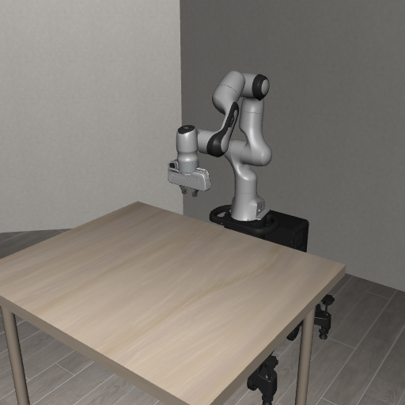

#### 5.3) 빈 초기 장면을 PNG로 저장하고 확인

[test_libero_tabletop.py](./custom_task_validation/test_libero_tabletop.py)는 위 초기 자세 코드를 실행하고 같은 빈 장면을 `libero_tabletop_test.png`로 저장한다. 기존 benchmark의 BDDL이나 `init_states`를 불러오지 않으므로, 다른 물체가 장면에 추가되지 않는다.

```powershell
& $liberoPython .\test_libero_tabletop.py
```

VSCode 탐색기에서 PNG를 열거나 PowerShell에서 다음 명령으로 확인한다.

```powershell
Invoke-Item .\libero_tabletop_test.png
```

사진에서 책상과 Panda만 보이는지, 로봇의 초기 자세가 정상인지 확인한다. 이후 6장에서 서랍 Task에 필요한 Fixture를 추가하고, 7장에서 그 작업의 Action과 Goal을 검사한다.


### 6\. 새 LIBERO BDDL task를 작업명세서로 작성하고, 실제 Tabletop 시뮬레이션에서 돌아가는지 검증

> **6번은 위 [전체 파이프라인](#전체-파이프라인)의 `BDDL 준비 → 환경 생성 → env.reset() → 초기 이미지 확인` 구간이다.** 작업을 시작할 수 있는 환경이 만들어지는지 확인한다.

#### 6.1) 기준이 되는 공식 서랍 BDDL 확인

6장부터 Task에 필요한 요소를 추가한다. 가운데 서랍 열기의 기준 파일은 다음 경로에 있다.

```text
libero/libero/bddl_files/libero_goal/open_the_middle_drawer_of_the_cabinet.bddl
```

공식 파일의 서랍 이름·Region·Goal을 참고하되, 실행할 Custom BDDL에는 서랍 작업에 필요한 요소만 남긴다.

#### 6.2) custom_tasks 폴더 생성

LIBERO 루트에서 `custom_tasks` 폴더를 준비한다. 이미 있어도 아래 명령은 그대로 실행할 수 있다.

```powershell
New-Item -ItemType Directory -Path .\custom_tasks -Force | Out-Null
```

Custom BDDL이 없는 경우에만 공식 Tabletop BDDL을 복사해 작성한다. 이미 준비된 파일은 바로 내용을 확인한다.

**현재 task: 나무 캐비닛의 가운데 서랍 열기**

영어 작업 명령은 `Open the middle layer of the drawer`다. Panda 로봇이 가운데 서랍 손잡이를 잡고 당겨 서랍을 여는 작업이다. BDDL의 성공 조건은 가운데 서랍 영역인 `wooden_cabinet_1_middle_region`이 열린 상태가 되는 것이다.

```powershell
if (-not (Test-Path -LiteralPath ".\custom_tasks\custom_test.bddl")) {
    Copy-Item `
    ".\libero\libero\bddl_files\libero_goal\open_the_middle_drawer_of_the_cabinet.bddl" `
    ".\custom_tasks\custom_test.bddl" `
    -Force
}
```

복사 확인

`Get-Content .\custom_tasks\custom_test.bddl | Select-Object -First 10`

복사한 파일을 VSCode 탐색기에서 열고, 아래 BDDL 전체로 교체해 저장한다. 불필요한 물체·Fixture와 그 Region·Init을 제거한 실행용 `custom_test.bddl`이다.

```lisp
(define (problem LIBERO_Tabletop_Manipulation)
  (:domain robosuite)
  (:language Open the middle layer of the drawer)

  (:regions
    (cabinet_region
      (:target main_table)
      (:ranges ((0.02 -0.25 0.04 -0.23)))
      (:yaw_rotation ((3.141592653589793 3.141592653589793)))
    )
    (middle_region (:target wooden_cabinet_1))
  )

  (:fixtures
    main_table - table
    wooden_cabinet_1 - wooden_cabinet
  )

  (:objects)

  (:obj_of_interest wooden_cabinet_1_middle_region)

  (:init
    (On wooden_cabinet_1 main_table_cabinet_region)
    (Close wooden_cabinet_1_middle_region)
  )

  (:goal
    (And (Open wooden_cabinet_1_middle_region))
  )
)
```

**첫 custom task에서의 고려 요소**

첫 custom task에서는 `(define (problem LIBERO_Tabletop_Manipulation)` 부분을 유지한다. 이 이름은 LIBERO가 Tabletop manipulation 환경 클래스를 선택할 때 사용한다.

첫 Task에서는 LIBERO가 지원하는 캐비닛과 서랍 Goal로 로딩·초기화·Action·성공 판정을 확인한다. 수정할 때는 다음 항목을 함께 확인한다.

- Objects → 어떤 물체를 사용할 것인가
- Regions → 테이블 위 어디에 배치하거나 어떤 물체의 영역을 사용할 것인가
- Init → 시작할 때 물체가 어디에 있고 어떤 상태인가
- Goal → 어떤 상태가 되면 task 성공인가

현재 `custom_test.bddl`은 공식 서랍 Task를 참고해 책상·캐비닛과 필요한 조건만 남긴 파일이다. 조작 물체가 필요 없어 `:objects`는 비워 두었다. 이 파일로 로딩과 초기화가 되는지 확인하고, 새로운 작업을 정의할 때 `:language`와 `:goal`을 함께 수정한다. 대상이 달라지면 `:obj_of_interest`도 맞춰 주고, 배치가 달라지면 `:regions`와 `:init`을 확인한다. 자연어 설명만 바꿔서는 성공 조건이 바뀌지 않는다.

BDDL의 각 항목은 다음과 같다.

```lisp
(define (problem LIBERO_Tabletop_Manipulation)

(:domain robosuite)

(:language ...)
; 자연어 작업 명령

(:regions
    ...
)
; 물체/fixture가 배치될 영역

(:fixtures
    ...
)
; 테이블, 캐비닛, 스토브 등 고정 환경 요소

(:objects
    ...
)
; 조작 대상 물체

(:obj_of_interest
    ...
)
; task에서 중요하게 보는 대상

(:init
    ...
)
; 시작 상태

(:goal
    ...
)
; 성공 조건
)
```

이 구조를 바탕으로 물체, 초기 상태, 성공 조건을 정의한다. Parser와 환경 생성 과정은 위 [전체 파이프라인](#전체-파이프라인)에서 확인할 수 있다.

#### 6.3) Custom BDDL 직접 실행

`OffScreenRenderEnv`에 BDDL 경로를 직접 전달한다. Benchmark 등록은 여러 Task를 suite로 관리하는 절차이며, BDDL 한 개를 실행할 때 필수는 아니다.

```text
LIBERO/
├─ custom_tasks/custom_test.bddl  ← 책상·서랍 캐비닛·조건 정의
├─ test_custom_bddl.py           ← 로딩·PNG·모니터링·별도 판정 시험
└─ libero/
```

[test_custom_bddl.py](./custom_task_validation/test_custom_bddl.py)를 LIBERO 루트에 저장한다. 아래 코드는 같은 폴더의 `test_custom_bddl.py`에서 Windows 설정과 환경 생성 함수를 가져와 초기 장면을 저장한다. import부터 종료까지 포함한 최소 실행 예제다. 60 step 검증은 아래 PowerShell 명령으로 실행한다.

```python
import test_custom_bddl as validation

env = validation.make_env(seed=0, size=512)
try:
    obs = env.reset()
    print("Initial goal success:", bool(env.check_success()))
    print("Initial checks:", validation.init_checks(env))
    validation.save_frame(
        validation.IMAGES / "custom_bddl_test.png", obs,
        "Drawer task: initial | goal=False",
    )
finally:
    env.close()
```

`reset()`은 BDDL의 Region과 Init으로 새 장면을 만든다. Benchmark의 저장 상태를 가져오는 과정은 아니다. `agentview_image`는 상하 방향과 RGB/BGR 순서를 보정한 뒤 PNG로 저장한다.

```powershell
& $liberoPython .\test_custom_bddl.py --headless --steps 60 --size 512 --seed 0
```

실행 결과 초기 Goal은 `False`였고, 캐비닛의 `On`과 중간 서랍의 `Close` Init은 모두 `True`였다. 코드에서도 조작 물체 목록이 비어 있고 Fixture가 `wooden_cabinet_1` 하나뿐인지 검사했다. 초기 PNG에는 책상·Panda·서랍 캐비닛만 보인다.


#### 6.4) 시뮬레이터 화면을 실시간·PNG·영상으로 확인하기

`custom_test.bddl`이 초기화된 뒤 화면을 확인하는 방법은 세 가지다. [실행 코드](./custom_task_validation/test_custom_bddl.py)는 `agentview_image`를 OpenCV 창에 표시하고, 초기·종료 화면을 PNG로 저장하며, `--record`를 지정하면 zero action 구간을 MP4로 기록한다. 이미지의 상하 방향과 RGB/BGR 색 순서는 저장·표시 전에 보정한다.

**실시간 화면.** LIBERO 루트에서 다음 명령을 실행한다. OpenCV 창에서 Panda와 서랍이 보이고, 각 step의 `goal=` 값이 갱신되는지 확인한다. 창을 클릭한 뒤 `q`, `Q`, `Esc`로 닫을 수 있다.

```powershell
& $liberoPython .\test_custom_bddl.py --steps 60 --size 512 --seed 0
```

**PNG로 초기·종료 상태 비교.** 같은 실행에서 `reset()` 직후 [초기 장면](./images/custom_bddl_test.png)과 zero action 실행 후 [종료 장면](./images/libero_live_agentview.png)을 저장한다. 두 사진을 열어 서랍과 Panda가 보이는지, 의도하지 않은 장면 변화가 없는지 확인한다. 화면 창 없이 파일만 만들려면 `--headless`를 붙인다.

```powershell
& $liberoPython .\test_custom_bddl.py --headless --steps 60 --size 512 --seed 0
```

VSCode 탐색기에서 `images` 폴더의 PNG를 클릭하거나 다음 명령으로 연다.

```powershell
Invoke-Item .\images\custom_bddl_test.png
Invoke-Item .\images\libero_live_agentview.png
```

**MP4로 step 사이의 움직임 확인.** `--record`를 붙이면 기본 경로 `images/custom_bddl_monitoring.mp4`에 저장한다. 원하는 경로를 지정하려면 `--record images/파일명.mp4`처럼 입력한다. [zero action 모니터링 영상](./images/custom_bddl_monitoring.mp4)에서 초기화 이후 관측 화면이 이어지는지 확인할 수 있다.

```powershell
& $liberoPython .\test_custom_bddl.py --headless --steps 60 --size 512 --seed 0 --record
Invoke-Item .\images\custom_bddl_monitoring.mp4
```

[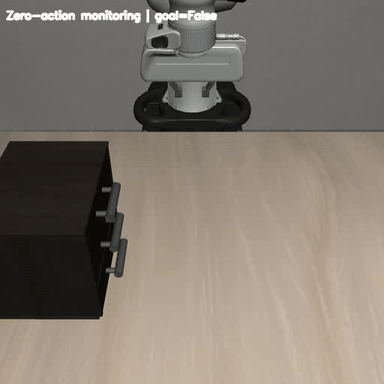](./images/custom_bddl_monitoring.mp4)

이 세 방법은 **환경 로딩과 관측 갱신**을 확인한다. zero action은 서랍을 열기 위한 제어 명령이 아니므로 여기서 Goal 달성을 기대하지 않는다. 7.3의 `--predicate-test`는 서랍 joint를 직접 바꾸어 Goal 판정만 시험하는 별도 실행이다. Panda가 `OSC_POSE` action으로 실제 서랍을 열어 성공한 과정은 7.4의 `test_panda_drawer_action.py`와 그 결과 사진·영상에서 확인한다.

#### 6.5) Windows 렌더링 설정 유지하기

5.1에서 현재 PowerShell에 `MUJOCO_GL=wgl`을 설정하며, 테스트 파일도 robosuite를 import하기 전에 같은 설정을 적용한다. `NUMBA_DISABLE_JIT=1`은 이 Windows 환경에서 오래 걸리는 Numba 초기화를 피하기 위한 설정이다.

```powershell
$env:MUJOCO_GL = 'wgl'
$env:NUMBA_DISABLE_JIT = '1'
& $liberoPython .\configure_libero_windows.py
& $liberoPython .\test_custom_bddl.py --headless --steps 60 --size 512 --seed 0
```

첫 명령은 현재 설치의 WGL 분기와 DLL을 확인하고, 두 번째 명령은 실제 환경 생성·렌더링을 확인한다. 새 터미널에서는 5.1을 다시 실행한다. 실시간 OpenCV 창을 열려면 `--headless`를 빼고 실행한 뒤 `q`, `Q`, `Esc`로 종료한다.

### 7. LIBERO Custom Task Action 실행 및 Goal Condition 검증

> **7번은 위 [전체 파이프라인](#전체-파이프라인)의 `초기 goal 확인 → action 전달 → observation 갱신 → goal 검사` 구간이다.** 6번에서 만든 환경에 action을 전달하고, 실행 전후의 성공 조건을 확인한다. 7.2에서는 zero action으로 연결을 점검하고, 7.3에서는 goal condition이 정상적으로 판정되는지 확인한다.

이 단계에서도 6장의 [test_custom_bddl.py](./custom_task_validation/test_custom_bddl.py)를 사용한다. 초기 Goal과 zero action을 확인하고, `--predicate-test`를 지정하면 모니터링 녹화가 끝난 뒤 서랍 joint의 판정 시험을 수행한다. 실제 Panda의 서랍 열기는 별도 실행 파일로 검증한다.

먼저 6.2에서 준비한 `custom_tasks/custom_test.bddl`이 있는지 확인한다. 터미널의 현재 위치는 `custom_tasks`나 `libero` 하위 폴더가 아닌, `requirements.txt`와 `custom_tasks`가 있는 LIBERO 루트여야 한다. 이 저장소에서는 `docs/W5/LIBERO`에 해당한다.

```powershell
Test-Path .\custom_tasks\custom_test.bddl
```

결과가 `True`이면 아래 코드 작성으로 진행한다. `False`이면 6.2의 BDDL 복사 과정과 현재 폴더를 확인한다.

#### 7.1) initial state에서 goal이 False인지 확인

현재 서랍 task는 시작할 때 가운데 서랍이 닫혀 있고 goal은 열린 상태이므로 `False`가 예상된다. `True`가 나오면 초기 상태가 이미 goal을 만족하는지 BDDL과 장면을 확인한다.

아래 최소 예제는 환경을 생성한 뒤 초기 Goal을 출력하고 종료한다. 같은 검사는 `test_custom_bddl.py`에도 포함돼 있다. 실행 후 `Initial goal success: False`를 확인한다.

```python
import test_custom_bddl as validation

env = validation.make_env(seed=0, size=512)
try:
    env.reset()
    print("Initial goal success:", bool(env.check_success()))
finally:
    env.close()
```

#### 7.2) env.step(action)이 정상적으로 동작하는지 확인

실제 서랍을 당기기 전에 값이 모두 0인 `zero action`으로 Action 인터페이스와 관측 갱신을 확인한다. `env.step(action)`은 컨트롤러를 통해 MuJoCo에 명령을 반영하고 제어 step을 진행한 뒤 observation·reward·done·info를 반환한다.

기본 Panda `OSC_POSE`의 Action은 7차원이다.

```text
[dx, dy, dz, dRx, dRy, dRz, gripper]
```

- `dx, dy, dz`: 말단(End-Effector)의 위치 변화 명령
- `dRx, dRy, dRz`: 말단의 회전 변화 명령
- `gripper`: 그리퍼 개폐 명령

이번 검사는 다음 코드를 반복한다. 값이 0이어도 중력·접촉과 물리 시뮬레이션은 계속 진행된다.

```python
import test_custom_bddl as validation
import numpy as np

env = validation.make_env(seed=0, size=512)
try:
    obs = env.reset()
    action = np.zeros(7, dtype=np.float32)
    obs, reward, done, info = env.step(action)
    print("Goal after one step:", bool(env.check_success()))
    print("Image shape:", obs["agentview_image"].shape)
finally:
    env.close()
```

```powershell
& $liberoPython .\test_custom_bddl.py --headless --steps 60 --size 512 --seed 0 --record
```

새 최소 장면에서 60 step을 실행했고 Goal은 계속 `False`였다. 초기 상태는 `reset()`으로 한 번 생성하며, 반복 중에는 `step()`과 관측·Goal 갱신만 수행한다. 결과는 [JSON](./images/custom_bddl_result.json)의 `monitoring`에 기록했다.


[](./images/custom_bddl_monitoring.mp4)

실시간 창으로 보려면 `--headless`를 빼고 실행한다. `cv2.putText()`로 각 frame의 Goal을 표시하며, 창을 클릭한 뒤 `q`, `Q`, `Esc`로 종료한다. `env.close()`와 `cv2.destroyAllWindows()`는 종료 시 실행된다.

이 단계는 **Action 전달 → MuJoCo 진행 → 관측 반환 → Goal 검사**가 연결되는지 확인한 결과다. 서랍을 여는 제어 명령은 아직 입력하지 않았으므로 Goal `False`가 정상이다.

#### 7.3) BDDL Goal Condition 정상 동작 확인

Panda의 실제 서랍 열기와 별도로, 서랍이 열린 상태에서 `Open` Predicate가 `True`를 반환하는지 확인한다. Goal 정의가 맞는지 먼저 알아야 로봇 동작이 실패했을 때 원인을 구분할 수 있다.

```lisp
(:goal (And (Open wooden_cabinet_1_middle_region)))
```

다음 명령의 `--predicate-test`는 zero action 녹화가 끝난 뒤 joint 값을 직접 바꾼다. 따라서 모니터링 MP4와 직접 상태 변경 시험의 MP4는 별도 파일이다.

```powershell
& $liberoPython .\test_custom_bddl.py --headless --steps 60 --size 512 --seed 0 --record --predicate-test
```

실행 코드의 핵심은 joint의 범위 안에서 값을 설정하고, 시뮬레이터·관측을 갱신한 뒤 Goal을 읽는 것이다.

```python
import test_custom_bddl as validation

env = validation.make_env(seed=0, size=512)
try:
    env.reset()
    joint_id = env.sim.model.joint_name2id(validation.JOINT_NAME)
    low, high = env.sim.model.jnt_range[joint_id]
    for fraction in (0.9, 0.1):
        target = float(low + fraction * (high - low))
        env.sim.data.set_joint_qpos(validation.JOINT_NAME, target)
        obs = validation.refresh_obs(env)
        print("Joint:", target, "Goal:", bool(env.check_success()))
finally:
    env.close()
```

joint `wooden_cabinet_1_middle_level`의 범위는 `[-0.16, 0.01] m`다. 같은 범위에서 두 방향을 검사한 결과는 다음과 같다.

| 직접 설정한 상태 | joint qpos | Goal |
| --- | ---: | --- |
| high 쪽 90% 위치 | −0.007 m | `False` |
| low 쪽 10% 위치 | −0.143 m | `True` |

qpos가 감소하는 방향으로 서랍이 열리며, 사진에서 열린 모습과 `Open=True`가 일치했다. [결과 JSON](./images/custom_bddl_result.json)의 `predicate_test`에 설정값과 판정이 있다.

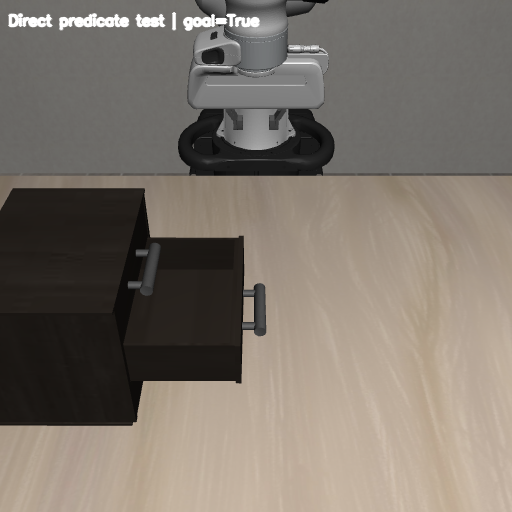

[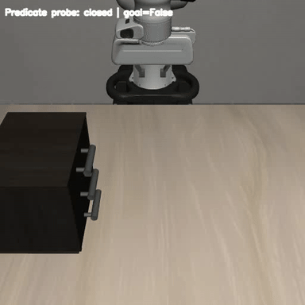](./images/custom_bddl_predicate_test.mp4)

이 결과는 Predicate의 동작을 확인한 것이다. Panda가 손잡이를 잡고 당긴 결과는 다음 절에서 별도로 확인한다.

#### 7.4) Panda OSC_POSE Action으로 실제 서랍 열기 및 Task Success 검증

7.3에서는 가운데 서랍의 MuJoCo joint 값을 직접 변경하여 BDDL의 Goal Condition이 `False → True`로 변경되는지 확인하였다. 7.4에서는 Panda 로봇에 실제 OSC_POSE action을 입력하여 서랍을 열고, 최종적으로 `env.check_success()`가 `True`가 되는지 확인한다.

**7.4에서 사용하는 용어**

**Drawer joint 뜻:** `Drawer`는 서랍, `joint`는 관절 또는 연결부를 뜻한다. 여기서는 **서랍의 이동 관절**, 즉 서랍이 캐비닛에 연결되어 레일을 따라 앞뒤로 움직이도록 하는 부분을 말한다.

실제 서랍으로 생각하면, 서랍 본체는 `body`, 레일을 따라 움직이는 방식은 `joint`, 손잡이의 모양과 접촉 부분은 `geom`에 해당한다. `site`는 물체에 붙여 둔 기준 위치나 영역이다.

| 용어 | 뜻 | 이번 코드에서의 역할 |
| --- | --- | --- |
| `body` | 함께 움직이는 물체의 한 부분 | 가운데 서랍 본체. 여기에 손잡이 geom과 서랍 내부 site가 붙어 있다. |
| `Drawer joint` — 서랍의 이동 관절 | 서랍을 캐비닛에 연결해 레일을 따라 앞뒤로 움직이게 하는 부분 | `wooden_cabinet_1_middle_level`. 한 축을 따라 이동하는 slide joint다. |
| `qpos` | joint의 현재 위치 값 | 이 slide joint에서는 이동량이며 단위는 m다. 현재 값과 goal을 비교해 서랍이 얼마나 열렸는지 확인한다. |
| `joint range` | joint가 움직일 수 있는 위치 범위 | `[-0.16, 0.01]`. 이 범위 자체가 성공 조건은 아니며, 성공 여부는 `env.check_success()`로 확인한다. |
| `joint axis` | joint 위치 값이 증가하는 방향 | 이 서랍이 레일을 따라 움직이는 방향을 나타낸다. 열리는 쪽은 이번 task에서 이 축의 반대 방향이다. |
| `site` | 위치·방향 또는 영역을 지정하는 가상의 기준. 자체적으로 충돌을 만들지는 않는다. | `wooden_cabinet_1_middle_region`은 서랍 내부 영역이다. Panda의 `grip_site`는 그리퍼 제어 기준 위치다. |
| `geom` | 물체를 이루는 모양. 설정에 따라 화면 표시나 충돌 계산에 사용된다. | `wooden_cabinet_1_g29`는 손잡이의 충돌 geom이다. 코드에서는 그 위치를 읽어 그리퍼의 접근 목표로 사용한다. |
| `EEF` / `End-Effector` | 로봇 팔 끝에서 작업하는 부분 | 이번 Panda에서는 그리퍼 끝의 제어 기준 위치를 뜻한다. `obs["robot0_eef_pos"]`로 현재 위치를 읽는다. |
| `local` / `world` 좌표계 | 물체에 붙은 좌표 기준 / 시뮬레이션 전체의 좌표 기준 | 캐비닛이 회전하면 local 축과 world 축도 달라진다. Panda가 어느 방향으로 당길지 정하려면 world axis를 사용한다. |

Joint·site·geom의 기본 정의는 [MuJoCo 공식 XML 문서](https://mujoco.readthedocs.io/en/stable/XMLreference.html#body-joint)를 참고했다. 표의 이름과 값은 현재 LIBERO의 wooden cabinet 모델과 실행 코드를 기준으로 한다.

**서랍 내부 영역과 손잡이 위치의 구분**

`wooden_cabinet_1_middle_region`은 가운데 서랍 내부에 설정된 site다. 7.3에서는 이 영역에 연결된 joint를 찾아 서랍이 열렸는지 확인한다. 이 site의 위치를 그대로 손잡이 위치로 사용하면 서랍 안쪽을 향하게 된다.

7.4에서는 손잡이 geom인 `wooden_cabinet_1_g29`의 위치를 접근 목표로 사용한다. 따라서 joint는 **어느 방향으로 움직이고 얼마나 열렸는지**, 손잡이 geom은 **그리퍼가 어디로 접근해야 하는지**를 확인하는 데 쓰인다.

**코드에 나온 변수 읽기**

- `joint_name2id()` / `geom_name2id()`: 이름으로 해당 joint·geom의 내부 번호를 찾는다. `joint_id`, `body_id`, `handle_id`는 좌표가 아니라 이 번호다.
- `geom_xpos[handle_id]`: 현재 손잡이 geom의 world 좌표 위치를 읽는다. 코드에서는 이를 `handle_pos`에 저장한다.
- `body_xmat[body_id]`: 서랍 body가 world 좌표계에서 어떤 방향을 향하는지 나타내는 회전 행렬이다. `body_rotation @ joint_axis_local`로 local 축을 world 축으로 바꾼다.
- `opening_direction`: 실제로 서랍을 당길 방향이다. 이번 task는 qpos가 감소할 때 열리므로 `-axis_world`를 사용한다.

기존 7.4.1의 정보 확인 내용은 이 단계에 합치고, 실행 코드는 아래 두 파일로 분리한다. 두 파일 모두 LIBERO 루트에 저장하며, `test_custom_bddl.py`에 이어 붙이지 않는다.

| 실행 파일 | 역할 |
| --- | --- |
| [`test_panda_drawer_info.py`](./custom_task_validation/test_panda_drawer_info.py) | Panda EEF 위치, Drawer joint world axis, 손잡이 geom 위치 확인 |
| [`test_panda_drawer_action.py`](./custom_task_validation/test_panda_drawer_action.py) | 손잡이에 접근 → 잡기 → 당기기 → Task Success 확인 |

두 파일은 각각 `env.reset()`으로 닫힌 초기 상태에서 시작한다. 7.3의 joint 직접 변경 코드를 실행하지 않으므로, 이미 열린 서랍에서 `True`가 나오는 경우와 구분할 수 있다.

**먼저 Panda End-Effector와 Drawer Joint 정보 확인**

7.3에서 확인한 가운데 서랍 joint는 `wooden_cabinet_1_middle_level`이고, 범위는 `[-0.16, 0.01]`이다. `qpos ≈ -0.007`에서는 Goal이 `False`, `qpos ≈ -0.143`에서는 `True`였으므로 joint qpos가 음수 방향으로 이동할수록 열리는 구조임을 확인하였다.

하지만 joint qpos의 음수 방향이 곧바로 world 좌표계의 -X, -Y, -Z를 의미하는 것은 아니다. 따라서 action을 작성하기 전에 Panda End-Effector 위치, 서랍 joint의 world axis, 손잡이 위치를 먼저 확인한다.

LIBERO 루트에 `test_panda_drawer_info.py`를 만들고 아래 전체 코드를 저장한다. 위치와 joint 정보를 출력한 뒤 종료하는 코드다.

```python
"""Inspect the only task fixture and the Panda in the minimal drawer scene."""

import json
import test_custom_bddl as validation


def main():
    env = validation.make_env(seed=0, size=512)
    try:
        obs = env.reset()
        scene = validation.scene_info(env)
        joint_id = env.sim.model.joint_name2id(validation.JOINT_NAME)
        body_id = env.sim.model.jnt_bodyid[joint_id]
        local_axis = env.sim.model.jnt_axis[joint_id]
        world_axis = env.sim.data.body_xmat[body_id].reshape(3, 3) @ local_axis
        handle_id = env.sim.model.geom_name2id("wooden_cabinet_1_g29")
        result = {"scene": scene, "eef_position_m": obs["robot0_eef_pos"].tolist(),
                  "initial_goal": bool(env.check_success()),
                  "initial_checks": validation.init_checks(env),
                  "drawer_joint": validation.JOINT_NAME,
                  "drawer_joint_range_m": env.sim.model.jnt_range[joint_id].tolist(),
                  "drawer_joint_qpos_m": float(env.sim.data.get_joint_qpos(validation.JOINT_NAME)),
                  "drawer_joint_local_axis": local_axis.tolist(),
                  "drawer_joint_world_axis": world_axis.tolist(),
                  "handle_geom": "wooden_cabinet_1_g29",
                  "handle_position_m": env.sim.data.geom_xpos[handle_id].tolist()}
        validation.IMAGES.mkdir(parents=True, exist_ok=True)
        output = validation.IMAGES / "panda_drawer_info.json"
        output.write_text(json.dumps(result, indent=2), encoding="utf-8")
        print(json.dumps(result, indent=2), flush=True)
        print("Saved:", output, flush=True)
    finally:
        env.close()


if __name__ == "__main__":
    main()
```

LIBERO 루트의 PowerShell 터미널에서 실행한다.

```powershell
& $liberoPython .\test_panda_drawer_info.py
```

출력 JSON에서 `initial_goal: false`, joint range, world axis, 손잡이 geom의 이름과 위치를 확인한다. 현재 asset의 가운데 손잡이 충돌 geom은 `wooden_cabinet_1_g29`다. World axis는 대략 `[0, -1, 0]`이므로 이 배치에서 서랍이 열리는 방향은 반대쪽인 world `+Y`다. 위치는 초기화할 때 달라질 수 있으므로 코드에서 현재 모델의 좌표를 읽어 사용한다.

**Panda OSC_POSE Action으로 실제 서랍 열기**

실제 서랍 열기는 다음 순서로 진행한다.

```text
손잡이 위치와 서랍이 움직이는 축 확인
    ↓
Gripper open → 손잡이 앞쪽 위에서 자세 맞추기 → 손잡이에 접근
    ↓
Gripper close → 손잡이를 잡은 상태로 잠시 유지
    ↓
서랍 opening 방향으로 End-Effector 이동
    ↓
Gripper release → 손잡이에서 후퇴
    ↓
env.check_success(): False → True, 마지막 검증 구간 유지 확인
```

OSC_POSE action의 구성은 7.2와 같으며, 마지막 값으로 gripper를 제어한다. PandaGripper에서는 `-1`이 open, `+1`이 close다. 위치와 회전 오차를 기본 OSC_POSE의 action scale에 맞춰 변환하고, joint 값은 직접 수정하지 않는다.

LIBERO 루트에 `test_panda_drawer_action.py`를 만들고 아래 전체 코드를 저장한다. `HANDLE_GEOM`은 현재 wooden cabinet asset의 손잡이 이름이므로, 다른 asset을 사용하면 정보 확인 코드로 이름을 다시 확인한다.

```python
"""Open the minimal scene's middle drawer using Panda actions only."""

import argparse
import json

import test_custom_bddl as validation
import cv2
import numpy as np
from scipy.spatial.transform import Rotation

JOINT_NAME = validation.JOINT_NAME
HANDLE_GEOM = "wooden_cabinet_1_g29"


def main():
    parser = argparse.ArgumentParser()
    parser.add_argument("--headless", action="store_true", help="Run without an OpenCV window.")
    parser.add_argument("--seed", type=int, default=0)
    parser.add_argument("--size", type=int, default=512)
    args = parser.parse_args()
    env = validation.make_env(args.seed, args.size)
    writer = None
    try:
        obs = env.reset()
        initial_goal = bool(env.check_success())
        scene = validation.scene_info(env)
        initial_checks = validation.init_checks(env)
        if initial_goal or not all(initial_checks.values()):
            raise RuntimeError("Start with a correctly placed, closed middle drawer.")
        validation.save_frame(validation.IMAGES / "panda_drawer_action_initial.png", obs,
                              "Panda drawer action: initial | goal=False")
        video_path = validation.IMAGES / "panda_drawer_action.mp4"
        writer = validation.open_writer(video_path, args.size, fps=10)
        writer.write(validation.frame_from(obs, "Panda drawer action: initial | goal=False"))
        initial_joint = float(env.sim.data.get_joint_qpos(JOINT_NAME))
        print("Initial goal success:", initial_goal, flush=True)
        joint_id = env.sim.model.joint_name2id(JOINT_NAME)
        body_id = env.sim.model.jnt_bodyid[joint_id]
        rotation = env.sim.data.body_xmat[body_id].reshape(3, 3)
        axis_world = rotation @ env.sim.model.jnt_axis[joint_id]
        opening_direction = -axis_world / np.linalg.norm(axis_world)
        handle_id = env.sim.model.geom_name2id(HANDLE_GEOM)
        handle_pos = env.sim.data.geom_xpos[handle_id].copy()
        print("Handle position:", handle_pos, flush=True)
        print("Opening direction:", opening_direction, flush=True)
        tool_z = -opening_direction
        tool_x = np.array([0.0, 0.0, 1.0])
        tool_y = np.cross(tool_z, tool_x)
        target_rotation = np.column_stack((tool_x, tool_y, tool_z))
        step_count = 0
        eef_site_id = env.env.robots[0].eef_site_id
        phases = []
        verification_goals = []
        grasp_confirmed = False

        def eef_rotation():
            return env.sim.data.site_xmat[eef_site_id].reshape(3, 3).copy()

        def step_toward(target, gripper, phase):
            nonlocal obs, step_count
            rotation_error = Rotation.from_matrix(target_rotation @ eef_rotation().T).as_rotvec()
            action = np.zeros(7, dtype=np.float32)
            action[:3] = np.clip((target - obs["robot0_eef_pos"]) / .05, -.4, .4)
            action[3:6] = np.clip(rotation_error / .5, -.4, .4)
            action[6] = gripper
            obs, _, _, _ = env.step(action)
            step_count += 1
            if phase == "Verify":
                verification_goals.append(bool(env.check_success()))
            if step_count % 2 == 0:
                writer.write(validation.frame_from(obs, "{} | goal={}".format(phase, env.check_success())))
            if step_count % 25 == 0:
                print("{} | Step: {} | Joint: {:.4f} | Success: {}".format(
                    phase, step_count, env.sim.data.get_joint_qpos(JOINT_NAME), env.check_success()), flush=True)
            if not args.headless:
                cv2.imshow("Panda Drawer Action", validation.frame_from(obs, "{} | goal={}".format(
                    phase, env.check_success())))
                if cv2.waitKey(1) & 0xFF in (ord("q"), ord("Q"), 27):
                    raise KeyboardInterrupt

        def move_to(target, gripper, phase, max_steps=200, hold=False):
            target = np.asarray(target, dtype=float)
            start_step = step_count
            for _ in range(max_steps):
                step_toward(target, gripper, phase)
                error = np.linalg.norm(target - obs["robot0_eef_pos"])
                rotation_error = Rotation.from_matrix(target_rotation @ eef_rotation().T).magnitude()
                if not hold and error < .015 and rotation_error < .12:
                    break
            if not hold and (error >= .015 or rotation_error >= .12):
                raise RuntimeError("{}: EEF error={:.4f} m, rotation error={:.4f} rad".format(
                    phase, error, rotation_error))
            phases.append({"phase": phase, "steps": step_count - start_step,
                           "joint_qpos_m": float(env.sim.data.get_joint_qpos(JOINT_NAME)),
                           "goal": bool(env.check_success())})

        pregrasp = handle_pos + .10 * opening_direction
        above = pregrasp + np.array([0., 0., .15])
        move_to(above, -1., "Above handle")
        move_to(pregrasp, -1., "Before handle")
        move_to(handle_pos, -1., "Approach handle")
        move_to(handle_pos, 1., "Close gripper", max_steps=30, hold=True)
        cabinet = env.env.fixtures_dict["wooden_cabinet_1"]
        gripper = env.env.robots[0].gripper
        # Check both finger pads against the middle drawer's handle geometry.
        grasp_confirmed = bool(env.env._check_grasp(gripper, HANDLE_GEOM))
        start = obs["robot0_eef_pos"].copy()
        start_step = step_count
        for distance in np.linspace(0., .18, 180):
            step_toward(start + distance * opening_direction, 1., "Pull drawer")
            if env.check_success():
                break
        phases.append({"phase": "Pull drawer", "steps": step_count - start_step,
                       "joint_qpos_m": float(env.sim.data.get_joint_qpos(JOINT_NAME)),
                       "goal": bool(env.check_success())})
        if not env.check_success():
            raise RuntimeError("The Panda action did not open the drawer.")
        # Release and retreat, then verify the drawer stays open without hand support.
        released_position = obs["robot0_eef_pos"].copy()
        move_to(released_position, -1., "Release", max_steps=20, hold=True)
        move_to(released_position + .10 * opening_direction + [0., 0., .12], -1., "Retreat")
        move_to(obs["robot0_eef_pos"].copy(), -1., "Verify", max_steps=30, hold=True)
        success = bool(env.check_success())
        gripper_released = not bool(env.env.check_contact(gripper, cabinet))
        if not success or not all(verification_goals) or not gripper_released or not grasp_confirmed:
            raise RuntimeError("Final goal, grasp, release or stability check failed.")
        validation.save_frame(validation.IMAGES / "panda_drawer_action_result.png", obs,
                              "Panda drawer action complete | goal=True")
        result = {"bddl": "custom_tasks/custom_test.bddl", "seed": args.seed,
                  "camera_size": args.size, "scene": scene, "initial_goal": initial_goal,
                  "initial_checks": initial_checks, "initial_drawer_joint_m": initial_joint,
                  "action": {"steps": step_count, "phases": phases,
                    "goal_after_robot_action": success,
                    "final_drawer_joint_m": float(env.sim.data.get_joint_qpos(JOINT_NAME)),
                    "grasp_confirmed": grasp_confirmed, "gripper_released": gripper_released,
                    "verification_steps": len(verification_goals),
                    "goal_true_throughout_verification": all(verification_goals),
                    "direct_object_state_changes_during_action": False,
                    "control_frequency_hz": 20, "video_frequency_hz": 10,
                    "video": str(video_path.relative_to(validation.ROOT))}}
        output = validation.IMAGES / "panda_drawer_action_result.json"
        output.write_text(json.dumps(result, indent=2), encoding="utf-8")
        print(json.dumps(result, indent=2), flush=True)
        print("Saved:", output, flush=True)
    finally:
        if writer is not None:
            writer.release()
        env.close()
        cv2.destroyAllWindows()


if __name__ == "__main__":
    try:
        main()
    except KeyboardInterrupt:
        print("Stopped by user.", flush=True)
```


저장한 뒤 실행한다. 창에는 각 단계와 현재 성공 여부가 표시된다. 실행 중 영상 창에서 `q`, `Q`, `ESC`를 누르거나 터미널에서 `Ctrl+C`를 누르면 종료한다.

```powershell
& $liberoPython .\test_panda_drawer_action.py
```

창 없이 실행해도 같은 해상도로 기록할 수 있다. 다음 명령은 512×512 사진과 영상을 저장한다.

```powershell
& $liberoPython .\test_panda_drawer_action.py --headless --size 512 --seed 0
```

책상·Panda·캐비닛만 있는 장면에서 `seed=0`으로 다시 실행했다. 초기 `On`·`Close`는 모두 `True`, Goal은 `False`였다. 실제 Action은 **369 step**이었고, 그리퍼가 손잡이에서 떨어진 뒤 마지막 30 step 내내 Goal `True`가 유지됐다. 최종 서랍 joint는 **−0.141538 m**였다. 이 검증 구간도 총 step에 포함된다.


[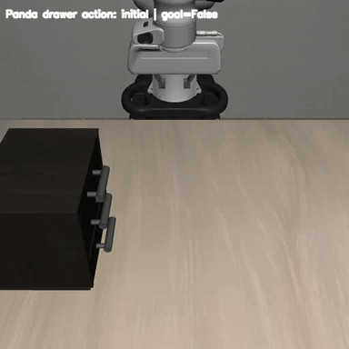](./images/panda_drawer_action.mp4)

[서랍 Action 결과 JSON](./images/panda_drawer_action_result.json)

결과 이미지는 `LIBERO/images/panda_drawer_action_result.png`에 저장된다. Panda가 `env.step(action)`으로 손잡이를 잡고 서랍을 연 뒤 `env.check_success()`가 `False → True`로 바뀌면 실제 task 수행에 성공한 것이다. 목표 위치에 도달하지 못하거나 최종 goal이 `False`이면 오류를 출력하므로, 접근 위치와 grasp 상태를 확인한다.

### 8. BDDL 구성 요소 변경 및 새로운 요소 추가를 통한 Custom Task 검증

#### 8.1) 검증 목적과 고려 사항

기존 Tabletop 환경에서 새로운 Custom Task를 정의할 때 `Object`, `Region`, `Init`, `Goal` 네 요소를 검토한다. 네 요소를 모두 변경해야 하는 것은 아니다. 먼저 기존 Task에서 유지할 항목과 바꿀 항목을 정하고, 변경한 정의가 환경의 초기 상태와 성공 판정에 실제로 반영되는지 확인한다.

| 요소 | 구체적으로 고려할 사항 |
| --- | --- |
| `Object` | 조작 대상이 무엇인지, 기존 BDDL의 물체를 그대로 사용할지 또는 LIBERO에 등록된 다른 물체를 `:objects`에 추가할지 정한다. 새 물체를 쓰면 배치할 공간과 초기 조건도 함께 확인한다. |
| `Region` | 물체의 시작 위치와 목표 위치를 어느 `:target`을 기준으로 정의할지 정한다. Table을 유지하고 작업 영역만 바꾸는 경우에는 `main_table`을 그대로 두고 `:ranges`의 좌표가 물체 크기와 로봇 도달 범위에 맞는지 확인한다. |
| `Init` | 시작 시 각 물체가 어느 Region에 놓이고 Fixture가 어떤 상태여야 하는지 정한다. `:init`에서 참조하는 물체와 Region의 이름이 실제 정의와 일치하는지, 초기 배치가 Goal을 이미 만족하지 않는지 확인한다. |
| `Goal` | 성공으로 인정할 물체와 상태 또는 영역을 정한다. `:goal`에 사용한 Predicate가 LIBERO에서 지원되는지 확인하고, 초기 상태에서는 `False`, 목표 상태에서는 `True`가 되는지 검사한다. |

기존 조건이 어떻게 판정되는지 코드를 확인했다. 아래 코드는 `docs/W5/LIBERO/libero/libero/envs/predicates/base_predicates.py`의 [`On`과 `Open` 구현](./custom_task_validation/reference_code/libero/libero/envs/predicates/base_predicates.py)에서 가져왔다.

```python
import test_custom_bddl
from libero.libero.envs.predicates.base_predicates import BinaryAtomic, UnaryAtomic

class On(BinaryAtomic):
    def __call__(self, arg1, arg2):
        return arg2.check_ontop(arg1)

class Open(UnaryAtomic):
    def __call__(self, arg):
        return arg.is_open()
```

예를 들어 BDDL의 `(On plate_1 main_table_plate_region)`은 `On`에 접시와 영역을 전달한다. `check_ontop()`이 접시가 그 영역 위에 있다고 판단하면 `True`를 반환한다. `(Open wooden_cabinet_1_middle_region)`은 `is_open()`으로 해당 서랍이 열렸는지 판단한다. `:init`은 시작할 때 만족시킬 조건을, `:goal`은 성공 여부를 확인할 조건을 적는 곳이다. `And`는 여러 조건을 모두 만족해야 한다는 논리 연산자다.

| 요소 | BDDL에서 확인할 항목 | 검증 기준 |
| --- | --- | --- |
| `Object` | `:objects`의 인스턴스 이름과 물체 종류, `:obj_of_interest`의 대상 | 물체 종류가 LIBERO에 등록되어 있고 인스턴스 이름이 중복되지 않는지, Init·Goal에서 참조하는 물체가 실제로 선언되어 생성되는지 확인한다. |
| `Region` | `:regions`의 영역 이름, `:target`, `:ranges`, 필요한 경우 `:yaw_rotation` | `:target`이 존재하는 Table·Fixture·Object를 가리키는지, 좌표 범위와 회전이 유효한지, 물체를 놓을 수 있고 로봇이 도달할 수 있는지 확인한다. Table을 유지하면서 작업 영역만 바꾸는 경우에는 `:target`을 유지하고 `:ranges`를 검토한다. |
| `Init` | `:init`의 각 Predicate와 인수로 사용한 Object·Region·Fixture 이름 | 참조하는 이름과 Predicate가 유효한지, 서로 충돌하는 초기 조건이 없는지, `env.reset()` 후 지정한 위치와 상태가 재현되는지 확인한다. |
| `Goal` | `:goal`의 Predicate, 논리 조합(`And` 등), 목표 대상 | 성공 조건이 Task 지시문과 일치하고 지원되는 Predicate로 표현되는지 확인한다. 초기 상태에서는 `env.check_success()`가 `False`이고 목표를 달성한 상태에서는 `True`인지 검증한다. |

`Fixture`는 캐비닛·스토브처럼 장면에 배치되는 고정 요소이고, `Table`은 물체 배치의 기준면이다. 기존 Fixture와 Table을 유지한다면 추가 선언은 필요 없다. Table 위 작업 영역만 바꾸는 경우에는 Region의 `:target`을 유지하고 `:ranges`를 조정한다. Fixture나 Table 자체를 바꿀 경우에는 연결된 Region과 Init의 참조도 함께 확인한다.

LIBERO에 이미 등록된 물체와 지원되는 Predicate는 BDDL에 추가해 사용할 수 있다. LIBERO에 없는 물체 모델이나 새로운 판정 방식이 필요하다면 BDDL 수정 외에 모델 등록 또는 Predicate 구현이 필요하다. 해당 확장 범위는 뒤에서 별도로 정리한다.

#### 8.2) 새로운 Task 설계 및 Object·Region·Init·Goal 선정

서랍 Task의 로딩·Action·Goal을 확인한 다음, 두 개의 BDDL을 별도로 구성한다. 각 작업에 필요한 물체와 Fixture만 선언한다.

- **검증안 A — 공식 접시 밀기 Task의 요소 재사용:** 공식 `push_the_plate_to_the_front_of_the_stove.bddl`에 있는 `plate_1`, `flat_stove_1`, 시작·목표 Region을 사용한다. 접시의 시작 범위를 조정하고 나머지 물체·Fixture는 제거한다.
- **검증안 B — 등록된 우유를 새 Task에 추가:** `hope_objects.py`의 `Milk` 클래스로 생성하는 `milk`를 사용한다. A의 접시를 놓을 대상으로 유지하고, `milk_1 - milk`와 우유의 Region·Init·Goal을 추가한다. 우유 놓기에 필요 없는 스토브는 제거한다.

6–7장의 `custom_test.bddl`은 서랍장만 있는 파일이다. 접시는 A의 `custom_goal_change.bddl`에서, 우유와 접시는 B의 `custom_milk_task.bddl`에서 각각 선언한다. 두 Task는 같은 책상·Panda·기본 제어 설정을 사용한다.

| 구분 | A: 접시 밀기 | B: 우유를 접시 위에 놓기 |
| --- | --- | --- |
| Task 지시문 | `Push the plate to the front of the stove` | `Put the milk on the plate` |
| Object·Fixture | `plate_1 - plate`, `flat_stove_1 - flat_stove`, `main_table - table` | `milk_1 - milk`, `plate_1 - plate`, `main_table - table` |
| Region | 접시 시작 위치, 스토브 위치, 스토브 앞 목표 영역 | 접시 시작 위치와 새 `milk_region` |
| Init | 접시와 스토브의 `On` 2개 | 접시와 우유의 `On` 2개 |
| Goal | `(On plate_1 main_table_stove_front_region)` | `(On milk_1 plate_1)` |
| 함께 맞출 항목 | `:language`, `:obj_of_interest`의 접시·목표 Region | `:language`, `:obj_of_interest`의 우유·접시 |

**우유 모델의 출처와 원래 Tabletop 장면**

`milk`는 [hope_objects.py](./custom_task_validation/reference_code/libero/libero/envs/objects/hope_objects.py)의 `Milk` 클래스가 [milk.xml](./custom_task_validation/reference_code/libero/libero/assets/stable_hope_objects/milk/milk.xml)을 읽어 생성하는 등록 물체다. 이 모델을 사용하는 공식 Tabletop 예시는 [LIVING_ROOM_SCENE2_pick_up_the_milk_and_put_it_in_the_basket.bddl](./custom_task_validation/reference_code/libero/libero/bddl_files/libero_90/LIVING_ROOM_SCENE2_pick_up_the_milk_and_put_it_in_the_basket.bddl)이다.

[test_milk_source_scene.py](./custom_task_validation/test_milk_source_scene.py)로 이 공식 파일을 원래 구성대로 `reset()`하고 초기 장면을 렌더링했다. 아래 사진의 가운데 아래쪽, 빨간 `Milk` 글자가 있는 상자가 우유다. 이 사진은 물체 출처를 확인하는 자료이므로 원본 Task의 바구니와 주변 식품도 함께 보인다.

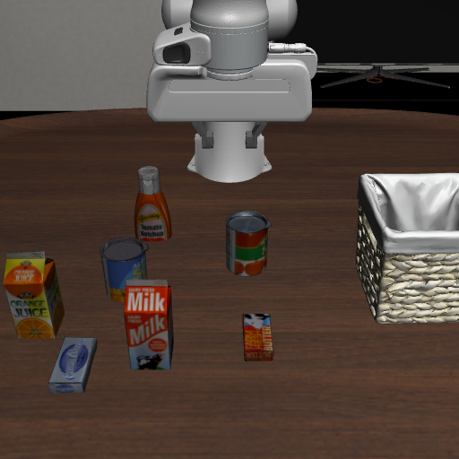

원본 Task와 새 B Task는 모두 `milk_1 - milk`를 선언하고 같은 `Milk` 모델을 생성한다. 원본에서는 우유를 바구니에 넣고, B에서는 접시 위에 놓는다. B의 실행 장면에는 우유와 접시만 남긴다. 원본 장면의 [렌더링 결과 JSON](./images/milk_source_scene.json)에는 BDDL 경로·Problem 이름·물체 목록을 기록했다.

```powershell
& $liberoPython .\test_milk_source_scene.py
```

A·B는 모두 `reset()` 후 초기 Goal이 `False`인지 확인하고, Panda Action으로 목표를 달성한 뒤 `check_success()`가 `True`인지 확인한다. 별도로 상태를 직접 바꾸는 Predicate 검사도 수행하되 실제 동작 영상과 구분한다.

#### 8.3) 변경 요소를 반영한 Custom BDDL 작성

8.2에서 정의한 검증안 A와 검증안 B를 실제 BDDL 파일로 작성한다.

작성하기 전에 LIBERO 공식 파일을 기준으로 사용할 요소가 실제로 존재하는지 확인

```text
검증안 A
push_the_plate_to_the_front_of_the_stove.bddl
→ LIBERO 공식 BDDL에 실제 존재

검증안 B에서 사용하는 milk
hope_objects.py
→ Milk class 실제 존재

milk_1 - milk
→ 기존 LIBERO BDDL에서 실제 사용

(On milk_1 ...)
→ 기존 LIBERO BDDL의 Init에서 실제 사용

(On object plate_1)
→ 기존 put_the_bowl_on_the_plate.bddl에서 실제 사용
```

따라서 검증안 A는 LIBERO의 공식 Task를 바탕으로 시작 Region 범위를 조정하고,
검증안 B는 LIBERO에 실제로 존재하는 Object와 Predicate를 조합하여
현재 BDDL에는 없는 새로운 Task를 작성한다.

단, 검증안 B의 `milk + main_table + plate` 조합 자체가
LIBERO 공식 BDDL에 그대로 존재하는 것은 아니다.

즉 검증안 B는 다음과 같다.

```text
실제로 존재하는 LIBERO 요소
        +
새로운 BDDL 조합
        ↓
Custom Task 작성
```

실제 환경에서 정상적으로 생성되는지는 8.4에서 검증한다.

---

##### 8.3.1) 검증용 BDDL 파일 분리

기존 `custom_test.bddl`은 서랍 Task 기준 파일로 그대로 보관한다.

검증안 A와 B는 다음 두 파일로 분리한다.

```text
custom_tasks/

├── custom_test.bddl
│   └── 기존 가운데 서랍 Task
│
├── custom_goal_change.bddl
│   └── 검증안 A
│       공식 접시·스토브 사용, 접시 시작 Region 범위 조정
│
└── custom_milk_task.bddl
    └── 검증안 B
        milk Object + 새 Region + 새 Init + 새 Goal
```

---

##### 8.3.2) 검증안 A — 공식 접시 밀기 Task를 기반으로 작성

검증안 A의 Task는 다음과 같다.

```text
Push the plate to the front of the stove
```

이 Task는 LIBERO 공식 BDDL에 실제로 존재한다.

파일 위치:

```text
libero/libero/bddl_files/libero_goal/
push_the_plate_to_the_front_of_the_stove.bddl
```

공식 BDDL을 복사한 뒤 접시·스토브와 그 Region·Init·Goal만 남긴다. 캐비닛·와인 랙·그릇·와인병·크림치즈와 그 참조는 삭제한다. 접시 시작 Region은 초기 `On` 판정과 사진의 배치가 일치하도록 범위를 조정한다.

LIBERO 루트의 PowerShell에서 실행한다. 작성된 BDDL이 있으면 복사를 건너뛴다.

```powershell
if (-not (Test-Path -LiteralPath ".\custom_tasks\custom_goal_change.bddl")) {
    Copy-Item `
    ".\libero\libero\bddl_files\libero_goal\push_the_plate_to_the_front_of_the_stove.bddl" `
    ".\custom_tasks\custom_goal_change.bddl" `
    -Force
}
```

복사한 파일의 내용을 확인한 뒤, VSCode 탐색기에서 열어 아래 Region 범위를 적용한다.

```powershell
Get-Content .\custom_tasks\custom_goal_change.bddl
```

| 시작 Region | 적용할 `:ranges` | 유지하는 것 |
| --- | --- | --- |
| `plate_region` | `(0.03 -0.04 0.07 0.0)` | 중심 `(0.05, -0.02)`, `:target main_table` |

접시 Region은 중심을 유지하고 폭을 0.02 m에서 0.04 m로 넓혔다. A·B에 같은 접시 범위를 적용했으며, `seed=0`에서 `env.reset()` 후 각 `On` 조건을 다시 평가해 확인한다.

수정한 파일을 저장한 뒤 내용을 확인한다.

```powershell
Get-Content .\custom_tasks\custom_goal_change.bddl
```

검증안 A의 핵심 정의는 다음과 같다.

```lisp
(:language Push the plate to the front of the stove)
```

Object는 기존 `plate_1`을 그대로 사용한다.

```lisp
(:objects
    plate_1 - plate
)
```

plate의 초기 Region 이름과 중심은 유지하고 범위를 다음과 같이 적용한다.

```lisp
(plate_region
    (:target main_table)
    (:ranges (
        (0.03 -0.04 0.07 0.0)
    ))
)
```

초기 상태는 다음과 같다.

```lisp
(On plate_1 main_table_plate_region)
```

Goal에서 사용하는 `stove_front_region` 역시
기존 BDDL에 실제로 존재한다.

```lisp
(stove_front_region
    (:target main_table)
    (:ranges (
        (-0.09 0.16999999999999998 -0.010000000000000002 0.25)
    ))
)
```

`obj_of_interest`는 공식 BDDL과 동일하게 다음 두 항목을 사용한다.

```lisp
(:obj_of_interest
    plate_1
    main_table_stove_front_region
)
```

Goal은 다음과 같다.

```lisp
(:goal
    (And
        (On plate_1 main_table_stove_front_region)
    )
)
```

따라서 검증안 A의 구조는 다음과 같다.

```text
plate_1

초기 상태:
main_table_plate_region

        ↓
Panda Action

목표 상태:
main_table_stove_front_region

        ↓

(On plate_1 main_table_stove_front_region)

        ↓

env.check_success()
False → True
```

검증안 A에서는 새로운 Object나 Region을 추가하지 않는다.

```text
Object  → 공식 접시 밀기 Task의 접시 사용
Region  → 접시 시작 범위 조정, 스토브 앞 목표 영역 유지
Init    → 접시·스토브 배치 조건 유지
Goal    → 공식 접시 밀기 Task의 Goal 유지
```

서랍 작업에서 접시 이동으로 Task를 바꾸어도 같은 실행 파이프라인이 연결되는지 확인한다. 접시·스토브와 Goal은 공식 접시 밀기 Task의 정의를 재사용한다. 최종 [전체 BDDL](./custom_task_validation/custom_tasks/custom_goal_change.bddl)에는 이 두 대상과 책상만 있다.

---

##### 8.3.3) 검증안 B — milk Object를 추가한 새로운 Custom BDDL 작성

검증안 B의 Task는 다음과 같다.

```text
Put the milk on the plate
```

현재 `custom_test.bddl`에는 `milk`가 존재하지 않는다.

하지만 LIBERO의

```text
libero/libero/envs/objects/hope_objects.py
```

파일에는 `Milk`가 실제 Object로 등록되어 있다. 다음 코드로 이 클래스를 가져와 `milk_1` 모델을 생성할 수 있다.

```python
import test_custom_bddl  # Windows renderer and log setup
from libero.libero.envs.objects.hope_objects import Milk

milk = Milk(name="milk_1")
print("Object class:", type(milk).__name__)
print("Instance name:", milk.name)
```

또한 LIBERO 공식 BDDL인

```text
LIVING_ROOM_SCENE2_pick_up_the_milk_and_put_it_in_the_basket.bddl
```

에서도 실제로 다음 선언을 사용한다.

```lisp
milk_1 - milk
```

따라서 새로운 Object 모델을 만드는 것이 아니라
LIBERO가 이미 지원하는 `milk` Object의 instance인
`milk_1`을 현재 Tabletop BDDL에 추가한다.

A의 BDDL을 복사해 접시 정의를 재사용하고, B에서 불필요한 스토브·스토브 Region·Init을 삭제한다.

```powershell
if (-not (Test-Path -LiteralPath ".\custom_tasks\custom_milk_task.bddl")) {
    Copy-Item `
    ".\custom_tasks\custom_goal_change.bddl" `
    ".\custom_tasks\custom_milk_task.bddl" `
    -Force
}
```

파일 내용을 확인하고, VSCode 탐색기에서 열어 수정한다.

```powershell
Get-Content .\custom_tasks\custom_milk_task.bddl
```

접시의 시작 Region·Init은 A와 같게 두고, 아래 절차로 우유의 선언과 조건을 추가한다.

---

##### 8.3.4) 새로운 milk Region 추가

`milk_1`을 초기 상태에서 `main_table` 위에 배치하려면
새로운 Region이 필요하다.

이번에는 임의의 좌표를 새로 추측하지 않고,
현재 동일한 Tabletop 환경에서 LIBERO 공식 BDDL이 실제로 사용하는
`stove_front_region`의 좌표 범위를 기준으로 사용한다.

공식 Region은 다음과 같다.

```lisp
(stove_front_region
    (:target main_table)
    (:ranges (
        (-0.09 0.16999999999999998 -0.010000000000000002 0.25)
    ))
)
```

이 좌표는 현재 Tabletop 장면에서 실제 BDDL이 사용하는
`main_table` 위의 영역이다.

검증안 B에서는 같은 좌표 범위를 사용하지만
새로운 Region 이름인 `milk_region`을 만든다.

`:regions` 내부에 다음 내용을 추가한다.

```lisp
(milk_region
    (:target main_table)
    (:ranges (
        (-0.09 0.16999999999999998 -0.010000000000000002 0.25)
    ))
)
```

즉,

```text
기존 실제 Region
stove_front_region
        ↓
동일한 main_table 좌표 범위 사용
        ↓
새 Region 이름
milk_region
```

으로 작성한다.

Region 이름이 `milk_region`이고 target이 `main_table`이므로
Init에서 사용하는 전체 Region 이름은 다음과 같다.

```text
main_table_milk_region
```

공식 파일에 있는 좌표라도 우유의 크기와 접근 경로에 맞는지는 확인해야 한다. `milk_1`의 초기 배치와 충돌 여부는 8.4의 `env.reset()` 결과로 검증했다.

---

##### 8.3.5) milk Object 추가

`:objects`에 다음 한 줄을 추가한다.

```lisp
milk_1 - milk
```

변경 후 다음과 같다.

```lisp
(:objects
    plate_1 - plate
    milk_1 - milk
)
```

여기서

```text
milk
= LIBERO에 실제 등록되어 있는 Object type

milk_1
= 현재 Custom BDDL에서 새로 만든 instance
```

이다.

---

##### 8.3.6) obj_of_interest 변경

A의 `obj_of_interest`는 다음과 같다.

```lisp
(:obj_of_interest
    plate_1
    main_table_stove_front_region
)
```

새로운 Task에서는 `milk_1`을 조작하여 `plate_1` 위에 올리는 것이므로
두 Object를 사용한다.

```lisp
(:obj_of_interest
    milk_1
    plate_1
)
```

기존 LIBERO의 Object-to-Object Task에서도
조작 대상과 목표 대상을 함께 `obj_of_interest`에 지정하는 형태를 사용한다.

---

##### 8.3.7) 새로운 Init Condition 추가

접시의 Init을 유지하고 우유의 초기 배치 조건을 추가한다.

```lisp
(On milk_1 main_table_milk_region)
```

전체 Init은 다음과 같다.

```lisp
(:init
    (On plate_1 main_table_plate_region)
    (On milk_1 main_table_milk_region)
)
```

따라서 `env.reset()`을 실행하면 의도한 초기 상태는 다음과 같다.

```text
milk_1
    ↓
main_table_milk_region

plate_1
    ↓
main_table_plate_region
```

milk와 plate가 서로 다른 Region에서 시작하므로
초기 Goal은 `False`가 되어야 한다.

---

##### 8.3.8) 새로운 Goal 작성

기존 Goal:

```lisp
(:goal
    (And
        (On plate_1 main_table_stove_front_region)
    )
)
```

을 제거하고 다음 Goal을 사용한다.

```lisp
(:goal
    (And
        (On milk_1 plate_1)
    )
)
```

`On` Predicate 자체는 기존 LIBERO에서 실제로 사용되고 있으며,
Object를 `plate_1` 위에 올려놓는 Goal 역시
기존 `put_the_bowl_on_the_plate.bddl`에서 사용되는 방식이다.

이번 Custom Task에서는 그 첫 번째 Object만

```text
akita_black_bowl_1
```

대신

```text
milk_1
```

으로 변경한다.

따라서 목표 상태는 다음과 같다.

```text
milk_1
        ↓
plate_1 위로 이동
        ↓
(On milk_1 plate_1)
        ↓
env.check_success() == True
```

---

##### 8.3.9) custom_milk_task.bddl 전체 코드

최종 파일에는 책상·접시·우유와 그 Region·Init·Goal만 남긴다.

```lisp
(define (problem LIBERO_Tabletop_Manipulation)
  (:domain robosuite)
  (:language Put the milk on the plate)
  (:regions
    (plate_region (:target main_table) (:ranges ((0.03 -0.04 0.07 0.0))))
    (milk_region (:target main_table) (:ranges ((-0.09 0.17 -0.01 0.25))))
  )
  (:fixtures
    main_table - table
  )
  (:objects
    plate_1 - plate
    milk_1 - milk
  )
  (:obj_of_interest milk_1 plate_1)
  (:init
    (On plate_1 main_table_plate_region)
    (On milk_1 main_table_milk_region)
  )
  (:goal (And (On milk_1 plate_1)))
)
```

##### 8.3.10) 작성한 두 BDDL 확인

검증안 A:

```powershell
Get-Content .\custom_tasks\custom_goal_change.bddl
```

다음 항목을 확인한다.

```text
Push the plate to the front of the stove

plate_1

main_table_stove_front_region

(On plate_1 main_table_stove_front_region)
```

검증안 B:

```powershell
Get-Content .\custom_tasks\custom_milk_task.bddl
```

다음 항목을 확인한다.

```text
Put the milk on the plate

milk_region

milk_1 - milk

milk_1
plate_1

(On milk_1 main_table_milk_region)

(On milk_1 plate_1)
```

이 단계까지는 BDDL 파일을 작성한 것이다.

검증안 A는 LIBERO 공식 BDDL을 바탕으로 하며, 접시 시작 Region의 범위를 조정하고 미사용 Region을 정리했다. 사용한 Object와 Goal은 공식 정의를 따른다.

검증안 B는 각 구성 요소 자체는 LIBERO에서 실제 지원되는 것을 확인했지만,
`milk + main_table + plate` 조합은 새로 작성한 Custom Task이므로
아직 실행 성공을 가정하지 않는다.

다음 8.4에서 두 파일을 각각 `OffScreenRenderEnv`에 전달하여

```text
BDDL Parser 성공
        ↓
환경 생성 성공
        ↓
env.reset() 성공
        ↓
Object 실제 생성 확인
        ↓
초기 배치 확인
        ↓
Initial Goal == False 확인
```

순서로 실제 시뮬레이션에서 검증한다.
#### 8.4) 환경 로딩과 초기 상태 검증

8.3에서 작성한 두 파일을 각각 `OffScreenRenderEnv`에 전달했다. 실행 코드는 [`test_custom_task_variants.py`](./custom_task_validation/test_custom_task_variants.py)이며, 파일은 앞 절과 같은 `docs/W5/LIBERO` 루트에 둔다. Windows의 `libero` conda 환경(Python 3.8.13), `MUJOCO_GL=wgl`, `seed=0`, `agentview` 512×512을 사용했다. 스크립트는 이 환경에서 오래 걸리는 Numba 초기화를 피하기 위해 `NUMBA_DISABLE_JIT=1`을 설정한다.

```powershell
& $liberoPython .\test_custom_task_variants.py --task both --seed 0 --size 512
```

각 환경에서 BDDL 로딩, `env.reset()`, 화면 저장, 초기 `env.check_success()`를 확인했다. 성공 판정이 처음부터 `True`라면 Task가 시작 전에 끝난 것이므로 초기 조건과 Goal을 다시 검토해야 한다.

| 확인 항목 | 검증안 A: 접시 이동 | 검증안 B: 우유 추가 |
| --- | --- | --- |
| BDDL 로딩·환경 생성·`reset()` | 성공 | 성공 |
| 장면에 생성된 조작 대상 | `plate_1` 확인 | `milk_1`, `plate_1` 확인 |
| 초기 장면 | 접시가 시작 위치에 있음 | 우유 상자가 접시와 떨어진 위치에 보임 |
| 초기 `check_success()` | `False` | `False` |
| `:init`의 `On` 조건 재평가 | 2개 모두 `True` | 2개 모두 `True` |

사진에서 확인한 배치를 코드로도 확인했다. A·B 각각 2개의 초기 `On` 조건이 모두 `True`였다. B의 우유는 지정한 `milk_region` 위에 있었고, 다른 물체나 고정물과 의도하지 않은 접촉도 없었다. 조건별 결과는 [A 결과 JSON](./images/custom_task_validation/A_result.json)과 [B 결과 JSON](./images/custom_task_validation/B_result.json)에 있다.

초기 장면 사진은 [검증안 A](./images/custom_task_validation/A_initial.png), [검증안 B](./images/custom_task_validation/B_initial.png)에 저장했다. 사진에서 B의 우유가 보인다는 사실은 `milk_1`이 시뮬레이터 장면에 생성됐다는 시각적 근거다. 화면 밖에서 생성됐거나 다른 물체와 겹친 경우를 성공으로 처리하지 않기 위해 사진을 함께 확인했다.

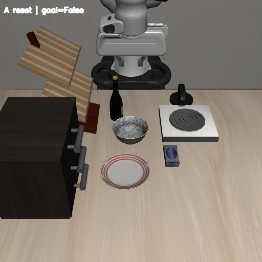

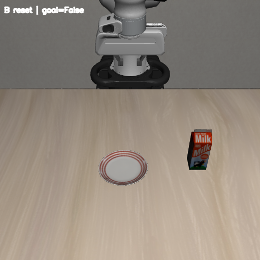

초기 프레임에서 Panda가 움직이는 과정까지 확인하려면 [A 시뮬레이션 영상](./images/custom_task_validation/A_robot_action.mp4)과 [B 시뮬레이션 영상](./images/custom_task_validation/B_robot_action.mp4)을 연다. 각 영상의 첫 프레임이 위 초기 장면이며, 이후 프레임은 8.5의 실제 `env.step(action)` 실행이다.

#### 8.5) Action 실행과 Goal Condition 검증

Panda의 7차원 `OSC_POSE` action을 `env.step(action)`에 전달해 두 작업을 수행했다. 그리퍼의 현재 위치와 자세를 읽어 목표와의 오차를 줄인다. A는 닫힌 그리퍼를 접시 표면에 접촉시킨 뒤, 접시를 들어 올리지 않고 +Y와 -X 방향으로 이동시킨다. B는 우유를 잡아 들어 올리고 접시 위로 옮긴 뒤 그리퍼를 연다. 두 경우 모두 그리퍼를 물러나게 한 뒤 Goal을 다시 확인했다.

| 구분 | 총 Panda action step 수 | 영상에서 확인한 것 | action 종료 후 Goal |
| --- | ---: | --- | --- |
| A | 645 | 접시가 테이블 위에서 이동해 스토브 앞 목표 Region에 도달함 | `True` |
| B | 273 | 우유를 잡아 약 0.170 m 들어 올린 뒤 접시 위에 놓고 그리퍼를 놓음 | `True` |

총 step 수에는 마지막 Goal 검증 구간(A 40 step, B 30 step)이 포함된다.

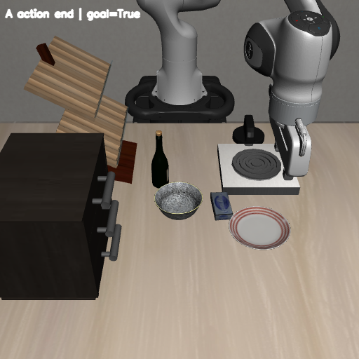

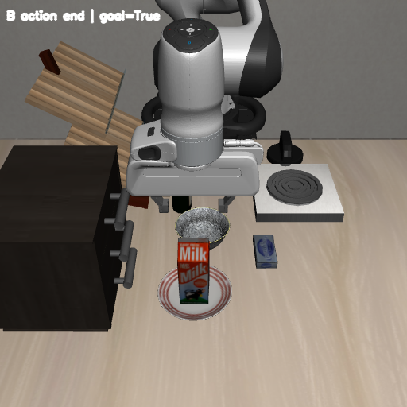

동작 전 과정을 [A 성공 영상](./images/custom_task_validation/A_robot_action.mp4), [B 성공 영상](./images/custom_task_validation/B_robot_action.mp4)에서 볼 수 있다. A는 접촉 종료 후 40 step, B는 놓기와 후퇴 후 30 step 동안 Goal이 계속 `True`였다. 최종 상태에서 물체는 그리퍼에 잡혀 있지 않았다. 영상의 동작 구간에서는 물체 위치나 관절 상태를 직접 바꾸지 않았다.

| A: 접시 이동 | B: 우유를 접시 위에 놓기 |
| --- | --- |
| [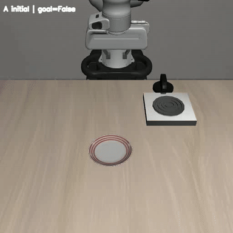](./images/custom_task_validation/A_robot_action.mp4) | [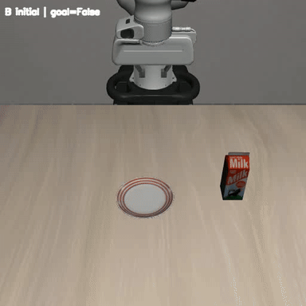](./images/custom_task_validation/B_robot_action.mp4) |

Goal 정의가 작동하는지는 별도 시험으로 확인했다. 같은 seed로 다시 `reset()`하고 20 step 동안 초기 물체를 안정시킨 뒤, A는 접시의 자유 관절 위치를 목표 Region 중심으로, B는 우유의 위치를 접시 위로 **직접** 옮겼다. `sim.forward()`로 상태를 반영하고 30 step 동안 물리 시뮬레이션을 진행한 뒤 사진과 `env.check_success()`를 확인했다. 두 경우 모두 `False → True`가 나왔다.

| 구분 | 초기 Goal | 물체 상태 직접 변경 후 Goal | 해석 |
| --- | --- | --- | --- |
| A | `False` | `True` | `(On plate_1 main_table_stove_front_region)` 판정 동작 |
| B | `False` | `True` | `(On milk_1 plate_1)` 판정 동작 |

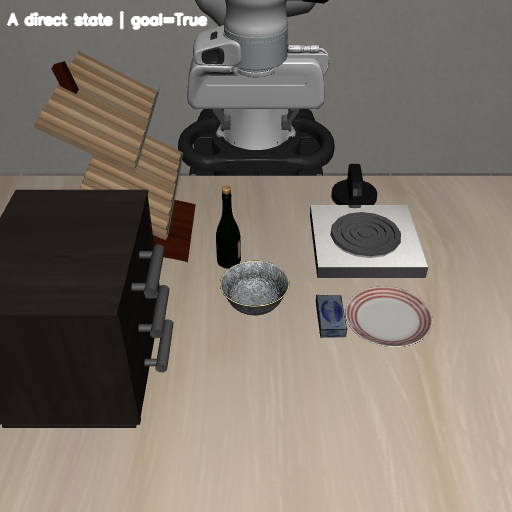

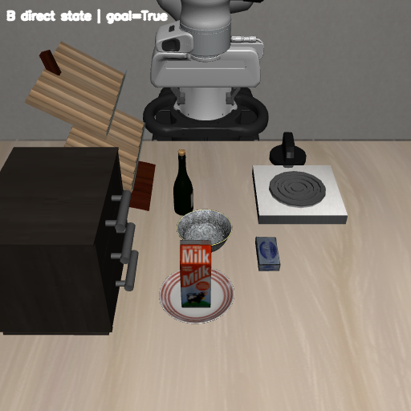

이 두 사진은 **직접 상태 변경 시험**의 결과다. B의 `On`은 두 물체의 접촉과 높이·수평 위치 관계를 검사한다. 수치 기록은 [A 결과 JSON](./images/custom_task_validation/A_result.json)과 [B 결과 JSON](./images/custom_task_validation/B_result.json)에 남겼다. 두 작업은 `seed=0`의 초기 배치에서 작성한 제어 규칙으로 수행했다.

#### 8.6) BDDL로 설정 가능한 범위와 LIBERO에 없는 새로운 요소를 추가할 때 필요한 확장 구조 정리

이번 검증안 B는 **LIBERO에 이미 등록된** `milk` 물체를 새 BDDL에서 사용한 사례다.

| 바꾸려는 것 | BDDL만으로 가능한 범위 | 추가 구현이 필요한 경우 |
| --- | --- | --- |
| Object·Fixture | 등록된 종류를 `:objects`, `:fixtures`에서 선택하고 인스턴스 이름을 지정 | 새로운 형상·물성의 물체는 asset과 [Object 등록 코드](./custom_task_validation/reference_code/libero/libero/envs/objects/hope_objects.py) 필요 |
| Region·Init | 기존 장면의 기준 대상에 대해 `:target`, `:ranges`, 지원되는 초기 Predicate를 지정 | 새 장면 구조나 지원되지 않는 초기 상태는 환경 코드와 초기화 방식 수정 필요 |
| Goal | [기존 Predicate](./custom_task_validation/reference_code/libero/libero/envs/predicates/base_predicates.py)의 `On`, `Open` 등을 조합 | 새로운 판정 의미는 Predicate 구현 및 등록 필요 |
| 로봇·카메라·제어 | BDDL에서 고르는 Task 조건과 별개 | 로봇 모델, 작업대 크기, 카메라와 컨트롤러는 [환경 생성 코드](./custom_task_validation/reference_code/libero/libero/envs/bddl_base_domain.py)와 [wrapper 설정](./custom_task_validation/reference_code/libero/libero/envs/env_wrapper.py)에서 변경 |

실제 사진 [B 초기 장면](./images/custom_task_validation/B_initial.png)과 [B 시뮬레이션 영상](./images/custom_task_validation/B_robot_action.mp4)은 **등록된 물체를 BDDL에 추가한 결과**의 예시다. 8장의 실행 범위는 기존 요소의 조합이며, 새 물체·Fixture·Predicate와 환경 설정의 추가 구현은 9장에서 검증한다.


---

### 9. BDDL에서 표현할 수 없는 요소를 LIBERO 코드로 확장한 Custom Task 검증

#### 9.1) 검증 목적과 공통 기준

8장에서는 기존 LIBERO에 등록된 물체와 Predicate를 BDDL에서 다시 조합했다. 9장에서는 그 범위를 한 단계 넓힌다. 새 물체(C), 새 고정 지지대(D), 새 성공 조건(E), 카메라·제어 설정(F)을 실제 코드에 추가하고, 각 요소를 참조하는 BDDL이 시뮬레이터에서 실행되는지 확인한다. **새 요소가 화면에 나타나고 Panda의 동작으로 Goal에 도달하는지** 확인한다.

네 사례 모두 같은 Tabletop 작업대와 Panda를 사용한다. C에는 상자·접시, D에는 우유·받침대, E·F에는 우유·접시만 남겼다. 캐비닛·스토브·와인병 등 각 Task의 조건과 동작에 필요 없는 요소는 선언과 참조를 함께 삭제했다. 실행 코드는 [test_extended_custom_tasks.py](./custom_task_validation/test_extended_custom_tasks.py)이며, Windows `libero` 환경에서 `seed=0`, 512×512 화면으로 최종 실행 결과를 각각 한 번 기록했다. 각 실험에서 `env.reset()` 직후 `:init`의 `On` 조건을 다시 검사하고 초기 Goal `False`를 확인했다. 이후 미리 정한 경유점을 따라가는 규칙 기반 제어로 `env.step(action)`에 접근·파지·들기·이동·놓기·그리퍼 이탈 명령을 전달했다. 마지막에는 추가 제어 step을 실행하면서 Goal이 계속 `True`인지 확인했다. Action 구간에는 물체의 MuJoCo 상태를 직접 바꾸지 않았다.

```powershell
& $liberoPython .\test_extended_custom_tasks.py --case all --seed 0 --size 512
```

##### 9.1.1) BDDL 밖에서 작성해야 하는 코드

8.6에서 정리한 확장 항목은 아래 파일에서 구현한다. BDDL에는 구현된 요소의 이름과 작업 조건을 적고, Python과 XML에는 **그 요소를 생성하거나 상태를 판정하는 방법**을 작성해야 한다. 파일 경로는 기존 실행 파일과 같은 LIBERO 루트를 기준으로 한다.

| 확장 항목 | 코드에서 작성해야 하는 내용 | 적용 방법을 설명하는 절 |
| --- | --- | --- |
| 새 Object의 형상·물성 | `libero/libero/assets/`의 XML에 충돌·시각 형상, 크기, 질량, 마찰, 배치 기준 site를 정의한다. `libero/libero/envs/objects/`의 클래스에서 XML 경로·자유 관절·회전 범위를 지정하고 `@register_object`로 등록한다. | 9.2.2 C의 XML·Object 클래스 |
| 새 장면·초기 상태 | 장면 XML과 Arena 연결, Fixture·Region 생성, 배치 sampler, 초기 관절·물체 상태를 작성한다. 기존 환경에서 처리할 수 없는 부분은 새 Problem과 초기화 코드로 확장한다. | 9.3.2 D의 Fixture·배치 코드, 9.3.6 장면·Init 확장 |
| 새 Goal 의미 | Predicate 클래스의 `__call__()`에 검사할 대상·접촉·거리·자세 기준과 `True/False` 반환을 작성한다. 실행 전에 Predicate 사전에 이름을 등록한다. | 9.4.2 E의 함수·등록 코드 |
| 로봇·작업대·카메라·제어 | 로봇 모델과 초기 관절각, 작업대 크기·높이, 카메라 위치·방향, 컨트롤러 설정을 작성한다. Wrapper에서 사용할 로봇·카메라·제어 종류를 선택한다. | 9.5.2 F의 카메라·제어 코드, 9.5.6 로봇·작업대 설정 |

구현 후에는 **모듈 import·등록 → BDDL에서 이름 연결 → `reset()`과 Init 확인 → Panda Action → Goal·사진·영상 확인** 순서로 검증한다. Table 위 영역이나 이미 지원되는 Init만 바꾸는 경우에는 `:target`, `:ranges`, `:init`을 수정하면 된다.

#### 9.2) C — LIBERO에 없던 Object 모델 추가

##### 9.2.1) 새 물체를 추가하는 일반적인 방법

LIBERO에 없는 물체를 추가할 때는 **모델 작성 → 클래스 구현·등록 → BDDL 선언 → 시뮬레이션 확인** 순서로 진행한다. 여기서는 MuJoCo XML로 물체를 정의하는 방법을 설명한다. **Asset**은 형상과 물리 속성을 담은 모델 파일이고, **Registry**는 BDDL의 종류 이름과 Python 클래스를 연결하는 목록이다.

1. **물체 모델을 작성한다.** `libero/libero/assets/` 아래에 XML을 만들고 충돌 형상, 크기, 질량 또는 밀도, 마찰을 정의한다. 색·표시용 형상을 따로 만들 경우에는 충돌 여부도 지정한다. `MujocoXMLObject`가 읽는 body 구조와 `bottom_site`·`top_site`·`horizontal_radius_site`를 갖춘 기존 물체 XML을 참고할 수 있다. 이 site들은 배치 높이와 수평 크기를 계산하는 정보다.
2. **물체 클래스를 작성한다.** `libero/libero/envs/objects/`에서 `MujocoXMLObject`를 상속하고 XML 경로를 연결한다. Tabletop의 조작 물체에는 위치·자세를 바꿀 수 있는 `free` joint를 두며, 배치기가 사용할 `rotation`, `rotation_axis`, `object_properties`도 지정한다.
3. **종류 이름을 등록한다.** 클래스에 `@register_object`를 붙이고 실행 전에 해당 모듈을 import한다. 이 데코레이터는 클래스 정의 시 등록 함수를 실행하는 표기다. 현재 LIBERO는 클래스 이름에서 종류 이름을 만들므로, BDDL에는 등록된 이름을 사용한다.
4. **Task에 연결한다.** `:objects`에 인스턴스 이름과 물체 종류를 선언하고, 시작 Region·Init·Goal을 작성한다. 인스턴스 이름은 장면의 개별 물체를 가리킨다.
5. **생성과 동작을 확인한다.** `reset()` 후 사진과 Init 판정을 대조하고, 물체가 겹치거나 떠 있지 않은지 확인한다. 이후 파지·이동·놓기 Action을 실행해 화면의 결과와 Goal 판정이 일치하는지 검사한다.

##### 9.2.2) 실험 예시 — 파란색 표식 상자의 모델과 등록

Task는 **새로 만든 파란색 표식 상자를 접시 위에 놓기**다. `milk`처럼 기존에 등록된 물체의 인스턴스를 늘리는 경우와 달리, 이 사례에서는 물체의 형상과 등록 클래스를 새로 만들었다.

| 요소 | C에서 사용한 정의 |
| --- | --- |
| Object | 새 종류 `custom_marker_box`, 장면 인스턴스 `custom_marker_box_1` |
| Region | `main_table`의 `custom_marker_box_region`에서 시작 |
| Init | `(On custom_marker_box_1 main_table_custom_marker_box_region)` |
| Goal | `(On custom_marker_box_1 plate_1)` |

접시는 8장에서 사용한 `plate_1`을 유지했다. 따라서 결과 차이는 새 물체 모델과 그 초기 배치에서 확인할 수 있다.

[marker_box.xml](./custom_task_validation/libero/libero/assets/custom_validation_objects/marker_box.xml)에 크기 52×52×110 mm인 상자를 정의했다. `collision` geom이 물리적 접촉을 계산하고, `visual` geom과 주황색 `marker` geom은 물체를 구분하기 위해 표시한다. 표시용 geom에는 `contype="0"`, `conaffinity="0"`을 지정해 충돌을 제외했다. [custom_validation_objects.py](./custom_task_validation/libero/libero/envs/objects/custom_validation_objects.py)의 `CustomMarkerBox`를 `@register_object`로 등록하고, [실행 코드](./custom_task_validation/test_extended_custom_tasks.py)에서 모듈을 import했다.

이 상자의 XML에서 형상과 물성을 정의한 부분은 다음과 같다. Box의 `size`는 각 방향의 **절반 크기**이므로 전체 크기는 두 배다. `mass`는 kg 단위 질량이고, `friction`은 미끄럼·비틀림·구름 마찰 계수다. `bottom_site`와 `top_site`는 배치 높이를 계산하는 기준점이다.

```xml
<geom name="collision" type="box" size="0.026 0.026 0.055"
      mass="0.1" friction="1 0.005 0.0001" group="0"
      solref="0.01 1" solimp="0.95 0.99 0.001"/>
<site name="bottom_site" pos="0 0 -0.055" size="0.001" rgba="0 0 0 0"/>
<site name="top_site" pos="0 0 0.055" size="0.001" rgba="0 0 0 0"/>
```

다음으로 클래스의 생성자에서 XML을 읽고 관절·회전 속성을 지정한다. `CustomMarkerBox`는 등록 과정에서 `custom_marker_box`라는 종류 이름으로 연결된다.

```python
from pathlib import Path

from robosuite.models.objects import MujocoXMLObject

from libero.libero.envs.base_object import register_object


@register_object
class CustomMarkerBox(MujocoXMLObject):
    """A 52 x 52 x 110 mm box with one collision shape and an orange marker."""

    def __init__(self, name="custom_marker_box", joints=None):
        asset = (Path(__file__).resolve().parents[2] / "assets" /
                 "custom_validation_objects" / "marker_box.xml")
        super().__init__(
            str(asset), name=name,
            joints=[dict(type="free", damping="0.0005")] if joints is None else joints,
            obj_type="all", duplicate_collision_geoms=False,
        )
        self.category_name = "custom_marker_box"
        self.rotation = (0.0, 0.0)
        self.rotation_axis = "z"
        self.object_properties = {"vis_site_names": {}}
```

생성자의 관절 설정은 `joints=[dict(type="free", damping="0.0005")] if joints is None else joints`다. `free` joint는 상자가 테이블 위에서 위치와 자세를 바꾸는 **자유 관절**이다. 이것이 있어야 Panda가 집어 들고 접시 위로 옮길 수 있다. 위 코드는 `libero/libero/envs/objects/custom_validation_objects.py`에 저장한다.

XML 작성 후 클래스에 `category_name`, `rotation`, `rotation_axis`, `object_properties`를 지정한다. 실행 파일에서 `import libero.libero.envs.objects.custom_validation_objects`를 수행한 뒤, 9.2.3의 `custom_marker_box_1 - custom_marker_box` 선언으로 장면에 생성한다.

##### 9.2.3) BDDL 작성

[custom_new_object_task.bddl](./custom_task_validation/custom_tasks/custom_new_object_task.bddl)의 핵심 선언은 다음과 같다. `:objects`에서 새 종류를 참조하며, 시작 Region과 Goal은 기존 BDDL과 같은 `On` Predicate를 사용한다.

```lisp
(custom_marker_box_region
    (:target main_table)
    (:ranges ((-0.09 0.16999999999999998 -0.010000000000000002 0.25)))
)

(:objects
    plate_1 - plate
    custom_marker_box_1 - custom_marker_box
  )

(On custom_marker_box_1 main_table_custom_marker_box_region)
(And (On custom_marker_box_1 plate_1))
```

마지막 두 줄은 각각 `:init`과 `:goal` 안에서 발췌했다. 접시와 상자의 나머지 선언·Init은 [전체 BDDL](./custom_task_validation/custom_tasks/custom_new_object_task.bddl)에 있다.

##### 9.2.4) 환경 로딩과 초기 상태

```powershell
& $liberoPython .\test_extended_custom_tasks.py --case C --seed 0 --size 512
```

환경 생성과 `reset()`이 성공했고, 초기 Goal은 `False`였다. 2개의 `On` 초기 조건이 모두 `True`였으며, 새 상자와 주변 물체 사이의 의도하지 않은 초기 접촉도 기록되지 않았다. [초기 사진](./images/extended_task_validation/C_initial.png)에는 파란 상자와 주황색 표식이 테이블 위에 보인다. 이는 XML 형상·물체 등록·BDDL 선언이 실제 장면으로 연결됐음을 보여준다.

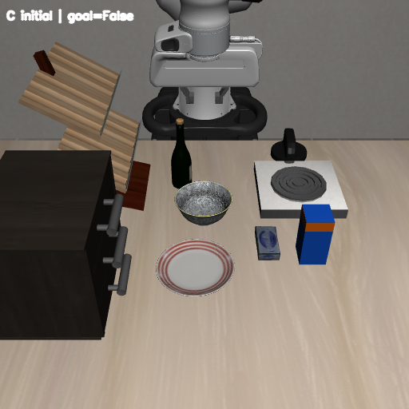

##### 9.2.5) Panda Action과 Goal 검증

Panda가 상자에 접근해 파지하고 약 0.173 m 들어 올린 다음 접시 위에 놓았다. 그리퍼가 상자에서 떨어진 뒤에도 Goal은 `True`였고, 30개 검증 step 동안 유지됐다. 이 검증 구간을 포함해 총 277 action step이 기록됐으며 접시와 상자의 접촉도 확인했다. 물체 상태를 직접 설정한 성공 판정은 사용하지 않았다.

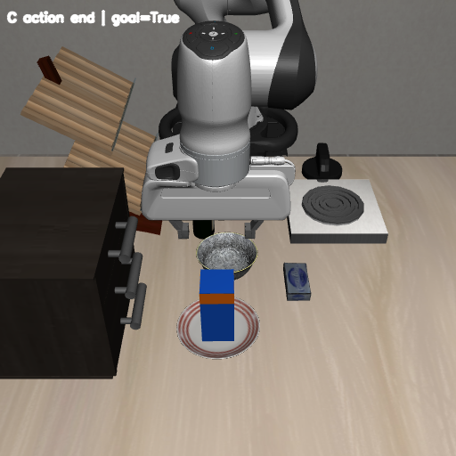

[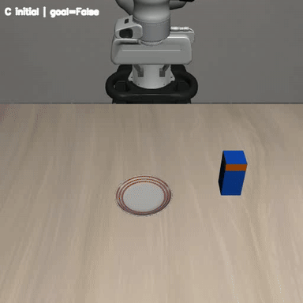](./images/extended_task_validation/C_robot_action.mp4)

[C 결과 JSON](./images/extended_task_validation/C_result.json)

#### 9.3) D — 새 Fixture와 윗면 Region 추가

##### 9.3.1) Fixture와 표면 Region을 추가하는 일반적인 방법

새 Fixture는 **고정 구조의 모델 → 사용할 표면 Region → 초기 배치 → BDDL 연결** 순서로 만든다. Fixture의 외부 위치를 고정하는 것과 서랍처럼 내부 관절을 움직이는 것은 각각 모델에서 정의한다.

1. **고정 구조를 모델링한다.** XML에 실제 지지·접촉을 계산할 geom을 작성하고, 클래스에서 모델을 읽는다. 장면에 고정할 Fixture는 외부 `free` joint를 만들지 않는다. 내부의 hinge·slide joint는 필요한 기능에 맞게 둘 수 있다.
2. **작업에 사용할 면을 정의한다.** 윗면이나 내부 공간에 site를 만들고 BDDL의 `:regions`에서 해당 Fixture를 `:target`으로 연결한다. 물체를 받치는 물리 형상과 Goal이 참조할 영역의 위치·크기를 맞춘다.
3. **배치 방식을 연결한다.** 기존 환경의 로더와 sampler로 처리할 수 있으면 재사용한다. 배치 높이·Region 처리처럼 추가 구현이 필요한 경우에는 환경을 확장하고 `@register_problem`으로 새 Problem을 등록한다. 새 Problem 이름에 사용할 Region sampler도 연결한다.
4. **조건을 작성하고 확인한다.** `:fixtures`, `:regions`, `:init`, `:goal`에 이름을 연결한다. `reset()` 후 고정물의 높이와 Init 판정을 확인한다. Action 실행 후에는 목표 물체를 실제로 지지하는지, 사진과 Goal 판정이 일치하는지 확인한다.

##### 9.3.2) 실험 예시 — 받침대와 윗면 Region의 구현

Task는 **우유를 새로 만든 받침대 위에 놓기**다. 기존 물체 `milk_1`을 사용하되, 놓을 대상은 새 Fixture인 `raised_support_1`로 바꿨다. Fixture는 테이블에 고정되어 작업의 기준이 되는 요소다.

| 요소 | D에서 사용한 정의 |
| --- | --- |
| Object | 기존 `milk_1 - milk` 사용 |
| Fixture | 새 종류 `raised_support`, 인스턴스 `raised_support_1` |
| Region | 받침대 시작 영역 `main_table_support_region`, 받침대 윗면 `raised_support_1_top_region` |
| Init | `(On raised_support_1 main_table_support_region)` 및 기존 물체 배치 |
| Goal | `(On milk_1 raised_support_1_top_region)` |

[raised_support.xml](./custom_task_validation/libero/libero/assets/custom_validation_objects/raised_support.xml)에 가로·세로 12 cm, 높이 4 cm인 블록을 정의했다. `support_block` geom은 우유를 실제로 받치는 충돌 면이고, `support_visual`은 화면 표시용이다. `top_region` site는 윗면의 위치와 범위를 표시하는 기준 요소이며 BDDL Goal이 참조한다. [custom_validation_fixtures.py](./custom_task_validation/libero/libero/envs/objects/custom_validation_fixtures.py)의 `RaisedSupport`를 `@register_object`로 등록했다. 자유 관절을 만들지 않아 받침대는 배치된 위치에 고정된다.

기본 Tabletop 환경의 Fixture 배치기는 기존 Fixture를 위한 `z_offset=-0.04 m`를 사용한다. 이 값을 새 받침대에 그대로 적용하면 아래로 가라앉으므로 [libero_custom_support.py](./custom_task_validation/libero/libero/envs/problems/libero_custom_support.py)에서 이 Fixture의 배치 sampler에 한해 `z_offset=0.0`을 적용했다. `z_offset`은 배치 높이를 보정하는 값이다. 새 환경 클래스 `Libero_Custom_Support`를 `@register_problem`으로 등록하고 Tabletop의 Region sampler도 연결했다. **Problem 등록**은 BDDL 첫 줄의 이름으로 실행할 환경 클래스를 찾게 하는 과정이다. 여기서는 BDDL만 수정해서는 물리적 받침대와 올바른 배치 높이를 만들 수 없었다.

```python
"""Tabletop environment extension for a platform with its own top Region."""
from libero.libero.envs.bddl_base_domain import TASK_MAPPING, register_problem
from libero.libero.envs.objects.custom_validation_fixtures import RaisedSupport
from libero.libero.envs.regions import REGION_SAMPLERS, TableRegionSampler


# register_problem stores the class in TASK_MAPPING; its decorator return is None.
_TabletopBase = TASK_MAPPING["libero_tabletop_manipulation"]
REGION_SAMPLERS["libero_custom_support"] = {"table": TableRegionSampler}


@register_problem
class Libero_Custom_Support(_TabletopBase):
    """Reuse the tabletop scene and place the new support at the table surface."""

    def _add_placement_initializer(self):
        super()._add_placement_initializer()
        # This platform's bottom_site matches its true collision bottom.
        # Tabletop's legacy fixture z_offset (-0.04 m) would sink the platform.
        for name, fixture in self.fixtures_dict.items():
            if isinstance(fixture, RaisedSupport):
                self.placement_initializer.samplers[name + "_sampler"].z_offset = 0.0
```

##### 9.3.3) BDDL 작성

[custom_new_fixture_task.bddl](./custom_task_validation/custom_tasks/custom_new_fixture_task.bddl)의 핵심은 새 Problem `LIBERO_Custom_Support`, Fixture, 시작 위치, 윗면 Region을 연결하는 부분이다.

```lisp
(support_region (:target main_table) (:ranges ((0.09 0.13 0.11 0.15))))
(top_region (:target raised_support_1))

(:fixtures
    main_table - table
    raised_support_1 - raised_support
  )

(On raised_support_1 main_table_support_region)
(On milk_1 raised_support_1_top_region)
```

마지막 두 줄은 각각 `:init`과 `:goal` 안에서 발췌했다. `:init`에는 `And`가 없고, `:goal`에서만 `And`가 조건을 묶는다. `top_region`의 실제 site는 위 XML asset 안에 있다. BDDL의 `:regions` 선언은 그 site를 `raised_support_1_top_region`이라는 이름으로 연결한다. 기존 Init 조건은 [전체 BDDL](./custom_task_validation/custom_tasks/custom_new_fixture_task.bddl)에 남아 있다.

##### 9.3.4) 환경 로딩과 초기 상태

```powershell
& $liberoPython .\test_extended_custom_tasks.py --case D --seed 0 --size 512
```

새 환경 Problem을 불러온 뒤 `reset()`이 성공했다. 초기 Goal은 `False`, 2개의 `On` 초기 조건은 모두 `True`였다. 받침대가 테이블 위에 놓였고 초기 물체와 받침대 사이에 원하지 않은 접촉이 없었다. [초기 사진](./images/extended_task_validation/D_initial.png)에서 우유와 파란 받침대가 서로 떨어져 보인다.

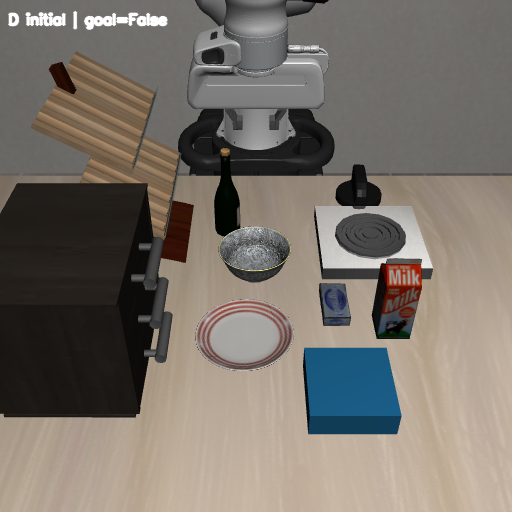

##### 9.3.5) Panda Action과 Goal 검증

Panda가 우유를 잡아 약 0.170 m 들어 올리고 받침대 위에 놓았다. 총 294 action step이 기록됐고, 그리퍼를 이탈시킨 뒤 마지막 40개 검증 step 동안 `env.check_success()`가 `True`로 유지됐다. 우유와 받침대의 접촉도 `True`였다.

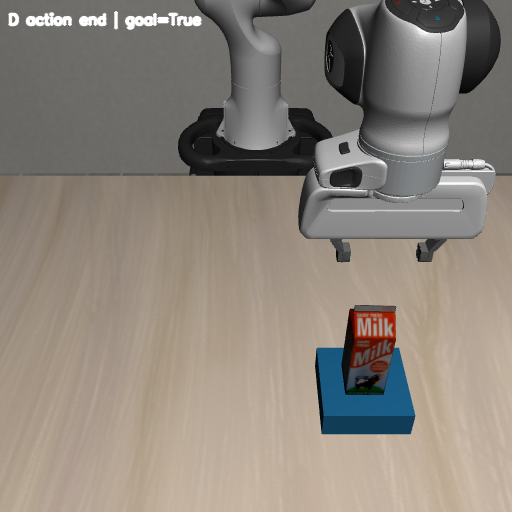

[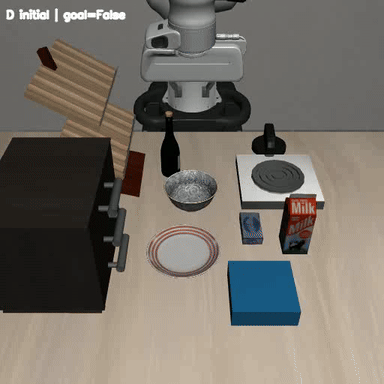](./images/extended_task_validation/D_robot_action.mp4)

[D 결과 JSON](./images/extended_task_validation/D_result.json)

##### 9.3.6) 새 장면과 지원되지 않는 Init을 작성하는 방법

테이블이나 주변 구조를 새로 만들 때는 사용할 Arena와 초기 상태의 생성 방식을 먼저 정한다. **장면 구조 작성 → 환경 연결 → 초기 상태 적용 → 관측과 Init 확인** 순서로 진행한다.

**일반적인 방법 — 장면 구조**

장면은 `libero/libero/assets/scenes/` 아래 XML로 만들고, [환경 생성 코드](./custom_task_validation/reference_code/libero/libero/envs/bddl_base_domain.py)의 `scene_xml`과 연결한다. 기존 [TableArena](./custom_task_validation/reference_code/libero/libero/envs/arenas/table_arena.py)를 사용할 때는 `table` body, `table_collision`, `table_visual`, `table_top`, 다리와 바닥·벽 texture처럼 이 클래스가 찾는 XML 요소를 유지한다. 기존 장면 XML을 복사해 필요한 형상을 추가하는 방식으로 시작할 수 있다.

```python
import test_custom_task_variants as base
from libero.libero.envs.env_wrapper import OffScreenRenderEnv

env = OffScreenRenderEnv(
    bddl_file_name=str(base.ROOT / "custom_tasks/custom_milk_task.bddl"),
    scene_xml="scenes/libero_tabletop_base_style.xml",
    camera_heights=512, camera_widths=512,
)
try:
    env.seed(0)
    obs = env.reset()
    print("Image shape:", obs["agentview_image"].shape)
    print("Initial goal:", bool(env.check_success()))
finally:
    env.close()
```

위 예제는 저장소에 있는 기본 장면 XML을 선택해 초기화한다. 새 장면을 작성하면 `scene_xml`을 그 파일의 `assets/` 기준 상대경로로 바꾼다. TableArena와 구조가 다른 작업 공간을 만들면 Arena 클래스와 새 Problem의 `_load_model()`을 작성해 연결하고, `_load_fixtures_in_arena()`·`_load_sites_in_arena()`에서 고정물과 Region 기준도 정의해야 한다. Tabletop은 `arena_type="table"`을 사용하므로 이 선택을 바꾸는 구현도 새 환경에서 담당한다.

**일반적인 방법 — 지원되지 않는 초기 상태**

초기 상태는 [기본 환경 코드](./custom_task_validation/reference_code/libero/libero/envs/bddl_base_domain.py)의 `_add_placement_initializer()`가 BDDL 조건을 배치·속성 sampler로 바꾸고, `_reset_internal()`이 샘플링한 위치·자세·관절값을 적용한다. 새로운 Init 의미를 사용하려면 **조건을 해석하는 분기, 설정할 상태값, reset 시 적용하는 코드**를 작성해야 한다. 예를 들어 서랍을 정해진 위치에서 시작하도록 만들 때는 새 Problem 클래스 내부에 다음 메서드를 작성한다. 독립 실행 파일이 아닌 환경 클래스의 구현 예시다.

```python
def _reset_internal(self):
    super()._reset_internal()
    if not self.deterministic_reset:
        drawer = self.object_states_dict["wooden_cabinet_1_middle_region"]
        drawer.set_joint(-0.08)
        self.sim.forward()
```

`-0.08 m`는 초기화 방법을 설명하기 위한 예시값이다. 새 조건 이름을 `:init`에 적으려면 해당 이름을 처리하는 sampler·초기화 분기도 함께 추가한다. Predicate 사전에 함수를 등록하는 작업은 상태를 **검사**하는 기능이며, 원하는 초기 상태를 **생성**하는 코드는 별도로 필요하다. `reset()`이 끝나면 새 관측값의 사진과 Init 판정이 일치하는지 확인한다.

**실험에서의 적용 — D의 초기 배치 보정**

D에서는 기존 Tabletop 장면에 새 받침대와 윗면 Region을 추가했다. [환경 코드](./custom_task_validation/libero/libero/envs/problems/libero_custom_support.py)의 `_add_placement_initializer()`에서 받침대 sampler의 `z_offset`을 0으로 바꾸어 상판 위에 배치했다. `reset()` 후 사진과 초기 `On` 조건을 함께 확인한 결과는 9.3.4–9.3.5에 제시했다.

#### 9.4) E — 새로운 Goal Predicate 추가

##### 9.4.1) Goal Predicate를 추가하는 일반적인 방법

새로운 성공 조건은 **판정 기준 정의 → 함수 구현·등록 → BDDL Goal 연결 → 만족·불만족 상태 검사** 순서로 작성한다. 먼저 무엇을 성공으로 볼 것인지 수치나 상태 기준으로 정한다.

1. **입력과 기준을 정한다.** 검사할 대상이 하나면 `UnaryAtomic`, 두 개면 `BinaryAtomic`을 사용하고 `__call__()`에 받을 대상을 정한다. 위치·접촉·관절값·자세 중 필요한 값과 허용 범위를 선택한다.
2. **판정 함수를 구현한다.** `libero/libero/envs/predicates/`에 클래스를 작성한다. 현재 시뮬레이터 값을 읽어 조건을 검사하고 `True` 또는 `False`를 반환한다. 기존 Predicate를 조합해 더 엄격한 조건을 만들 수도 있다.
3. **이름을 등록한다.** 실행 전에 모듈을 import하고 `get_predicate_fn_dict()`에 소문자 이름과 Predicate 인스턴스를 넣는다. BDDL의 `:goal`에는 이 함수에 대응하는 이름과 인수를 적는다.
4. **경계까지 검사한다.** 성공하는 상태뿐 아니라 거리·각도·접촉 기준을 벗어난 상태도 검사한다. 판정식만 확인하는 상태 변경 시험과 실제 로봇의 작업 수행 결과는 따로 확인한다.

##### 9.4.2) 실험 예시 — 접시 중앙에 세워 놓는 조건

8장의 `(On milk_1 plate_1)`은 우유가 접시 위에 놓였는지를 판정한다. E에서는 **접시 중앙에서 똑바로 선 상태**까지 성공 조건에 포함했다. 장면의 물체와 배치는 B를 유지하고 Goal만 더 엄격하게 만들었다.

| 요소 | E에서 사용한 정의 |
| --- | --- |
| Object | 기존 `milk_1`, `plate_1` 유지 |
| Region·Init | B의 시작 Region과 초기 조건 유지 |
| Goal | `(CenteredUprightOn milk_1 plate_1)` |
| 추가 판정 | 기존 `On`, XY 중심 거리 ≤ 0.01 m, 우유의 수직 방향 내적 ≥ 0.95 |

[custom_validation_predicates.py](./custom_task_validation/libero/libero/envs/predicates/custom_validation_predicates.py)의 `CenteredUprightOn`은 기존 `On`이 `True`인지 먼저 확인한다. 다음으로 우유와 접시 중심의 평면 거리(XY)를 1 cm 이내로 제한한다. **로컬 Y축**은 우유 상자에 고정된 방향이며, 이 asset에서는 상자 윗면을 향한다. 이를 시뮬레이터의 수직 Z축과 비교한 내적이 1이면 완전히 같은 방향이다. 기준 0.95는 수직에서 약 18.2° 이내의 기울기를 허용한다.

```python
import test_custom_bddl
import numpy as np

from libero.libero.envs.predicates.base_predicates import BinaryAtomic, On


class CenteredUprightOn(BinaryAtomic):
    """Milk contacts the plate, is centered within 1 cm, and stands upright.

    The milk asset's local positive Y axis points toward the carton top.
    """

    def __call__(self, milk, plate):
        if not On()(milk, plate):
            return False
        milk_pos = milk.get_geom_state()["pos"]
        plate_pos = plate.get_geom_state()["pos"]
        xy_distance = np.linalg.norm(milk_pos[:2] - plate_pos[:2])
        body_id = milk.env.obj_body_id[milk.object_name]
        rotation = milk.env.sim.data.body_xmat[body_id].reshape(3, 3)
        local_y_world_z = float(rotation[2, 1])
        return bool(xy_distance <= 0.01 and local_y_world_z >= 0.95)
```

새 함수를 파일에 만드는 것만으로는 LIBERO의 Goal 평가 코드가 이름을 찾지 못한다. [실행 코드](./custom_task_validation/test_extended_custom_tasks.py)는 E 환경을 만들기 전에 모듈을 import하고 `get_predicate_fn_dict()["centereduprighton"] = CenteredUprightOn()`으로 Predicate registry에 명시적으로 등록한다. 이는 BDDL에 없는 **판정 의미 자체**를 Python에서 추가한 사례다.

두 물체를 받는 조건은 E처럼 `BinaryAtomic`을 상속해 `__call__(self, milk, plate)`를 작성한다. 함수 안에서 시뮬레이터의 현재 값을 읽어 위 기준을 검사하고 bool을 반환한다. 실행 파일의 등록 부분은 다음과 같다.

```python
import test_custom_bddl  # Windows renderer and log setup
from libero.libero.envs.predicates import get_predicate_fn_dict
from libero.libero.envs.predicates.custom_validation_predicates import CenteredUprightOn

get_predicate_fn_dict()["centereduprighton"] = CenteredUprightOn()
```

등록 후 BDDL의 `:goal`에 `(CenteredUprightOn milk_1 plate_1)`을 작성하고, 9.4.6처럼 만족하는 상태와 기준을 벗어난 상태를 모두 검사한다.

##### 9.4.3) BDDL 작성

[custom_new_predicate_task.bddl](./custom_task_validation/custom_tasks/custom_new_predicate_task.bddl)은 B의 물체·Region·Init을 유지하면서 지시문과 Goal을 변경했다.

```lisp
(:language Put the milk upright at the center of the plate)

(:goal
    (And (CenteredUprightOn milk_1 plate_1))
)
```

BDDL에는 Predicate의 **이름과 대상**을 적고, 접촉·거리·자세를 계산하는 실제 함수는 위 Python 코드에 둔다. [전체 BDDL](./custom_task_validation/custom_tasks/custom_new_predicate_task.bddl)에서 기존 Init도 확인할 수 있다.

##### 9.4.4) 환경 로딩과 초기 상태

```powershell
& $liberoPython .\test_extended_custom_tasks.py --case E --seed 0 --size 512
```

새 Predicate를 등록한 뒤 BDDL 로딩과 `reset()`이 성공했다. 초기 Goal은 `False`였고, 2개의 `On` 초기 조건이 모두 `True`였다. [초기 사진](./images/extended_task_validation/E_initial.png)의 우유는 접시와 떨어져 있으므로 이 판정은 자연스럽다.


##### 9.4.5) Panda Action과 Goal 검증

Panda가 우유를 파지해 약 0.170 m 들어 올리고 접시 위에 놓았다. 총 273 action step 후 기존 `On`과 새 `CenteredUprightOn`이 모두 `True`였다. 우유·접시 중심의 XY 거리는 **0.000795 m**, 우유 로컬 Y축과 수직 Z축의 내적은 **0.999832**로 기록됐다. 그리퍼가 이탈한 뒤에도 총 step에 포함된 마지막 30개 검증 step 동안 Goal이 유지됐다.

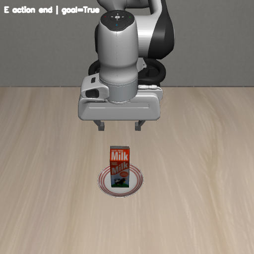

[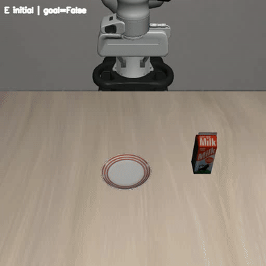](./images/extended_task_validation/E_robot_action.mp4)

[E 결과 JSON](./images/extended_task_validation/E_result.json)

##### 9.4.6) 새 Predicate의 경계 조건 검사

새 조건이 기존 `On`보다 엄격한지도 별도 시험했다. [경계 조건 검사 코드](./custom_task_validation/test_custom_predicate_conditions.py)는 우유의 MuJoCo 상태를 **직접 변경**해 접시 중심에서의 거리와 기울기를 바꾼다.

```powershell
& $liberoPython .\test_custom_predicate_conditions.py
```

| 직접 설정한 상태 | XY 거리 | 우유 로컬 Y축·수직 Z축 내적 | 기존 `On` | 새 `CenteredUprightOn` |
| --- | ---: | ---: | --- | --- |
| 중심 | 0 m | 0.999971 | `True` | `True` |
| 1 cm 안쪽 | 0.0099 m | 0.999971 | `True` | `True` |
| 1 cm 바깥쪽 | 0.0101 m | 0.999971 | `True` | `False` |
| 중심에서 더 벗어남 | 0.015 m | 0.999971 | `True` | `False` |
| 중심에서 20° 기울임 | 0 m | 0.937041 | `True` | `False` |

결과는 [E 경계 조건 JSON](./images/extended_task_validation/E_predicate_conditions.json)에 기록했다. 기존 `On`이 모두 `True`여도 거리 또는 자세 기준을 벗어나면 새 조건만 `False`가 됐다.

#### 9.5) F — 카메라와 제어 설정을 바꾼 환경 추가

##### 9.5.1) 카메라와 제어 설정을 추가하는 일반적인 방법

실행 환경은 **관측·제어 요구 정의 → 환경 코드 설정 → Wrapper 연결 → 실제 값과 동작 확인** 순서로 바꾼다. BDDL에는 작업 조건과 사용할 Problem을 적고, 카메라와 컨트롤러의 수치는 환경 코드에서 정한다.

1. **관측 시점을 만든다.** 장면 XML이나 환경의 `_setup_camera()`에서 카메라 이름·위치·방향을 정의한다. Wrapper의 `camera_names`에 같은 이름을 전달하고 해상도와 필요한 관측값을 지정한다.
2. **제어 종류와 값을 정한다.** Wrapper의 `controller`에서 컨트롤러 종류를 선택한다. Wrapper가 생성해 전달하는 `controller_configs`를 환경 클래스의 생성자에서 조정해 이득·감쇠를 설정하고, Action의 구성과 제어 주기를 맞춘다.
3. **환경을 Task에 연결한다.** 설정을 새 환경 클래스로 구현한 경우 `@register_problem`으로 등록하고, BDDL의 problem 이름을 맞춘다. 기존 배치 기능을 재사용하려면 해당 Region sampler도 연결한다.
4. **적용 결과를 확인한다.** 선택한 카메라의 이미지와 실제 컨트롤러 값을 확인한 뒤 Action·Goal을 검사한다. 제어 성능을 비교하려면 초기 배치와 Task를 맞춰 반복 평가한다.

##### 9.5.2) 실험 예시 — 새 카메라와 제어 이득을 적용한 환경

F는 B의 **우유를 접시 위에 놓기** Task를 유지하면서 관찰 시점과 Panda 제어 설정을 바꾼다. 같은 BDDL 물체 배치와 Goal을 사용하므로 새 환경 코드의 역할을 따로 볼 수 있다.

| 요소 | F에서 사용한 정의 |
| --- | --- |
| Object·Region·Init | B의 우유·접시 및 시작 배치 유지 |
| Goal | `(On milk_1 plate_1)` 유지 |
| 카메라 | `custom_overview` 추가, 넓은 작업 장면을 촬영 |
| 제어 | `OSC_POSE`의 `kp=180`, `damping_ratio=1.0` 설정 |

[libero_custom_camera_control.py](./custom_task_validation/libero/libero/envs/problems/libero_custom_camera_control.py)는 기존 Tabletop 환경을 상속하고 `@register_problem`으로 새 환경 이름을 등록한다. D와 같은 방식으로 새 Problem 이름에 Tabletop 배치 sampler도 연결했으며, 기존 `agentview`를 유지한 채 `custom_overview` 카메라를 추가했다.

```python
from copy import deepcopy

from libero.libero.envs.bddl_base_domain import TASK_MAPPING, register_problem
from libero.libero.envs.problems import libero_tabletop_manipulation  # noqa: F401
from libero.libero.envs.regions import REGION_SAMPLERS


REGION_SAMPLERS["libero_custom_camera_control"] = dict(
    REGION_SAMPLERS["libero_tabletop_manipulation"]
)


@register_problem
class Libero_Custom_Camera_Control(TASK_MAPPING["libero_tabletop_manipulation"]):
    """Preserve the tabletop scene while extending its control and observation."""

    def __init__(self, bddl_file_name, *args, **kwargs):
        controller = deepcopy(kwargs.get("controller_configs") or {})
        controller["kp"] = 180
        controller["damping_ratio"] = 1.0
        kwargs["controller_configs"] = controller
        super().__init__(bddl_file_name, *args, **kwargs)

    def _setup_camera(self, mujoco_arena):
        super()._setup_camera(mujoco_arena)
        mujoco_arena.set_camera(
            camera_name="custom_overview",
            pos=[0.9, 0.0, 1.8],
            quat=[
                0.6380177736282349,
                0.3048497438430786,
                0.30484986305236816,
                0.6380177736282349,
            ],
        )
```

위 코드는 `libero/libero/envs/problems/libero_custom_camera_control.py`에 저장한다. `kp`는 목표 자세와 현재 자세의 오차에 반응하는 강도를 정하는 제어 이득이다. 여섯 값은 말단의 **위치 3축과 회전 3축**에 대응한다. 기본 실험의 실제 controller 값은 모두 150이었고, F에서는 모두 180으로 읽혔다. `damping_ratio`는 목표 근처의 진동을 줄이기 위한 감쇠 비율로 코드에서 1.0을 전달했다.

##### 9.5.3) BDDL 작성

[custom_camera_control_task.bddl](./custom_task_validation/custom_tasks/custom_camera_control_task.bddl)은 Problem 이름을 새 환경 클래스에 맞춰 바꾸고 B의 Goal을 유지했다.

```lisp
(define (problem LIBERO_Custom_Camera_Control)
  (:domain robosuite)
  (:language Put the milk on the plate)
```

Goal은 `(And (On milk_1 plate_1))`이다. 카메라 위치나 제어 이득의 수치는 BDDL에 적지 않았다. 이 파일은 새 Problem을 선택하고 작업 조건을 정의하며, 카메라·컨트롤러 구현은 환경 코드가 담당한다. Object·Region·Init은 [전체 BDDL](./custom_task_validation/custom_tasks/custom_camera_control_task.bddl)에 있다.

##### 9.5.4) 환경 로딩과 초기 상태

```powershell
& $liberoPython .\test_extended_custom_tasks.py --case F --seed 0 --size 512
```

새 Problem으로 환경을 만들고 `custom_overview`에서 초기 화면을 받았다. 초기 Goal은 `False`, 2개의 `On` 초기 조건은 모두 `True`였다. [초기 사진](./images/extended_task_validation/F_initial.png)은 기존 시점보다 테이블 주변을 넓게 보여준다. JSON에는 관측 카메라 이름 `custom_overview`와 controller 이득 `[180, 180, 180, 180, 180, 180]`이 기록됐다.


##### 9.5.5) Panda Action과 Goal 검증

동일한 우유 집기·이동·놓기 동작을 새 환경에서 실행했다. 총 261 action step 뒤 우유와 접시의 접촉 및 Goal `True`를 확인했고, 그리퍼 이탈 후 마지막 30개 검증 step 내내 `True`가 유지됐다. 이 검증 구간도 총 step에 포함된다. [최종 사진](./images/extended_task_validation/F_action_end.png)과 영상은 새 카메라 시점에서 기록됐다. 이 결과는 새 카메라와 제어 설정을 적용한 환경에서도 Task가 실제로 수행됨을 보여준다.

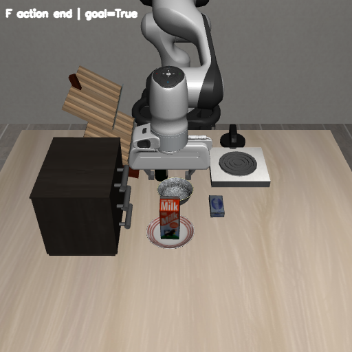

[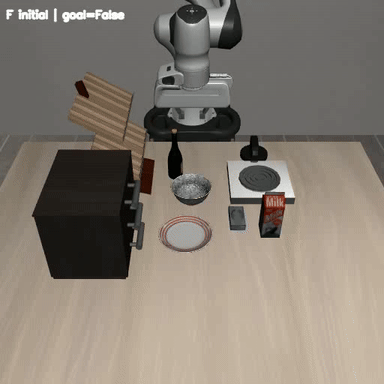](./images/extended_task_validation/F_robot_action.mp4)

[F 결과 JSON](./images/extended_task_validation/F_result.json)

##### 9.5.6) 로봇·작업대·관측 설정을 작성하는 방법

로봇·작업대 설정은 **모델과 초기 자세 정의 → 작업 공간 설정 → Wrapper에서 선택 → 초기화와 Action 확인** 순서로 적용한다.

**일반적인 방법 — 로봇 모델과 초기 자세**

새 로봇 모델을 추가할 때는 **관절·actuator가 있는 로봇 XML, 모델 클래스, 초기 관절각, mount·gripper, 설치 위치, 사용할 컨트롤러**를 작성한다. Actuator는 관절을 구동하는 요소다. 모델 모듈을 import해 등록하고, `ROBOT_CLASS_MAPPING`에 이름을 연결한다. Tabletop 환경은 입력한 로봇 이름 앞에 `Mounted`를 붙이므로 이 이름 규칙도 맞춰야 한다. 이후 관절 수, 그리퍼, 컨트롤러에 맞게 Action 구성과 접근 경로를 정한다.

초기 자세만 바꿀 때는 기존 모델을 사용하면서 `init_qpos`에 관절 수와 제한 범위에 맞는 값을 정의한다. `initialization_noise=None`으로 자세에 무작위 잡음을 넣지 않고, `reset()` 후 실제 관절값과 화면의 자세를 확인한다.

**일반적인 방법 — 작업대 크기와 높이**

작업대 크기는 [libero_tabletop_manipulation.py](./custom_task_validation/libero/libero/envs/problems/libero_tabletop_manipulation.py)의 `table_full_size`, 상판 높이는 `table_offset`에서 정한다. 전달받은 크기는 환경 생성자의 다음 코드로 읽는다. `self`와 `kwargs`를 사용하는 생성자 내부 발췌다.

```python
if "table_full_size" in kwargs:
    self.table_full_size = kwargs["table_full_size"]
else:
    self.table_full_size = (1.0, 1.2, 0.05)
self.table_offset = (0, 0, 0.90)
```

크기를 바꾼 후에는 Region이 상판 범위에 들어가는지, 로봇 설치 위치와 도달 범위가 맞는지 확인한다. 상판 높이를 바꾸면 배치 기준 좌표와 Fixture의 높이 보정도 함께 검토한다.

**실험에서의 적용 — F의 Panda와 관측 설정**

C–F에서는 로봇 모델을 `MountedPanda`로 유지했다. Tabletop은 `robots=["Panda"]`를 받아 이 모델을 선택한다. 초기 관절각은 [mounted_panda.py](./custom_task_validation/reference_code/libero/libero/envs/robots/mounted_panda.py)의 `init_qpos`, 설치 위치는 `base_xpos_offset`에 정의돼 있다. [robots/__init__.py](./custom_task_validation/reference_code/libero/libero/envs/robots/__init__.py)는 모델을 다음처럼 실행 클래스에 연결한다. 아래는 해당 모듈 내부의 등록 코드다.

```python
import test_custom_bddl
from robosuite.robots.single_arm import SingleArm
from robosuite.robots import ROBOT_CLASS_MAPPING

ROBOT_CLASS_MAPPING.update({"MountedPanda": SingleArm})
```

로봇과 관측 설정은 [Wrapper](./custom_task_validation/reference_code/libero/libero/envs/env_wrapper.py)를 통해 환경에 전달했다. F를 불러올 때의 핵심 설정은 다음과 같다. 컨트롤러의 `kp`와 `damping_ratio`는 9.5.2의 환경 클래스에서 설정한다.

```python
import test_custom_task_variants as base
from libero.libero.envs.env_wrapper import OffScreenRenderEnv
import libero.libero.envs.problems.libero_custom_camera_control

env = OffScreenRenderEnv(
    bddl_file_name=str(base.ROOT / "custom_tasks/custom_camera_control_task.bddl"),
    robots=["Panda"], initialization_noise=None,
    controller="OSC_POSE", camera_names=["custom_overview"],
    camera_heights=512, camera_widths=512,
)
try:
    env.seed(0)
    obs = env.reset()
    print("Image shape:", obs["custom_overview_image"].shape)
    print("Controller kp:", env.env.robots[0].controller.kp)
    print("Initial goal:", bool(env.check_success()))
finally:
    env.close()
```

**별도 설정 확인 — 작업대 크기 변경**

실행 파일에서 `table_full_size=(1.1, 1.3, 0.05)`를 전달해 길이 1.1 m, 폭 1.3 m, 두께 0.05 m로 생성했다.

```powershell
& $liberoPython .\test_tabletop_configuration.py
```

[설정 확인 코드](./custom_task_validation/test_tabletop_configuration.py)로 변경한 크기를 적용해 `reset()`을 검사했다. 실제 충돌 형상의 절반 크기는 `(0.55, 0.65, 0.025) m`, 로봇 base의 X 위치는 `-0.71 m`였다.

### 10. Panda 초기 장면부터 확장 Custom Task까지의 검증 결과

이번 검증의 목적은 **새 Task를 BDDL로 작성했을 때, 의도한 장면이 시뮬레이터에 나타나고 Panda가 실제로 움직여 Goal을 달성하는지 확인하는 것**이다. 화면에 물체가 생성되는 과정부터 로봇의 작업 완료까지 확인해, 앞으로 Task를 설계할 때 필요한 근거를 얻고자 했다.

5장에서는 책상과 Panda만 있는 초기 장면을 준비했다. 6–7장에서는 서랍 Task의 로딩·관측·Action·성공 판정을 연결했고, 8장에서는 등록된 요소로 새 BDDL을 구성했다. 9장에서는 새 물체·Fixture·Predicate·카메라와 제어 설정을 코드에 추가했다.

#### 10.1) 5장 — 빈 작업 공간과 Panda의 초기 자세

먼저 **책상과 Panda만 있는 장면**에서 로봇 모델과 렌더링을 확인했다. 5.2의 `test_panda_initial_pose.py`는 BDDL 없이 `MountedPanda`와 빈 TableArena를 구성한다. TableArena는 작업대의 형상과 배치 기준을 제공하는 모델이다. 크기는 `(1.0, 1.2, 0.05) m`, 상판 높이는 `0.90 m`로 정했고, 작업 물체나 캐비닛·스토브는 추가하지 않았다.

Panda는 `init_qpos`에 정의된 7개 관절각으로 시작한다. `initialization_noise=None`으로 무작위 자세 변화를 없애고, `reset()` 후 실제 관절값이 설정과 일치하는지 검사했다. 작업 물체가 0개인지도 확인했다. 이 단계에서 초기 자세가 틀어지거나 화면이 나오지 않으면 뒤의 Task 배치와 동작을 판단하기 어려우므로, 가장 단순한 구성부터 확인했다.


5.3의 `test_libero_tabletop.py`는 같은 장면을 `libero_tabletop_test.png`로 저장해 확인하는 과정이다. 따라서 5장에서 확인한 것은 **로봇의 시작 자세·빈 작업 공간·이미지 출력**이며, BDDL Task 수행은 다음 단계부터 검증했다.

#### 10.2) 6–7장 — 서랍 BDDL의 로딩에서 실제 작업 완료까지

##### 10.2.1) 필요한 Fixture와 초기 조건만 남긴 서랍 Task

6장에서는 공식 가운데 서랍 열기 BDDL을 참고해 `custom_test.bddl`을 작성했다. 책상·Panda·서랍 캐비닛만 남기고 조작 물체를 선언하는 `:objects`는 비웠다. 캐비닛의 시작 위치와 중간 서랍 Region을 정의하고, Init에는 캐비닛이 책상 위에 있다는 `On`과 서랍이 닫혀 있다는 `Close`를 지정했다.

Goal은 `(Open wooden_cabinet_1_middle_region)`이다. BDDL 경로를 `OffScreenRenderEnv`에 직접 전달하면 Wrapper가 Problem 이름으로 환경을 선택하고 Parser가 나머지 명세를 해석한다. `env.reset()` 후 Init 두 조건은 모두 `True`, Goal은 `False`였다. 단일 파일을 실행하는 데 별도 benchmark suite 등록은 필요하지 않았다.


##### 10.2.2) 실시간 화면·PNG·영상으로 관측 갱신 확인

6.4에서는 OpenCV 창으로 실시간 화면을 보고, 초기·종료 PNG를 비교하며, 진행 과정을 MP4로 기록하는 방법을 정리했다. 세 방법은 같은 `agentview_image` 관측값을 사용한다. 표시·저장 전에 이미지의 상하 방향과 RGB/BGR 순서를 보정해 장면이 정상적으로 보이도록 했다.

7.2에서는 7차원 `zero action`을 60 step 전달했다. `env.step(action)`이 시뮬레이션을 진행하고 관측값을 반환하는지, 매 step의 Goal 검사도 이어지는지 확인했다. 의도적인 이동 명령을 주지 않아도 중력과 접촉 계산은 계속 진행된다. 이 구간에서 Goal은 계속 `False`였으며, 아래 영상은 **관측 갱신을 확인한 기록**이다.


##### 10.2.3) 서랍이 열렸을 때 Goal 판정이 바뀌는지 검사

7.3에서는 서랍 joint 값을 직접 설정해 `Open` Predicate를 시험했다. Predicate는 현재 상태가 조건을 만족하는지 참·거짓을 반환하는 함수다. 먼저 이 판정이 맞는지 확인해야 실제 로봇 동작이 실패했을 때 Goal 정의와 제어 문제를 구분할 수 있다.

서랍 joint의 범위는 `[-0.16, 0.01] m`다. `qpos=-0.007 m`에서는 Goal이 `False`, `qpos=-0.143 m`에서는 `True`였다. 값을 바꾼 뒤 시뮬레이터와 관측을 갱신했고, 아래 화면에서 중간 서랍이 열린 모습과 판정이 일치했다. 이 시험은 직접 상태를 설정한 결과이며, Panda의 서랍 열기 동작과는 별도로 기록했다.


##### 10.2.4) Panda가 손잡이를 잡고 실제로 서랍 열기

7.4에서는 닫힌 초기 상태로 다시 시작해 `OSC_POSE` Action을 실행했다. 이 컨트롤러는 말단의 위치·회전 변화와 그리퍼 명령을 받는다. 손잡이 geom의 현재 위치와 서랍이 움직이는 축을 읽고, **접근 → 파지 → 당기기 → 놓기 → 후퇴** 순서로 Panda를 제어했다. 동작 구간에서 서랍 joint를 직접 설정하지 않았다.

총 **369 Action step**을 실행했고, 최종 서랍 joint는 약 **−0.141538 m**였다. 손잡이 파지와 그리퍼 이탈을 확인했으며, 마지막 30 step 내내 Goal `True`가 유지됐다. 아래 영상과 종료 사진은 서랍이 실제 로봇의 접촉으로 열렸음을 보여 준다.


6–7장을 통해 **BDDL 로딩 → Init 확인 → Action 전달 → 관측 변화 → Goal 판정**을 하나의 작업에서 연결했다. 직접 joint를 바꾸는 시험과 실제 조작을 구분한 점도 이후 검증의 기준으로 삼았다.

#### 10.3) 8장 — 기존 LIBERO 요소로 새로운 BDDL 구성

새 Task를 만들 때는 먼저 물체 종류와 Predicate가 LIBERO에 등록돼 있는지 확인한다. 기존 요소를 사용할 수 있으면 BDDL의 Object·Region·Init·Goal을 조합해 작업을 정의한다. A·B는 같은 책상·Panda·기본 제어 설정을 사용하면서, 각 작업에 필요한 물체와 Fixture만 남긴 사례다.

##### 10.3.1) A — 접시를 스토브 앞 영역으로 밀기

A는 공식 접시 밀기 BDDL을 바탕으로 접시와 스토브만 남겼다. 접시의 시작 Region은 중심을 유지하면서 폭을 0.02 m에서 0.04 m로 넓혔고, 공식 스토브 앞 목표 Region은 그대로 사용했다. Init은 접시·스토브의 배치 조건 2개, Goal은 `(On plate_1 main_table_stove_front_region)`이다.

Panda가 접시 표면에 접촉해 테이블 위에서 밀었다. 접시를 들어 올려 옮기는 방식은 사용하지 않았다. 총 **645 step** 후 목표 영역에 도달했고, 접촉 종료·후퇴 이후 마지막 40 step 동안 Goal이 유지됐다. 이 사례는 기존 물체와 Region으로 정의한 작업이 실제 접촉 동작까지 이어지는지 확인한 결과다.


##### 10.3.2) B — 다른 Tabletop Task의 우유 모델을 접시 놓기에 사용

`milk`는 `hope_objects.py`의 `Milk` 클래스가 기존 `milk.xml`을 읽어 생성하는 등록 물체다. 같은 모델을 사용하는 공식 `LIVING_ROOM_SCENE2_pick_up_the_milk_and_put_it_in_the_basket.bddl`을 원래 구성대로 렌더링해 출처를 확인했다. 아래 사진의 가운데 아래쪽, 빨간 `Milk` 글자가 있는 상자가 우유다. 출처 사진에는 원본 Task의 바구니와 다른 식품도 함께 보인다.


B에서는 `milk_1 - milk`로 우유를 선언했다. 오른쪽 `milk`는 물체 종류, 왼쪽 `milk_1`은 새 환경에 생성할 인스턴스 이름이다. 우유와 접시만 남기고 우유의 시작 Region·Init을 추가했으며, Goal을 `(On milk_1 plate_1)`로 정했다. 원본의 바구니 넣기와 달리 새 작업은 접시 위에 놓기다.

초기에는 우유와 접시가 떨어져 있고 Goal은 `False`였다. Panda가 우유를 파지해 약 0.170 m 들어 올린 뒤 접시 위에 놓았다. 총 **273 step**, 마지막 30 step 동안 Goal `True`를 확인했다. 새 모델을 구현하지 않고 **기존 물체를 다른 초기 배치와 Goal에 연결한 경우**다.


#### 10.4) 9장 — 새 요소를 코드에 구현한 뒤 BDDL에 연결

LIBERO에 없는 형상이나 판정 의미를 사용하려면 먼저 모델·함수를 구현하고 등록해야 한다. 9장에서는 일반적인 추가 방법을 설명한 뒤 C–F 실험으로 적용 결과를 확인했다. 네 경우 모두 필요한 대상만 남기고 초기 `On` 2개와 Goal `False`를 검사한 다음 실제 Panda Action을 실행했다.

##### 10.4.1) C — 새 Object의 형상·물성·등록

새 물체는 **XML 모델 작성 → Object 클래스 구현·등록 → BDDL 선언** 순서로 추가한다. XML에는 충돌 형상·크기·질량·마찰을 정의하고, 클래스가 이 파일을 읽도록 연결한다. 실행 전에 모듈을 import해야 등록된 종류 이름을 BDDL에서 찾을 수 있다.

C에서는 파란색 표식 상자를 만들었다. 크기는 52×52×110 mm이며, 충돌 계산용 geom과 색·주황 표식 표시용 geom을 분리했다. `CustomMarkerBox`를 등록하고 `custom_marker_box_1 - custom_marker_box`를 선언했다. 장면에는 이 상자와 접시만 있다. Panda가 상자를 약 0.173 m 들어 올려 접시 위에 놓았고, **277 step** 후 마지막 30 step 동안 Goal이 유지됐다.


##### 10.4.2) D — 새 Fixture와 물체를 놓을 윗면 Region

고정 구조를 추가할 때는 실제로 물체를 받칠 형상과 Goal이 참조할 영역을 함께 만든다. 충돌 geom은 물리적 지지를 계산하고, site는 윗면의 위치·범위를 표시하는 기준이다. site만 정의하면 물체를 받치는 형상이 생기는 것은 아니다.

D에서는 가로·세로 12 cm, 높이 4 cm의 받침대를 Fixture로 등록했다. 기존 배치기의 높이 보정을 그대로 쓰면 받침대가 가라앉으므로, 새 환경에서 해당 sampler의 `z_offset`을 0으로 조정했다. 우유·받침대만 남기고 `(On milk_1 raised_support_1_top_region)`을 Goal로 사용했다.

Panda가 우유를 새 받침대 위에 놓고 후퇴했다. 총 **294 step** 후 우유와 받침대의 물리적 접촉을 확인했고, 마지막 40 step 동안 Goal이 유지됐다. 새 Fixture의 생성뿐 아니라 초기 높이·윗면 Region·실제 지지가 함께 맞는지 검증한 사례다.


##### 10.4.3) E — 접시 중앙에 똑바로 놓는 새 Predicate

새 성공 조건은 검사할 상태와 허용 범위를 정한 뒤 Python 함수로 구현한다. 현재 시뮬레이터 값을 읽어 참·거짓을 반환하고, Predicate registry에 등록한 이름을 BDDL Goal에서 사용한다. registry는 조건 이름과 판정 함수를 연결하는 목록이다.

E의 `CenteredUprightOn`은 기존 `On`에 **접시 중심과의 XY 거리 ≤ 1 cm**, **우유의 직립 방향과 수직축의 내적 ≥ 0.95**를 더했다. 우유 모델에서는 로컬 Y축이 윗면을 향하며, 내적이 1이면 수직축과 완전히 같은 방향이다. 물체와 초기 배치는 B를 유지하고 Goal을 더 엄격하게 바꿨다.

실제 Panda 동작은 **273 step**이었다. 최종 중심 거리는 **0.000795 m**, 방향 내적은 **0.999832**였고, 그리퍼 이탈 후 마지막 30 step 동안 새 Goal이 유지됐다. 별도 직접 상태 변경 검사에서는 9.9 mm가 `True`, 10.1 mm와 20° 기울임이 `False`였다. 이때 기존 `On`은 모두 `True`여서, 새 조건이 위치·자세를 추가로 구분함을 확인했다.


##### 10.4.4) F — 새 관측 카메라와 제어 설정

카메라 위치·방향과 컨트롤러 수치는 환경 코드에 작성하고 Wrapper에서 선택한다. F에서는 새 Problem에 `custom_overview` 카메라를 추가하고, `OSC_POSE`의 위치·회전 6축 `kp`를 150에서 180으로 설정했다. 감쇠 비율 `damping_ratio=1.0`도 전달했다. BDDL은 이 Problem을 선택하고 우유·접시의 배치와 기존 `On` Goal을 정의한다.

같은 Panda 모델로 우유 놓기를 실행해 **261 step** 후 Goal에 도달했고, 마지막 30 step 동안 유지됐다. 아래 영상은 넓어진 관측 시점에서 기록한 결과다.


#### 10.5) 전체 결과와 새 Task 설계에 적용할 기준

| 사례 | 실행 장면의 핵심 대상 | 초기 Goal·Init | 전체 Action step | 마지막 Goal 유지 |
| --- | --- | --- | ---: | --- |
| 7장 서랍 열기 | 서랍 캐비닛 | `False`, `On`·`Close` 2/2 | 369 | 30 step 모두 `True` |
| A 접시 밀기 | 접시·스토브 | `False`, `On` 2/2 | 645 | 40 step 모두 `True` |
| B 우유 놓기 | 우유·접시 | `False`, `On` 2/2 | 273 | 30 step 모두 `True` |
| C 새 Object | 표식 상자·접시 | `False`, `On` 2/2 | 277 | 30 step 모두 `True` |
| D 새 Fixture | 우유·받침대 | `False`, `On` 2/2 | 294 | 40 step 모두 `True` |
| E 새 Predicate | 우유·접시 | `False`, `On` 2/2 | 273 | 30 step 모두 `True` |
| F 새 실행 환경 | 우유·접시 | `False`, `On` 2/2 | 261 | 30 step 모두 `True` |

모든 장면에 책상과 Panda가 있으며, 전체 Action step에는 마지막 검증 구간도 포함된다. 성공 여부는 초기 배치 사진, 실제 동작 영상, 종료 Goal과 그리퍼 이탈을 함께 확인했다. 직접 상태 변경으로 Predicate를 시험한 결과는 실제 로봇 수행 기록과 구분했다.

작업대 크기 변경은 `(1.1, 1.3, 0.05) m` 설정과 `reset()`까지만 확인했다. 각 작업은 `seed=0`의 초기 배치에서 규칙 기반 제어로 수행했다.

새 Task를 설계할 때는 **필요한 요소 선정 → BDDL과 코드 작성 → 초기 배치 확인 → 실제 Action → Goal 검증** 순서로 진행할 수 있다. 기존 요소가 있으면 BDDL에서 조합하고, 새 요소가 필요하면 모델·환경·판정 함수를 구현해 연결한다. 이번 검증에서는 이 과정을 따라 명세가 화면의 장면으로 만들어지고, Panda의 실제 동작으로 목표에 도달하며, 눈으로 본 결과와 Goal 판정이 일치하는지 확인했다.
