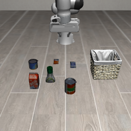
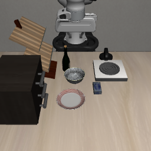
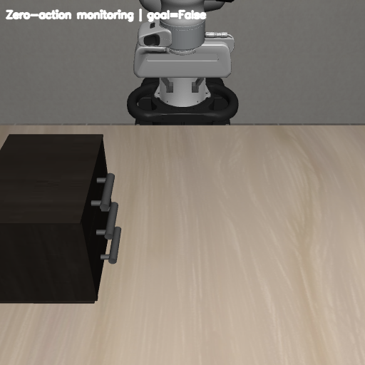
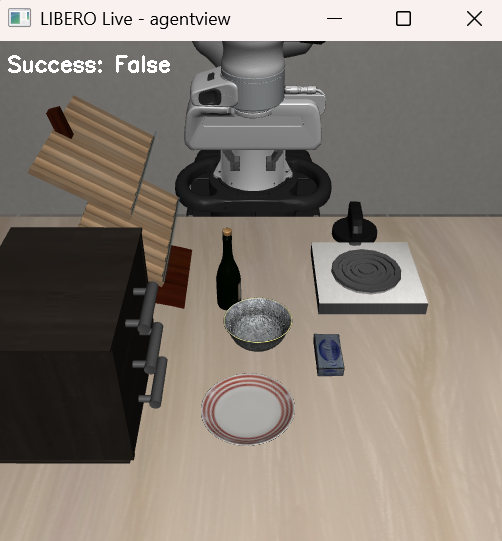
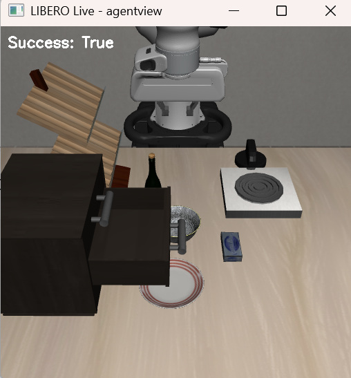
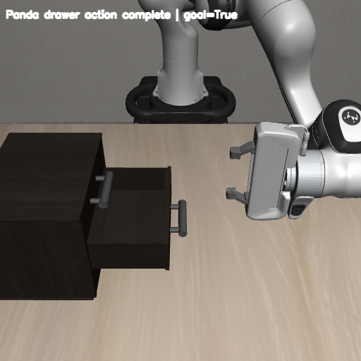

# 1\. LIBERO BDDL 새로운 task를 작업명세서로 작성했을 때 시뮬레이션에서 돌아가는 지 검증

로컬 Windows PC의 Nvidia RTX 5070으로 진행했다. 명령어는 VSCode의 PowerShell 터미널 기준이다. 아래 순서대로 설치 → 기존 task 확인 → custom BDDL 초기화 → action 및 goal 검사를 진행한다.

먼저 파이프라인과 각 요소의 역할을 정리하고, 실제 명령어와 코드는 아래 [실행과정 1~7번](#실행과정)에서 설명한다.

## 작업명세서, BDDL, Parser 및 실행 Pipeline

### 전체 파이프라인

작업명세서를 BDDL로 작성한 뒤, LIBERO가 내용을 해석해 환경을 구성한다. `env.reset()`으로 초기 상태를 만들고, `env.step(action)`으로 로봇을 움직이며, `env.check_success()`로 goal condition을 확인한다.

실행과정의 1~4번은 설치, 5번은 기존 benchmark task로 환경을 확인하는 준비 과정이다. 6번과 7번은 아래 파이프라인에서 표시한 구간에 해당한다.

```text
작업명세서
    ↓
사람이 수행할 task 정의
예: "가운데 서랍을 연다."
    ↓
[실행과정 6번: BDDL 준비 / 환경 생성 / 초기 상태 확인]
BDDL 작성 / 기존 BDDL 복사 및 수정
    ↓
custom_tasks/custom_test.bddl
    ↓
OffScreenRenderEnv(bddl_file_name=...)
    ↓
get_problem_info()로 problem 이름 확인
    ↓
TASK_MAPPING에서 LIBERO_Tabletop_Manipulation 선택
    ↓
BDDL Parser로 내용 해석
(objects / regions / fixtures / init / goal)
    ↓
robosuite / MuJoCo scene 구성
    ↓
env.reset()
    ↓
BDDL의 :init 조건을 기반으로 초기 상태 생성
Panda 초기 자세 / Cabinet / Object 배치
    ↓
obs 반환 → obs["agentview_image"]
    ↓
초기 상태 PNG 또는 화면 확인
    ↓
[실행과정 7번: action 전달 / observation 갱신 / goal 검사]
env.check_success()로 초기 goal 확인
현재 서랍 task에서는 False 예상
    ↓
action 생성
현재 7.2: zero action / 이후: 실제 작업 수행 action
    ↓
env.step(action)
    ↓
컨트롤러를 통해 Panda action 실행
MuJoCo 물리 시뮬레이션 진행
    ↓
새로운 observation / reward / done / info 반환
    ↓
agentview_image 갱신
(실시간 viewer 사용 시 cv2.imshow()로 화면 갱신)
    ↓
env.check_success()
    ↓
BDDL의 :goal 조건 만족 여부 확인
    ├─ False → goal 미충족 → 다음 action으로 반복
    └─ True  → goal 충족 → task 성공
```

### 작업명세서란?

작업명세서는 로봇이 어떤 작업을 수행해야 하는지를 사람이 이해할 수 있는 형태로 정의한 것이다. 작업명세서에는 다음 내용이 포함된다.

- 어떤 물체를 사용할 것인지
- 물체의 초기 위치는 어디인지
- 로봇이 어떤 행동을 수행해야 하는지
- 어떤 상태가 되면 작업이 성공한 것인지

예를 들어, "테이블 위에 있는 우유를 집어서 바구니 안에 넣는다."라는 문장은 사람이 이해할 수 있는 작업명세서이다. 즉, 작업명세서는 **"로봇에게 어떤 작업을 시킬 것인가?"**를 정의하는 상위 개념이다.

### BDDL이란? — 작업명세서와의 차이

BDDL은 사람이 작성한 작업명세서를 LIBERO 시뮬레이터가 읽고 사용할 수 있도록 구조화한 작업 정의 파일이다. 작업명세서와 BDDL은 서로 다른 task가 아니라 같은 task를 서로 다른 형태로 표현한 것이다.

작업명세서가 "우유를 집어서 바구니 안에 넣는다."라면, BDDL에서는 사용할 물체, 배치 영역, 초기 상태, 성공 조건 등을 나누어 정의한다. 작업명세서는 무엇을 수행할지 사람이 이해하기 쉽게 정의하고, BDDL은 그 작업을 LIBERO에서 사용할 수 있도록 구체적으로 표현한다.

BDDL 파일의 전체 구조와 각 항목은 실행과정 6.2의 예시에서 확인할 수 있다. BDDL에 목표를 적으면 환경과 성공 조건이 정의되며, 그 목표를 달성할 action은 별도로 만들어 입력해야 한다.

### BDDL Parser란?

BDDL Parser는 `.bddl` 파일에 작성된 내용을 읽고 해석하는 프로그램이다. `custom_test.bddl`은 텍스트 형태의 작업 정의 파일이기 때문에 MuJoCo가 그 내용을 바로 이해하는 것은 아니다.

따라서 Parser가 problem, domain, language, objects, regions, fixtures, init condition, goal condition을 읽고 LIBERO가 사용할 수 있는 형태로 해석한다.

예를 들어 BDDL에 다음과 같이 작성되어 있으면,

```lisp
(:objects
    milk_1 - milk
)
```

"milk 타입의 milk_1이라는 물체가 필요하다."라고 해석한다. 또한 `:goal`을 해석해서 어떤 상태가 되어야 task가 성공한 것인지 LIBERO가 판단할 수 있도록 정보를 전달한다.

### LIBERO_Tabletop_Manipulation이란?

BDDL 파일의 첫 부분에는 다음과 같은 내용이 들어간다.

```lisp
(define (problem LIBERO_Tabletop_Manipulation)
```

이 의미는 "이 작업은 LIBERO_Tabletop_Manipulation이라는 Tabletop 조작 문제 형식을 사용한다."라는 뜻이다. LIBERO는 이 problem 이름을 확인하고, 이에 해당하는 Tabletop manipulation 환경을 생성한다.

실제 코드에서는 `OffScreenRenderEnv`가 `get_problem_info()`로 problem 이름을 읽고, `TASK_MAPPING`에서 환경 클래스를 선택한다. 선택된 환경은 `robosuite_parse_problem()`으로 나머지 BDDL 내용을 해석해 장면과 조건을 구성한다.

MuJoCo는 로봇과 물체의 움직임, 접촉 등 실제 물리 simulation을 수행하는 엔진이다. LIBERO와 robosuite는 BDDL로 정의된 환경을 구성하고, action 전달과 observation 반환, 성공 조건 판정을 연결한다.

### env.reset()이란?

LIBERO 환경을 생성한 뒤 `obs = env.reset()`을 실행하면 BDDL에 정의된 scene과 `:init` 조건을 기준으로 시뮬레이션의 초기 상태를 만든다. Drawer task라면 Panda 로봇 초기 자세, Tabletop과 Cabinet, 서랍의 초기 상태, 주변 object 배치 등을 준비한다.

5번의 `env.set_init_state(init_states[0])`는 benchmark에 저장된 특정 상태를 재현한다. 반면 6번의 `env.reset()`은 BDDL의 배치 영역과 초기 조건을 기반으로 초기화하므로 실행할 때 물체의 위치가 영역 안에서 달라질 수 있다.

이때 얻는 `obs`에는 카메라 이미지, 로봇 상태 등의 observation이 들어 있다.

### agentview_image란?

`agentview_image`는 LIBERO 시뮬레이션 환경을 외부 카메라 시점에서 촬영한 RGB 이미지이다. `obs["agentview_image"]`로 가져와 OpenCV를 이용해 저장하거나 실시간으로 확인할 수 있다.

PNG를 저장할 때는 6.3 코드처럼 이미지 방향을 보정하고 RGB를 OpenCV용 BGR로 변환한다. 화면을 계속 확인하려면 `env.step()`으로 새로운 observation을 받고, `cv2.imshow()`와 `cv2.waitKey()`를 반복 호출한다. 실시간 viewer의 전체 코드는 7.2에 있다.

### env.step(action)이란?

`env.reset()`은 초기 환경만 생성한다. 실제로 로봇을 움직이려면 action을 입력해야 한다.

```python
obs, reward, done, info = env.step(action)
```

`env.step(action)`은 하나의 action을 컨트롤러에 전달하고 시뮬레이션의 제어 step을 한 번 진행한다. 이 제어 주기 안에서 MuJoCo의 물리 계산은 여러 timestep 실행될 수 있다.

이 예제의 Panda는 기본 `OSC_POSE` 컨트롤러를 사용한다. Action의 7차원 구성과 zero action 테스트 방법은 7.2에서 설명한다.

### env.check_success()란?

BDDL의 `:goal`에는 task 성공 조건이 정의되어 있다. Drawer task라면 "가운데 drawer가 열린 상태"가 goal condition이 될 수 있다.

`success = env.check_success()`로 현재 시뮬레이션 상태가 goal condition을 만족하는지 확인한다.

- `False` → 아직 task 성공 조건을 만족하지 않음
- `True` → BDDL에 정의된 goal condition 만족

이 함수는 현재 상태를 검사하는 역할이며 로봇을 움직이거나 goal을 자동으로 달성하지 않는다. 7.2의 `False`는 zero action 테스트에서 예상하는 결과다. 7.3에서는 서랍이 열린 상태에서 `True`가 되는지 확인해, BDDL의 goal 정의와 Panda action 수행을 나누어 검증한다.

---

## 실행과정

### 1\. LIBERO 공식 코드 받기

VSCode PowerShell 터미널에서 다음 명령 실행

`git clone https://github.com/Lifelong-Robot-Learning/LIBERO.git`

### 2\. Tabletop 코드 확인

`cd LIBERO`로 이동한 뒤 다음 명령으로 Tabletop 환경 코드를 확인한다. 이후 상대 경로가 포함된 명령과 Python 실행은 이 LIBERO 루트에서 진행한다. 새 터미널을 열었다면 해당 폴더로 다시 이동하고 `conda activate libero`를 실행한다.

`ls libero/libero/envs/problems` -> libero_tabletop_manipulation.py 확인

### 3\. LIBERO 전용 conda 환경 생성

#### 3.1) Anaconda 설치: winget으로 설치 진행

`winget --version` -> 설치 가능한 지 확인, 정상적으로 버전 나오면 됨

`winget install -e --id Anaconda.Anaconda3` -> Anaconda 설치

설치가 끝나면 VSCode를 완전히 종료한 후 다시 실행한다.

#### 3.2) PowerShell에서 conda activate 바로 사용하기

먼저 설치를 확인한다.

```powershell
& "$env:USERPROFILE\anaconda3\Scripts\conda.exe" --version
```

새 PowerShell 터미널에서도 `conda`를 바로 쓰려면 아래 명령을 한 번 실행한다.

```powershell
$liberoCondaProfile = $PROFILE.CurrentUserAllHosts
New-Item -ItemType Directory -Path (Split-Path -Parent $liberoCondaProfile) -Force | Out-Null
if (-not (Test-Path -LiteralPath $liberoCondaProfile)) {
    New-Item -ItemType File -Path $liberoCondaProfile | Out-Null
}
if ((Get-Content -LiteralPath $liberoCondaProfile -Raw) -notlike '*anaconda3\shell\condabin\conda-hook.ps1*') {
    Add-Content -LiteralPath $liberoCondaProfile -Value @'
$condaHook = Join-Path $env:USERPROFILE 'anaconda3\shell\condabin\conda-hook.ps1'
if (Test-Path -LiteralPath $condaHook) { . $condaHook }
'@
}
```

VSCode 터미널을 닫고 새 PowerShell 터미널을 열어 `conda --version`으로 확인한다. 이후에는 hook 명령을 따로 입력할 필요가 없다.

프로필 실행이 차단된다는 오류가 날 때만 현재 사용자 실행 정책을 확인하고 `RemoteSigned`로 설정한다.

```powershell
Get-ExecutionPolicy -List
Set-ExecutionPolicy -Scope CurrentUser RemoteSigned
```

#### 3.3) LIBERO 환경 생성

1. `conda create -n libero python=3.8.13 -y`

**CondaToSNonInteractiveError가 발생하면:** Anaconda 채널 이용약관 동의 후 다시 진행한다.

```powershell
conda tos accept --override-channels --channel https://repo.anaconda.com/pkgs/main
conda tos accept --override-channels --channel https://repo.anaconda.com/pkgs/r
conda tos accept --override-channels --channel https://repo.anaconda.com/pkgs/msys2
```

명령어를 순서대로 입력해 동의한 후, conda 환경 생성 명령을 다시 실행한다.

2. `conda activate libero`

3. `python --version`

`python --version`을 실행하면 `Python 3.8.13`이라고 나와야 한다. 이번 LIBERO 환경은 이 버전을 기준으로 한다. 그리고 터미널 앞에 `(libero)`가 뜨는지 확인한다. 이후 설치와 실행은 이 환경에서 진행한다.

### 4\. LIBERO 설치

앞에서 만든 `libero` 환경을 활성화한 상태에서 설치를 진행한다.

1. `python -m pip install "pip<25" setuptools wheel`

VSCode에서 `Ctrl+Shift+P` → `Python: Select Interpreter`를 열어 `libero` conda 환경을 선택한다.

2. `pip install -r requirements.txt`

LIBERO 의존성 설치

**Windows에서 egl_probe 빌드 오류가 나면:** 먼저 CMake를 설치한다.

`pip install cmake`

`cmake --version` -> 확인

그 후 Windows 패치된 `egl_probe`를 설치한다.

```powershell
pip install https://github.com/mhandb/egl_probe/archive/fix_windows_build.zip
```

Windows 패치된 `egl_probe` 설치가 성공하면 `pip install -r requirements.txt`를 다시 실행한다.

패치 설치도 실패하면 당시 진행한 것처럼 Windows WGL 테스트에 필요한 나머지 패키지를 설치하고 `egl_probe`는 건너뛴다. 전체 requirements 설치가 실패한 상태에서 바로 다음 단계로 넘어가면 다른 패키지도 누락될 수 있으므로 아래 명령을 실행한다.

```powershell
pip install robomimic==0.2.0 --no-deps
pip install hydra-core==1.2.0 numpy==1.22.4 wandb==0.13.1 easydict==1.9 transformers==4.21.1 opencv-python==4.6.0.66 einops==0.4.1 thop==0.1.1-2209072238 robosuite==1.4.0 bddl==1.0.1 future==0.18.2 matplotlib==3.5.3 cloudpickle==2.1.0 gym==0.25.2
```

이 우회 경로를 사용한 뒤 `pip install robomimic`을 다시 실행하면 `egl_probe` 설치가 반복될 수 있다. 여기서는 버전을 지정한 `--no-deps` 명령을 사용한다.

**Windows 렌더링 설정**

렌더링은 Windows용 `wgl`로 설정한다. 먼저 현재 터미널에서 아래 명령을 실행한다.

```powershell
$env:MUJOCO_GL="wgl"
```

그래도 `invalid value for environment variable MUJOCO_GL: egl` 오류가 나면 `binding_utils.py`가 `egl`을 강제로 설정하는지 확인한다. 이번 실행에서는 해당 설정을 `wgl`로 바꿔 진행했다. 수정할 파일은 현재 활성화한 conda 환경 안에 있다.

`code "$env:CONDA_PREFIX\Lib\site-packages\robosuite\utils\binding_utils.py"`

파일에서 `os.environ["MUJOCO_GL"] = "egl"`을 찾아 Windows에서 실행되는 분기에 대해 `"wgl"`로 바꾸고 저장한다. 기존 운영체제 분기를 유지하려면 다음처럼 작성한다.

```python
if _SYSTEM == "Darwin":
    os.environ["MUJOCO_GL"] = "cgl"
elif _SYSTEM == "Windows":
    os.environ["MUJOCO_GL"] = "wgl"
else:
    os.environ["MUJOCO_GL"] = "egl"
```

**로그 경로 오류가 발생하면**

`C:\tmp\robosuite.log` 관련 `FileNotFoundError`가 발생하면 로그 폴더를 만든 뒤 import를 다시 확인한다.

```powershell
New-Item -ItemType Directory -Force C:\tmp
Test-Path C:\tmp
```

`Test-Path` 결과가 `True`이면 폴더가 준비된 것이다.

3. `pip install mujoco` -> mujoco 설치

당시 사용한 MuJoCo 버전은 `2.3.2`다. 같은 조합으로 재현하려면 `pip install mujoco==2.3.2`로 설치하고 `python -c "import mujoco; print(mujoco.__version__)"`으로 확인한다.

LIBERO 루트에서 `pip install -e .`도 실행해 로컬 LIBERO 패키지를 현재 환경에 등록한다.

4. `python -c "import robosuite; print('ROBOSUITE OK')"` 실행 후 `ROBOSUITE OK`가 나오면 다음 단계로 넘어간다. 오류가 남아 있으면 위의 설치·렌더링·로그 경로 처리를 확인한다.

### 5\. LIBERO Tabletop task 띄우기

#### 5.1) `python -c "import libero; import robosuite; import robomimic; import bddl; print('LIBERO OK')"`

`LIBERO OK`가 나오면 설치 확인 완료

#### 5.2) 기존 LIBERO Tabletop task 1개를 실제로 띄워서 PNG 저장

LIBERO 폴더 안에 `test_libero_tabletop.py`를 만들고 다음 코드 저장

```python
import os
import cv2
import numpy as np

os.environ["MUJOCO_GL"] = "wgl"

from libero.libero import benchmark, get_libero_path
from libero.libero.envs.env_wrapper import OffScreenRenderEnv

# 1) benchmark에서 기존 task 하나 선택
task_suite = benchmark.get_benchmark_dict()["libero_object"]()
task_id = 0
task = task_suite.get_task(task_id)

# 2) 실제 bddl 파일 경로
bddl_file = os.path.join(
    get_libero_path("bddl_files"),
    task.problem_folder,
    task.bddl_file,
)

# 3) init state
init_states = task_suite.get_task_init_states(task_id)

print("Task language :", task.language)
print("BDDL file     :", bddl_file)

# 4) Offscreen 환경 생성
env = OffScreenRenderEnv(
    bddl_file_name=bddl_file,
    camera_heights=256,
    camera_widths=256,
)

# 5) reset + 초기 상태 세팅
env.reset()
obs = env.set_init_state(init_states[0])

print("Observation keys:", list(obs.keys()))

# 6) image key 찾기
img_key = None
for k, v in obs.items():
    if isinstance(v, np.ndarray) and v.ndim == 3:
        img_key = k
        break

if img_key is None:
    raise RuntimeError("이미지 observation을 찾지 못했습니다.")

print("Using image key:", img_key)

frame = obs[img_key]

# LIBERO / robosuite offscreen은 위아래 뒤집혀 나오는 경우가 많아서 뒤집어서 저장
frame = frame[::-1]

if frame.dtype != np.uint8:
    frame = np.clip(frame, 0, 255).astype(np.uint8)

cv2.imwrite("libero_tabletop_test.png", cv2.cvtColor(frame, cv2.COLOR_RGB2BGR))
print("Saved: libero_tabletop_test.png")

env.close()
```

코드 저장 후

```powershell
$env:MUJOCO_GL="wgl"
python .\test_libero_tabletop.py
```

실행 후 `libero_tabletop_test.png`가 생성되면 성공



### 6\. 새 LIBERO BDDL task를 작업명세서로 작성하고, 실제 Tabletop 시뮬레이션에서 돌아가는지 검증

> **6번은 위 [전체 파이프라인](#전체-파이프라인)의 `BDDL 준비 → 환경 생성 → env.reset() → 초기 이미지 확인` 구간이다.** 작업을 시작할 수 있는 환경이 만들어지는지 확인한다.

#### 6.1) 기존 BDDL 하나 복사

5번에서 사용한 benchmark task의 BDDL 경로는 다음 명령으로 확인할 수 있다.

`python -c "from libero.libero import benchmark,get_libero_path; import os; s=benchmark.get_benchmark_dict()['libero_object'](); t=s.get_task(0); print(os.path.join(get_libero_path('bddl_files'),t.problem_folder,t.bddl_file))"`

#### 6.2) custom_tasks 폴더 생성

LIBERO 루트에서 `custom_tasks` 폴더와 `custom_test.bddl` 파일을 만든다. 이미 존재하면 생성 명령은 생략한다.

```powershell
mkdir custom_tasks
New-Item .\custom_tasks\custom_test.bddl -ItemType File
```

그 후 기존 Tabletop BDDL 하나를 복사해서 실행 가능한지 먼저 확인한다.

**현재 task: 나무 캐비닛의 가운데 서랍 열기**

영어 작업 명령은 `Open the middle layer of the drawer`다. Panda 로봇이 가운데 서랍 손잡이를 잡고 당겨 서랍을 여는 작업이다. BDDL의 성공 조건은 가운데 서랍 영역인 `wooden_cabinet_1_middle_region`이 열린 상태가 되는 것이다.

```powershell
Copy-Item `
".\libero\libero\bddl_files\libero_goal\open_the_middle_drawer_of_the_cabinet.bddl" `
".\custom_tasks\custom_test.bddl" `
-Force
```

복사 확인

`Get-Content .\custom_tasks\custom_test.bddl | Select-Object -First 10`

예시

```lisp
(define (problem LIBERO_Tabletop_Manipulation)
  (:domain robosuite)
  (:language Open the middle layer of the drawer)
    (:regions
      (plate_region
          (:target main_table)
          (:ranges (
              (0.04 -0.03 0.060000000000000005 -0.01)
            )
          )
```

**첫 custom task에서의 고려 요소**

첫 custom task에서는 `(define (problem LIBERO_Tabletop_Manipulation)` 부분을 유지한다. 이 이름은 LIBERO가 Tabletop manipulation 환경 클래스를 선택할 때 사용한다.

처음부터 새로운 object를 추가하기보다는 LIBERO가 이미 지원하는 object를 사용하고 goal을 바꾸는 것이 목표다. 수정할 때는 다음 항목을 함께 확인한다.

- Objects → 어떤 물체를 사용할 것인가
- Regions → 테이블 위 어디에 배치하거나 어떤 물체의 영역을 사용할 것인가
- Init → 시작할 때 물체가 어디에 있고 어떤 상태인가
- Goal → 어떤 상태가 되면 task 성공인가

현재 `custom_test.bddl`은 기존 서랍 task를 그대로 복사한 파일이다. 우선 이 파일로 로딩과 초기화가 되는지 확인하고, 새로운 작업을 정의할 때 `:language`와 `:goal`을 함께 수정한다. 대상이 달라지면 `:obj_of_interest`도 맞춰 주고, 배치가 달라지면 `:regions`와 `:init`을 확인한다. 자연어 설명만 바꿔서는 성공 조건이 바뀌지 않는다.

BDDL의 각 항목은 다음과 같다.

```lisp
(define (problem LIBERO_Tabletop_Manipulation)

(:domain robosuite)

(:language ...)
; 자연어 작업 명령

(:regions
    ...
)
; 물체/fixture가 배치될 영역

(:fixtures
    ...
)
; 테이블, 캐비닛, 스토브 등 고정 환경 요소

(:objects
    ...
)
; 조작 대상 물체

(:obj_of_interest
    ...
)
; task에서 중요하게 보는 대상

(:init
    ...
)
; 시작 상태

(:goal
    ...
)
; 성공 조건
)
```

이 구조를 바탕으로 물체, 초기 상태, 성공 조건을 정의한다. Parser와 환경 생성 과정은 위 [전체 파이프라인](#전체-파이프라인)에서 확인할 수 있다.

#### 6.3) Custom BDDL 직접 실행

아직 benchmark에 등록하지 않고 `OffScreenRenderEnv`에 BDDL 경로를 직접 전달한다. Benchmark 등록은 여러 task를 suite로 관리하기 위한 절차이며, BDDL 한 개를 실행하기 위한 필수 절차는 아니다.

```text
LIBERO/
├─ custom_tasks/
│  └─ custom_test.bddl  ← 실제 작업 정의 파일
├─ test_libero_tabletop.py
├─ test_custom_bddl.py  ← BDDL을 읽어서 실행·검증하는 Python 코드
├─ libero/
└─ ...
```

##### 1) test_custom_bddl.py 생성

LIBERO 최상위 폴더에서 `test_custom_bddl.py`를 만들고 아래 코드 그대로 넣기

```python
import os
import cv2

# Windows MuJoCo rendering
# robosuite / LIBERO import 전에 설정해야 함
os.environ["MUJOCO_GL"] = "wgl"

from libero.libero.envs.env_wrapper import OffScreenRenderEnv

# test_custom_bddl.py가 있는 LIBERO 루트를 기준으로 BDDL 경로 생성
base_dir = os.path.dirname(os.path.abspath(__file__))

bddl_path = os.path.join(
    base_dir,
    "custom_tasks",
    "custom_test.bddl"
)

print("BDDL path:", bddl_path)

if not os.path.exists(bddl_path):
    raise FileNotFoundError(f"BDDL 파일이 없습니다: {bddl_path}")

# Custom BDDL을 직접 읽어 LIBERO 환경 생성
env = OffScreenRenderEnv(
    bddl_file_name=bddl_path,
    camera_heights=256,
    camera_widths=256,
)

print("Environment created")

# BDDL의 scene 및 :init 조건을 기반으로 환경 초기화
# benchmark에 저장된 특정 init_state를 재현하는 것은 아님
obs = env.reset()

print("Environment reset success")
print("Observation keys:")
print(obs.keys())

# agentview 카메라 이미지 가져오기
image = obs["agentview_image"]

# LIBERO / robosuite 렌더링 이미지 방향 보정
image = image[::-1]

# OpenCV 저장을 위해 RGB -> BGR 변환
image = cv2.cvtColor(image, cv2.COLOR_RGB2BGR)

cv2.imwrite("custom_bddl_test.png", image)

print("Saved: custom_bddl_test.png")

env.close()
```

##### 2) 실행

현재 터미널이 `(libero)` 환경인지 확인한 뒤 LIBERO 루트에서 실행한다. 전에 `egl` 오류가 나서 Windows에서는 `wgl`로 렌더링 설정을 바꿔 진행했다.

```powershell
conda activate libero
$env:MUJOCO_GL="wgl"
python .\test_custom_bddl.py
```

```text
Environment created
Environment reset success
Saved: custom_bddl_test.png
```

문구가 나오고 PNG에 예상한 장면이 보이면 BDDL 로딩, 환경 생성, 초기화, 이미지 출력이 정상적으로 이루어진 것이다. 현재는 initial state를 띄우는 과정이다. 7번에서는 action 전달과 goal 판정을 확인하고, 실제 서랍 열기 성공은 목표를 달성하는 action을 실행한 뒤 검증한다.



---

#### 6.4) 시뮬레이터를 실시간으로 모니터링하기

초기 PNG 한 장 대신 시뮬레이션 화면을 계속 확인하려면 PNG 저장 부분을 반복문으로 바꾼다. `env.step()`으로 새로운 observation을 받고, `agentview_image`를 OpenCV 창에 출력한다. 종료할 때는 시뮬레이터 그림을 한 번 클릭하고 `q`를 누른다.

이 과정은 위 파이프라인에서 7번의 action 실행과 observation 갱신 구간까지 연결된다. 다만 zero action만 입력하기 때문에 실제 서랍 열기 동작을 수행하는 예제는 아니다.

실시간 viewer는 7.2의 전체 코드에 초기 goal 검사와 zero action 테스트까지 포함되어 있다. 실시간 화면을 확인하려면 7.2의 코드로 파일 내용을 교체한 뒤 실행한다.



#### 6.5) Windows 렌더링 설정 유지하기

`conda activate libero`로 해당 환경에 들어간 상태에서 설정한다. 이 설정은 `libero` 환경을 활성화할 때 적용된다.

`$env:MUJOCO_GL="wgl"`을 실행할 때마다 입력하는 대신 `MUJOCO_GL=wgl`을 영구 설정하면 편하다.

```powershell
conda env config vars set MUJOCO_GL=wgl
```

설정한 후 conda 환경을 껐다 다시 켜야 적용된다.

```powershell
conda deactivate
conda activate libero
```

```powershell
$env:MUJOCO_GL
```

확인 후 결과가 `wgl`이면 설정 완료

앞으로는 두 명령어만 입력하면 실행이 가능하다.

```powershell
conda activate libero
python .\test_custom_bddl.py
```

### 7. LIBERO Custom Task Action 실행 및 Goal Condition 검증

> **7번은 위 [전체 파이프라인](#전체-파이프라인)의 `초기 goal 확인 → action 전달 → observation 갱신 → goal 검사` 구간이다.** 6번에서 만든 환경에 action을 전달하고, 실행 전후의 성공 조건을 확인한다. 7.2에서는 zero action으로 연결을 점검하고, 7.3에서는 goal condition이 정상적으로 판정되는지 확인한다.

이 단계에서 작성할 파일은 LIBERO 루트의 `test_custom_bddl.py`다. 6.4에서 설명한 실시간 viewer에 초기 goal 검사, zero action 10회 테스트, 화면의 `Success` 표시를 추가한다. 7.1은 초기 goal 검사 부분을 설명하고, 7.2는 그대로 저장해서 실행할 수 있는 전체 코드를 제공한다.

먼저 6.2에서 준비한 `custom_tasks/custom_test.bddl`이 있는지 확인한다. 터미널의 현재 위치는 `custom_tasks`나 `libero` 하위 폴더가 아닌, `requirements.txt`와 `custom_tasks`가 있는 LIBERO 루트여야 한다. 이 저장소에서는 `docs/W5/LIBERO`에 해당한다.

```powershell
conda activate libero
Test-Path .\custom_tasks\custom_test.bddl
```

결과가 `True`이면 아래 코드 작성으로 진행한다. `False`이면 6.2의 BDDL 복사 과정과 현재 폴더를 확인한다.

#### 7.1) initial state에서 goal이 False인지 확인

현재 서랍 task는 시작할 때 가운데 서랍이 닫혀 있고 goal은 열린 상태이므로 `False`가 예상된다. `True`가 나오면 초기 상태가 이미 goal을 만족하는지 BDDL과 장면을 확인한다.

`obs = env.reset()`과 초기화 성공 출력 다음에 아래 두 줄을 실행하면 초기 상태의 goal 충족 여부를 확인할 수 있다. 이 부분은 7.2의 전체 코드에 포함되어 있으므로, 전체 코드를 사용할 때 별도로 추가하지 않는다. 실행 후 `Initial goal success: False`를 확인한다.

```python
success = env.check_success()
print("Initial goal success:", success)
```

#### 7.2) env.step(action)이 정상적으로 동작하는지 확인

처음부터 Panda가 서랍을 당기는 action을 실행하지 않고, 먼저 값이 모두 0인 `zero action`을 여러 step 입력하여 `env.step(action)`의 action pipeline이 정상적으로 동작하는지 확인한다.

`env.step(action)`은 현재 action을 컨트롤러를 통해 MuJoCo 시뮬레이션에 반영하고 제어 step을 한 번 진행한 뒤, 새로운 observation과 reward 등의 정보를 반환한다.

이 예제의 기본 Panda 컨트롤러(`OSC_POSE`)에서 action은 다음과 같이 7차원으로 구성된다.

```text
[dx, dy, dz, dRx, dRy, dRz, gripper]
```

- `dx, dy, dz`: End-Effector 위치 변화량
- `dRx, dRy, dRz`: End-Effector 회전 변화량
- `gripper`: Gripper 제어값

이번 단계에서는 실제 task를 수행하는 것이 목적이 아니므로 모든 값을 0으로 설정한다.

`numpy`는 `test_custom_bddl.py` 파일 상단 import 부분에 넣는다. 아래 전체 코드에 이미 포함되어 있으므로 따로 추가하지 않는다.

**test_custom_bddl.py 작성**

LIBERO 루트에서 다음 명령으로 `test_custom_bddl.py`를 연다. 파일이 없으면 VSCode에서 새로 작성하고, 있으면 기존 내용을 아래 전체 코드로 교체한다. 파일 이름은 `test_custom_bddl.py`로 저장한다.

```powershell
code .\test_custom_bddl.py
```

아래는 현재 [`test_custom_bddl.py`](./LIBERO/test_custom_bddl.py)와 동일한 전체 코드다. 파일 처음부터 끝까지 이 코드 하나만 넣으면 되며, 6.3의 PNG 코드를 아래에 이어 붙이지 않는다. BDDL 경로는 Python 파일이 있는 폴더를 기준으로 계산하므로, `test_custom_bddl.py`와 `custom_tasks` 폴더를 같은 LIBERO 루트에 둔다.

실행 순서는 BDDL 경로 설정 → 환경 생성 → reset 1회 → 초기 goal 확인 → zero action 10회 테스트 → 실시간 viewer다. 10회 테스트는 `while True:` 반복문 앞에서 한 번만 실행된다. 환경 생성 전에 `env.step()`을 호출하거나 `env.reset()`을 중복으로 넣지 않는다.

```python
import os
import cv2
import numpy as np

os.environ["MUJOCO_GL"] = "wgl"

from libero.libero.envs.env_wrapper import OffScreenRenderEnv


base_dir = os.path.dirname(os.path.abspath(__file__))

bddl_path = os.path.join(
    base_dir,
    "custom_tasks",
    "custom_test.bddl"
)


# LIBERO 환경 생성
env = OffScreenRenderEnv(
    bddl_file_name=bddl_path,
    camera_heights=512,
    camera_widths=512,
)


# --------------------------------------------------
# 초기 상태 생성
# --------------------------------------------------

obs = env.reset()

print("Environment reset success")


# --------------------------------------------------
# 초기 상태에서 goal condition 확인
# --------------------------------------------------

success = env.check_success()

print("Initial goal success:", success)


# --------------------------------------------------
# Action interface 동작 확인
# --------------------------------------------------

# Panda OSC_POSE action
# [dx, dy, dz, dRx, dRy, dRz, gripper]

action = np.zeros(7, dtype=np.float32)

for step in range(10):

    # zero action을 입력하고 제어 step 한 번 진행
    obs, reward, done, info = env.step(action)

    # 각 step 이후 goal condition 확인
    success = env.check_success()

    print(
        f"Step: {step:02d} | "
        f"Reward: {reward} | "
        f"Done: {done} | "
        f"Success: {success}"
    )


# --------------------------------------------------
# 실시간 Viewer 시작
# --------------------------------------------------

print("LIBERO live viewer 시작")
print("종료: q 키")


while True:

    # 현재는 아무 행동도 하지 않는 zero action
    action = np.zeros(7, dtype=np.float32)

    # 한 control step 진행
    obs, reward, done, info = env.step(action)

    # 현재 goal condition 확인
    success = env.check_success()

    # agentview 카메라
    image = obs["agentview_image"]

    # 화면 방향 보정
    image = image[::-1]

    # OpenCV용 RGB -> BGR
    image = cv2.cvtColor(
        image,
        cv2.COLOR_RGB2BGR
    )

    # 화면에 현재 goal 성공 여부 표시
    cv2.putText(
        image,
        f"Success: {success}",
        (10, 30),
        cv2.FONT_HERSHEY_SIMPLEX,
        0.7,
        (255, 255, 255),
        2
    )

    # 실시간 화면 출력
    cv2.imshow(
        "LIBERO Live - agentview",
        image
    )

    # q 누르면 종료
    if cv2.waitKey(20) & 0xFF == ord("q"):
        break


env.close()

cv2.destroyAllWindows()
```



**실행 및 결과 확인**

VSCode에서 `Ctrl+S`로 저장한 뒤, 앞서 확인한 LIBERO 루트의 PowerShell 터미널에서 실행한다. Python 파일 안에서 robosuite / LIBERO를 import하기 전에 `MUJOCO_GL=wgl`을 설정하므로, 4번의 Windows 렌더링 오류 처리를 완료했다면 아래 명령으로 실행할 수 있다.

```powershell
conda activate libero
python .\test_custom_bddl.py
```

정상적으로 실행되면 다음과 비슷한 결과가 출력된다.

```text
Environment reset success
Initial goal success: False

Step: 00 | Reward: ... | Done: ... | Success: False
Step: 01 | Reward: ... | Done: ... | Success: False
Step: 02 | Reward: ... | Done: ... | Success: False
...
Step: 09 | Reward: ... | Done: ... | Success: False
LIBERO live viewer 시작
종료: q 키
```

10회 테스트가 끝나면 512×512 크기의 `LIBERO Live - agentview` 창이 열린다. Viewer 반복문에서도 zero action으로 `env.step()`을 호출하고, 매 step마다 `env.check_success()`를 다시 검사한다. 카메라 이미지는 상하 방향을 보정하고 RGB에서 BGR로 변환한 뒤 표시한다.

`cv2.putText()`가 영상 왼쪽 위에 `Success: False` 또는 `Success: True`를 표시하므로 화면을 보면서 현재 goal 충족 여부를 확인할 수 있다. Viewer 구간의 성공 여부는 화면에서 확인하고, 터미널의 `Step: 00`~`Step: 09` 출력은 viewer 시작 전 10회 테스트 결과다.

현재 파일은 PNG를 저장하는 대신 실시간 화면을 출력한다. 종료할 때는 영상 창을 클릭하고 `q`를 누른다. 반복문을 빠져나온 뒤 `env.close()`로 환경을 닫고 `cv2.destroyAllWindows()`로 OpenCV 창을 정리한다.

현재 입력한 action이 `np.zeros(7, dtype=np.float32)`이므로 Panda에 의도적인 위치 및 회전 변화량을 주지 않는다.

따라서 `Success: False`가 계속 출력되어도 정상이다. Zero action을 입력해도 물리 시뮬레이션은 계속 진행되므로 접촉이나 중력에 따른 변화까지 멈추는 것은 아니다.

> 7.2의 목적은 실제 서랍 열기 전에 `action → env.step() → MuJoCo simulation → observation 반환`과 goal 검사 과정이 정상적으로 동작하는지 확인하는 것이다. 전체 흐름에서의 위치는 위 [전체 파이프라인](#전체-파이프라인)에 표시했다.

이 단계가 정상적으로 동작하면 다음 단계에서 zero action을 실제 Panda movement action으로 변경하여 서랍을 여는 동작을 수행하고, 최종적으로 `env.check_success()`가 `False → True`로 변경되는지 검증한다.

#### 7.3) BDDL Goal Condition 정상 동작 확인

바로 Panda로 서랍을 잡아당기기 전에, 먼저 서랍을 실제로 열린 상태로 만들었을 때 `env.check_success()`가 `True`가 되는지 확인한다.

두 문제를 분리시켜서 판단하기 위함이다.

1. BDDL의 goal 정의가 정상인가? → goal 정의 확인
2. Panda action으로 서랍을 실제로 열 수 있는가? → action이 문제인지 확인

이 단계는 파이프라인의 `env.check_success() → BDDL의 :goal 조건 만족 여부 확인`에 해당한다.

현재 goal이 
```lisp
(:goal
    (And
        (Open wooden_cabinet_1_middle_region)
    )
)
```
 가운데 서랍 joint를 직접 열린 상태로 바꾼 뒤 env.check_success()가 True가 되는 지 확인

 `test_custom_bddl.py`에서 밑 코드를 7.2 zero action 10회 테스트가 끝난 직후, 실시간 viewer보다 앞에 넣는다.
 ```python
 # --------------------------------------------------
# 7.3 BDDL Goal Condition 정상 동작 확인
# --------------------------------------------------

print("\n===== Goal Condition Test =====")

# 초기 상태에서는 서랍이 닫혀 있으므로 False가 정상
success_before = env.check_success()
print("Before opening drawer:", success_before)


# BDDL goal에서 사용하는 가운데 서랍 region 이름
drawer_region = "wooden_cabinet_1_middle_region"

# 해당 region에 연결된 joint 확인
drawer_site = env.env.object_sites_dict[drawer_region]

print("Drawer joints:", drawer_site.joints)


# 가운데 서랍 joint를 직접 열린 상태로 변경
for joint_name in drawer_site.joints:

    # joint ID
    joint_id = env.sim.model.joint_name2id(joint_name)

    # 해당 joint의 허용 범위
    joint_range = env.sim.model.jnt_range[joint_id]

    # 현재 joint 위치
    qpos_addr = env.sim.model.get_joint_qpos_addr(joint_name)
    current_qpos = env.sim.data.qpos[qpos_addr]

    print(
        f"Joint: {joint_name} | "
        f"Current: {current_qpos} | "
        f"Range: {joint_range}"
    )

    # 현재 위치에서 더 먼 joint limit 방향을 open 방향으로 사용
    low = joint_range[0]
    high = joint_range[1]

    if abs(current_qpos - low) > abs(current_qpos - high):
        target_qpos = low
    else:
        target_qpos = high

    # joint limit 끝에 정확히 붙이지 않고 90% 정도까지 이동
    target_qpos = current_qpos + 0.9 * (target_qpos - current_qpos)

    env.sim.data.set_joint_qpos(
        joint_name,
        target_qpos
    )

    print("Set joint qpos:", target_qpos)


# 변경된 joint 상태를 MuJoCo에 반영
env.sim.forward()


# Goal condition 다시 확인
success_after = env.check_success()

print("After opening drawer:", success_after)
```



```text
===== 7.3 Goal Condition Test =====
Drawer region: wooden_cabinet_1_middle_region
Drawer joints: ['wooden_cabinet_1_middle_level']
Before opening drawer: False
wooden_cabinet_1_middle_level -> range=[-0.16  0.01], target=-0.0069999999999999785
Goal after high-direction test: False
High direction was not open. Trying opposite direction.
wooden_cabinet_1_middle_level -> opposite target=-0.14300000000000002
After opening drawer: True
BDDL Goal Condition test SUCCESS
```
이 부분으로 출력이 성공했는 지 판단
```text
Before opening drawer: False
...
After opening drawer: True
BDDL Goal Condition test SUCCESS
```

이렇게 나오면 성공

#### 7.4) Panda OSC_POSE Action으로 실제 서랍 열기 및 Task Success 검증

7.3에서는 가운데 서랍의 MuJoCo joint 값을 직접 변경하여 BDDL의 Goal Condition이 `False → True`로 변경되는지 확인하였다. 7.4에서는 Panda 로봇에 실제 OSC_POSE action을 입력하여 서랍을 열고, 최종적으로 `env.check_success()`가 `True`가 되는지 확인한다.

**7.4에서 사용하는 용어**

**Drawer joint 뜻:** `Drawer`는 서랍, `joint`는 관절 또는 연결부를 뜻한다. 여기서는 **서랍의 이동 관절**, 즉 서랍이 캐비닛에 연결되어 레일을 따라 앞뒤로 움직이도록 하는 부분을 말한다.

실제 서랍으로 생각하면, 서랍 본체는 `body`, 레일을 따라 움직이는 방식은 `joint`, 손잡이의 모양과 접촉 부분은 `geom`에 해당한다. `site`는 물체에 붙여 둔 기준 위치나 영역이다.

| 용어 | 뜻 | 이번 코드에서의 역할 |
| --- | --- | --- |
| `body` | 함께 움직이는 물체의 한 부분 | 가운데 서랍 본체. 여기에 손잡이 geom과 서랍 내부 site가 붙어 있다. |
| `Drawer joint` — 서랍의 이동 관절 | 서랍을 캐비닛에 연결해 레일을 따라 앞뒤로 움직이게 하는 부분 | `wooden_cabinet_1_middle_level`. 한 축을 따라 이동하는 slide joint다. |
| `qpos` | joint의 현재 위치 값 | 이 slide joint에서는 이동량이며 단위는 m다. 현재 값과 goal을 비교해 서랍이 얼마나 열렸는지 확인한다. |
| `joint range` | joint가 움직일 수 있는 위치 범위 | `[-0.16, 0.01]`. 이 범위 자체가 성공 조건은 아니며, 성공 여부는 `env.check_success()`로 확인한다. |
| `joint axis` | joint 위치 값이 증가하는 방향 | 이 서랍이 레일을 따라 움직이는 방향을 나타낸다. 열리는 쪽은 이번 task에서 이 축의 반대 방향이다. |
| `site` | 위치·방향 또는 영역을 지정하는 가상의 기준. 자체적으로 충돌을 만들지는 않는다. | `wooden_cabinet_1_middle_region`은 서랍 내부 영역이다. Panda의 `grip_site`는 그리퍼 제어 기준 위치다. |
| `geom` | 물체를 이루는 모양. 설정에 따라 화면 표시나 충돌 계산에 사용된다. | `wooden_cabinet_1_g29`는 손잡이의 충돌 geom이다. 코드에서는 그 위치를 읽어 그리퍼의 접근 목표로 사용한다. |
| `EEF` / `End-Effector` | 로봇 팔 끝에서 작업하는 부분 | 이번 Panda에서는 그리퍼 끝의 제어 기준 위치를 뜻한다. `obs["robot0_eef_pos"]`로 현재 위치를 읽는다. |
| `local` / `world` 좌표계 | 물체에 붙은 좌표 기준 / 시뮬레이션 전체의 좌표 기준 | 캐비닛이 회전하면 local 축과 world 축도 달라진다. Panda가 어느 방향으로 당길지 정하려면 world axis를 사용한다. |

Joint·site·geom의 기본 정의는 [MuJoCo 공식 XML 문서](https://mujoco.readthedocs.io/en/stable/XMLreference.html#body-joint)를 참고했다. 표의 이름과 값은 현재 LIBERO의 wooden cabinet 모델과 실행 코드를 기준으로 한다.

**서랍 내부 영역과 손잡이 위치의 구분**

`wooden_cabinet_1_middle_region`은 가운데 서랍 내부에 설정된 site다. 7.3에서는 이 영역에 연결된 joint를 찾아 서랍이 열렸는지 확인한다. 이 site의 위치를 그대로 손잡이 위치로 사용하면 서랍 안쪽을 향하게 된다.

7.4에서는 손잡이 geom인 `wooden_cabinet_1_g29`의 위치를 접근 목표로 사용한다. 따라서 joint는 **어느 방향으로 움직이고 얼마나 열렸는지**, 손잡이 geom은 **그리퍼가 어디로 접근해야 하는지**를 확인하는 데 쓰인다.

**코드에 나온 변수 읽기**

- `joint_name2id()` / `geom_name2id()`: 이름으로 해당 joint·geom의 내부 번호를 찾는다. `joint_id`, `body_id`, `handle_id`는 좌표가 아니라 이 번호다.
- `geom_xpos[handle_id]`: 현재 손잡이 geom의 world 좌표 위치를 읽는다. 코드에서는 이를 `handle_pos`에 저장한다.
- `body_xmat[body_id]`: 서랍 body가 world 좌표계에서 어떤 방향을 향하는지 나타내는 회전 행렬이다. `body_rotation @ joint_axis_local`로 local 축을 world 축으로 바꾼다.
- `opening_direction`: 실제로 서랍을 당길 방향이다. 이번 task는 qpos가 감소할 때 열리므로 `-axis_world`를 사용한다.

기존 7.4.1의 정보 확인 내용은 이 단계에 합치고, 실행 코드는 아래 두 파일로 분리한다. 두 파일 모두 LIBERO 루트에 저장하며, `test_custom_bddl.py`에 이어 붙이지 않는다.

| 실행 파일 | 역할 |
| --- | --- |
| [`test_panda_drawer_info.py`](./LIBERO/test_panda_drawer_info.py) | Panda EEF 위치, Drawer joint world axis, 손잡이 관련 site·geom 정보 확인 |
| [`test_panda_drawer_action.py`](./LIBERO/test_panda_drawer_action.py) | 손잡이에 접근 → 잡기 → 당기기 → Task Success 확인 |

두 파일은 각각 `env.reset()`으로 닫힌 초기 상태에서 시작한다. 7.3의 joint 직접 변경 코드를 실행하지 않으므로, 이미 열린 서랍에서 `True`가 나오는 경우와 구분할 수 있다.

**먼저 Panda End-Effector와 Drawer Joint 정보 확인**

7.3에서 확인한 가운데 서랍 joint는 `wooden_cabinet_1_middle_level`이고, 범위는 `[-0.16, 0.01]`이다. `qpos ≈ -0.007`에서는 Goal이 `False`, `qpos ≈ -0.143`에서는 `True`였으므로 joint qpos가 음수 방향으로 이동할수록 열리는 구조임을 확인하였다.

하지만 joint qpos의 음수 방향이 곧바로 world 좌표계의 -X, -Y, -Z를 의미하는 것은 아니다. 따라서 action을 작성하기 전에 Panda End-Effector 위치, 서랍 joint의 world axis, 손잡이 위치를 먼저 확인한다.

LIBERO 루트에 `test_panda_drawer_info.py`를 만들고 아래 전체 코드를 저장한다. 위치와 joint 정보를 출력한 뒤 종료하는 코드다.

```python
import os

# robosuite / LIBERO import 전에 Windows 렌더링 설정
os.environ["MUJOCO_GL"] = "wgl"

from libero.libero.envs.env_wrapper import OffScreenRenderEnv


def main():
    base_dir = os.path.dirname(os.path.abspath(__file__))
    bddl_path = os.path.join(base_dir, "custom_tasks", "custom_test.bddl")

    env = OffScreenRenderEnv(
        bddl_file_name=bddl_path,
        camera_heights=512,
        camera_widths=512,
    )

    try:
        obs = env.reset()

        # Panda End-Effector 현재 위치
        eef_pos = obs["robot0_eef_pos"]

        print("\n===== Panda / Drawer Info =====")
        print("EEF position:", eef_pos)
        print("Initial goal success:", env.check_success())

        # 가운데 서랍 joint
        joint_name = "wooden_cabinet_1_middle_level"
        joint_id = env.sim.model.joint_name2id(joint_name)

        # joint range와 local axis
        joint_range = env.sim.model.jnt_range[joint_id]
        joint_axis_local = env.sim.model.jnt_axis[joint_id]

        # 해당 joint가 연결된 body의 회전 행렬
        body_id = env.sim.model.jnt_bodyid[joint_id]
        body_rotation = env.sim.data.body_xmat[body_id].reshape(3, 3)

        # joint axis를 world 좌표계로 변환
        joint_axis_world = body_rotation @ joint_axis_local

        print("Drawer joint:", joint_name)
        print("Drawer joint range:", joint_range)
        print("Drawer joint local axis:", joint_axis_local)
        print("Drawer joint world axis:", joint_axis_world)

        # 서랍 손잡이와 관련된 site 이름과 위치 확인
        print("\n===== Cabinet / Handle Sites =====")

        for i in range(env.sim.model.nsite):
            name = env.sim.model.site_id2name(i)
            if name is not None:
                lower_name = name.lower()
                if "cabinet" in lower_name or "handle" in lower_name:
                    print("SITE:", name, "POSITION:", env.sim.data.site_xpos[i])

        # site 출력에서 손잡이를 찾기 어려울 때 참고할 geom 정보
        print("\n===== Cabinet / Handle Geoms =====")

        for i in range(env.sim.model.ngeom):
            name = env.sim.model.geom_id2name(i)
            if name is not None:
                lower_name = name.lower()
                if "cabinet" in lower_name or "handle" in lower_name:
                    print("GEOM:", name, "POSITION:", env.sim.data.geom_xpos[i])

    finally:
        env.close()


if __name__ == "__main__":
    main()
```

LIBERO 루트의 PowerShell 터미널에서 실행한다.

```powershell
conda activate libero
python .\test_panda_drawer_info.py
```

출력에서 `Initial goal success: False`, joint range, world axis, Cabinet / Handle 관련 site 또는 geom 이름과 위치를 확인한다. 현재 asset의 가운데 손잡이 충돌 geom은 `wooden_cabinet_1_g29`다. World axis는 대략 `[0, -1, 0]`이므로 이 배치에서 서랍이 열리는 방향은 반대쪽인 world `+Y`다. 물체 위치는 초기화할 때 달라질 수 있으므로 코드에서 현재 모델의 좌표를 읽어 사용한다.

**Panda OSC_POSE Action으로 실제 서랍 열기**

실제 서랍 열기는 다음 순서로 진행한다.

```text
손잡이 위치와 서랍이 움직이는 축 확인
    ↓
Gripper open → 손잡이 앞쪽 위에서 자세 맞추기 → 손잡이에 접근
    ↓
Gripper close → 손잡이를 잡은 상태로 잠시 유지
    ↓
서랍 opening 방향으로 End-Effector 이동
    ↓
env.check_success(): False → True 확인
```

OSC_POSE action의 구성은 7.2와 같으며, 마지막 값으로 gripper를 제어한다. PandaGripper에서는 `-1`이 open, `+1`이 close다. 위치와 회전 오차를 기본 OSC_POSE의 action scale에 맞춰 변환하고, joint 값은 직접 수정하지 않는다.

LIBERO 루트에 `test_panda_drawer_action.py`를 만들고 아래 전체 코드를 저장한다. `HANDLE_GEOM`은 현재 wooden cabinet asset의 손잡이 이름이므로, 다른 asset을 사용하면 정보 확인 코드로 이름을 다시 확인한다.

```python
import argparse
import os

os.environ["MUJOCO_GL"] = "wgl"

import cv2
import numpy as np
from scipy.spatial.transform import Rotation

from libero.libero.envs.env_wrapper import OffScreenRenderEnv


JOINT_NAME = "wooden_cabinet_1_middle_level"
HANDLE_GEOM = "wooden_cabinet_1_g29"


def main():
    parser = argparse.ArgumentParser()
    parser.add_argument("--headless", action="store_true", help="OpenCV 창 없이 실행")
    parser.add_argument("--seed", type=int, default=0)
    args = parser.parse_args()

    base_dir = os.path.dirname(os.path.abspath(__file__))
    env = OffScreenRenderEnv(
        bddl_file_name=os.path.join(base_dir, "custom_tasks", "custom_test.bddl"),
        camera_heights=128 if args.headless else 512,
        camera_widths=128 if args.headless else 512,
    )

    try:
        env.seed(args.seed)
        obs = env.reset()
        print("Initial goal success:", env.check_success())
        if env.check_success():
            raise RuntimeError("서랍이 닫힌 초기 상태에서 시작해야 합니다.")

        joint_id = env.sim.model.joint_name2id(JOINT_NAME)
        body_id = env.sim.model.jnt_bodyid[joint_id]
        rotation = env.sim.data.body_xmat[body_id].reshape(3, 3)
        axis_world = rotation @ env.sim.model.jnt_axis[joint_id]
        # 이 task는 joint qpos의 음수 방향으로 서랍이 열린다.
        opening_direction = -axis_world / np.linalg.norm(axis_world)

        handle_id = env.sim.model.geom_name2id(HANDLE_GEOM)
        handle_pos = env.sim.data.geom_xpos[handle_id].copy()
        print("Handle position:", handle_pos)
        print("Opening direction:", opening_direction)

        # 손가락은 손잡이 위아래로 닫히고, 손끝은 서랍을 향한다.
        tool_z = -opening_direction
        tool_x = np.array([0.0, 0.0, 1.0])
        tool_y = np.cross(tool_z, tool_x)
        target_rotation = np.column_stack((tool_x, tool_y, tool_z))

        step_count = 0
        eef_site_id = env.env.robots[0].eef_site_id

        def eef_rotation():
            # obs의 eef_quat은 hand body 기준이며 grip_site와 회전 offset이 있다.
            return env.sim.data.site_xmat[eef_site_id].reshape(3, 3).copy()

        def step_toward(target, gripper, phase):
            nonlocal obs, step_count
            # OSC_POSE는 정규화된 delta action을 받는다.
            # 기본 output_max: 위치 0.05 m, 회전 0.5 rad.
            current_rotation = eef_rotation()
            rotation_error = Rotation.from_matrix(
                target_rotation @ current_rotation.T
            ).as_rotvec()
            action = np.zeros(7, dtype=np.float32)
            action[:3] = np.clip((target - obs["robot0_eef_pos"]) / 0.05, -0.4, 0.4)
            action[3:6] = np.clip(rotation_error / 0.5, -0.4, 0.4)
            action[6] = gripper
            obs, reward, done, info = env.step(action)
            step_count += 1
            if step_count % 25 == 0:
                print(
                    f"{phase} | Step: {step_count} | "
                    f"Joint: {env.sim.data.get_joint_qpos(JOINT_NAME):.4f} | "
                    f"Success: {env.check_success()}"
                )
            if not args.headless:
                frame = cv2.cvtColor(obs["agentview_image"][::-1], cv2.COLOR_RGB2BGR)
                cv2.putText(
                    frame, f"{phase} | Success: {env.check_success()}", (10, 30),
                    cv2.FONT_HERSHEY_SIMPLEX, 0.55, (255, 255, 255), 2,
                )
                cv2.imshow("Panda Drawer Action", frame)
                if cv2.waitKey(1) & 0xFF in (ord("q"), ord("Q"), 27):
                    raise KeyboardInterrupt

        def move_to(target, gripper, phase, max_steps=200):
            for _ in range(max_steps):
                step_toward(target, gripper, phase)
                error = np.linalg.norm(target - obs["robot0_eef_pos"])
                rotation_error = Rotation.from_matrix(
                    target_rotation @ eef_rotation().T
                ).magnitude()
                if error < 0.015 and rotation_error < 0.12:
                    return
            raise RuntimeError(
                f"{phase}: 목표 위치에 도달하지 못했습니다. "
                f"EEF error={error:.4f} m, rotation error={rotation_error:.4f} rad"
            )

        # 1. 손잡이 앞쪽 위에서 자세를 맞춘 뒤 서랍에 접근한다.
        pregrasp = handle_pos + 0.10 * opening_direction
        above = pregrasp + np.array([0.0, 0.0, 0.15])
        move_to(above, -1.0, "Above handle")
        move_to(pregrasp, -1.0, "Before handle")

        # 2. 손잡이 중앙에 접근한 뒤 gripper를 닫는다.
        grasp = handle_pos.copy()
        move_to(grasp, -1.0, "Approach handle")
        for _ in range(30):
            step_toward(grasp, 1.0, "Close gripper")

        # 3. 손잡이를 잡은 상태로 서랍의 opening 방향으로 당긴다.
        start = obs["robot0_eef_pos"].copy()
        for distance in np.linspace(0.0, 0.18, 180):
            step_toward(start + distance * opening_direction, 1.0, "Pull drawer")
            if env.check_success():
                break

        success = env.check_success()
        print("Final drawer joint:", env.sim.data.get_joint_qpos(JOINT_NAME))
        print("Final goal success:", success)
        output_path = os.path.join(base_dir, "images", "panda_drawer_action_result.png")
        frame = cv2.cvtColor(obs["agentview_image"][::-1], cv2.COLOR_RGB2BGR)
        cv2.putText(
            frame, f"Success: {success}", (10, 30),
            cv2.FONT_HERSHEY_SIMPLEX, 0.7, (255, 255, 255), 2,
        )
        os.makedirs(os.path.dirname(output_path), exist_ok=True)
        if not cv2.imwrite(output_path, frame):
            raise RuntimeError("결과 이미지 저장 실패")
        print("Saved:", output_path)
        if not success:
            raise RuntimeError("서랍 열기에 실패했습니다. 접근 위치와 grasp 상태를 확인하세요.")

    finally:
        env.close()
        cv2.destroyAllWindows()


if __name__ == "__main__":
    try:
        main()
    except KeyboardInterrupt:
        print("사용자가 실행을 종료했습니다.")
```



저장한 뒤 실행한다. 창에는 각 단계와 현재 성공 여부가 표시된다. 실행 중 영상 창에서 `q`, `Q`, `ESC`를 누르거나 터미널에서 `Ctrl+C`를 누르면 종료한다.

```powershell
conda activate libero
python .\test_panda_drawer_action.py
```

창 없이 실행하려면 다음 명령을 사용한다. 이 경우 렌더링 이미지는 128×128이며, 일반 실행에서는 512×512다.

```powershell
python .\test_panda_drawer_action.py --headless
```

현재 `custom_test.bddl`, 기본 OSC_POSE 컨트롤러, `seed=0`으로 창 없이 실행했을 때 다음 결과를 확인하였다.

```text
Initial goal success: False
...
Final drawer joint: -0.1400351567647335
Final goal success: True
```

결과 이미지는 `LIBERO/images/panda_drawer_action_result.png`에 저장된다. Panda가 `env.step(action)`으로 손잡이를 잡고 서랍을 연 뒤 `env.check_success()`가 `False → True`로 바뀌면 실제 task 수행에 성공한 것이다. 목표 위치에 도달하지 못하거나 최종 goal이 `False`이면 오류를 출력하므로, 접근 위치와 grasp 상태를 확인한다.

### 8. BDDL 구성 요소 변경 및 새로운 요소 추가를 통한 Custom Task 검증

#### 8.1) 검증 목적과 고려 사항

기존 Tabletop 환경에서 새로운 Custom Task를 정의할 때 `Object`, `Region`, `Init`, `Goal` 네 요소를 검토한다. 네 요소를 모두 변경해야 하는 것은 아니다. 먼저 기존 Task에서 유지할 항목과 바꿀 항목을 정하고, 변경한 정의가 환경의 초기 상태와 성공 판정에 실제로 반영되는지 확인한다.

| 요소 | 구체적으로 고려할 사항 |
| --- | --- |
| `Object` | 조작 대상이 무엇인지, 기존 BDDL의 물체를 그대로 사용할지 또는 LIBERO에 등록된 다른 물체를 `:objects`에 추가할지 정한다. 새 물체를 쓰면 배치할 공간과 초기 조건도 함께 확인한다. |
| `Region` | 물체의 시작 위치와 목표 위치를 어느 `:target`을 기준으로 정의할지 정한다. Table을 유지하고 작업 영역만 바꾸는 경우에는 `main_table`을 그대로 두고 `:ranges`의 좌표가 물체 크기와 로봇 도달 범위에 맞는지 확인한다. |
| `Init` | 시작 시 각 물체가 어느 Region에 놓이고 Fixture가 어떤 상태여야 하는지 정한다. `:init`에서 참조하는 물체와 Region의 이름이 실제 정의와 일치하는지, 초기 배치가 Goal을 이미 만족하지 않는지 확인한다. |
| `Goal` | 성공으로 인정할 물체와 상태 또는 영역을 정한다. `:goal`에 사용한 Predicate가 LIBERO에서 지원되는지 확인하고, 초기 상태에서는 `False`, 목표 상태에서는 `True`가 되는지 검사한다. |

`Predicate`는 시뮬레이션의 현재 상태가 조건을 만족하는지 `True` 또는 `False`로 판단하는 함수다. 아래 코드는 `docs/W5/LIBERO/libero/libero/envs/predicates/base_predicates.py`의 [`On`과 `Open` 구현](./LIBERO/libero/libero/envs/predicates/base_predicates.py)에서 가져왔다.

```python
class On(BinaryAtomic):
    def __call__(self, arg1, arg2):
        return arg2.check_ontop(arg1)

class Open(UnaryAtomic):
    def __call__(self, arg):
        return arg.is_open()
```

예를 들어 BDDL의 `(On wine_bottle_1 main_table_wine_bottle_region)`은 `On`에 와인병과 영역을 전달한다. `check_ontop()`이 와인병이 그 영역 위에 있다고 판단하면 `True`를 반환한다. `(Open wooden_cabinet_1_middle_region)`은 `is_open()`으로 해당 서랍이 열렸는지 판단한다. `:init`은 시작할 때 만족시킬 조건을, `:goal`은 성공 여부를 확인할 조건을 적는 곳이다. `And`는 여러 조건을 모두 만족해야 한다는 논리 연산자다.

| 요소 | BDDL에서 확인할 항목 | 검증 기준 |
| --- | --- | --- |
| `Object` | `:objects`의 인스턴스 이름과 물체 종류, `:obj_of_interest`의 대상 | 물체 종류가 LIBERO에 등록되어 있고 인스턴스 이름이 중복되지 않는지, Init·Goal에서 참조하는 물체가 실제로 선언되어 생성되는지 확인한다. |
| `Region` | `:regions`의 영역 이름, `:target`, `:ranges`, 필요한 경우 `:yaw_rotation` | `:target`이 존재하는 Table·Fixture·Object를 가리키는지, 좌표 범위와 회전이 유효한지, 물체를 놓을 수 있고 로봇이 도달할 수 있는지 확인한다. Table을 유지하면서 작업 영역만 바꾸는 경우에는 `:target`을 유지하고 `:ranges`를 검토한다. |
| `Init` | `:init`의 각 Predicate와 인수로 사용한 Object·Region·Fixture 이름 | 참조하는 이름과 Predicate가 유효한지, 서로 충돌하는 초기 조건이 없는지, `env.reset()` 후 지정한 위치와 상태가 재현되는지 확인한다. |
| `Goal` | `:goal`의 Predicate, 논리 조합(`And` 등), 목표 대상 | 성공 조건이 Task 지시문과 일치하고 지원되는 Predicate로 표현되는지 확인한다. 초기 상태에서는 `env.check_success()`가 `False`이고 목표를 달성한 상태에서는 `True`인지 검증한다. |

`Fixture`는 캐비닛·스토브처럼 장면에 배치되는 고정 요소이고, `Table`은 물체 배치의 기준면이다. 기존 Fixture와 Table을 유지한다면 추가 선언은 필요 없다. Table 위 작업 영역만 바꾸는 경우에는 Region의 `:target`을 유지하고 `:ranges`를 조정한다. Fixture나 Table 자체를 바꿀 경우에는 연결된 Region과 Init의 참조도 함께 확인한다.

LIBERO에 이미 등록된 물체와 지원되는 Predicate는 BDDL에 추가해 사용할 수 있다. LIBERO에 없는 물체 모델이나 새로운 판정 방식이 필요하다면 BDDL 수정 외에 모델 등록 또는 Predicate 구현이 필요하다. 해당 확장 범위는 뒤에서 별도로 정리한다.

#### 8.2) 새로운 Task 설계 및 Object·Region·Init·Goal 선정

#### 8.3) 변경 요소를 반영한 Custom BDDL 작성

#### 8.4) 환경 로딩과 초기 상태 검증

#### 8.5) Action 실행과 Goal Condition 검증

#### 8.6) BDDL로 설정 가능한 범위와 LIBERO에 없는 새로운 요소를 추가할 때 필요한 확장 구조 정리

#### 8.7) 최종 검증 결과 정리
