# W6 Mirobot pick up — 9자리 시뮬 영상과 실물 확인

> **기록** · 만든 날 2026-10-11 · 기준 견본 [poses/](poses/) `pickup-*` 9개, `tools/poses_to_gcode.py --scale 0.663 --every 5 --gripper`
> 실물 pick up을 견본 9자리에서 확인할 때 쓰는 G-code·시뮬 영상과 자리별로 볼 값을 한곳에 모았다. 자리별 장면은 4장, 실물 결과는 6장에 적는다.
> 분업과 할 일은 [DIVISION.md](DIVISION.md) 5장 7번에 있다.

## 1. 목적

10/11 seed 2 red를 실물로 돌려 RGB 20 mm 블록을 집어 드는 것을 확인했다. 그래서 손 뻗기는 건너뛰고 pick up만 9자리에서 확인한다.

자리마다 확인하는 것은 **변환된 X·Y·Z가 실물에서 블록 기준으로 맞는가**다. 블록 자리는 로봇 밑 좌표종이(cm, 원점 = J1 중심)에 표시한다.
여러 자리의 어긋남 모양을 보고 원인을 가린다.

| 어긋남 모양 | 의심할 것 |
| --- | --- |
| 자리와 관계없이 일정하다 | 짝(Panda 시작 ↔ Mirobot 홈) 또는 종이 원점 |
| 홈에서 멀수록 커진다 | 배율 0.663 |
| 좌우가 반대로 어긋난다 | 회전 `F` |
| 들쭉날쭉하다 | 측정 오차, 반복 오차(red s2 세 번으로 본다) |

## 2. 영상 읽는 법

영상은 견본 action을 같은 장면에서 다시 실행해 찍었다. 다시 실행한 손 좌표는 견본과 같다(차이 0). 한 자리에 파일이 세 개다.

| 파일 | 크기 | 쓰임 |
| --- | --- | --- |
| `images/mirobot/<색>_seed<seed>_pickup_sim.mp4` | 512 px, 20 FPS (시뮬 1 step = 1 frame), 약 9.5초 | 원본. 한 장씩 넘겨 볼 때 |
| `images/mirobot/<색>_seed<seed>_pickup_sim.gif` | 384 px, 10 FPS | 이 문서 안에서 바로 보는 미리보기 |
| `images/mirobot/<색>_seed<seed>_pickup_close.png` | 512 px | 집게를 닫기 직전 줄의 순간 |

영상은 처음 1초 시작 자세, 끝 1초 마지막 장면에서 멈춘다.

화면 위 글자는 세 줄이다.

| 줄 | 예 | 뜻 |
| --- | --- | --- |
| 1 | `red pick up \| seed 2 \| block paper X18.29 Y-4.66 cm` | 집을 블록과 그 중심의 종이 좌표 |
| 2 | `step 59 \| lower \| gripper open \| goal False \| G-code [13/31]` | 시뮬 step, 단계, Panda 집게, BDDL 목표(`Up`) 달성 여부, **이 순간에 해당하는 G-code 줄** |
| 3 | `Mirobot gripper open (M4 S40)` | Mirobot 집게 상태. 닫기 직전 줄에서는 `Mirobot: M4 S60 after this line`, 그 뒤로는 `Mirobot gripper closed (M4 S60 after [13/31])`이다 |

- `G-code [n/N]`은 `run_gcode`가 보여 주는 `[n/N]`과 같은 줄이다. G-code는 5 step마다 한 줄이라, 줄 사이 step에서는 마지막으로 지난 줄 번호가 보인다
- 단계는 `settle`(시작 자세 유지 20 step) → `approach`(블록 위 15 cm) → `lower` → `grasp`(30 step) → `lift`(15 cm) → `verify` 순서다
- Panda는 `grasp` 30 step 동안 집게를 천천히 닫는다. Mirobot은 `M4 S60` 한 줄로 닫는다
- 실물은 한 줄씩 Enter로 넘기므로 시간이 영상과 다르다. **시간이 아니라 줄 번호로 맞춰 본다**
- 시뮬 블록은 한 변 40 mm(Mirobot 크기로 26.5 mm)다. 실물 블록은 20 mm라 크기가 다르다

## 3. 자리별 정리

측정 순서대로 적었다. 종이 좌표는 [poses/README.md](poses/README.md) 2장 값(mm)을 cm로 바꾼 것이다. G-code는 `trajectories/2026_10_11-w6-pickup-<색>-s<seed>-e5.gcode`다.

| 측정 | 자리 | 종이 좌표 (cm) | 줄 | 닫기 직전 줄 (Z) | 손 − 블록 (mm) | 열린 집게 끝 높이 | 가장 낮은 줄 (Z) | 잡는 동안 손 X (mm) | 영상 · G-code |
| --- | --- | --- | ---: | --- | --- | ---: | --- | --- | --- |
| 1–3 | red s2 | X 18.29 Y −4.66 | 31 | #13 (75.14) | dX −1.4 dY +0.1 | 19.4 mm | #15 (71.69) | 180.4–182.8 | [mp4](images/mirobot/red_seed2_pickup_sim.mp4) · [gcode](../../trajectories/2026_10_11-w6-pickup-red-s2-e5.gcode) |
| 4 | green s2 | X 23.64 Y +7.08 | 33 | #14 (75.79) | dX −1.0 dY −0.1 | 20.1 mm | #17 (72.35) | 235.2–235.9 | [mp4](images/mirobot/green_seed2_pickup_sim.mp4) · [gcode](../../trajectories/2026_10_11-w6-pickup-green-s2-e5.gcode) |
| 5 | blue s2 | X 24.31 Y −8.41 | 32 | #14 (75.67) | dX −0.9 dY +0.1 | 20.0 mm | #16 (72.38) | 242.1–242.6 | [mp4](images/mirobot/blue_seed2_pickup_sim.mp4) · [gcode](../../trajectories/2026_10_11-w6-pickup-blue-s2-e5.gcode) |
| 6 | red s0 | X 25.60 Y −2.33 | 32 | #14 (74.87) | dX −1.2 dY +0.2 | 19.2 mm | #17 (72.49) | 254.9–255.8 | [mp4](images/mirobot/red_seed0_pickup_sim.mp4) · [gcode](../../trajectories/2026_10_11-w6-pickup-red-s0-e5.gcode) |
| 7 | green s0 | X 20.82 Y +1.36 | 31 | #13 (75.41) | dX −1.2 dY −0.2 | 19.7 mm | #15 (72.21) | 206.8–207.8 | [mp4](images/mirobot/green_seed0_pickup_sim.mp4) · [gcode](../../trajectories/2026_10_11-w6-pickup-green-s0-e5.gcode) |
| 8 | red s1 | X 17.25 Y +7.56 | 32 | #14 (75.14) | dX −1.6 dY −0.2 | 19.4 mm | #16 (70.94) ⚠ | 168.3–172.8 | [mp4](images/mirobot/red_seed1_pickup_sim.mp4) · [gcode](../../trajectories/2026_10_11-w6-pickup-red-s1-e5.gcode) |
| 9 | green s1 | X 22.37 Y −1.65 | 31 | #13 (75.67) | dX −0.9 dY +0.1 | 20.0 mm | #15 (72.33) | 222.6–223.5 | [mp4](images/mirobot/green_seed1_pickup_sim.mp4) · [gcode](../../trajectories/2026_10_11-w6-pickup-green-s1-e5.gcode) |
| 10 | blue s0 | X 15.78 Y −8.26 | 34 | #15 (75.28) | dX −1.4 dY +0.4 | 19.6 mm | #18 (70.08) ⚠ | 151.6–158.9 | [mp4](images/mirobot/blue_seed0_pickup_sim.mp4) · [gcode](../../trajectories/2026_10_11-w6-pickup-blue-s0-e5.gcode) |
| 11 | blue s1 | X 16.54 Y −6.04 | 33 | #14 (74.67) | dX −1.7 dY +0.2 | 19.0 mm | #17 (70.91) ⚠ | 161.1–165.8 | [mp4](images/mirobot/blue_seed1_pickup_sim.mp4) · [gcode](../../trajectories/2026_10_11-w6-pickup-blue-s1-e5.gcode) |

- **닫기 직전 줄**: 이 줄 다음에 `M4 S60`이 있다. Z는 플랜지(손목 끝) 높이(mm)다
- **손 − 블록**: 닫기 직전 줄의 손 X·Y에서 블록 중심을 뺀 값이다. 파일 자체의 값이라 이만큼은 변환 오차가 아니다
- **열린 집게 끝 높이**: 닫기 직전 줄에서 열린 집게 끝이 작업대에서 얼마나 떠 있는지 예상한 값이다. 플랜지 Z − 55.7 mm로 계산했다(W5 실측 `Zt`, 연 집게 끝이 작업대에 닿는 플랜지 Z). 실물 20 mm 블록의 윗면 높이와 거의 같다
- **가장 낮은 줄**: 닫은 뒤 손이 더 내려간 가장 낮은 점이다. ⚠는 Z 66–71 mm 경고 구간이다(blue s0은 #18·#19 두 줄). 경고만 하고 보낸다. 하한 66 mm 아래 줄은 없다
- **잡는 동안 손 X**: `grasp` 단계 줄들의 손 X 범위다. 안쪽 세 자리(red s1, blue s0, blue s1)는 4.5–7.3 mm 움직인다

## 4. 자리별 장면

왼쪽 사진은 Mirobot이 집게를 닫기 직전 줄에 해당하는 순간이다. 실물에서 그 줄에서 멈췄을 때와 나란히 비교한다.
오른쪽 GIF는 전체 동작이다. 시간과 글자는 mp4와 같고, 크기만 384 px, 10 FPS로 줄였다(2 step마다 1장).

### 측정 1–3. red s2 — 종이 X 18.29 Y −4.66 cm

닫기 직전 줄 #13 (Z 75.14) · 손 − 블록 dX −1.4 dY +0.1 mm · 가장 낮은 줄 #15 (Z 71.69) · [mp4](images/mirobot/red_seed2_pickup_sim.mp4) · [G-code](../../trajectories/2026_10_11-w6-pickup-red-s2-e5.gcode)

| 닫기 직전 — `[13/31]` 다음에 `M4 S60` | 전체 동작 (GIF) |
| --- | --- |
| 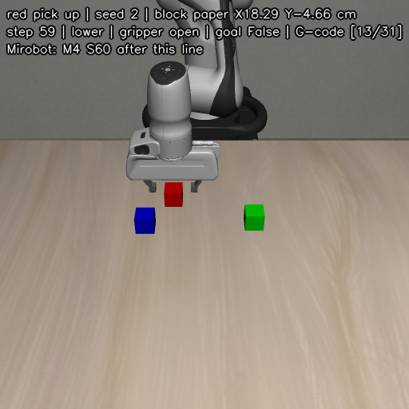 | 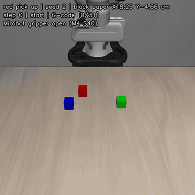 |

### 측정 4. green s2 — 종이 X 23.64 Y +7.08 cm

닫기 직전 줄 #14 (Z 75.79) · 손 − 블록 dX −1.0 dY −0.1 mm · 가장 낮은 줄 #17 (Z 72.35) · [mp4](images/mirobot/green_seed2_pickup_sim.mp4) · [G-code](../../trajectories/2026_10_11-w6-pickup-green-s2-e5.gcode)

| 닫기 직전 — `[14/33]` 다음에 `M4 S60` | 전체 동작 (GIF) |
| --- | --- |
| 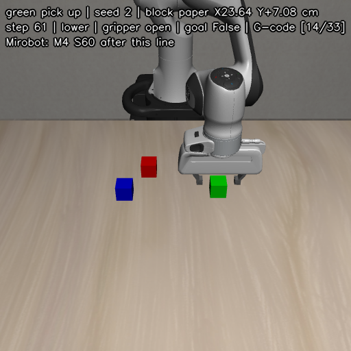 |  |

### 측정 5. blue s2 — 종이 X 24.31 Y −8.41 cm

닫기 직전 줄 #14 (Z 75.67) · 손 − 블록 dX −0.9 dY +0.1 mm · 가장 낮은 줄 #16 (Z 72.38) · [mp4](images/mirobot/blue_seed2_pickup_sim.mp4) · [G-code](../../trajectories/2026_10_11-w6-pickup-blue-s2-e5.gcode)

| 닫기 직전 — `[14/32]` 다음에 `M4 S60` | 전체 동작 (GIF) |
| --- | --- |
| 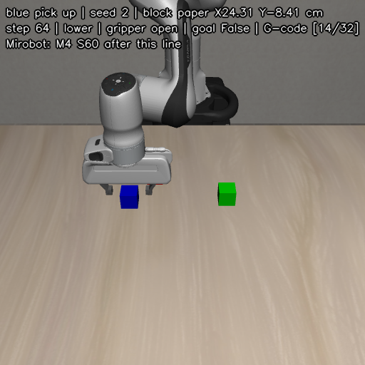 | 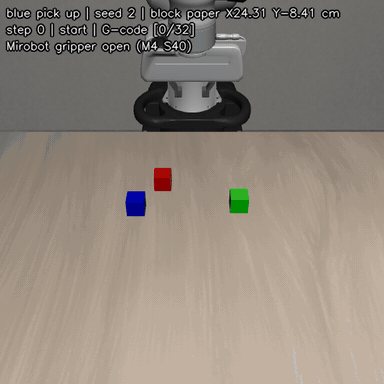 |

### 측정 6. red s0 — 종이 X 25.60 Y −2.33 cm

닫기 직전 줄 #14 (Z 74.87) · 손 − 블록 dX −1.2 dY +0.2 mm · 가장 낮은 줄 #17 (Z 72.49) · [mp4](images/mirobot/red_seed0_pickup_sim.mp4) · [G-code](../../trajectories/2026_10_11-w6-pickup-red-s0-e5.gcode)

| 닫기 직전 — `[14/32]` 다음에 `M4 S60` | 전체 동작 (GIF) |
| --- | --- |
| 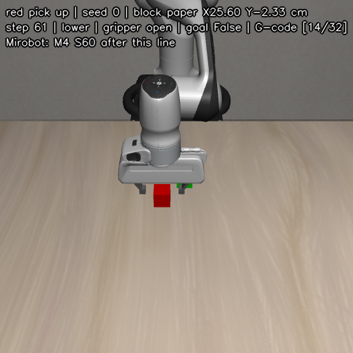 | 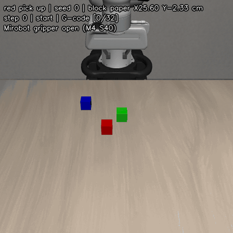 |

### 측정 7. green s0 — 종이 X 20.82 Y +1.36 cm

닫기 직전 줄 #13 (Z 75.41) · 손 − 블록 dX −1.2 dY −0.2 mm · 가장 낮은 줄 #15 (Z 72.21) · [mp4](images/mirobot/green_seed0_pickup_sim.mp4) · [G-code](../../trajectories/2026_10_11-w6-pickup-green-s0-e5.gcode)

| 닫기 직전 — `[13/31]` 다음에 `M4 S60` | 전체 동작 (GIF) |
| --- | --- |
| 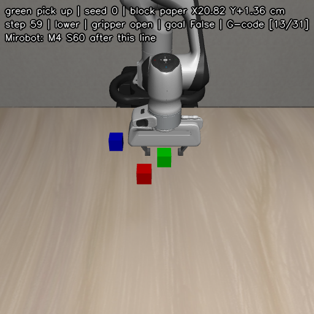 | 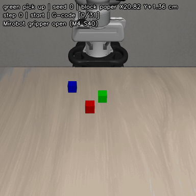 |

### 측정 8. red s1 — 종이 X 17.25 Y +7.56 cm

닫기 직전 줄 #14 (Z 75.14) · 손 − 블록 dX −1.6 dY −0.2 mm · 가장 낮은 줄 #16 (Z 70.94) ⚠ · [mp4](images/mirobot/red_seed1_pickup_sim.mp4) · [G-code](../../trajectories/2026_10_11-w6-pickup-red-s1-e5.gcode)

| 닫기 직전 — `[14/32]` 다음에 `M4 S60` | 전체 동작 (GIF) |
| --- | --- |
| 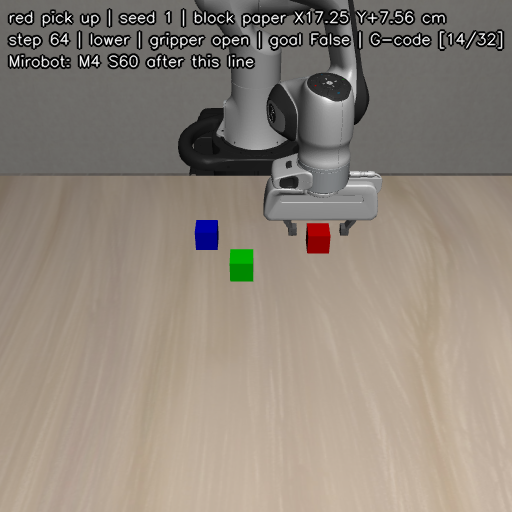 | 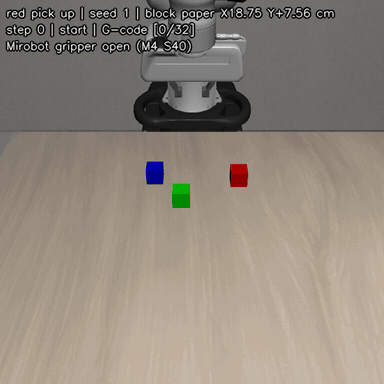 |

### 측정 9. green s1 — 종이 X 22.37 Y −1.65 cm

닫기 직전 줄 #13 (Z 75.67) · 손 − 블록 dX −0.9 dY +0.1 mm · 가장 낮은 줄 #15 (Z 72.33) · [mp4](images/mirobot/green_seed1_pickup_sim.mp4) · [G-code](../../trajectories/2026_10_11-w6-pickup-green-s1-e5.gcode)

| 닫기 직전 — `[13/31]` 다음에 `M4 S60` | 전체 동작 (GIF) |
| --- | --- |
| 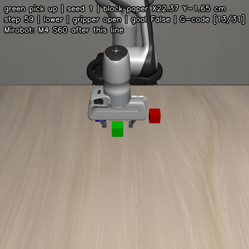 | 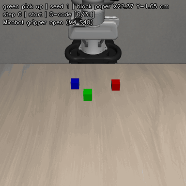 |

### 측정 10. blue s0 — 종이 X 15.78 Y −8.26 cm

닫기 직전 줄 #15 (Z 75.28) · 손 − 블록 dX −1.4 dY +0.4 mm · 가장 낮은 줄 #18 (Z 70.08) ⚠ · [mp4](images/mirobot/blue_seed0_pickup_sim.mp4) · [G-code](../../trajectories/2026_10_11-w6-pickup-blue-s0-e5.gcode)

| 닫기 직전 — `[15/34]` 다음에 `M4 S60` | 전체 동작 (GIF) |
| --- | --- |
| 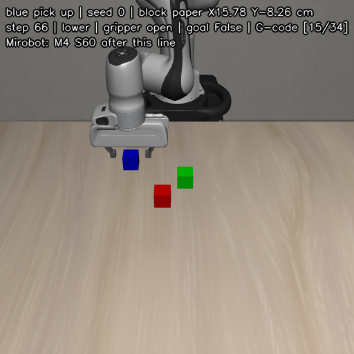 |  |

### 측정 11. blue s1 — 종이 X 16.54 Y −6.04 cm

닫기 직전 줄 #14 (Z 74.67) · 손 − 블록 dX −1.7 dY +0.2 mm · 가장 낮은 줄 #17 (Z 70.91) ⚠ · [mp4](images/mirobot/blue_seed1_pickup_sim.mp4) · [G-code](../../trajectories/2026_10_11-w6-pickup-blue-s1-e5.gcode)

| 닫기 직전 — `[14/33]` 다음에 `M4 S60` | 전체 동작 (GIF) |
| --- | --- |
| 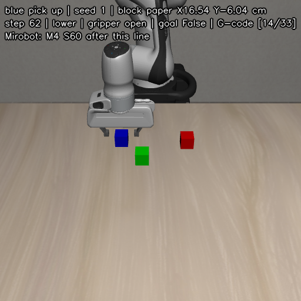 | 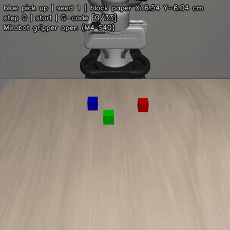 |

## 5. 측정할 때 볼 것

1. **X·Y**: 닫기 직전 줄에서 멈춘 상태(Enter를 누르기 전)로, 열린 집게 가운데와 블록 중심의 차이를 잰다. 3장의 "손 − 블록"(모두 −X 쪽 0.9–1.7 mm)을 빼고 본다
2. **Z**: 같은 줄에서 열린 집게 끝의 작업대 위 높이를 잰다. 3장의 "열린 집게 끝 높이"(19.0–20.1 mm)와 비교한다
3. **집기**: 닫은 뒤 블록이 밀린 방향과 양, 들어 올렸는지를 본다
4. **닫은 뒤 더 내려감**: 닫은 뒤 2–3.5 mm 더 내려갔다가 올라온다(seed 2 red 실물에서 봄). 견본의 `grasp` 단계에 있는 움직임이다
5. **안쪽 세 자리**: 잡는 동안 파일이 손을 X로 4.5–7.3 mm 움직인다. 블록이 X로 밀려도 변환보다 견본의 움직임 때문일 수 있다

## 6. 실물 결과

| 측정 | 자리 | 날짜 | 집었나 | 닫기 직전 X·Y 차이 (mm) | 집게 끝 높이 (mm) | 블록이 밀린 방향·양 | 메모 |
| --- | --- | --- | --- | --- | --- | --- | --- |
| 1 | red s2 | | | | | | |
| 2 | red s2 | | | | | | |
| 3 | red s2 | | | | | | |
| 4 | green s2 | | | | | | |
| 5 | blue s2 | | | | | | |
| 6 | red s0 | | | | | | |
| 7 | green s0 | | | | | | |
| 8 | red s1 | | | | | | |
| 9 | green s1 | | | | | | |
| 10 | blue s0 | | | | | | |
| 11 | blue s1 | | | | | | |

## 7. 다시 만드는 법

G-code (저장소 루트, conda를 끈 셸, Python 3.9 이상):

```bash
cosmos-policy/.venv/bin/python -m tools.poses_to_gcode --poses docs/W6/poses/pickup-red-s0.jsonl \
    --scale 0.663 --every 5 --gripper --out trajectories/2026_10_11-w6-pickup-red-s0-e5.gcode
cosmos-policy/.venv/bin/python -m tools.run_gcode trajectories/2026_10_11-w6-pickup-red-s0-e5.gcode --dry-run
```

영상은 서버 conda `libero`에서 견본 action을 [rgb_blocks/preview.py](rgb_blocks/preview.py)의 `create_env`로 다시 실행해 만들었다.
frame 하나를 `ffmpeg` 한 번에 넣어 mp4(`libx264 -crf 20`, 20 FPS)와 GIF(10 FPS, 384 px, 128색 palette)를 함께 만들고,
닫기 직전 step의 frame은 PNG로 저장했다. 이 영상 스크립트는 아직 저장소에 넣지 않았다.

견본이 다시 만들어지면(블록 크기·잡는 높이 변경) 같은 seed라도 블록 자리가 바뀐다. 그때는 G-code·영상·이 문서의 3·4장을 다시 만든다.
