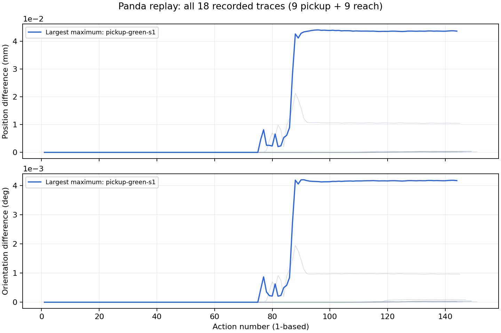
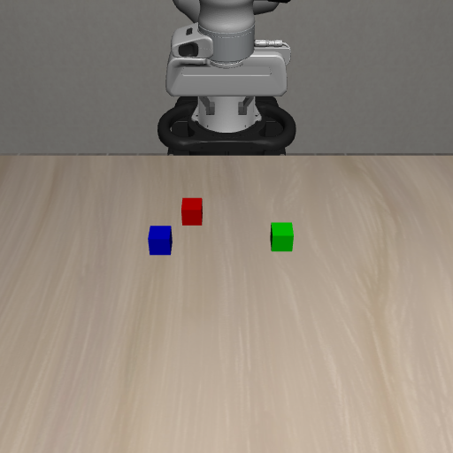
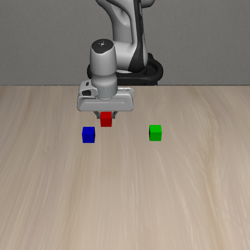
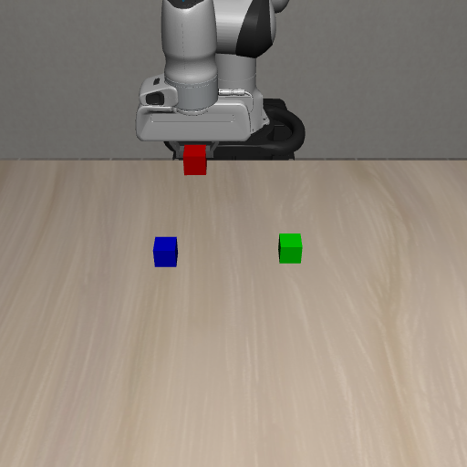
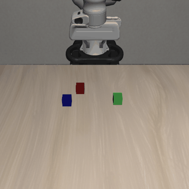

# W6 Panda 동작 재생과 Mirobot 좌표 변환

> **기록** · 확인 2026-10-09 · 기준 W6 손 좌표 견본 18개, `tools/poses_to_gcode.py`
> Panda 동작의 재생 결과와 LIBERO 좌표를 Mirobot 명령으로 바꾼 방법을 정리했다.

## 1. 실험 목적

LIBERO에서 Panda가 블록을 잡는 동작을 Mirobot으로 옮기려면, 먼저 Panda 손이 어디로 움직였는지 알아야 한다. 그래서 동작을 실행하면서 매 step의 손 위치와 방향을 파일로 저장했다.

저장한 action을 같은 장면에서 다시 실행해 원래 손 위치와 방향이 재현되는지 확인했다. 또 저장된 LIBERO 좌표를 Mirobot 좌표로 변환하고, 로봇에 보낼 G-code를 만들었다.

## 2. 저장한 값과 비교 방법

Panda의 action은 한 step에 넣는 7개 값으로 이루어진 제어 입력이다. 앞의 세 값은 이동, 다음 세 값은 회전, 마지막 값은 집게 개폐에 사용한다. 마지막 값이 −1이면 열고, +1이면 닫는다.

Panda 동작을 재생하는 이유는 처음 실행할 때 저장한 Action을 다시 실행해도 동일한 손 위치, 자세와 Goal 결과가 나오는지 검증하기 위해서 -> Panda 동작 재현이 가능한 지 확인하기 위함.

① Panda 최초 실행
Action 실행 → 손 위치·자세 기록

② Panda 재생 및 비교
동일한 Action 재실행 → 원래 기록과 비교

③ Mirobot 좌표 변환
검증한 Panda 손 좌표 → Mirobot G-code 생성

이동·회전 action은 컨트롤러에 주는 입력이다. 실제 손 좌표는 action을 시뮬레이터에서 실행한 뒤 읽었다. 재생할 때도 같은 action을 넣고, 실행 후 얻은 좌표를 원래 기록과 비교했다.

```text
원래 실행:  action → Panda 시뮬레이션 → 손 위치·자세 기록
재생 실행:  같은 action → 새 Panda 시뮬레이션 → 손 위치·자세 기록
                                            ↓
                              같은 action 순번의 두 결과 비교
```

한 step은 action을 한 번 넣고 결과를 받는 단위다. 첫 action부터 1, 2, 3으로 센다. `seed`는 무작위 블록 배치를 다시 만드는 데 쓰는 번호다. `BDDL` 파일에는 장면에 놓을 물체와 배치 범위, 과제 성공 조건이 들어 있다.

손 위치는 LIBERO 장면 전체를 기준으로 한 `(x, y, z)`이며 단위는 m다. 두 위치 사이의 직선거리를 구해 mm로 바꿨다.

```text
위치 차이(mm) = 1000 × √[(x재생 − x원래)² + (y재생 − y원래)² + (z재생 − z원래)²]
```

시작 위치와 매 step의 위치를 모두 비교했다. 시작부터 손이 1 cm 옆에 있는 경우에는 step 사이의 이동량만 비교하면 차이를 놓칠 수 있다.

이 문서에서 **자세**는 손이 향하는 방향을 뜻한다. 파일에는 방향을 쿼터니언이라는 네 숫자로 저장한다. 비교할 때는 한 방향을 다른 방향과 겹치도록 돌리는 데 필요한 최소 각도를 구했다. 예를 들어 자세 차이가 0.004°라면 두 손의 방향이 그만큼 다르다는 뜻이다. 쿼터니언 `q`와 `−q`는 같은 방향을 나타내므로 부호만 다른 경우는 0°로 처리했다.

## 3. LIBERO 좌표를 Mirobot 좌표로 바꾼 방법

변환에는 [`tools/poses_to_gcode.py`](../../tools/poses_to_gcode.py)를 사용했다. 입력 파일에서 손 위치인 `eef_pos`와 방향인 `eef_quat_xyzw`를 읽어 Mirobot의 `G0 X Y Z A B C` 명령으로 바꾼다. 이런 형태로 로봇에 이동과 집게 개폐를 지시하는 명령을 G-code라고 한다. `X Y Z`는 위치(mm), `A B C`는 x·y·z축 회전각(°)이다.

### 3.1 두 로봇에서 어느 점을 맞췄나

**파지점**은 집게가 물체를 무는 손가락 사이의 기준점이다. **플랜지**는 집게를 장착하는 손목 끝의 면이다. LIBERO의 `robot0_eef_pos`는 파지점 위치이고, Mirobot의 `G0 X Y Z`는 플랜지 위치를 받는다.

따라서 먼저 두 로봇의 파지점을 맞추고, 마지막에 Mirobot 파지점을 플랜지 좌표로 바꿨다. 이번에 사용한 기준점은 다음과 같다.

| 기준점 | 위치 | 단위 |
| --- | --- | --- |
| Panda 시작 파지점 | `(-0.208464661, 0, 1.173279476)` | m |
| Mirobot 홈 플랜지 | `(198.67, 0, 230.72)` | mm |
| Mirobot 홈 파지점 | `(198.67, 0, 175.72)` | mm |

Panda 시작값은 입력 파일 첫 줄의 `meta.start_eef_pos`에서 읽었다. Mirobot 홈은 로봇이 기준 위치로 돌아가는 초기화 과정인 호밍 후의 보고값을 사용했다. Mirobot의 플랜지와 파지점 사이 길이를 55 mm로 두었으므로, 수직인 홈 자세에서 파지점 Z는 `230.72 − 55 = 175.72 mm`다.

### 3.2 시작점에서 움직인 거리를 옮겼다

두 로봇은 좌표 원점이 다르다. LIBERO의 좌표를 그대로 1,000배 하면 단위만 mm로 바뀌고 원점 차이는 남는다. 그래서 **Panda 시작점에서 이동한 거리**를 구해 Mirobot 홈 파지점에 더했다.

앞·뒤, 좌·우, 위·아래 축 방향은 두 로봇이 같아서 축을 교환하거나 부호를 뒤집는 과정은 없다([축 확인 기록](../W3/LIBERO_AXES.md)). 세 축에 같은 식을 적용했다.

```text
Mirobot 파지점(mm)
  = Mirobot 홈 파지점(mm)
    + (현재 Panda 파지점 − Panda 시작 파지점)(m) × 1000 × 0.663
```

`1000`은 m를 mm로 바꾸는 값이고, `0.663`은 각 로봇이 시작점에서 작업대까지 내려가는 거리를 맞추기 위해 정한 배율이다. 예를 들어 Panda가 시작점에서 100 mm 앞으로 움직이면 Mirobot은 홈 파지점에서 66.3 mm 앞으로 움직인다. 회전각에는 이 배율을 곱하지 않았다.

배율은 집게가 작업대에 닿는 높이를 측정해서 구했다. Mirobot은 열린 집게가 닿을 때 플랜지 Z가 55.715 mm였다. Panda는 시작 파지점에서 작업대에 닿는 파지점까지 264.07 mm 내려갔다([높이 측정 기록](../W5/TABLE_ALIGNMENT.md)).

```text
배율 = (Mirobot 홈 플랜지 Z − 작업대에 닿을 때 플랜지 Z) / Panda가 내려간 거리
     = (230.72 − 55.715) / 264.07
     ≈ 0.6627 → 0.663
```

코드의 기본 배율은 아직 `1.0`이므로 실행할 때 `--scale 0.663`을 넣었다.

### 3.3 손 방향을 Mirobot 회전각으로 바꿨다

LIBERO는 손 방향을 쿼터니언 `(qx, qy, qz, qw)`로 기록한다. 변환 코드에서는 `(qw, qx, qy, qz)` 순서를 쓰므로 먼저 순서를 바꿨다.

두 로봇은 손이 아래를 향하는 자세를 다른 숫자로 표현한다. Mirobot은 `A=0, B=0, C=0`이고, LIBERO는 x축으로 180° 회전한 자세다. 같은 방향을 나타내도록 이 차이를 보정한 뒤, Mirobot의 회전각 세 개로 바꿨다.

```python
q_libero = quat_xyzw_to_wxyz(eef_quat_xyzw)  # 저장 순서 변경
q_mirobot = libero_to_mirobot_quat(q_libero) # 두 로봇의 방향 표현 맞추기
A, B, C = quat_to_euler_xyz_deg(q_mirobot)   # 회전각(도)으로 변환
```

`libero_to_mirobot_quat` 안에서는 `q_mirobot = q_libero ⊗ F⁻¹`을 계산한다. `F`는 x축 180° 회전, `F⁻¹`은 그 역회전이며, `⊗`는 두 회전을 합치는 쿼터니언 곱이다. 이렇게 얻은 `A B C`는 고정된 x→y→z축 순서의 오일러각이다. 구현은 [`common/rotation.py`](../../common/rotation.py)에 있다.

이번 변환은 기록된 방향을 그대로 옮기는 `--orientation absolute`를 사용했다. Panda 시작 손이 약 3.3° 기울어 있어, 시작 파지점이 Mirobot 홈 파지점에 대응하더라도 플랜지 위치와 회전각은 홈값에서 조금 달라진다.

**역회전 F⁻¹을 곱하는 이유**

LIBERO(Panda)와 Mirobot은 손이 아래를 향하는 동일한 자세를 서로 다른 회전값으로 표현한다. LIBERO에서는 x축으로 180° 회전한 자세이고, Mirobot에서는 A=0°, B=0°, C=0°이다.

F는 두 로봇의 기본 손 자세 사이에 존재하는 x축 180° 회전 차이이다. LIBERO의 회전값에는 이 차이가 포함되어 있으므로, Mirobot 기준의 회전값을 구하려면 역회전 F⁻¹을 곱해 기존 회전 차이를 상쇄해야 한다.

q_libero = q_mirobot ⊗ F
q_libero ⊗ F⁻¹ = q_mirobot ⊗ F ⊗ F⁻¹

F ⊗ F⁻¹ = I이므로,

q_mirobot = q_libero ⊗ F⁻¹

여기서 I는 회전하지 않은 상태를 나타내는 항등 회전이다. 즉, 역회전을 적용해 LIBERO와 Mirobot의 기본 자세 차이를 제거하는 것이다.

이번에 사용한 F는 x축 180° 회전이므로 F와 F⁻¹은 동일한 물리적 회전을 나타낸다. 또한 쿼터니언 곱은 교환법칙이 일반적으로 성립하지 않으므로, 코드에서 정의한 회전 합성 순서에 따라 F⁻¹을 오른쪽에 곱해야 한다.

### 3.4 파지점을 플랜지 좌표로 바꿨다

Mirobot에 보낼 좌표는 파지점에서 손목 방향으로 55 mm 떨어진 집게 장착면의 위치다. 손이 수직이면 Z에 55 mm를 더하면 된다. 손이 기울어져 있으면 집게 길이가 x·y 방향에도 영향을 주므로, 벡터의 방향을 바꾸는 회전행렬을 사용해 그 방향을 구했다.

```text
u = 플랜지에서 손가락 쪽을 향하는 길이 1의 방향 벡터
Mirobot 플랜지(mm) = Mirobot 파지점(mm) − 55 × u
```

수직일 때 `u = (0, 0, −1)`이므로 플랜지 Z가 파지점보다 55 mm 높아진다. 코드에서는 [`common/workspace.py`](../../common/workspace.py)의 `mirobot_grip_to_flange_mm`이 이 계산을 한다.

실제 코드의 공통 변환 함수는 Panda 플랜지를 입력으로 받는다. 그래서 `poses_to_gcode.py`는 파지점에서 Panda 공구 길이 97 mm를 되짚어 플랜지를 구하고, 공통 함수 안에서 다시 파지점으로 내려온다. 이번 `--point grip` 계산에서는 이 두 과정이 상쇄되고, 파지점의 변위가 그대로 사용된다.

### 3.5 저장된 좌표로 계산한 예시

[`pickup-red-s2.jsonl`](poses/pickup-red-s2.jsonl)의 **step 65**, 집게를 닫고 있는 구간을 10/9에 다시 변환했다. 아래 입력은 읽기 쉽게 반올림해 적었고, 계산에는 파일의 원래 값을 사용했다.

```text
Panda 시작 파지점(m) = (-0.208465,  0.000000, 1.173279)
step 65 파지점(m)    = (-0.235355, -0.071490, 0.933421)
시작점에서 변위(m)   = (-0.026891, -0.071490, -0.239858)
```

이 변위에 `1000 × 0.663`을 곱하고 Mirobot 홈 파지점에 더했다.

```text
X = 198.67 + (-0.026890752 × 1000 × 0.663) = 180.841 mm
Y =   0.00 + (-0.071490376 × 1000 × 0.663) = -47.398 mm
Z = 175.72 + (-0.239858494 × 1000 × 0.663) =  16.694 mm
```

이 좌표는 아직 Mirobot **파지점**이다. 같은 step의 LIBERO 쿼터니언은 `(0.999991002, 0.000985508, 0.004125828, −0.000056529)`이며 순서는 `xyzw`다. 앞의 자세 변환을 적용하면 `A=0.006°, B=−0.473°, C=0.113°`가 된다.

이 방향에서 파지점→플랜지 보정값은 `(-0.454, -0.007, +54.998) mm`다. 위 파지점 좌표에 더하고 소수 둘째 자리까지 적으면 다음 명령이 나온다.

```gcode
G0 X180.39 Y-47.40 Z71.69 A0.01 B-0.47 C0.11
```

### 3.6 집게 명령과 변환 확인

집게는 `action[6]`의 부호가 바뀌는 지점에 `M4` 명령을 넣었다. 이 파일은 step 1 앞에 `M4 S40`(열기), step 60 앞에 `M4 S60`(닫기)이 들어간다. `--every 1`로 모든 step을 남겨 이동 명령 `G0`는 144줄이 나왔다.

변환한 red seed 2 파일을 `run_gcode --dry-run`으로 확인했을 때 Mirobot 원점에서의 수평 거리 `√(X²+Y²)`는 최대 202.6 mm, 플랜지 Z 최저는 71.7 mm였고 범위 경고는 없었다. 소수 둘째 자리로 저장한 명령을 LIBERO 좌표로 되돌렸을 때 최대 위치 차이는 **0.012 mm**였다. 역변환 후 LIBERO 좌표 차이에 `1000 × 0.663`을 곱해 Mirobot 이동 거리로 환산한 값이다.

역변환으로는 계산과 반올림을 확인했다. 실제 집게 길이가 코드의 55 mm와 다른 경우에는 같은 값을 양방향으로 쓰면서 차이가 상쇄된다. 실물 손끝 오차는 별도로 측정해야 한다.

## 4. 재생 비교 코드

[`tools/action_to_poses.py`](../../tools/action_to_poses.py)에 원래 기록과 재생 기록의 위치·자세 비교를 추가했다. `Goal`은 BDDL에서 정한 성공 조건의 `True/False` 판정이다.

- 첫 action 직전의 위치와 자세를 비교한다.
- 매 action의 위치 차이와 자세 차이에서 최대·평균·마지막 값을 구한다. 최대 차이가 생긴 action 번호도 남긴다.
- 처음 Goal이 나타나는 번호뿐 아니라, 각 action의 Goal 판정도 비교한다.
- 기록에 좌표나 Goal이 없으면 비교한 개수를 표시한다. 없는 값을 0 오차로 처리하지 않는다.
- `--max-steps`로 앞부분만 재생하면 그 구간만 비교한다.

비교 결과는 출력 JSONL의 `meta.replay_comparison`에 저장한다. JSONL은 한 줄마다 JSON 하나를 적는 파일 형식이고, 첫 줄의 `meta`에는 실행 조건이 들어 있다. 손 좌표 파일 형식은 `panda-poses/1`을 유지했다.

로컬 `libero` 환경의 Python 3.8에서도 실행되도록 필요한 시점에 시뮬레이터를 불러오게 하고, 이 도구에서 `common/`을 불러오는 부분을 없앴다. 블록 크기는 원래 기록에서 읽는다. 이웃 블록 배치를 바꾸는 `adjacent`·`sandwich`는 아직 초기 배치 복원을 지원하지 않아 재생을 막았다. 이번 실험은 기본 배치인 `scenario=none`, 블록 40 mm 조건으로 진행했다.

## 5. 재생 실험 결과

기존 [손 좌표 견본](poses/README.md) 18개를 새 시뮬레이터에서 각각 재생했다. 빨강·초록·파랑 × seed 0–2 × 두 동작이다. 블록을 들어 올리는 `pickup`은 9개, 블록 위로 손을 뻗었다가 돌아오는 `reach`는 9개다.

| 항목 | 이번 실험 조건 |
| --- | --- |
| 실행 환경 | Windows, conda `libero`, Python 3.8.13 |
| 물리 시뮬레이터 | MuJoCo 2.3.7, robosuite 1.4.0 |
| 장면 | RGB 블록 40 mm, yaw 0°, `scenario=none` |
| 시작 | BDDL과 seed로 reset, 기록에 따라 추가 대기 action 0개 |
| 입력 | 원래 파일의 action을 기록된 순서대로 실행 |
| 재생 카메라 | 128×128, 실제 장면 사진은 별도 실행에서 512×512 |
| 비교 대상 | 시작 파지점 위치·자세, 매 action의 위치·자세·Goal |

**18개 파일의 2,358개 action을 모두 비교했고, Goal 판정이 다른 action은 없었다.** Pickup 9개는 Goal이 처음 나타나는 번호도 원래와 같았다. Reach는 블록을 들어 올리지 않는 동작이므로 Goal이 계속 `False`인 것이 정상이다.

| 파일 | action 수 | 최대 위치 차이 (mm) | 최대 자세 차이 (°) | 첫 Goal action |
| --- | ---: | ---: | ---: | ---: |
| pickup-red-s0 | 145 | 0.021258 | 0.001947 | 105 |
| pickup-red-s1 | 149 | 0.000432 | 0.0000363 | 108 |
| pickup-red-s2 | 144 | 0.000135 | 0.0000190 | 103 |
| pickup-green-s0 | 144 | 0.000189 | 0.0000202 | 103 |
| pickup-green-s1 | 144 | 0.044098 | 0.004200 | 103 |
| pickup-green-s2 | 146 | 0.000223 | 0.0000179 | 105 |
| pickup-blue-s0 | 151 | 0.000209 | 0.0000214 | 110 |
| pickup-blue-s1 | 147 | 0.000246 | 0.0000939 | 106 |
| pickup-blue-s2 | 149 | 0.000357 | 0.0000425 | 108 |
| reach-red-s0 | 115 | < 0.000001 | < 0.000001 | — |
| reach-red-s1 | 116 | < 0.000001 | < 0.000001 | — |
| reach-red-s2 | 112 | < 0.000001 | < 0.000001 | — |
| reach-green-s0 | 113 | < 0.000001 | < 0.000001 | — |
| reach-green-s1 | 113 | < 0.000001 | < 0.000001 | — |
| reach-green-s2 | 116 | < 0.000001 | < 0.000001 | — |
| reach-blue-s0 | 121 | < 0.000001 | < 0.000001 | — |
| reach-blue-s1 | 113 | < 0.000001 | < 0.000001 | — |
| reach-blue-s2 | 120 | < 0.000001 | < 0.000001 | — |

표의 `< 0.000001`은 차이가 그 값보다 작았다는 뜻이다. 시작 위치 차이는 모든 파일에서 0.000000001 mm보다 작았고, 시작 자세 차이도 0.000000001°보다 작았다.

가장 큰 차이는 `pickup-green-s1`에서 나왔다. 위치 최대는 **0.044098 mm, action 96**, 자세 최대는 **0.004200°, action 91**이었다. 이 파일의 평균 위치 차이는 0.017830 mm, 마지막 위치 차이는 0.043673 mm였다. 평균 자세 차이는 0.001701°, 마지막 자세 차이는 0.004171°였다.



회색 선은 나머지 파일의 차이이고, 파란 선은 차이가 가장 컸던 `pickup-green-s1`이다. 위 그래프의 세로축에 적힌 `1e−2`는 눈금 4가 0.04 mm라는 뜻이다. 아래의 `1e−3`에서는 눈금 4가 0.004°다.

Green seed 1은 중간에 차이가 커졌고, 마지막에도 0.043673 mm가 남았다. 발생 원인은 추가 확인이 필요하다. 이번에 재생한 길이는 파일당 112–151 action이었다.

재생 오차의 허용 기준은 아직 정하지 않아 측정값을 그대로 기록했다.

## 6. 픽업 실행 장면

아래는 red, seed 2를 `run_pickup`으로 실행한 장면이다. 사진은 시뮬레이터의 `agentview_image`를 512×512로 저장했다. 재생 오차 측정과는 별도로 실행했다.

| 시작: action 전 | 잡기: 누적 action 89 | 들어 올린 뒤: 누적 action 144 |
| --- | --- | --- |
|  |  |  |

이 실행은 144 action 뒤 `pickup_success=True`였다. 블록 상승량은 0.1465 m였고, 양쪽 손가락의 파지가 확인됐다. 마지막 확인 구간 30 step 동안 Goal이 유지됐으며, 다른 두 블록도 제자리를 유지했다. 이 전체 성공 조건은 [PICKUP.md](rgb_blocks/PICKUP.md)에 정의되어 있다.



GIF는 3 step마다 저장한 관측 49장을 약 7.5초로 재생한 영상이다. 동작 순서를 보여주기 위해 재생 속도를 정했다.

재생 18개는 손 위치·자세와 Goal을 비교했다. 양쪽 손가락의 파지와 주변 블록 이동까지 다시 확인한 것은 위 red seed 2 실행이다.

## 7. 실행 방법

### 7.1 좌표 변환

시뮬레이터를 켜지 않고 저장된 손 좌표 파일만으로 변환할 수 있다. 저장소 루트의 PowerShell에서 실행한다. 아래는 로컬 Python 3.12를 사용한 명령이다. Python 3.9 이상에서 실행할 수 있으며, conda `libero`의 Python 3.8과는 다른 셸을 쓴다.

```powershell
$env:PYTHONIOENCODING = 'utf-8'
py -3.12 -B -m tools.poses_to_gcode --poses docs/W6/poses/pickup-red-s2.jsonl --mapping home --point grip --orientation absolute --scale 0.663 --gripper --every 1 --out data/translate/w6-coordinate-check/pickup-red-s2.gcode --log-dir data/translate/w6-coordinate-check
py -3.12 -B -m tools.run_gcode data/translate/w6-coordinate-check/pickup-red-s2.gcode --dry-run
```

`--mapping home`은 Panda 시작 파지점을 Mirobot 홈 파지점에 대응시키는 옵션이다. `--point grip`은 파지점 기준, `--orientation absolute`는 기록된 손 방향을 옮기는 옵션이다. `--gripper`는 집게 개폐 명령을 넣고, `--every 1`은 모든 step을 남긴다.

출력 G-code와 step별 변환 기록은 `data/translate/w6-coordinate-check/`에 저장된다. `--dry-run`은 명령과 범위 경고를 확인하며 로봇에는 전송하지 않는다. 집게 명령이 포함된 파일의 실물 실행에는 `run_gcode --auto`를 사용한다.

### 7.2 Panda 동작 재생

재생에는 W5에서 구성한 conda `libero` 환경과 WGL/DLL 설정을 사용한다. 처음 구성하는 경우에는 [W5 실행 절차](../W5/NewTaskBDDL.md)를 따른다.

```powershell
$liberoPython = Join-Path $env:USERPROFILE 'anaconda3\envs\libero\python.exe'
$liberoEnvironment = Split-Path -Parent $liberoPython
$env:PATH = "$liberoEnvironment;$liberoEnvironment\Library\bin;$liberoEnvironment\Scripts;$env:PATH"
$env:MUJOCO_GL = 'wgl'
$env:NUMBA_DISABLE_JIT = '1'
$env:LIBERO_CONFIG_PATH = Join-Path $env:USERPROFILE '.libero'
$env:PYTHONIOENCODING = 'utf-8'

# 한 파일의 action을 다시 실행하고 원래 위치·자세와 비교
& $liberoPython -B -m tools.action_to_poses --log docs/W6/poses/pickup-green-s1.jsonl --res 128 --out data/poses/check-green-s1.jsonl

# 비교 계산과 누락 기록 처리 테스트
& $liberoPython -B -m unittest tests.test_action_to_poses
```

18개를 모두 다시 확인하려면 같은 환경에서 아래를 실행한다. 원래 견본을 덮어쓰지 않고 `data/poses/`에 재생 기록을 남긴다.

```powershell
Get-ChildItem -LiteralPath docs/W6/poses -Filter '*.jsonl' | Sort-Object Name | ForEach-Object {
    $replayOutput = Join-Path 'data/poses' ('check-' + $_.Name)
    & $liberoPython -B -m tools.action_to_poses --log $_.FullName --res 128 --out $replayOutput
    if ($LASTEXITCODE -ne 0) { throw "재생 실패: $($_.Name)" }
}
```

10/8에 비교 테스트 17개가 Python 3.8.13에서 통과했고, 변환·실행 도구를 포함한 전체 테스트 65개도 Python 3.12.10에서 통과했다. 재생 실험은 Python 3.8.13 환경에서 수행했다. 10/9에는 7.1절 명령으로 red seed 2 좌표 변환과 dry-run을 다시 확인했고, 재생 비교 테스트 17개도 Python 3.12.10에서 통과했다.

## 8. 추가로 확인할 것

현재 견본 18개에서 Panda 동작을 재생해 위치·자세·Goal을 비교했고, 저장된 좌표를 Mirobot G-code로 변환했다. 다음에는 실물 Mirobot으로 실행해 블록 표시 위치와 손끝 사이의 거리, 집게 폭, 실제 파지 성공을 측정해야 한다.

이번 픽업은 시뮬레이터가 알려주는 블록 좌표를 사용했다. 영상에서 블록의 색과 위치를 판단하는 VLA 실행은 별도로 진행해야 한다. 더 긴 동작에서 오차가 쌓이는지, 블록을 돌려 놓거나 이웃 블록을 가까이 놓아도 잡을 수 있는지도 추가 실험이 필요하다.

실물 측정 후에는 [DIVISION.md](DIVISION.md) 4–6장대로 Panda의 잡는 높이와 블록 크기를 조정하고 손 좌표 파일을 다시 만든다.
