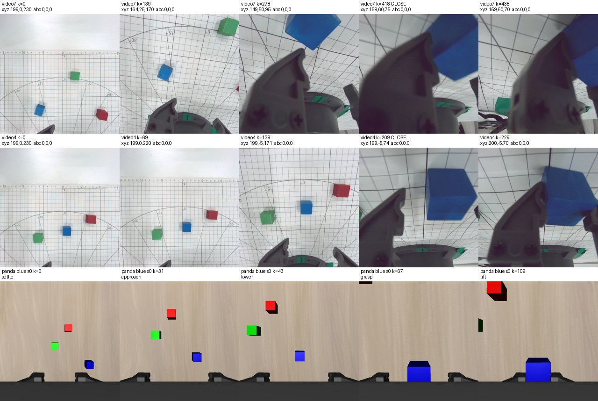
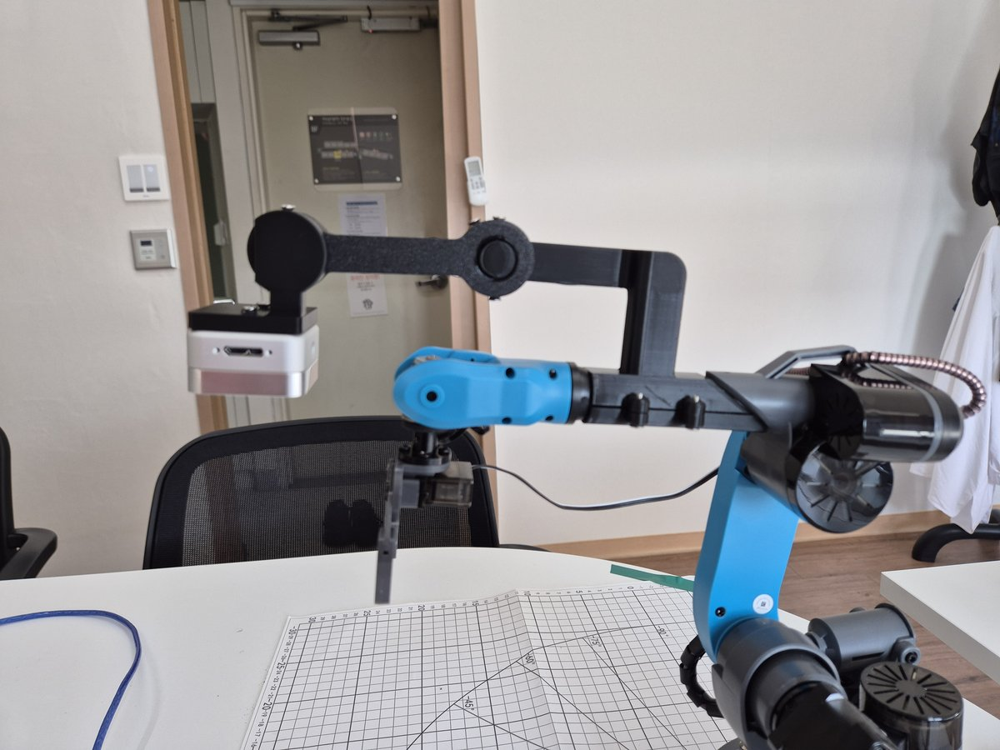

# 걸리는 점 — Panda 시뮬 + Mirobot 실물 학습 데이터

> **기록** · 확인 2026-11-02 · 기준 동료 녹화 영상1–10(`docs/W9/data/raw/`, `docs/W9/data/hdf5/mirobot_real/`), Panda 90개(`data/hdf5/panda_sim/`, 11/01), [panda_cameras/cameras.json](panda_cameras/cameras.json), [../W6/rgb_blocks/PICKUP.md](../W6/rgb_blocks/PICKUP.md) 5.3
> 학습 데이터를 만들며 걸리는 점을 모은다. 항목마다 현상·근거·영향·확인할 것·해결 후보·결정 상태.

할 일과 상태는 [CHECKLIST.md](CHECKLIST.md), 시간 순서 기록은 [WORKLOG.md](WORKLOG.md) 11/02 18–19.
2–4절은 11/02 에 [DATASET_HDF5.md](DATASET_HDF5.md) 8절에 처음 적었다가 이 문서로 옮겼다 (pick up 정교화를 넣은 것은 사용자 지시, 8절 나머지까지 옮긴 것은 임의 판단).

## 0. 한눈에

| # | 걸리는 점 | 상태 | 급한 점 |
| --- | --- | --- | --- |
| 1 | Mirobot 손목 카메라 화면이 돌고 기운다 — Panda 와 다르다 | **미정** — 1차 파인튜닝(Panda 90 + Mirobot 10) 결과를 보고 정한다 (11/02 사용자). 원인(팔뚝 장착)은 사진으로 확인 (11/02) | 그동안 D405 장착은 그대로, 빨강·초록 녹화도 지금 장착으로. 나중에 장착 변경(1-6 ②)으로 가면 그때까지 찍은 녹화는 다시 찍어야 한다 |
| 2 | Panda pick up 이 쉬운 장면에서만 된다 — pick up 정교화 | **A** — 지금 90개를 먼저 쓴다. 1차 파인튜닝 결과가 너무 나쁘면 그때 정교화 (11/02 사용자) | 없음. Mirobot 집게 열림 폭 측정은 미정 |
| 3 | 변환 코드가 실물과 맞는지 모른다 — 블록 좌표 기록 | **계속 기록** (11/02 사용자). 좌표 기준 보충은 **대면으로 전달하기로** (11/02 사용자) | 빨강·초록 녹화 전에 전해야 첫 녹화부터 검사에 쓸 수 있다 |
| 4 | 실물 기록의 빈칸 — 그리퍼는 추정값, 관절·`Pump PWM` 없음 | **`?` 응답 원문 저장을 답장 메일로 부탁하기로** (11/02 사용자) — 원문에 `Angle`·`Pump PWM` 이 들어 있다 | 1번 정량 확인에 관절 값이 있으면 좋다 — 다음 녹화 전에 부탁해야 남는다 |

- **진행 순서 (11/02, 사용자)** — 지금은 Panda 90 + Mirobot 10 을 합쳐 1차 파인튜닝까지 먼저 한다. 결과가 너무 나쁘면 그때 pick up 정교화(2절)나 Mirobot 이미지 재가공(1-6 ③·④)을 한다. 11/02 본학습 시작 — [FINETUNE.md](FINETUNE.md)
- **미정 — 결과 판단 기준.** 무엇을 "너무 작동 안 함" 으로 볼지 아직 안 정했다. Panda 시뮬 성공률과 Mirobot 실물(또는 Mirobot 에피소드 오프라인 평가)을 따로 봐야 문제가 시뮬·학습 쪽인지 실물 카메라 쪽인지 가릴 수 있다 (임의 판단, 제안)

## 1. Mirobot 손목 카메라 화면이 돌고 기운다 — Panda 와 다르다 (11/02, 미정)

### 1-1. 현상

Mirobot 은 녹화 내내 손 자세를 그대로 두었다고 보고한다(A·B·C = 0°). 그런데 손목 D405 화면은 옆으로 가면 돌고,
내려가면 시점이 바뀌며 집게가 화면에서 커지고 자리가 바뀐다. Panda 손목 화면은 그렇지 않다.



그림은 HDF5 `eye_in_hand_rgb` 그대로(256×256, 정책이 보는 방향)다. Mirobot 칸 위 숫자는 그 순간 보고 자세(xyz mm · abc 도).
다시 만들기: `cosmos-policy/.venv/bin/python docs/W9/wrist_camera/compare_views.py` ([wrist_camera/compare_views.py](wrist_camera/compare_views.py)).

| 줄 | 칸 k (보고 xyz) | 보이는 것 |
| --- | --- | --- |
| 영상7 — 닫을 때 Y +60 mm | 0 (199, 0, 230) | 화면 위쪽에 매트 너머 벽 — 시작부터 앞으로 기울어 본다 |
| | 139 (164, 25, 170) | 모눈이 돌기 시작한다 |
| | 278 (149, 50, 95) · 418 닫기 (159, 60, 75) · 438 (159, 60, 70) | 크게 돈다. 집게가 화면 왼쪽 절반을 덮는다. 블록에 아주 가까우면 흐리다 |
| 영상4 — 닫을 때 Y −5 mm | 0 · 69 · 139 · 209 닫기 · 229 | 모눈은 돌지 않는다. Z 230 → 74 mm 로 내려가며 집게가 화면 아래 작은 끝 → 왼쪽 절반을 덮을 만큼 커진다 |
| Panda blue s0 | 0 settle · 31 approach · 43 lower · 67 grasp · 109 lift | 위에서 수직. 손가락은 화면 아래 같은 자리, 블록만 커진다 |

Mirobot 칸의 보고 자세는 모두 abc = 0, 0, 0 이다.

### 1-2. 근거

| | Mirobot | Panda |
| --- | --- | --- |
| 기록된 손 방향 | 10개 모두 녹화 구간 내내 A·B·C = 0° (`robot.jsonl` 보고 자세) | 90개, 에피소드 첫 칸 대비: 전체 회전 변화 최대 4.65°(중앙 4.03°), 접근축 기울기 최대 4.63° — 움직이는 동안 2–4.5° 안에서 흔들린다(s0 은 approach 이후 2.04–4.53°). **손가락 축 방향(yaw) 변화 최대 0.40°**. 손을 `TOP_DOWN` 으로 되돌리는 회전 보정이 매 step 들어간다 (`docs/W6/rgb_blocks/pickup.py:36, 88`) |
| 카메라가 달린 곳 | **팔뚝에 고정** (11/02 사용자 사진, 아래) — 팔꿈치와 파란 손목 사이 팔뚝의 검은 사각 관에 클램프로 물린 검은 브래킷이 위로 올라갔다가 앞으로 뻗고, 그 끝에 D405(은색 상자)가 아래를 보며 매달려 있다. 집게(회색)는 파란 손목 아래에 따로 달려 있다. 브래킷의 둥근 부분은 조절 관절이 아니고 카메라는 고정이다 (사용자 확인). 동료 설치 사진 [images/mirobot_tabletop_setup.png](images/mirobot_tabletop_setup.png)(877a831)에서도 집게와 다른 부품에 달려 있다 | `robot0_right_hand`(손)에 고정 — 파지점에서 손 좌표 (0.05, 0, −0.097) m ([panda_cameras/cameras.json](panda_cameras/cameras.json)) |
| 시작 자세 시선 | 앞으로 기울어 매트 너머 벽이 보인다 (각도 미측정) | 수평에서 86.7° 아래 (거의 수직) |
| 학습 영상 시야 | D405 fx 392.2 px (`영상N/metadata.json` intrinsics) — 640×480 은 가로 78.4°, 가운데 480 정사각을 잘라 256 으로 줄이면 **62.9°** | fovy **75°** |
| 화면 속 집게 | 높이에 따라 자리·크기가 바뀐다 | 늘 같은 자리 |
| 블록에 아주 가까울 때 | 흐리다 (영상7 k=418) | 선명 (렌더링) |

수치는 `compare_views.py` 가 함께 찍는다 (Mirobot 10개 A·B·C 범위, Panda 90개 방향 변화). s0 구간별 기울기는 따로 계산했다.



**앞선 확인의 한계** — 11/01 "화면 방향이 Panda 손목 영상과 같다 ✓"(CHECKLIST 2절 받은 기록 확인 4)는 정지 화면에서 위아래·좌우 방향만 본 것이다.
움직일 때 돌고 기우는지는 보지 않았다.

### 1-3. 원인 후보 (확정 안 함)

| 후보 | 설명 | 맞는 근거 | 모르는 것 |
| --- | --- | --- | --- |
| **A. 장착 위치** — D405 가 손목 관절 J5 앞쪽(팔뚝)에 고정됐다. **장착 부위는 사진으로 확인 (11/02)** | 집게는 J5·J6 이 수직·같은 방향으로 맞춘다. 그 앞 부품은 베이스 회전 J1 을 따라 돌고, 팔 굽힘 J2·J3 에 따라 기운다 | 집게가 화면에서 움직인다 → 카메라와 집게가 한 몸이 아니다. 옆 이동이 큰 영상7 에서만 화면이 돈다 (영상4 와 비교). **사진(1-2): 팔뚝의 브래킷에 고정, 집게와 따로.** J5 뒤·J6 앞이라면 집게가 화면에서 돌기만 하고 크기는 그대로여야 한다 — 크기가 바뀌는 것은 J5 앞쪽을 가리킨다 | 화면이 돈 각도가 J1 과 같은지, 기운 정도가 J2·J3 와 맞는지 (정량 확인은 아직) |
| B. 보고 자세가 실제와 다르다 | Mirobot 은 스테퍼 모터를 위치 센서 없이 돌린다고 알려져 있다 (이 저장소에서 확인한 사실은 아님). 보고 A·B·C 는 제어기가 믿는 값 — 백래시·탈조·영점 오차가 있으면 실제 손은 기운다 | — | 이것만으로는 집게가 화면에서 움직이는 것을 설명 못 한다. A 와 함께 있을 수 있다 |

A 는 장착 부위가 사진으로 확인돼 원인으로 본다 (11/02). 화면 회전 = J1 같은 정량 확인은 아직이다 (1-5 ②). B 가 함께 있는지는 모른다.

### 1-4. 영향

| | 걸리는 점 |
| --- | --- |
| P1. Mirobot 데이터 안 | 영상은 돌고 기우는데 proprio 쿼터니언·action 회전은 보고 자세로 만들어 회전이 0 이다. 같은 장착이면 실행할 때도 같은 식으로 돌고 기우니 Mirobot 만 보면 일관된다. 모델은 "화면이 돌아도 손은 돌리지 않는다" 를 배워야 한다 |
| **P2. Panda 와 섞을 때 (가장 크다)** | 화면 속 방향 → 손 이동 방향의 관계가 Panda 는 늘 같지만, Mirobot 은 베이스 회전 J1(영상7 닫기 지점 X 159 · Y 60 mm 에서 atan2(60, 159) ≈ 21°, 근사)과 팔 굽힘에 따라 바뀐다. 적은 실물 데이터(10–30개)로 이 관계를 배워야 하고, Panda 데이터의 도움이 줄어든다. 바닥·색 차이보다 맞추기 어렵다 |
| P3. 장면 맞추기 범위 | CHECKLIST 4-1 "손목 카메라" 는 시야각·장착 위치 맞추기로 적었다. 실제로는 카메라가 어느 부품에 달려 어떻게 움직이는지까지 맞춰야 한다 — Panda 손에 단 시뮬 카메라로는 이 움직임이 안 나온다. 시야(62.9° vs 75°)와 시작 시선도 다르다 |
| P4. 실제 자세를 모른다 | 보고 자세만으로는 실제 손·카메라 자세를 알 수 없다. 따라가기 오차(동료 데이터 평균 2.9 · p95 4.9 · 최대 8.2 mm, CHECKLIST 3-3)는 시뮬과 보고 자세의 차이일 뿐이다 (원인 B 가 있다면) |
| P5. 가까우면 흐리다 | 집는 순간 화면 정보가 줄어든다. D405 초점 범위는 확인하지 않았다 |

### 1-5. 확인할 것 (아직 안 함)

1. ~~**장착 부위** — 로봇 앞에서 옆·위 사진. 브래킷이 어느 부품에 고정됐는지~~ → **완료 (11/02)** — 사용자 사진: 팔뚝 브래킷에 고정 (1-2)
2. **화면 회전 각도 vs 베이스 회전 J1 = atan2(Y, X)** — 기존 영상에서 모눈 선 각도를 재 비교한다. 같으면 원인 A 의 회전 부분이 확정된다
3. **화면 기울기 vs 팔 굽힘(J2 + J3)** — 모눈 소실점으로 잴 수 있는지
4. **화면 속 집게 위치 vs J5**
5. **원인 B** — 블록 좌표가 오면 3절 검사 ①
6. **브래킷 치수** — 클램프 위치(팔꿈치·손목에서의 거리), 카메라까지 높이·앞 거리, 카메라 기울기. 해결 후보 ③·④ 를 고를 때 필요하다 — 카메라가 고정이라 한 번 재면 된다

관절 각도는 녹화에 없다 (4절). 보고 자세에서 역기구학으로 계산하거나, 다음 녹화부터 `Angle` 을 저장한다.
`Angle(ABCDXYZ)` 순서는 4절 (B = 관절5, Y = 관절2, Z = 관절3, 예 하나로 맞춰 봄).

### 1-6. 해결 후보 (정하지 않음)

| 후보 | 내용 | 좋은 점 | 걸리는 점 |
| --- | --- | --- | --- |
| ① 그대로 둔다 | 두 로봇의 손목 화면 차이를 모델이 배우게 한다 | 일이 없다 | P2 그대로 — Mirobot 에서는 위치마다 다른 관계를 적은 데이터로 배워야 한다 |
| ② 실물 카메라를 집게에 고정 | 장착을 바꿔 Panda 처럼 카메라와 손을 한 몸으로 | 가장 근본적. Panda 와 화면 움직임이 비슷해진다 | 그때까지 찍은 녹화(파랑 10개 포함)를 다시 찍는다. 색 보정·카메라 설정 다시, 브래킷 제작 |
| ③ 시뮬 카메라를 Mirobot 처럼 | Panda 시뮬에서 카메라를 손이 아니라 "Mirobot 이면 카메라가 있을 자리" 에 둔다 — 보고 자세 → Mirobot 관절 → 카메라 자세 → 시뮬 좌표 | 실물 녹화는 그대로 | 브래킷 치수(1-5 ⑥)·Mirobot 기구학을 정확히 알아야 한다. Panda 손가락은 그 시점에서 Mirobot 집게처럼 보이지 않는다 |
| ④ 실물 영상을 펴기 | 화면이 돈 만큼 반대로 돌린다 | 간단하다 | 회전만 고친다 — 기울기·집게 위치는 못 고친다. 실행할 때도 같은 처리가 필요하다 |

- 후보 목록은 임의 판단이다 — 더 있을 수 있다
- **11/02 사용자 방향** — 1차 파인튜닝 결과를 보고 정한다. 그동안 장착은 그대로 둔다(①).
  사용자가 말한 "Mirobot 이미지 재가공" 은 ③·④ 같은 소프트웨어 쪽 후보에 해당한다 (④는 회전만 고칠 수 있다)

## 2. Panda pick up 이 쉬운 장면에서만 된다 — pick up 정교화 (11/02 결정: A, 사용자)

실물은 비뚤어지거나 붙어 있는 블록도 집는데 Panda 90개는 반듯하고 떨어진 배치뿐이다.

### 2-1. 장면 비교

| | 실물 Mirobot (10개, 첫 프레임 눈대중) | Panda 90개 |
| --- | --- | --- |
| 블록 방향 | 비뚤어진 블록이 있다 (영상1·10 파랑 약 20°) | 항상 반듯 — `docs/W6/rgb_blocks/objects.py:59` yaw 0 고정 |
| 블록 간격 | 붙은 배치가 있다 (영상5·6 은 세 블록이 1 cm 안팎으로 일렬) | LIBERO 배치는 블록을 외접원으로 보고 겹침을 검사해 면 사이 12.5 mm 보다 가깝게 못 놓는다 ([DATASET_HDF5.md](DATASET_HDF5.md) 6-4절) |
| 집는 동작 | 위에서 수직, 보고 자세로는 손목 회전 없음 (4절). 실제 손목 화면은 돌고 기운다 (1절) | 위에서 수직, 손가락은 world y 로 벌어짐 |
| 붙은 블록 | 집었다 | W6 시험(10/7)에서 면 사이 2 mm·20 mm 모두 실패 — 벌린 손가락이 옆 블록에 걸린다 ([../W6/rgb_blocks/PICKUP.md](../W6/rgb_blocks/PICKUP.md) 5.3) |

다른 것은 **동작이 아니라 장면**이다. 실물 집게가 붙은 블록 사이로 들어간 것은 블록에 비해 덜 벌어지기 때문일 수 있다 — Mirobot 집게 열림 폭은 아직 재지 않았다.

### 2-2. 결정 (11/02, 사용자)

| 선택지 | 내용 |
| --- | --- |
| **A. 지금 90개를 먼저 쓰고, 정교화는 장면 맞추기와 함께 다음 생성에** | **결정** |
| B. 지금 정교화부터 하고 다시 생성 | 장면 맞추기 뒤에 한 번 더 생성해야 한다 |
| C. 90개만 계속 사용 | 실물의 어려운 배치는 Mirobot 데이터로만 배운다 |

A 를 고른 이유:

1. 장면 맞추기(바닥·블록 색·손목 카메라) 뒤 어차피 Panda 를 다시 만든다 — 지금 따로 바꾸면 두 번 생성한다
2. 빨강·초록 실물이 아직 없어 최종 데이터는 지금 못 만든다
3. 90개로 먼저 학습하면 정교화한 데이터가 도움이 되는지 비교할 기준이 생긴다

→ **11/02 진행 순서 (사용자)** — 합쳐서 1차 파인튜닝까지 먼저 하고, 결과가 너무 나쁘면 그때 정교화한다 (0절).

### 2-3. 정교화 때 넣을 것

- 블록 무작위 회전 (지금 yaw 0 고정)
- 붙은 배치 — 배치 규칙 밖이라 `scenarios.py` 처럼 reset 뒤 옮긴다
- 그 장면에서 집는 방법 — 실물처럼 손목을 돌리지 않고 되는지 먼저 재고, 안 되면 손가락을 덜 벌리기·방향 고르기 (W6 5.3 대비책, 아직 구현 안 함)
- 그 전에 Mirobot 집게 열림 폭을 재 두기를 제안한다 (임의 판단, 아직 정하지 않음) — 덜 벌어져서 붙은 블록 사이로 들어간 것이라면, 모르고 Panda 를 고치면 엉뚱한 방향으로 맞출 수 있다
- **1절과 같이 풀어야 한다** — 장면 맞추기의 "손목 카메라" 가 1절 문제다. 다시 생성할 때 1-6 중 무엇으로 갈지 정해져 있어야 한다

## 3. 변환 코드가 실물과 맞는지 모른다 — 블록 좌표 기록 (11/02 결정: 계속 기록, 사용자)

- **결정** — 실물 녹화마다 세 블록 좌표를 계속 기록한다 (2번 요청 2 그대로, CHECKLIST 2절).
  손목 첫 프레임에 세 블록과 모눈이 보여(4절) 기존 영상1–10의 **종이 기준 초기 좌표를 영상에서 복원했다**([복원 보고서](LAYOUT_RECONSTRUCTION.md)). 영상 추정값으로 배치 분포를 살피고 시뮬 장면을 만들 수 있지만, 변환 코드가 실물과 맞는지 독립적으로 검사할 정답으로는 직접 잰 좌표가 필요하다
- W6 "왕복 최대 0.013 mm"(CHECKLIST 1절 표)는 Mirobot → Panda → Mirobot 이 제자리로 돌아온다는 뜻일 뿐이다. 변환한 자리가 실제 자리와 맞는지는 아니다

**기존 영상 보완 (11/02).** 모눈 간격 1 cm와 첫 원본 프레임의 인쇄 눈금으로 공통 종이 좌표계를 정하고, 카메라 왜곡·원근과 블록 높이를 고려해 세 블록 바닥 중심을 추정했다. 복원 원점은 영상에 보이는 종이 경계와 인쇄 `0` 중심선의 교점이며, 로봇 J1 중심으로 등록된 좌표가 아니다. `layout.json`과 검토 그림 `layout.jpg`를 각 폴더에 남겼다. 기존 `metadata.json`이나 학습 HDF5는 바꾸지 않았으며, 모든 목표는 사용자 확인에 따른 `blue`다. 따라서 이 보완이 빨강·초록 실물 시연이나 언어 준수율 평가를 대신하지는 않는다.

좌표로 할 수 있는 검사:

1. **로봇 보고 위치** — 닫기 순간(`M4 S60`)의 `cart` X·Y 와 잰 블록 중심. 로봇 자체 오차와 매트 위치 (우리 코드와 무관)
2. **변환 코드** — 잰 블록 좌표를 같은 변환으로 Panda 시뮬에 놓고, 변환한 손 궤적과 비교. 점·배율·공구 길이 설정이 맞는지

**좌표 기준 보충 — 대면으로 전달하기로 (11/02 사용자).** 보낸 요청 2 는 "세 블록 모눈 좌표 cm" 만 적었고 무엇을 기준으로 재는지는 적지 않았다.
기준이 매번 다르거나 매트가 움직이면 검사에 쓸 수 없다. 보충안:

- 블록 **중심**의 X·Y, cm, 0.5 cm 단위, 매트에 인쇄된 눈금 기준
- 블록이 돌아가 있으면 대략 각도(도)
- 매트는 테이프로 고정하고, 로봇 베이스 중심의 매트 좌표를 한 번 잰다
- 사진은 따로 찍지 않고, 시작 자세 손목 첫 프레임에 세 블록이 모두 들어오게 놓는다 (임의 판단)

대면으로 함께 전할 것 (11/02): 위 좌표 기준, 세 블록이 시작 자세 첫 프레임에 들어오게, 손가락 잡음 값 0.0191 → 0.0140 알림(`prepare.py` 가 `common/proprio.py` 의 `fingers()` 를 써서 다음 변환부터 반영), 빨강·초록 녹화 때 `--color` 를 실제 색으로. 장착 사진은 사용자가 찍어 와서 완료 (1-2).

## 4. 실물 기록의 빈칸 — 그리퍼는 추정값, 관절·`Pump PWM` 없음

Mirobot 은 `?` 에 한 줄로 답한다 — 관절 각도 7개, 위치·자세 6개, 집게 PWM 이 함께 온다 (10/5 진단 기록 `data/probe/20261005_104416.jsonl`):

```
<Idle,Angle(ABCDXYZ):0.000,-27.545,0.000,0.000,0.000,5.972,21.578,Cartesian coordinate(XYZ RxRyRz):199.993,0.000,149.710,0.000,0.000,0.000,Pump PWM:30,Valve PWM:0,Motion_MODE:1>
```

| 기록 | 녹화에 남았나 | 확인한 내용 |
| --- | --- | --- |
| 위치·자세 (`cart`) | ✓ `robot.jsonl` `state` 줄, 16–17 Hz | 10개 합 11,636줄 |
| 손 방향 | ✓ (`cart` 의 A·B·C) | **10개 모두 녹화 구간 내내 A·B·C = 0°** — 보고 자세로는 손을 돌리지 않고 평행 이동만 했다 (실제 손목 화면은 돌고 기운다, 1절). 닫기 순간 X·Y 가 5 mm 단위 (키보드 조종 한 칸) |
| 그리퍼 | 명령만 (`command` 의 `M4 S60` 닫기 / `M4 S40` 열기, `gripper_initial`) | 연속 값 없음. 녹화 구간 안의 닫기는 10개 모두 한 번뿐이다 (영상9 는 이미 열린 상태에서 열기 명령이 한 번 더 있다). 예: 영상1 은 시작 S40(5.15 s), 녹화 전 34.25 s 닫기 · 34.88 s 열기, 녹화 중 58.34 s 닫기 (기록 시계 `t_s`, 녹화 구간 45.67–61.82 s). HDF5 손가락 2칸은 명령 시각부터 1 s 선형으로 만든 추정값 (B', [FOLLOW.md](FOLLOW.md) 3절) |
| 관절 각도 · `Pump PWM` | **없음** | 응답에는 있지만 `docs/W9/d405/teleop.py:103` 이 `Cartesian` 만 꺼내 저장하고 원문 줄은 버린다. 10개 모두 해당 줄 0개 |
| 블록 위치 | 숫자 기록 없음 | **손목 첫 프레임(`rgb/00000000.png`)에 세 블록과 모눈 눈금이 보인다** (10개 모두). 배치는 녹화마다 다르다 |
| 영상 `영상N.mp4` | ✓ | MPEG-4 Part 2(`mp4v`, OpenCV 기본) 640×480, 약 10.35 fps. 파일은 정상(끝까지 디코딩)이지만 VS Code·브라우저는 H.264 만 재생한다 — `ffmpeg -i 영상N.mp4 -c:v libx264 -pix_fmt yuv420p -crf 18 out.mp4` 로 사본을 만들어 본다 (VLC 는 원본 재생) |

- **고친 것** — 처음(DATASET_HDF5 8-1)에는 영상1 의 34.25 s 닫기 · 34.88 s 열기를 "다시 잡기" 로 적었다. 둘 다 녹화 시작(45.67 s) 전이다
- 학습에는 관절 각도가 필요 없다 — `robot_states` 는 손가락·손 위치·쿼터니언이고, Mirobot 관절 6개는 Panda 7개와 맞지도 않는다.
  관절·`Pump PWM` 을 남기려면 `teleop.py` 저장 칸에 두 칸을 더하면 된다 (동료 파일이라 고치지 않았다)
- `Angle(ABCDXYZ)` 순서는 관절 번호 순이 아니다 — 위 예에서 B = 관절5, Y = 관절2, Z = 관절3 로 보인다 (손끝 수평이면 관절5 = −(관절2 + 관절3) = −27.55).
  예 하나로 맞춰 본 것이라 쓰게 되면 다시 확인한다

**`?` 응답 원문 저장 — 답장 메일로 부탁하기로 (11/02 사용자).** 두 칸을 따로 꺼내 달라는 대신, 응답 한 줄 원문을 `state` 줄에 함께 저장해 달라고 한다 — 원문에 `Angle`·`Pump PWM` 이 들어 있다. 학습에는 필요 없지만,
1절 원인 확인(1-5 ② J1, ④ 집게 위치 vs J5)에 관절 값이 있으면 역기구학 없이 바로 비교할 수 있다.
