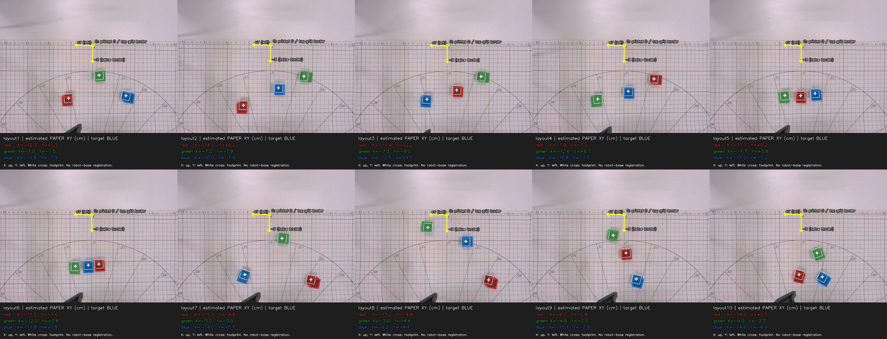

# layout1–layout10 초기 블록 배치 복원

2026-11-02. 기존 실물 시연 열 개의 **첫 원본 RGB 프레임에서 세 블록의 종이 기준 초기 위치를 추정**했다. 녹화 당시 자로 잰 기록을 찾은 것은 아니며, 아래 좌표는 영상에서 복원한 값이다. 배치 이름은 `layout1`–`layout10`이며 각각 원본 영상1–10에 대응한다. 모든 시연의 목표는 사용자 확인에 따라 `blue`다. 빨강·초록 실물 시연을 새로 녹화한 결과는 아니다.

11/02 사용자 요청으로 원본 폴더·MP4 이름은 `layoutblue1`–`layoutblue10`으로 변경했다. 아래 `layout1`–`layout10` 복원 ID와 역사적 영상 번호는 같은 배치의 기존 식별자다. 복원 좌표·원본 내용·HDF5는 이름 변경만으로 다시 계산하지 않았다.

## 사용할 수 있는 범위

복원 좌표는 배치 분포·색별 위치 편향을 살피고, 시뮬에 비슷한 장면을 만드는 출발점으로 쓸 수 있다. 블록이 보이는 첫 원본 프레임과 추정 결과를 함께 보관하므로 위치를 다시 검토할 수 있다.

**독립 실측 정답으로는 검증되지 않았다.** 로봇 베이스와 종이 좌표의 등록값이 없으므로, 이 좌표만으로 Mirobot→Panda 변환 코드의 실물 정확도를 입증할 수는 없다. 기존 열 개가 모두 파랑 집기인 사실도 바뀌지 않는다. 실물 언어 준수율을 학습·평가하려면 빨강·초록 시연과 학습에 쓰지 않은 배치에서의 세 색 평가가 계속 필요하다.

## 좌표계

문서 [MirobotTableTop.md](MirobotTableTop.md)에 기록된 모눈 간격 **10×10 mm**, 즉 한 칸 **1×1 cm**를 길이 기준으로 삼았다. 모든 영상에서 같은 종이 좌표계를 사용한다.

| 항목 | 정의 |
| --- | --- |
| 원점 | 종이 윗쪽 경계선과 인쇄된 `0`에서 내려오는 중심선의 교점 |
| +X | 초기 영상 위쪽 방향, 종이 작업 영역 바깥쪽 |
| +Y | 초기 영상 왼쪽 방향 |
| +Z | 종이 면의 위쪽 수직 방향, 오른손 좌표계 |
| 단위 | cm |
| 블록 위치 | 종이 위에 놓인 블록 바닥면 중심의 X·Y |

이 축의 영상 방향은 **선택한 초기 프레임**에서의 설명이다. 카메라가 이동한 뒤의 모든 프레임에서 화면 위·왼쪽을 그대로 좌표축으로 쓰는 방식은 아니다. 블록들은 원점보다 영상 아래쪽에 있어 이 정의에서는 X가 음수일 수 있다.

과거 W6 문서의 종이 좌표는 J1 중심을 원점으로 설명한다([MIROBOT_PICKUP.md](../W6/MIROBOT_PICKUP.md)). 이번 복원에서는 화면에서 식별 가능한 인쇄 눈금을 기준으로 정했다. 두 원점이 같다고 가정하지 않았고, 로봇 베이스 좌표로 바꾸는 이동·회전값도 임의로 넣지 않았다.

## 복원 절차

1. 각 `영상N/frames.jsonl`의 첫 항목이 가리키는 원본 RGB PNG를 사용했다. 열 개 모두 `rgb/00000000.png`다. HDF5의 256×256 crop이나 압축 MP4에서 좌표를 읽지 않았다. 첫 프레임에 세 블록이 보이는지 검토했다.
2. 영상별로 인쇄된 `0`과 종이 경계의 대략적인 교점을 확인해 모눈 검색을 시작했다. 가로·세로의 어두운 선 응답으로 실제 교점을 찾았고, 초기 추측 위치를 그대로 측정점으로 쓰지 않았다. 채도가 높은 블록 주변·영상 경계·선 대비가 약한 후보는 제외했다. 카메라가 팔뚝에 고정되어 움직이므로 영상별 기준점을 따로 사용했다.
3. `metadata.json`의 내부 파라미터와 `inverse_brown_conrady` 왜곡 모델을 RealSense SDK `rs2_deproject_pixel_to_point`에 전달해 정규화 광선을 구했다. 일반 Brown 왜곡계수로 바꾸어 OpenCV에 넣지 않았다. 역방향 투영도 SDK `rs2_project_point_to_pixel`을 사용했다.
4. 격자 인덱스로 검증점을 **피팅 전에 분리**했다. 나머지 교점에서 RANSAC으로 방사선·문자 등 잘못 대응한 점을 걸러낸 뒤, 정규화 좌표에 OpenCV `solvePnP`를 적용해 종이→카메라 자세를 구했다. 최종 피팅점은 영상당 57–67개다. 검증 교점은 이 자세의 예측 위치 주변에서 원본 밝기 응답으로 다시 찾았다. 검증점을 자세 피팅에 쓰거나 검증 잔차가 크다는 이유로 버리지는 않았다. 검증점은 영상당 24–27개이며, 다시 찾는 단계의 대비·색 마스크 제외 내역은 `calibration.validation_rejected`에 남긴다. 이번 열 개에서는 이 내역이 모두 빈 목록이다.
5. 색 보정 전 원본 RGB의 OpenCV HSV로 빨강·초록·파랑 영역을 분리했다. 최소 밝기는 35, 최소 채도는 빨강·파랑 65, 초록 20이다. 초록의 옅은 면이 빠지지 않도록 채도 문턱을 낮췄다. 블록 윗면과 보이는 옆면을 포함한 색 영역의 볼록 윤곽에 **한 변 2 cm인 정육면체의 투영 윤곽**을 맞췄다. 바닥 중심 X·Y와 회전을 함께 구했으며, 정육면체의 대칭 때문에 회전은 `yaw_mod_90_deg`로 저장했다. 여기서 2 cm는 기존 실물 블록 크기 기록에 따른 명목값이며, 블록마다 다시 실측한 값은 아니다.
6. 초록 채도 문턱 20·25·35, 빨강·파랑 50·65·80으로 다시 계산해 중심 위치의 민감도를 기록했다. 색 영역 중심을 종이 평면에 바로 투영한 좌표와 정육면체 모델의 중심 차이도 남겼다.
7. 기준점·검증점·블록 윤곽·복원 좌표를 표시한 `layout.jpg`와 추정값·진단을 담은 `layout.json`을 각 폴더에 저장했다. 집기 목표와 성공 여부를 영상 기하 계산으로 새로 판정하지 않았다.

윗면이 종이보다 2 cm 높으므로, 색 영역의 중심에 종이 평면 변환만 적용하면 바닥 중심과 다른 위치가 나올 수 있다. 이를 줄이기 위해 알려진 블록 크기와 보이는 옆면을 사용했다. 이 보정도 블록이 정육면체이고 바닥에 평평하게 놓였다는 가정, 색 분리와 픽셀 위치 선택의 영향을 받는다.

## 산출물과 결과

각 원본 녹화 폴더 `data/raw/layoutblueN/`(기존 영상N)에 다음 파일을 추가했다.

| 파일 | 내용 |
| --- | --- |
| `layout.json` | 목표 `blue`, 단위 `cm`, 세 블록의 추정 바닥 중심 좌표, 좌표계, 원본 프레임, 복원 방법과 검증 진단 |
| `layout.jpg` | 첫 원본 RGB에 모눈 기준점·검증점·블록 위치를 표시한 검토용 그림 |

`layout.jpg`는 기존 손목 RGB에 표시를 더한 그림이다. 새로 위에서 찍은 독립 사진이나 실측 장면이 아니다. 원본 `metadata.json`의 촬영 색 `red`와 기존 PNG·MP4·정렬·HDF5 파일은 이 작업에서 바꾸지 않았다. 목표가 `blue`라는 근거는 사용자 확인이며, 성공 여부의 근거는 기존 metadata의 사용자 검토 기록이다.

일괄 결과는 [summary.json](data/layout_reconstruction/summary.json), [coordinates.csv](data/layout_reconstruction/coordinates.csv)에 있다. 아래 X·Y는 모두 위에서 정한 **종이 기준 영상 추정값**이며, 0.1 cm로 반올림했다. 마지막 두 열은 기준점 피팅 RMS와 피팅에 쓰지 않은 검증점 RMS다. 표의 표시 자릿수는 실제 정확도를 뜻하지 않는다.

| 배치 | 빨강 (X, Y) cm | 초록 (X, Y) cm | 파랑 (X, Y) cm | 피팅 RMS px | 검증 RMS px |
| --- | --- | --- | --- | ---: | ---: |
| layout1 | (-12.3, 5.5) | (-7.0, -1.5) | (-11.8, -7.9) | 0.454 | 0.684 |
| layout2 | (-14.1, 6.2) | (-7.2, -7.9) | (-10.0, -1.9) | 0.576 | 0.594 |
| layout3 | (-10.4, -2.2) | (-7.3, -8.0) | (-12.5, 4.7) | 0.526 | 0.671 |
| layout4 | (-7.9, -7.0) | (-12.6, 6.1) | (-10.8, -1.0) | 0.498 | 0.696 |
| layout5 | (-11.7, 0.2) | (-11.7, 3.8) | (-11.2, -3.2) | 0.526 | 0.768 |
| layout6 | (-11.5, -1.6) | (-12.0, 3.8) | (-11.8, 0.8) | 0.523 | 0.774 |
| layout7 | (-15.3, -9.8) | (-5.5, -3.0) | (-14.0, 5.7) | 0.554 | 0.690 |
| layout8 | (-15.2, -9.8) | (-3.0, 4.4) | (-6.2, -4.4) | 0.472 | 1.094 |
| layout9 | (-9.0, -0.4) | (-4.8, 2.5) | (-15.1, -2.9) | 0.593 | 0.656 |
| layout10 | (-14.0, 0.5) | (-9.0, -3.7) | (-14.6, -4.9) | 0.577 | 0.788 |



그림은 위 줄 layout1–layout5, 아래 줄 layout6–layout10이다. 흰 십자는 추정 바닥 중심, 윤곽선은 정육면체 투영이다. 분홍 점은 피팅에 쓴 모눈 교점, 노란 십자 표시는 검증 교점이다. 개별 원본 크기 검토 그림은 각 `영상N/layout.jpg`에 있다.

예를 들어 [layoutblue1/layout.json](data/raw/layoutblue1/layout.json)의 기본 위치 필드는 다음과 같다. 로봇 베이스 등록은 아직 없으므로 `robot_base_registration`은 `null`이다.

```json
{
  "target": "blue",
  "unit": "cm",
  "blocks": {"red": [-12.3, 5.5], "green": [-7.0, -1.5], "blue": [-11.8, -7.9]},
  "photo": "layout.jpg",
  "estimated": true,
  "source": "estimated_from_initial_frame",
  "coordinate_frame": {"id": "paper_top_border_zero_Xup_Yleft_cm", "robot_base_registration": null},
  "real_success": true
}
```

원본 추적 정보는 `source_frame.file`, `source_frame.sha256`, `source_frame.t_s`, `source_frame.number`, `source_metadata_sha256`에 저장했다. 영상1의 첫 PNG SHA256은 `07da6e15669a6c713739c6a1f2788d5c3f2d5365120445ff6c7f288480594dff`, metadata SHA256은 `3d6c28017443b56266952644c2be3cc690bf4fe8f2a2106c65f2b487d74c7618`이다. 해시는 복원에 쓴 파일의 동일성을 확인하는 값이며, 좌표 정확도를 검증하는 값은 아니다.

세부값은 `reconstruction.calibration`과 `reconstruction.block_fits.<색>`에 있다. 예를 들어 영상1 파랑의 `xy_cm`은 약 `[-11.825, -7.898]`, `uncorrected_silhouette_centroid_projection_cm`은 약 `[-12.156, -8.318]`이며, `correction_from_uncorrected_cm`은 약 `[0.331, 0.419]`다. 중심 좌표는 원래 자릿수로 남기되 기본 `blocks` 필드만 0.1 cm로 표시했다.

## 오차를 읽는 방법

모눈 기준점의 재투영 잔차는 선택한 점을 카메라 모델이 얼마나 잘 설명하는지 나타낸다. 보정에서 제외한 모눈 교점의 오차는 종이 평면의 좌표 복원을 점검한다. 블록 윤곽의 겹침·잔차는 정육면체 투영과 색 영역이 얼마나 맞는지 나타낸다. 어느 값도 실제 블록 중심을 독립적으로 자로 재어 대조한 오차와 같지 않다.

| 진단 | 실제 결과 범위 | 해석 |
| --- | ---: | --- |
| 모눈 피팅 RMS | 0.454–0.593 px | 영상별 `reprojection_rms_px` |
| 별도 모눈 검증 RMS | 0.594–1.094 px | 영상별 `validation_rms_px` |
| 영상별 모눈 검증 최대 거리 | 0.085–0.189 cm | 종이 위 교점 기준 `validation_max_cm`; 전체 최대 약 1.89 mm |
| 블록 윤곽 RMS | 0.508–1.756 가상 px | 30개 블록의 기본 문턱 `silhouette_rms_virtual_px`; 왜곡을 제거한 광선에 초점거리를 곱한 영상 좌표 단위 |
| 채도 문턱 변경에 따른 블록별 최대 중심 이동 | 0.014–0.089 cm | `segmentation.max_threshold_displacement_cm`; 같은 모델에서 지정한 문턱만 바꾼 민감도 |
| 종이 평면 직접 투영과 정육면체 보정 중심의 거리 | 0.084–0.751 cm | `correction_from_uncorrected_cm`의 길이; 오차 정답이 아니라 모델 보정량 |

요약 파일의 `max_silhouette_rms_virtual_px`, `max_threshold_displacement_cm`, `max_correction_from_plane_cm`은 각 영상에서 세 색 중 최대값이다. 위 윤곽·민감도·보정량 범위는 영상별 최대값 범위가 아니라 **30개 블록 전체**에서 계산했다. 검증 교점도 같은 영상에서 검출한 값이므로 독립 계측 장치로 확인한 검증과는 다르다.

**0.5 cm는 작업상 점검 허용치이며 통계적 신뢰구간이나 보장된 정확도가 아니다.** 렌즈 왜곡, 모눈 교점 선택, 가림, 조명에 따른 색 영역, 블록 모양·높이·기울기 가정에 따른 오차가 남는다. 모눈 평면의 검증이 좋더라도 블록 중심 추정의 정확도를 그대로 보장하지 않는다.

새 녹화부터는 같은 좌표계에서 블록 중심을 직접 재고 원점·축·매트 고정 상태를 기록한다. 베이스 중심의 종이 좌표와 축 방향을 별도로 등록하면 로봇 좌표와도 연결할 수 있다. 영상 추정값과 독립 실측값을 비교해야 이번 복원의 실제 위치 오차와 변환 코드의 정확도를 평가할 수 있다.

## 다시 실행

저장소 루트에서 실행한다. 원본 열 개와 해당 프레임·metadata가 있어야 한다.

```bash
docs/W9/.venv/bin/python tools/reconstruct_w9_layouts.py
```

구현은 [reconstruct_w9_layouts.py](../../tools/reconstruct_w9_layouts.py)와 [w9_layout_geometry.py](../../tools/w9_layout_geometry.py)에 있다. 이 명령은 저장된 원본에서 배치 추정 산출물을 재생성하며 로봇을 움직이거나 새 촬영을 수행하지 않는다.

기하 계산 회귀 검사는 다음 명령으로 실행한다. 이 검사는 좌표·왜곡 처리 구현을 확인하며 실제 블록의 실측 정확도를 대신하지 않는다.

```bash
docs/W9/.venv/bin/python -m unittest tests.test_w9_layout_geometry -v
```

**회귀 검사 8개가 통과했다.** 별도 [독립 재검사 기록](data/layout_reconstruction/validation.json)은 열 개 영상의 최초 PNG·metadata 해시, 기존 정렬 입력의 정규화 해시, 추정 표시·공통 좌표계·기준점과 검증점의 분리를 확인했다. 원본 추적 파일과 HDF5 변경 내역은 없었으며, 영상4·7·10의 검토 그림도 별도로 확인했다. 이 재검사는 산출물과 구현의 일관성을 확인한 것으로, 실제 블록 좌표의 독립 실측 검증은 아니다.
