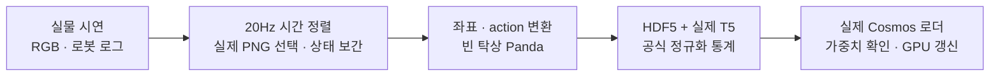
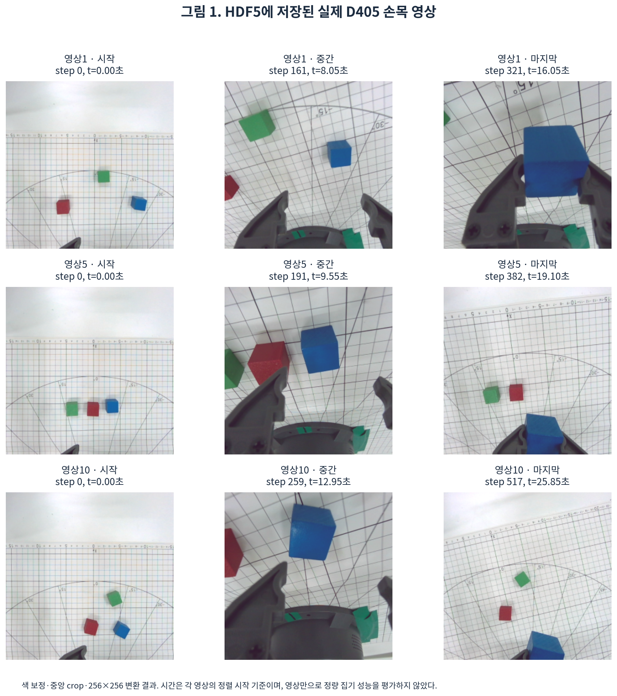
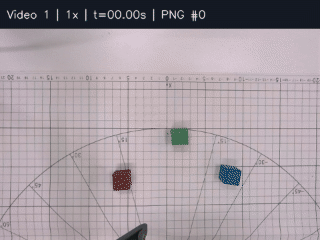
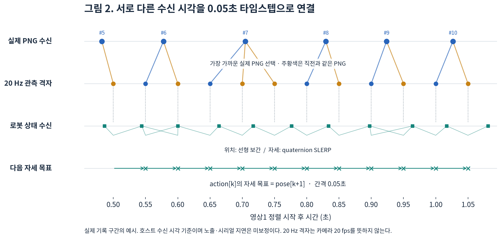
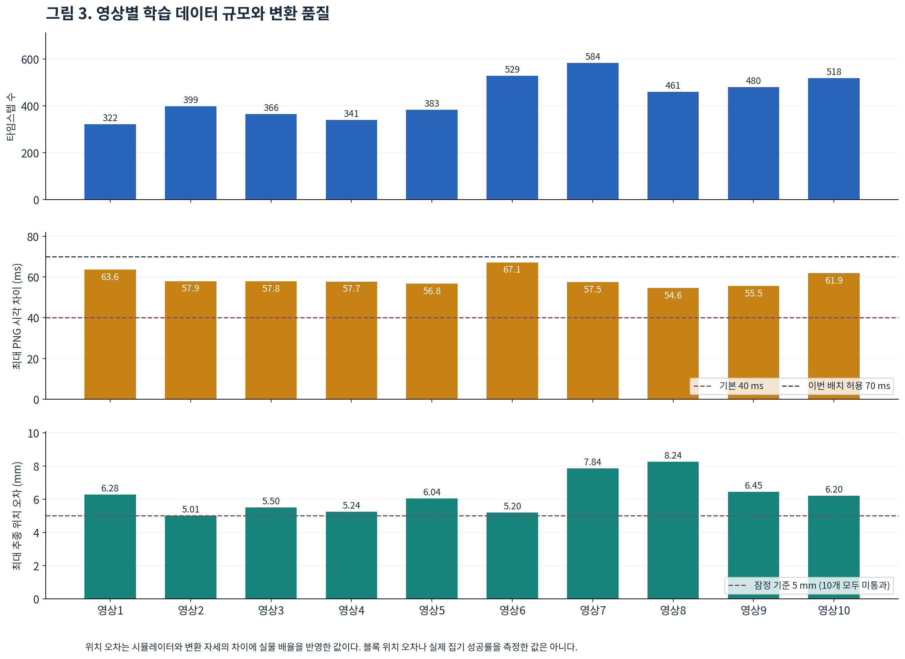
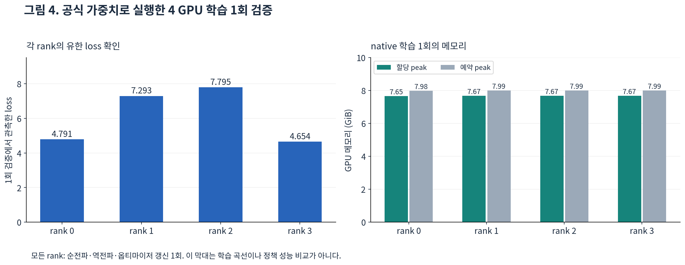

# Mirobot 촬영 → Cosmos Policy LIBERO 학습 데이터

2026-10-29 촬영한 영상1~10을 OASYS에서 변환했다. 목표는 RGB 블록 중 **파란 블록 집어 들기**다.

**지시문: `pick up the blue block on the table`**
뜻: 테이블 위의 파란 블록을 집어 들어라. 소문자·마침표 없음. HDF5 파일명·내부 속성·T5 임베딩 키에 같은 문장을 사용한다.

이번에 한 일은 실물 영상·로봇 로그를 0.05초 간격으로 정렬하고, 실제 손목 RGB·상태·행동을 담은 **HDF5 10개, 4,383 타임스텝**을 만든 것이다. 실제 T5와 공식 LIBERO 통계를 연결했으며, 공식 가중치를 불러와 **4 GPU에서 순전파·역전파·옵티마이저 갱신 1회**까지 확인했다. 정책의 집기 성공률을 평가한 단계는 아니다.

바로 실행하려면 [6절의 일괄 검사](#6-서버-작업-한-번에-실행) 후 [8절의 Cosmos 학습 명령](#8-cosmos-학습-실행)을 사용한다. 마지막 [연구보고서](#9-연구보고서)는 표·실제 사진·그래프를 포함한 약 20분 발표용 설명이다.

## 1. 연결 장치와 실행 위치

| 장치 | 이번 촬영에서 확인한 값 | 촬영 명령 |
| --- | --- | --- |
| Mirobot 제어기 | **COM3**, **115200 baud** | `--port COM3` |
| RealSense D405 | **USB 일련번호 262422272124** | `--serial 262422272124` |

영상1~10의 `metadata.json`에서 로봇 포트와 카메라 일련번호를 확인했다. **D405는 COM 포트를 사용하지 않는다.** 코드 일부의 `COM4`는 자동 G-code 수집 기본값이며 이번 촬영 장치의 연결값이 아니다.

장치 조회와 촬영은 USB가 연결된 **Windows 노트북 PowerShell**에서 한다. 데이터 변환·로더 검사·학습은 **OASYS Bash**에서 한다. 예제의 `C:\mirobot-vla`는 실제 노트북 저장소 경로로 바꾼다.

촬영 직전에 다음 명령으로 COM 번호와 USB 연결 위치를 확인한다. 장치를 조회하며 로봇을 움직이지 않는다.

```powershell
cd C:\mirobot-vla
docs/W9/.venv/Scripts/python.exe -m docs.W9.d405.devices --robot-port COM3 --camera-serial 262422272124 --check
```

`robot_found`와 `camera_found`가 모두 `true`여야 한다. `robot_serial_ports`의 `device`, `hwid`, `location`이 로봇 연결 정보다. `realsense_cameras`의 `serial_number`, `physical_port`가 D405 기기 번호와 USB 연결 경로다. Windows 장치 관리자 → 포트(COM 및 LPT)에서도 로봇 COM 번호를 확인할 수 있다. 물리 USB 소켓 경로는 촬영 기록에 없으므로 촬영 PC의 조회 결과로 확인한다. OASYS에는 두 USB 장치가 연결돼 있지 않다.

## 2. Windows 설치·색 보정

최초 설치:

```powershell
cd C:\mirobot-vla
powershell -ExecutionPolicy Bypass -File docs/W9/d405/setup.ps1
```

이번 촬영은 검증된 `docs/W9/data/calibration/classic_mini.json`을 사용했다. 같은 카메라·조명·장착 상태면 그대로 사용한다. 조명이나 장착을 바꿨다면 [색상표 보정 절차](COLORCHECKER_MINI.md)로 새 프로필을 만들고 별도 촬영으로 확인한다. 원본 PNG에는 색 보정을 입히지 않고 HDF5 생성 시 적용한다. 녹화 전 RealSense Viewer를 닫는다.

## 3. 키보드 촬영

```powershell
docs/W9/.venv/Scripts/python.exe -m docs.W9.d405.capture --teleop --color blue --seed 2 --reference docs/W6/poses/pickup-blue-s2.jsonl --mapping-gcode trajectories/2026_10_11-w6-pickup-blue-s2-e5.gcode --color-profile docs/W9/data/calibration/classic_mini.json --initial-s 40 --open-s 40 --closed-s 60 --gripper-seconds 1.0 --port COM3 --serial 262422272124 --execute --preview
```

시작·종료 시 호밍이 일어나므로 작업 공간을 비워 둔다. 기존 로봇 조작기를 동시에 실행하지 않는다. 이번 데이터의 집게 이동 시간 1.0초 근거는 [측정 기록](GRIPPER_CALIBRATION.md)에 있다.

| 키·버튼 | 동작 |
| --- | --- |
| `w/s`, `a/d`, `↑/↓` | X, Y, Z 이동 |
| `←/→` | 집게 열기 S40 / 닫기 S60 |
| `1/2`, `4/5`, `7/8` | A, B, C 회전 |
| `START REC (F8)` | 초기 위치에서 녹화 시작 |
| `STOP REC (F9)` | 집어 든 뒤 녹화 종료 |
| `q` | 조작기 종료·호밍·파일 저장 |

초기 이동이 끝나고 `READY`가 표시되면 집게를 열고 F8을 누른다. 파란 블록을 집어 들고 약 1초 유지한 뒤 F9, q 순서로 종료한다. 블록 배치는 바꿔도 된다. `reference`와 `mapping-gcode`는 로봇 좌표 변환의 기준으로 사용한다.

`--out`을 생략하면 `docs/W9/data/raw/영상N/`에 다음 번호로 저장된다. 폴더 전체를 보관한다: 원본 `rgb/`, MP4, `metadata.json`, `frames.jsonl`, `robot.jsonl`, `reference.jsonl`, `source.gcode`, `color_profile.json`.

## 4. 0.05초 타임스텝 정렬

새 촬영분은 영상을 확인한 뒤 기본 40ms 기준으로 정렬한다.

```powershell
Start-Process "docs/W9/data/raw/영상11/영상11.mp4"
docs/W9/.venv/Scripts/python.exe -m docs.W9.d405.prepare "docs/W9/data/raw/영상11"
```

PNG·로봇 상태·집게 명령을 F8~F9 구간의 **20Hz 격자**에 맞추고 `aligned.npz`, `alignment_report.json`을 만든다. 관측은 시각 t, action 목표는 t+0.05초 자세다. MP4를 여러 짧은 영상으로 자르는 작업은 아니다.

이번 영상1~10은 이미 정렬했다. 실제 저장 속도는 약 10~11fps이며 기본 40ms 검사는 실패했다. 이번 배치는 **프레임 허용 차이 70ms**, 로봇 상태 공백 한계 150ms로 정렬했다. 실제 최대 프레임 차이는 54.6~67.1ms다. 새 프레임을 만들어 채우지 않았으며, 같은 PNG가 여러 타임스텝에 사용된다.

이번 배치를 다시 검사·정렬해야 할 때만 서버에서 실행한다. 파생 정렬 결과를 재생성한다.

```bash
cosmos-policy/.venv/bin/python docs/W9/data/postprocess/finish_local.py --max-frame-ms 70
```

## 5. Windows → OASYS 전송

PNG·MP4·NPZ·검토 JPG는 Git LFS로 관리한다. 양쪽 PC에서 Git LFS를 설치한다.

Windows PowerShell:

```powershell
git lfs install
git add -- docs/W9/data/raw docs/W9/data/calibration docs/W9/data/postprocess
git diff --cached --stat
git commit -m "Add Mirobot recordings"
git push
```

OASYS Bash, 같은 브랜치의 깨끗한 작업 트리에서:

```bash
cd ~/UROP
git lfs install
git pull --ff-only
git lfs pull
```

이미 원본과 `aligned.npz`가 있으면 다시 전송하거나 정렬할 필요가 없다. 입력 해시는 Windows CRLF와 Linux LF 줄바꿈 차이를 허용한다. `.venv`는 각 OS에서 따로 준비한다.

## 6. 서버 작업 한 번에 실행

기존 `cosmos-policy/.venv`와 LIBERO 환경을 사용한다.

```bash
cd ~/UROP
cosmos-policy/.venv/bin/python -m docs.W9.d405.finish_server --target blue --real-success --gpus 4 --smoke
```

이 명령은 영상1~10의 HDF5 생성 → 실제 T5 임베딩 → 구조 검사 → 실제 Cosmos 로더·통계 검사 → 사전학습 가중치 확인 → GPU 학습 1회 검증을 순서대로 실행한다. 기존 출력은 원본 해시와 설정을 확인한 뒤 재사용한다. 원본이 달라졌다면 덮어쓰지 않고 오류를 낸다. 새 서버에 공식 모델 캐시가 없을 때만 `--allow-download`를 추가한다. T5-11B 원본 가중치는 약 45.2GB다.

검증용 학습은 순전파·역전파·옵티마이저 갱신 1회이며 결과를 `training_smoke.json`에 저장한다. 본학습은 8절에서 시작한다.

출력:

```text
docs/W9/data/hdf5/
  mirobot_real/MIROBOT_video1_SCENE1_pick_up_the_blue_block_on_the_table_demo.hdf5
  ... 영상10까지
  t5_embeddings.pkl
  dataset_statistics.json
  dataset_statistics_post_norm.json
  loader_validation.json
  training_config_validation.json
  training_smoke.json
  independent_validation.json
  ready.json
  validation_logs/
```

**학습은 손목 영상만 사용한다.** HDF5의 `eye_in_hand_rgb`는 실제 D405 RGB를 보정·중앙 정사각 crop·256×256 변환한 것이다. upstream 로더가 두 영상 키를 읽기 때문에 `agentview_rgb`는 같은 데이터의 hard link로 두되, 학습 설정에서 `use_third_person_images=False`로 제외한다. 외부 카메라 영상으로 사용하면 안 된다.

로봇 상태는 기존 좌표 보정으로 Panda 형식의 `robot_states` 9칸에 변환한다. action은 빈 탁상의 Panda가 다음 실물 자세를 20Hz로 따라가며 받는 OSC_POSE 7칸이다. 블록 배치를 가정하거나 시뮬 집기 성공을 실물 성공 대신 사용하지 않는다. 시작 자세를 맞추는 10 step은 학습 시퀀스에 넣지 않는다.

## 7. 개별 실행·검사

<details>
<summary>단계별로 다시 실행할 때 사용하는 명령</summary>

HDF5만 생성:

```bash
cosmos-policy/.venv/bin/python -m docs.W9.d405.export_real_hdf5 \
  docs/W9/data/raw/영상{1..10} --out docs/W9/data/hdf5/mirobot_real \
  --target blue --real-success --skip-existing
```

HDF5 구조·실제 T5 검사:

```bash
cosmos-policy/.venv/bin/python -m docs.W9.d405.check_dataset docs/W9/data/hdf5 \
  --t5 docs/W9/data/hdf5/t5_embeddings.pkl
```

T5를 새로 만들어야 할 때:

```bash
cosmos-policy/.venv/bin/python -m docs.W9.d405.make_t5 docs/W9/data/hdf5
```

T5는 공식 `google-t5/t5-11b`, Cosmos와 같은 tokenizer·padding을 사용한다. 출력은 지시문 하나당 `(1,512,1024)` bfloat16이다. 실제 문장 뒤 padding은 0으로 만든다. 기존 임베딩은 덮어쓰지 않는다.

실제 로더를 다시 검사하려면 6절 명령을 재실행한다. 회전·쿼터니언처럼 상수인 칸을 자체 min/max로 정규화하면 0으로 나누는 문제가 있어, **공식 LIBERO 체크포인트 통계**를 사용한다. 실제 데이터 범위와 모든 정규화 값의 유한성을 `loader_validation.json`에 기록한다.

</details>

## 8. Cosmos 학습 실행

Cosmos에는 MP4를 직접 넣지 않는다. 아래 세 입력을 `docs/W9/data/hdf5/`에 두고, 학습 실행기의 `--data-dir`에 그 폴더를 전달한다. 현재 서버에는 모두 준비돼 있다.

| 입력 | 위치 | 역할 |
| --- | --- | --- |
| 시연 HDF5 10개 | `mirobot_real/*.hdf5` | 손목 RGB, 9차원 상태, 7차원 action |
| 실제 언어 임베딩 | `t5_embeddings.pkl` | 지시문을 T5-11B로 인코딩한 값 |
| 공식 LIBERO 정규화 통계 | `dataset_statistics.json` | 사전학습 모델의 상태·action 스케일 유지 |

OASYS Bash에서 저장소 루트로 이동한 뒤 실행한다. `--steps 1000 --run`은 본학습을 시작하므로 GPU를 사용할 수 있을 때 실행한다.

```bash
cd ~/UROP
W9_CHECKPOINT=$(cosmos-policy/.venv/bin/python -c 'from huggingface_hub import hf_hub_download; print(hf_hub_download("nvidia/Cosmos-Policy-LIBERO-Predict2-2B", "Cosmos-Policy-LIBERO-Predict2-2B.pt", local_files_only=True))')
cosmos-policy/.venv/bin/python -m docs.W9.d405.train \
  --cosmos-repo cosmos-policy --data-dir docs/W9/data/hdf5 \
  --checkpoint "$W9_CHECKPOINT" --gpus 4 --steps 1000 --run
```

이번 손목 영상 설정은 `state_t=7`, 조건 프레임 3개, tokenizer 입력 25프레임이다. 학습 loader와 sampler 양쪽에 같은 데이터·영상 설정을 적용한다. 1000 step은 실행 예시이며 성능이 검증된 학습 횟수는 아니다. 검증 데이터를 나눌 때는 프레임이 아니라 영상 단위로 분리한다.

본학습 기본값은 GPU당 batch 1, gradient accumulation 8, learning rate `1e-5`다. `--smoke` 검증 때만 accumulation과 step 수를 각각 1로 바꾼다.

학습 로그와 체크포인트는 HDD의 `outputs/cosmos_policy/w9_mirobot/` 아래에 저장한다. 다른 경로를 쓰려면 `IMAGINAIRE_OUTPUT_ROOT` 환경변수를 지정한다.

## 9. 연구보고서

### 실물 Mirobot 시연의 Cosmos Policy LIBERO 학습 데이터 전환과 실행 검증

촬영일은 2026-10-29이며, 데이터 변환과 사전학습 모델의 GPU 검증은 10-30에 완료했다. 11-01에는 저장 경로와 회귀 테스트를 다시 확인했다. 아래는 실제 수행한 작업과 산출물을 바탕으로 정리한 발표 본문이다. 그림 설명을 포함해 다음 순서로 약 20분 동안 설명할 수 있도록 구성했다.

| 발표 구간 | 주제 | 시간 |
| --- | --- | ---: |
| 0:00~1:30 | 연구 목적과 완료 기준 | 1분 30초 |
| 1:30~3:30 | 장치 구성, 촬영, 보정 | 2분 |
| 3:30~5:00 | 과제 확인과 원본 보존 | 1분 30초 |
| 5:00~8:00 | 0.05초 타임스텝 정렬 | 3분 |
| 8:00~10:30 | 좌표 변환과 행동 라벨 생성 | 2분 30초 |
| 10:30~12:30 | HDF5와 모델 입력 구성 | 2분 |
| 12:30~14:00 | 언어 임베딩과 정규화 | 1분 30초 |
| 14:00~16:00 | 오류 원인과 수정 | 2분 |
| 16:00~18:30 | 실제 학습과 독립 검증 | 2분 30초 |
| 18:30~20:00 | 결과 해석과 다음 실험 | 1분 30초 |

### 9.1 연구 목적과 완료 기준

이번 작업의 목표는 Mirobot으로 촬영한 파란 블록 집기 시연을 Cosmos Policy의 LIBERO 학습 경로에 연결하는 것이었다. 영상과 로그를 저장했더라도 파일 형식만 바꾸는 것으로 학습 준비가 끝나지는 않았다. 영상과 로봇 상태의 시각이 다르고, Mirobot이 보고하는 좌표와 LIBERO가 사용하는 상태·action의 의미도 달랐다. 언어 지시문과 카메라 입력 수까지 맞아야 같은 시연으로 해석될 수 있었다.

따라서 완료 기준을 파일 생성에 두지 않았다. 첫째, 원본의 어느 영상과 상태가 각 타임스텝에 대응하는지 추적할 수 있어야 했다. 둘째, 만들어진 HDF5를 실제 Cosmos 로더로 읽었을 때 영상·상태·action·언어 임베딩이 올바른 형상과 유한값으로 나와야 했다. 셋째, 공식 LIBERO 사전학습 가중치를 불러온 모델이 그 배치로 순전파와 역전파를 수행하고 옵티마이저를 한 번 갱신해야 했다. 이 세 단계를 모두 확인한 상태를 이번 작업의 완료로 정했다.

실험 과제는 RGB 세 블록 가운데 파란 블록을 집어 드는 것이다. 지시문은 `pick up the blue block on the table`로 통일했다. 대소문자와 마침표 차이까지 없도록 파일명, HDF5 내부의 instruction 속성, T5 임베딩 사전의 키에 같은 문장을 사용했다.

전체 처리 흐름은 다음과 같다. 시뮬레이터는 가운데의 행동 변환에만 사용하고, 학습 영상에는 실제 D405 RGB만 사용했다.



### 9.2 장치 구성, 촬영과 보정

수집 장치는 Mirobot과 손목에 장착한 RealSense D405였다. USB 장치가 연결된 Windows 노트북에서 촬영과 키보드 조작을 수행했고, OASYS의 Linux 환경에서 정렬 결과를 확인하고 HDF5 변환과 학습 검증을 진행했다. 두 환경은 가상환경을 공유하지 않고 각각 설치했다. 큰 원본 파일은 Git LFS로 전달하되, 아래 발표용 그림과 미리보기는 문서와 함께 읽을 수 있는 일반 Git 파일로 별도 구성했다.

| 항목 | 이번 실험의 설정 또는 확인값 | 의미 |
| --- | --- | --- |
| 로봇 연결 | COM3, 115200 baud | `metadata.json`에 남은 촬영 당시 연결 |
| 카메라 식별 | D405, USB serial `262422272124` | COM 번호가 아닌 카메라 일련번호 |
| RGB 요청 설정 | 640×480, 30fps | 촬영 프로그램이 요청한 스트림 설정 |
| 실제 저장 속도 | 중앙값 약 10.350~11.473Hz | `frames.jsonl`의 수신 시각 차이로 계산 |
| 녹화 구간 | 초기 이동 후 F8부터 F9까지 | 시작·종료 호밍을 학습 구간에서 제외 |
| 집게 명령 | S40 열림, S60 닫힘 | 상태 추정과 action 생성의 기준 |

로봇 포트는 열 개 기록 모두 COM3였고, D405는 COM 포트를 쓰지 않는 USB 장치였다. 물리 USB 소켓 경로는 당시 기록에 없어 촬영 PC에서 `devices --check`로 로봇의 `location`과 카메라의 `physical_port`를 조회하도록 했다.

촬영 때는 초기 이동이 끝난 뒤 집게를 열고 녹화를 시작했다. 파란 블록을 집어 든 뒤 약 1초 유지하고 녹화를 종료했다. 원본 폴더에는 RGB PNG뿐 아니라 `frames.jsonl`, `robot.jsonl`, `metadata.json`, 좌표 변환 기준인 reference와 G-code, 색 보정 프로필을 함께 남겼다. MP4는 사람이 동작을 검토하는 용도다. 학습 타임스텝을 만들 때는 MP4의 재생 프레임 번호보다 개별 PNG의 실제 시각 기록을 사용했다.

색 보정에는 `classic_mini.json` 프로필을 사용했다. 원본 PNG는 바꾸지 않고 HDF5 영상을 만들 때만 보정했다. 프로필에 기록된 ColorChecker 24패치의 CIE76 평균 색차는 보정 전 12.672, 전체 패치에 맞춘 보정 후 3.596이었다. 한 패치씩 제외해 평가한 교차검증 평균은 4.143, 최대는 7.710이었다. 전체 데이터에 맞춘 값과 교차검증 값을 나눠 제시한 이유는 보정에 사용한 패치에서의 개선을 새로운 조건의 성능으로 오해하지 않기 위해서다. 이 결과가 다른 조명에서도 그대로 유지된다고 판단하지는 않았다.

집게의 시간 모델은 별도 측정 기록을 사용했다. 첫 개폐 쌍을 제외한 일곱 동작에서 이동 시간 중앙값이 1.000초였고, 관찰 범위는 약 0.93~1.07초였다. 이에 따라 열림과 닫힘 사이를 1초 동안 선형으로 이동하는 것으로 두었다. 실제 집게 폭이나 파지력을 측정한 모델은 아니며, 명령 전송 지연까지 따로 보정한 것도 아니다. 근거는 [색 보정 프로필](data/calibration/classic_mini.json)과 [집게 측정 기록](GRIPPER_CALIBRATION.md)에 남아 있다.



**그림 1.** 실제 HDF5에서 선택한 손목 RGB 예시. 영상 번호와 타임스텝을 함께 표시했다. 원본 RGB에 색 보정과 중앙 crop을 적용한 학습 관측이며, 합성 장면이나 시뮬레이터 렌더링이 아니다. 사진 몇 장만으로 열 개 시연의 성공률을 산출하지는 않았다.

[](images/data_collection_report/video1_review.mp4)

**동영상 1.** 영상1의 실제 PNG 수신 시각에 맞춘 원속도 미리보기. GIF는 문서 안에서 확인하고, 클릭하면 [H.264 MP4](images/data_collection_report/video1_review.mp4)를 연다. 약 16.2초의 축소 미리보기이며, 재생용 프레임 반복은 촬영 속도 개선이나 학습 데이터 증강을 뜻하지 않는다. 원본 PNG와 시각 기록은 변경하지 않았다.

### 9.3 과제 확인과 원본 보존

초기 기록을 확인했을 때 촬영 metadata에는 목표 색이 `red`로 남아 있었다. 그러나 이번에 학습할 과제는 파란 블록 집기였다. 또 촬영마다 빨강·초록·파랑 세 블록을 모두 옮겼고, 각 영상의 블록 좌표는 기록하지 않았다. 따라서 예제에 있던 red/seed 2라는 설정을 실제 작업의 목표와 배치로 그대로 받아들일 수 없었다.

이 문제는 파일 속 문자열 하나를 바꾸는 것으로 끝나지 않았다. 기존 방식은 고정된 시뮬레이터 배치에서 로봇 궤적을 재생하고 시뮬 집기 성공 여부까지 확인하려 했다. 실제 배치가 다르다는 사실을 반영하지 않으면, 실물에서 집었더라도 시뮬 블록과 손의 위치가 맞지 않아 실패로 처리될 수 있었다. 반대로 시뮬에서 성공한다고 해서 실제 영상과 같은 장면을 검증한 것도 아니었다.

최종적으로 과제 라벨과 좌표 변환 기준을 분리했다. 실제 과제의 목표는 사용자 확인에 따라 `blue`로 정했고, 원본 metadata의 `red`는 수정하지 않았다. 파생 HDF5에는 `recorded_capture_color=red`와 `reviewed_target=blue`를 함께 남겼다. 원본에 무엇이 적혀 있었고 어떤 검토를 거쳐 학습 지시문을 정했는지 추적할 수 있게 한 것이다. 집기 성공 표시는 사용자 검토에 근거하며, 자동 영상 판정기가 성공을 확인했다고 기술하지 않았다.

reference와 G-code에 남은 시작 자세·배율·공구 정보는 로봇 좌표 대응에 사용했다. 그 안의 블록 좌표를 영상마다의 실측 배치로 사용하지는 않았다. 현재 데이터로는 로봇이 움직인 경로와 본 장면을 학습할 수 있지만, 열 개 배치의 정확한 물체 좌표를 복원했다거나 seed 2의 장면을 재현했다고 주장할 수는 없다. 이 구분을 정리한 뒤에야 시뮬레이션 실패와 데이터 변환 실패를 혼동하지 않고 처리할 수 있었다.

원본 보존은 해시로 확인했다. Windows와 Linux 사이의 CRLF/LF 차이는 텍스트 내용을 바꾼 것으로 처리하지 않도록 정규화하되, 실제 내용이 달라지면 다시 정렬하도록 했다. 선택된 PNG와 정렬 배열에도 해시를 남겼다. 기존 HDF5를 재사용할 때는 지시문·변환 설정·입력 해시가 같은지 검사하므로, 예전 출력이 있다는 이유만으로 현재 데이터의 결과로 인정하지 않는다.

### 9.4 0.05초 타임스텝으로 정렬한 방법

영상과 로봇 로그는 같은 주기로 들어오지 않았다. 카메라가 요청대로 30fps를 꾸준히 저장한 것도 아니었고, 로봇 상태의 수신 간격도 일정하지 않았다. 학습에서는 이 비동기 기록을 관측과 다음 행동의 쌍으로 묶어야 했다. 그래서 두 기록이 겹치는 F8~F9 구간에 0.05초 간격의 시간 격자를 만들었다. 여기서 20Hz는 데이터를 배치한 기준 주기이며, 카메라의 실측 촬영 속도를 나타내지 않는다.

격자 시각을 `t[k] = t[0] + 0.05 × k`라고 두었다. 각 `t[k]`에 가장 가까운 실제 PNG를 하나 선택하고, 로봇 상태는 그 시각을 사이에 둔 두 측정값에서 구했다. 위치는 선형 보간하고 자세는 quaternion SLERP로 보간했다. 측정 구간 밖으로 자세를 외삽하지 않았으며, 상태 간 공백이 150ms를 넘으면 오류로 처리했다. 관측과 action을 한 행으로 만들 때는 현재 관측 `obs[k]`에 다음 자세 `pose[k+1]`를 향하는 행동 `action[k]`를 대응시켰다.

이때 action이 N개라면 목표 생성용 자세는 N+1개가 필요하다. 마지막 추가 자세는 마지막 action의 목표를 만드는 데만 쓰고, HDF5 관측에는 앞의 N개 상태만 저장했다. 집게도 같은 구분을 적용했다. 현재 상태에는 1초 이동 모델로 추정한 닫힘 정도를 넣고, action의 마지막 값에는 다음 시각에 유지할 열림·닫힘 목표를 넣었다. 현재 상태와 명령 목표를 섞으면 집게가 명령을 받는 순간 이미 끝까지 움직인 것으로 기록되는 문제가 생긴다.



**그림 2.** 영상1의 실제 기록 일부를 확대해 카메라 수신 시각, 50ms 격자, 상태 보간과 다음 자세 목표를 나타냈다. 서로 다른 두 격자점이 같은 PNG를 고를 수 있다. 그림에서 선을 따라가면 관측 시각과 action 목표 시각이 한 칸 어긋나야 하는 이유를 확인할 수 있다.

처음에는 가장 가까운 프레임과 격자의 차이를 40ms 이내로 제한했다. 그러나 이번 배치에서는 열 개 영상 모두 이 기준을 통과하지 못했다. 로그를 확인한 결과 실제 저장 속도 중앙값이 영상별 약 10~11Hz였고, 일부 프레임 간격은 더 길었다. 기존 영상을 더 촘촘하게 저장한 것처럼 처리하는 대신, 이번 배치만 허용 차이를 70ms로 명시해 정렬했다. 그 결과 실제 최대 차이는 54.627~67.137ms였고, 40ms를 넘는 행은 전체 4,383개 중 543개, 약 12.39%였다.

| 영상 | 타임스텝 N | 제어 구간 N×0.05초 | 카메라 Hz 중앙값 | 최대 프레임 차이 ms | PNG 중복 사용 수 |
| --- | ---: | ---: | ---: | ---: | ---: |
| 1 | 322 | 16.10 | 10.350 | 63.557 | 157 |
| 2 | 399 | 19.95 | 11.287 | 57.930 | 177 |
| 3 | 366 | 18.30 | 11.473 | 57.811 | 160 |
| 4 | 341 | 17.05 | 11.369 | 57.736 | 149 |
| 5 | 383 | 19.15 | 11.277 | 56.761 | 169 |
| 6 | 529 | 26.45 | 10.751 | 67.137 | 249 |
| 7 | 584 | 29.20 | 11.292 | 57.517 | 258 |
| 8 | 461 | 23.05 | 11.274 | 54.627 | 203 |
| 9 | 480 | 24.00 | 11.022 | 55.478 | 219 |
| 10 | 518 | 25.90 | 11.196 | 61.921 | 230 |
| 합계 | **4,383** | **219.15** | — | — | **1,971** |

표의 제어 구간은 N개의 50ms action이 차지하는 길이다. 첫 관측부터 마지막 관측까지의 차이는 `(N−1)×0.05초`이고, F8~F9 녹화 길이와도 조금 다르다. 중복 사용 수는 `N−선택된 고유 PNG 수`로 계산했다. 전체 원본 PNG는 2,422개이고 학습 관측에 사용한 고유 PNG는 2,412개였다. 이를 4,383개 격자점에 대응시키면서 1,971번 추가로 재사용했다. 같은 이미지가 반복됐다는 사실을 지우거나 보간 영상으로 채우지는 않았다.

시간의 기준은 촬영 프로세스가 기록한 호스트 수신 시각이다. 카메라 노출 순간과 로봇 상태 측정 순간을 별도로 동기화한 것은 아니다. `camera_latency_ms=0`도 지연이 없음을 측정한 결과가 아니라 별도 보정을 적용하지 않았다는 설정이다. 따라서 이번 정렬 결과는 주어진 로그 안에서의 대응을 검증한 것으로 해석해야 한다. 더 빠른 접촉 동작을 다룬다면 촬영 처리량과 지연을 먼저 측정할 필요가 있다. 구현과 수치는 [prepare.py](d405/prepare.py)와 각 영상의 `alignment_report.json`에 남겼다.

### 9.5 Mirobot 좌표와 LIBERO 행동 라벨의 연결

Mirobot 로그의 XYZ는 mm 단위의 플랜지 위치이고 ABC는 도 단위 자세다. Cosmos의 LIBERO 경로가 사용하는 상태는 Panda 파지점 위치와 quaternion, 두 손가락 값이다. action도 절대 XYZ 좌표를 그대로 넣는 형식이 아니다. 따라서 단위를 m로 바꾸는 것만으로는 부족했고, 두 로봇 사이에 이미 정해 둔 기준점·공구 오프셋·배율·자세 대응을 함께 적용해야 했다.

| 변환 항목 | 이번 기록에서 사용한 값 또는 규칙 |
| --- | --- |
| 대응할 점 | 파지점 기준 `point=grip` |
| 기준 자세 짝 | reference의 Panda 시작 자세 ↔ Mirobot `(213.67, 0, 175.72)mm` |
| 공간 배율 | `scale=0.663` |
| 공구 오프셋 | `(15, 0, −55)mm` |
| 자세 모드 | absolute, 기존 x축 180° 프레임 대응 적용 |
| 상태 저장 순서 | 손가락 2 + 파지점 xyz(m) 3 + quaternion xyzw 4 |

이 값들은 각 촬영 폴더에 함께 보관한 G-code 머리말과 reference에서 읽었다. 내부 quaternion 계산에서 쓰는 wxyz 순서와 HDF5에 저장하는 xyzw 순서를 명시적으로 변환했고, 같은 자세를 뜻하는 `q`와 `−q`가 불필요하게 뒤집히지 않도록 기준 quaternion 쪽으로 부호를 맞췄다. 좌표와 상태를 만드는 함수는 [common/proprio.py](../../common/proprio.py)에 모았다.

손가락 두 값은 실제 Panda 관절을 측정한 값이 아니다. Mirobot 집게의 명령과 추정 이동량을 Panda 데이터에서의 의미에 맞춰 대응시켰다. 완전 열림은 좌우 `±0.0398m`, 40mm 블록을 잡은 닫힘 상태는 `±0.0191m`로 두고 그 사이를 보간했다. 단순히 닫힘을 0으로 두면 블록을 잡은 상태와 빈손으로 끝까지 닫은 상태의 의미가 달라질 수 있어 이 대응을 사용했다.

행동 라벨은 블록이 없는 탁상과 LIBERO MountedPanda를 구성해 생성했다. 카메라 렌더링과 물체 집기 판정은 끄고, 20Hz OSC_POSE 제어기가 다음 실물 변환 자세를 따라가게 했다. 현재 시뮬레이터 자세와 다음 목표 자세의 위치 차이는 0.05m, 회전 오차는 0.5rad의 action 스케일로 나눠 6개 성분을 만들었다. 여기에 열림 −1 또는 닫힘 +1을 붙여 7차원 action으로 저장했다. 범위를 넘는 경우에는 위치와 회전 각각의 방향을 유지한 채 크기를 줄였다.

중요한 점은 이 action이 실물의 `pose[k+1]−pose[k]`를 단순 복사한 값이 아니라는 것이다. 시뮬레이터의 실제 현재 자세에서 다음 변환 목표로 향하도록 계산했기 때문에 제어기의 추종 지연이 함께 반영된다. 학습 proprio는 실물 측정에서 만든 현재 상태이며, 두 경로의 차이는 `follow_error_mm_deg`로 별도 기록했다. 초기 Panda 자세를 첫 관측에 맞추는 데 사용한 10 step은 학습 시퀀스에 포함하지 않았다.

추종 오차를 확인한 결과 위치 최대값은 8.244mm, 자세 최대값은 0.479°였다. 여기서 mm는 Panda 좌표 차이에 `1000×0.663`을 곱한 Mirobot 배율 환산값이다. 열 개 영상 모두 어느 구간에서는 잠정 5mm 위치 기준을 넘었으므로, 위치 추종 기준을 통과했다고 표시하지 않았다. 반면 2° 자세 기준은 통과했다. 라벨 생성이 정상 종료됐다는 사실과 목표 궤적을 충분히 정확하게 따라갔다는 평가는 따로 남긴 셈이다.



**그림 3.** 영상별 타임스텝 수와 최대 프레임 차이, 실물 배율로 환산한 최대 추종 위치 오차. 40ms 선은 기본 정렬 기준, 70ms 선은 이번 배치에서 명시한 허용 기준, 5mm 선은 기존 잠정 추종 기준이다. 마지막 패널은 정책의 예측 오차나 실제 파지 위치 정확도가 아니다. 최종 수치는 [real_export_summary.json](data/hdf5/real_export_summary.json)을 사용했으며, 예전 고정 장면의 실패 보고서와 구분했다.

### 9.6 HDF5 저장 구조와 Cosmos의 실제 입력

한 시연을 하나의 HDF5 파일로 저장했다. 열 개 파일의 총 크기는 약 674.7MiB다. HDF5를 쓰는 이유는 영상을 짧게 잘라 저장하기 위해서가 아니라 같은 행 번호의 관측·상태·행동을 함께 읽을 수 있게 하기 위해서다. 예를 들어 k행은 `timestamps[k]`의 실제 관측과 그때 시작할 행동을 나타낸다. 파일명에도 과제를 넣어 사람이 확인하는 이름과 로더가 읽는 지시문을 맞췄다.

| HDF5 항목 | 형상 | 내용 |
| --- | --- | --- |
| `data/demo_0/obs/eye_in_hand_rgb` | `(N,256,256,3)` uint8 | 실제 D405 RGB, 색 보정·중앙 crop 후 저장 |
| `data/demo_0/obs/agentview_rgb` | 같은 데이터의 hard link | upstream의 필수 영상 키 충족용 |
| `data/demo_0/robot_states` | `(N,9)` | 현재 손가락·파지점 위치·quaternion |
| `data/demo_0/actions` | `(N,7)` | 다음 목표를 향한 OSC_POSE와 집게 명령 |
| `timestamps`, `frame_indices`, `frame_error_s` | 각각 `(N,)` | 시간, 실제 PNG 대응, 정렬 차이 |
| `follow_error_mm_deg` | `(N,2)` | 실물 배율 위치 오차와 자세 오차 |
| 속성·내장 보고서 | 문자열·수치 | 지시문, 목표 검토, 해시, 변환·품질 기록 |

이번 수집에는 외부 카메라가 없었다. 그런데 upstream 로더는 손목 영상만 사용하도록 설정해도 두 영상 키를 읽었다. 이를 맞추기 위해 `agentview_rgb`는 손목 데이터의 hard link로 두었다. 같은 영상을 두 카메라의 관측이라고 해석하지 않도록 `observation_mode=wrist_only`와 `agentview_is_wrist_alias=True`를 기록하고, 학습 dataset과 sampler 양쪽에서 `use_third_person_images=False`로 설정했다. 실제 샘플에서도 현재·미래 외부 영상의 latent index가 −1인지 확인했다.

모델에 들어가는 `(3,25,224,224)` 텐서에서 25는 연속 카메라 영상 25장을 뜻하지 않는다. 실제 로더는 아래 순서의 슬롯을 만든다. tokenizer의 첫 blank 한 장을 제외한 슬롯은 각각 네 장씩 복제하고, 최종적으로 7개 latent에 대응시킨다. proprio와 action 값은 별도 데이터로 전달돼 해당 latent 위치에 주입된다.

| latent 슬롯 | 역할 | tokenizer 입력 장수 | 조건으로 사용 |
| --- | --- | ---: | --- |
| 0 | 초기 blank | 1 | 예 |
| 1 | 현재 proprio 자리 | 4 | 예 |
| 2 | 현재 손목 영상 | 4 | 예 |
| 3 | action chunk 자리 | 4 | 아니오 |
| 4 | 미래 proprio 자리 | 4 | 아니오 |
| 5 | 미래 손목 영상 | 4 | 아니오 |
| 6 | value 자리 | 4 | 아니오 |
| 합계 | 7개 latent | **25** | **3개 조건 슬롯** |

그래서 손목 전용 설정을 `state_t=7`, 조건 프레임 수 3, tokenizer chunk duration 25로 함께 변경했다. 외부 영상이 있는 원래 구성의 9·4·33 가운데 일부만 바꾸면 슬롯 수가 맞지 않는다. HDF5의 256×256 영상은 로더에서 224×224로 전처리된다. action chunk는 16개, 즉 현재 정렬 주기 기준 0.8초의 제어 구간이며, 미래 관측은 k+16에서 가져온다. 끝부분에서 부족한 action은 마지막 값으로 padding하고 미래 관측도 마지막 행을 넘지 않게 제한한다. 모델이 사용하는 고정 `fps=16` 메타값 역시 실제 카메라 속도와는 구분했다.

### 9.7 실제 언어 임베딩과 정규화

언어 입력은 공식 `google-t5/t5-11b`로 만들었다. 실제 문장을 인코딩한 값을 `t5_embeddings.pkl`에 넣었으며, Cosmos와 같은 FastTokenizer를 사용했다. fp32 encoder 계산 결과는 모델이 사용하는 bfloat16 형태로 저장했다. 원본 T5 가중치 크기는 약 45.2GB였고, 최종 언어 임베딩 파일은 이 지시문 한 개에 대한 약 1.0MiB였다.

생성 결과는 `(1,512,1024)`였고 유효 토큰은 9개였다. 유효 영역의 nonzero 값은 9,216개였으며 나머지 토큰 위치는 0이었다. 모든 값의 유한성과 padding을 검사했고, 독립 검토에서도 같은 파일 해시를 확인했다. 단순히 pickle 파일이 존재한다는 검사로는 목표 문장이 잘못됐거나 전체가 0인 임베딩을 걸러낼 수 없으므로 문장 키·형상·값을 함께 확인했다.

정규화에서는 이번 작은 데이터만으로 min/max를 새로 구했을 때 문제가 드러났다. 촬영 중 자세가 거의 고정돼 quaternion 네 성분이 상수였기 때문이다. 일반적인 min/max 변환의 분모인 `max−min`이 0이 되면 원본 값이 정상이더라도 정규화 결과가 NaN이 될 수 있다. HDF5 구조 검사는 통과하고 학습 직전에야 오류가 드러날 수 있는 종류의 문제였다.

최종 학습에는 공식 LIBERO 체크포인트의 통계를 사용했다. 이는 상수 축의 0 나눗셈을 피하는 동시에 사전학습 모델이 기대하는 입력 스케일을 유지하려는 선택이었다. 이번 데이터 자체의 실제 범위는 따로 측정해 보고서에 남겼다. 공식 통계를 쓴다는 이유로 분포 차이가 사라지는 것은 아니므로, 열 개 영상의 모든 정규화 action과 proprio를 실제 계산해 유한값인지 확인했다. 결과는 [loader_validation.json](data/hdf5/loader_validation.json)에 기록했다.

### 9.8 중간 오류를 수정한 과정

작업 중 반복된 오류는 서로 다른 단계의 가정을 한꺼번에 묶은 데서 많이 생겼다. 촬영 완료, 과제 확인, 시간 정렬, 좌표 변환, 로더 호환, 가중치 로딩을 각각 검사하도록 나눈 뒤 원인을 좁힐 수 있었다. 수정 내용과 확인 방법은 다음과 같다.

| 단계·문제 | 확인한 원인 | 수정과 확인 |
| --- | --- | --- |
| 목표 지시문 불일치 | 원본에 예제의 red 설정이 남음 | 원본을 보존하고 검토 목표 blue를 파생 데이터에 기록 |
| 시뮬 집기 실패를 데이터 실패로 처리 | 실제 세 블록 배치가 고정 seed 장면과 다름 | 빈 탁상 Panda를 action 변환에만 사용, 시뮬 성공 조건 제거 |
| 40ms 프레임 정렬 실패 | 요청 30fps와 실제 PNG 저장 속도가 다름 | 실제 간격을 측정하고 이번 배치의 70ms 허용·반복 프레임 수를 명시 |
| OS 간 해시 불일치 | CRLF와 LF 줄바꿈 차이 | 텍스트 해시는 줄바꿈을 정규화하고 내용·PNG 변경은 계속 검출 |
| 언어 입력 검사 부족 | 파일·형상만으로 실제 임베딩 여부를 확정할 수 없음 | 실제 T5 생성 후 문장 키, 유한값, nonzero, padding을 함께 검사 |
| 정규화 후 NaN | 상수 quaternion 축의 자체 min/max 분모가 0 | 공식 LIBERO 통계로 실제 전체 배열 정규화 검사 |
| 체크포인트를 디렉터리로 읽음 | HF symlink를 resolve하면서 `.pt` 확장자가 사라짐 | snapshot의 `.pt` 파일명을 보존해 공식 파일 로더를 선택 |
| 학습은 되지만 사전학습 가중치 미반영 | 기존 진입점의 DCP 경로가 consolidated `.pt`를 건너뜀 | 공식 consolidated-checkpoint helper로 모델 생성 후 native trainer 실행 |
| 가중치 대조 시 이름 불일치 | activation-checkpoint wrapper가 parameter 이름에 포함됨 | 알려진 wrapper만 정규화하고 중복 이름은 오류 처리 |
| 외부 영상 슬롯·형상 불일치 | 필수 키와 실제 카메라 수를 혼동 | hard link는 호환용으로 제한하고 loader·sampler·모델 7/3/25 설정 동시 검사 |
| 학습 산출물이 시스템 디스크를 사용 | upstream 기본 경로가 `/tmp` | 기본 출력은 HDD의 `outputs/`, 기존 검증 결과도 이동하고 원래 경로 유지 |

잘못된 가중치·NaN·0 gradient·잘못된 카메라 설정은 실패해야 하는 조건으로 회귀 테스트에 넣었다. `finish_server`는 HDF5 재사용 검증부터 GPU 1회 검증까지 순서대로 수행하며, 각 단계의 로그와 JSON을 남긴다. 앞 단계가 실패하면 `ready`로 표시하지 않는다.

### 9.9 실제 Cosmos 학습과 독립 검증

먼저 모의 로더가 아니라 upstream의 실제 `LIBERODataset`을 호출했다. 열 개 파일에서 전체 4,383 step을 읽고 에피소드 경계와 내부를 포함한 21개 샘플을 확인했다. 배치 영상은 `(2,3,25,224,224)`, action은 `(2,16,7)`로 나왔고 실제 T5가 함께 전달됐다. 이 단계에서 호환용 외부 영상이 모델 입력으로 소비되지 않는지, 마지막 action padding에서 형상이 깨지지 않는지, 모든 정규화 상태·action이 유한값인지 검사했다.

다음으로 `nvidia/Cosmos-Policy-LIBERO-Predict2-2B`의 공식 가중치를 로딩했다. 로컬 진입점은 Cosmos의 공식 consolidated-checkpoint helper로 모델을 만든 뒤 원래 trainer의 forward, loss, backward, optimizer 흐름을 그대로 사용한다. 검증 callback은 그 과정을 관찰하고 증거를 저장하는 역할만 맡겼다. 학습 직전 학습 대상 파라미터 567개의 이름·형상을 확인하고, 입력 projection·첫 attention query projection·최종 linear의 세 tensor 값을 원본과 정확히 비교했다. 원본을 모델 dtype으로 변환한 뒤 대조하고 SHA256을 남겼으므로, 567개 tensor 전체의 값 해시를 비교했다고 확대해서 해석하지는 않았다.

그 상태에서 GPU 4개를 사용해 각 rank의 batch size 1, gradient accumulation 1, optimizer iteration 1로 실행했다. 네 rank가 각각 가중치 대조를 통과했고, 실제 순전파·역전파·옵티마이저 갱신을 끝냈다. 학습 파라미터 tensor 567개에서 nonzero gradient가 관찰됐으며 loss와 gradient는 모두 유한값이었다.

| GPU rank | 같은 iteration의 loss | 최대 할당 GiB | 최대 예약 GiB | backward / optimizer | 가중치 대조 |
| --- | ---: | ---: | ---: | --- | --- |
| 0 | 4.790888 | 7.655 | 7.979 | 1회 / 1회 | 통과 |
| 1 | 7.292550 | 7.671 | 7.994 | 1회 / 1회 | 통과 |
| 2 | 7.795186 | 7.671 | 7.994 | 1회 / 1회 | 통과 |
| 3 | 4.654483 | 7.671 | 7.994 | 1회 / 1회 | 통과 |



**그림 4.** 동일한 한 iteration에서 rank별로 기록한 loss와 GPU 메모리. 서로 다른 rank의 값 네 개이며 시간에 따른 학습곡선이 아니다. 이 그림에서 loss 감소나 수렴 속도를 읽을 수는 없다. 할당량과 예약량은 해당 실행에서 관측한 PyTorch 메모리 값이며, 모든 학습 설정에 필요한 GPU 용량으로 일반화하지 않았다.

한 번의 실행 성공 뒤에는 별도 에이전트가 원본과 최종 산출물의 대응을 다시 확인했다. 원본 RGB 50개를 직접 보정·crop한 결과와 HDF5 관측을 비교했고, 모든 선택 PNG의 해시·시각·상태·집게 action 대응도 확인했다. 독립 검증은 T5 padding, 실제 로더 배치, 공식 가중치의 주요 tensor 해시, 네 rank의 proof 파일까지 대조했다. 최종 증거는 [학습 1회 결과](data/hdf5/training_smoke.json)와 [독립 검증 결과](data/hdf5/independent_validation.json)에 남아 있다.

마지막으로 2026-11-01에 저장 경로를 HDD로 변경한 뒤 회귀 테스트 111개와 모의 장치 기반 촬영 테스트 28개를 통과했다. 실제 Cosmos 설정을 다시 로딩해 4 GPU·손목 전용 설정과 `outputs/cosmos_policy/w9_mirobot/d405_libero_finetune` 출력 경로도 확인했다. 이때 GPU 학습을 새로 길게 수행한 것은 아니며, 앞서 완료한 실제 1회 학습 증거와 이후 설정·코드 검증을 구분해 기록했다.

### 9.10 결과 해석과 다음 실험

최종적으로 실물 시연 열 개를 총 4,383 타임스텝, 제어 구간 합계 219.15초의 HDF5로 만들었다. 실제 언어 임베딩과 공식 정규화 통계를 연결했고, 실제 Cosmos 로더와 공식 가중치를 거쳐 네 GPU에서 한 번의 학습 갱신까지 완료했다. 이번 작업에서 확보한 결과는 영상 파일을 모델 입력으로 이어 주는 경로가 실제로 동작한다는 것이다. 단순 파일 검사보다 강한 근거이지만, 정책 성능을 검증하는 실험과는 범위가 다르다.

| 이번에 확인한 내용 | 아직 확인하지 않은 내용 |
| --- | --- |
| 원본과 타임스텝·HDF5의 대응 및 실제 로더 호환 | 촬영 당시의 정확한 블록별 좌표와 노출 시각 |
| 실제 T5, 공식 가중치의 주요 값 일치 | 충분한 본학습 뒤의 수렴과 과적합 정도 |
| 네 GPU의 유한 loss·gradient 및 optimizer 1회 | 처음 보는 배치·조명에서의 파란 블록 선택 성공률 |
| 시간 정렬·추종 오차의 정량 기록 | 실물 로봇에서 정책을 닫힌 고리로 실행한 성능 |

품질 측면에서는 세 가지가 다음 실험에 직접 영향을 준다. 실제 카메라 기록이 10~11Hz여서 20Hz 격자에서 같은 영상이 반복됐고, 수신 지연은 별도로 측정하지 않았다. 좌표 변환 후의 추종 위치 오차는 최대 8.244mm로 기존 잠정 5mm 기준을 넘었다. 또 손가락 상태는 실제 폭 측정이 아니라 명령과 이동 시간에 따른 추정이다. 따라서 데이터가 로더에 들어간다는 확인을 이 세 오차가 사라졌다는 의미로 사용하면 안 된다.

다음 단계에서는 먼저 같은 장착 상태에서 카메라 저장 처리량과 시간 지연을 측정하고, 로봇의 빠른 이동 구간에서 추종 오차가 커지는 원인을 확인할 필요가 있다. 이후 시연을 더 모아 영상 단위로 학습·검증 세트를 나누고, 보지 않은 블록 배치에서 파란 블록을 선택하고 들어 올리는 성공률을 평가해야 한다. 인접 프레임을 무작위로 나누면 거의 같은 장면이 양쪽에 들어가므로 이번 규모의 데이터에서는 특히 영상 단위 분리가 중요하다. 8절의 1000 step은 본학습 실행 예시일 뿐, 검증된 최적 횟수로 정한 값은 아니다.

보고서 그림과 동영상은 [미디어 폴더](images/data_collection_report/)의 상대 경로로 연결했다. PNG·SVG와 GIF·경량 MP4는 일반 Git 파일로 관리하며, 원본 데이터의 LFS 포인터나 로컬 절대 경로를 문서 미리보기로 사용하지 않는다. 그림을 다시 만들려면 저장소 루트에서 다음 명령을 실행한다.

```bash
cosmos-policy/.venv/bin/python tools/w9_report_figures.py
```

주요 확인 자료: [일괄 결과](data/hdf5/ready.json), [정렬·변환 집계](data/hdf5/real_export_summary.json), [실제 로더 검사](data/hdf5/loader_validation.json), [native 설정 검사](data/hdf5/training_config_validation.json), [GPU 학습 증거](data/hdf5/training_smoke.json), [독립 검증](data/hdf5/independent_validation.json). 구현은 [시간 정렬](d405/prepare.py), [행동 라벨](d405/action_labels.py), [HDF5 생성](d405/export_real_hdf5.py), [실제 T5 생성](d405/make_t5.py), [학습 진입점](../../tools/train_cosmos_libero.py)에 나눠 두었다.
