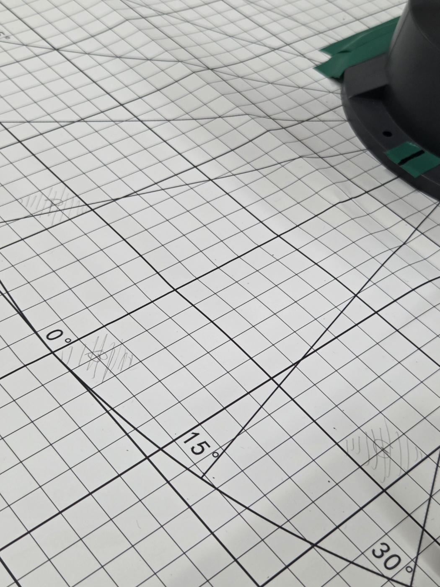
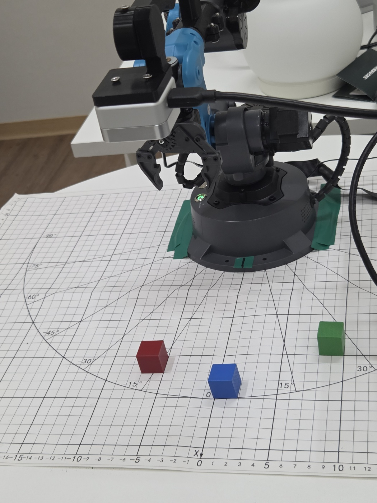

'''Mirobot Tabletop 환경 세팅'''

10/29
카메라 선 길이 때문에 Mirobot remote port 실험 리눅스 노트북 기준으로 COM3으로 변경
D405 카메라 연결 포트는 COM4
격자판 기준 0도에 Homing에서 고정, 청테이프로 mirobot 밑에 표시 완료

RGB 블록 초기 위치 설정 완료, 샤프로 초기 위치 표시 완료
-> LIBERO TABLETOP으로 XML 작성할 때 초기 환경 수정 필요

그리고 LIBERO D405 기준으로 색상 보정 행렬 써서 맞춰야 합니다.

실험실을 커튼 치고, 불 다 켜고 하시면 됩니다. d405 색상 보정은 제가 했어요!

격자 무늬 1칸당 가로 10mm, 세로 10mm

## 환경 세팅 사진

격자판과 초기 위치 표시:

Mirobot과 RGB 블록 초기 배치:

